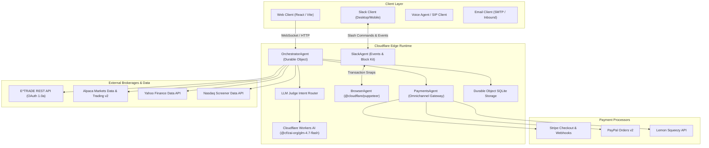

# External APIs and Endpoints Directory & Integration Architecture

> **Comprehensive Reference Guide for E\*TRADE, Yahoo Finance, Alpaca, Nasdaq, Slack, Payment Gateways, Cloudflare Workers AI, and BrowserAgent**

---

## 1. System Integration Architecture & Topology

The platform coordinates a multi-agent mesh hosted on Cloudflare Workers and Durable Objects. Agents interact with external brokerages, real-time market data providers, omnichannel payment gateways, and bidirectional communication channels through standardized facades, secure OAuth 1.0a / HMAC-SHA256 signatures, and W3C DID attestations.



---

## 2. E\*TRADE REST API Directory

The E\*TRADE integration provides real-time market quotes, options chain discovery, account balances, portfolio tracking, and order execution. All requests require **OAuth 1.0a** authentication using HMAC-SHA1 signatures.

### 2.1 Authentication & Token Lifecycle

| Method | Endpoint Path | Summary | Content-Type |
| :--- | :--- | :--- | :--- |
| `GET` | `/oauth/request_token` | Step 1: Obtains temporary request token and secret | `application/x-www-form-urlencoded` |
| `GET` | `https://us.etrade.com/e/t/etws/authorize` | Step 2: User authorization URL to acquire verification code | `text/html` |
| `GET` | `/oauth/access_token` | Step 3: Exchanges request token + verifier for access token | `application/x-www-form-urlencoded` |
| `GET` | `/oauth/renew_access_token` | Renews active token before midnight US Eastern Time | `application/x-www-form-urlencoded` |
| `GET` | `/oauth/revoke_access_token` | Revokes active access token upon user logout | `application/x-www-form-urlencoded` |

#### Input Parameters
* `oauth_consumer_key` (Header, String, Required): Application consumer key.
* `oauth_token` (Header, String, Required for Step 3 & Renew): Active or temporary token.
* `oauth_verifier` (Header, String, Required for Step 3): Numeric verification code entered by user.
* `oauth_signature_method` (Header, String, Required): Constant `HMAC-SHA1`.
* `oauth_timestamp` (Header, Integer, Required): Epoch timestamp in seconds.
* `oauth_nonce` (Header, String, Required): Cryptographic random alphanumeric string.
* `oauth_signature` (Header, String, Required): RFC 5849 compliant URL-encoded HMAC-SHA1 signature.

#### Output Response Schema
* `200 OK`: `oauth_token=...&oauth_token_secret=...`
* `401 Unauthorized`: `<Error><message>Invalid Consumer key or signature</message></Error>`

---

### 2.2 Accounts & Balances API

#### `GET /v1/accounts/list`
Lists all brokerage accounts associated with the authenticated E\*TRADE profile.

* **Headers**: `Authorization: OAuth ...`, `Accept: application/json`
* **Response `200 OK`**:
```json
{
  "AccountListResponse": {
    "Accounts": {
      "Account": [
        {
          "accountId": "83405188",
          "accountIdKey": "a1b2c3d4e5f6g7h8",
          "accountMode": "MARGIN",
          "accountDesc": "Individual Brokerage",
          "accountName": "Trading Account",
          "accountType": "INDIVIDUAL",
          "institutionType": "BROKERAGE",
          "accountStatus": "ACTIVE"
        }
      ]
    }
  }
}
```

#### `GET /v1/accounts/{accountIdKey}/balance`
Retrieves cash balances, purchasing power, margin limits, and net asset values.

* **Path Parameters**: `accountIdKey` (String, Required) - Account key identifier.
* **Query Parameters**: `realTimeNAV` (Boolean, Optional, default `true`), `accountType` (String, Optional).
* **Response `200 OK`**:
```json
{
  "BalanceResponse": {
    "accountId": "83405188",
    "accountType": "MARGIN",
    "Computed": {
      "cashAvailableForInvestment": 45210.50,
      "cashAvailableForWithdrawal": 45210.50,
      "netMv": 128450.00,
      "netMvCash": 45210.50,
      "netMvMargin": 83239.50,
      "marginBuyingPower": 90421.00,
      "cashBuyingPower": 45210.50,
      "openCalls": 0.00,
      "realTimeValues": { "totalAccountValue": 173660.50 }
    }
  }
}
```

---

### 2.3 Portfolio & Positions API

#### `GET /v1/accounts/{accountIdKey}/portfolio`
Retrieves positions, average acquisition costs, unrealized gains/losses, and market values.

* **Path Parameters**: `accountIdKey` (String, Required)
* **Query Parameters**: `count` (Integer, Optional, default `50`), `sortBy` (String, Optional, `SYMBOL`), `sortOrder` (String, Optional, `ASC`), `marketSession` (String, Optional, `REGULAR`).
* **Response `200 OK`**:
```json
{
  "PortfolioResponse": {
    "AccountPortfolio": [
      {
        "accountId": "83405188",
        "Position": [
          {
            "positionId": 10928374,
            "symbolDescription": "NVIDIA CORP COM",
            "dateAcquired": 1720000000000,
            "pricePaid": 120.50,
            "quantity": 100,
            "marketValue": 18050.00,
            "totalGain": 6000.00,
            "totalGainPct": 49.79,
            "Product": { "symbol": "NVDA", "securityType": "EQ" },
            "Quick": { "lastTrade": 180.50, "change": 2.30 }
          }
        ]
      }
    ]
  }
}
```

---

### 2.4 Market Quotes & Option Chains API

#### `GET /v1/market/quote/{symbols}`
Retrieves real-time Level 1 quotes for up to 50 comma-separated equity or option tickers.

* **Path Parameters**: `symbols` (String, Required) - e.g. `NVDA,AAPL,SPY`
* **Query Parameters**: `detailFlag` (String, Optional, `ALL` | `FUNDAMENTAL` | `OPTIONS`), `requireEarningsDate` (Boolean, Optional).
* **Response `200 OK`**:
```json
{
  "QuoteResponse": {
    "QuoteData": [
      {
        "dateTime": "16:00:00 EST 10-13-2026",
        "Product": { "symbol": "NVDA", "securityType": "EQ" },
        "All": {
          "lastTrade": 180.50,
          "changeClose": 2.30,
          "changeClosePercentage": 1.29,
          "bid": 180.48,
          "ask": 180.52,
          "bidSize": 500,
          "askSize": 800,
          "totalVolume": 42100000,
          "high": 182.10,
          "low": 178.90,
          "open": 179.20,
          "previousClose": 178.20
        }
      }
    ]
  }
}
```

#### `GET /v1/market/optionexpiredate`
Fetches all available option expiration cycles for a given ticker.

* **Query Parameters**: `symbol` (String, Required) - Underlying ticker.
* **Response `200 OK`**:
```json
{
  "OptionExpireDateResponse": {
    "ExpirationDate": [
      { "year": 2026, "month": 10, "day": 16, "expiryType": "REGULAR" },
      { "year": 2026, "month": 10, "day": 23, "expiryType": "WEEKLY" },
      { "year": 2026, "month": 11, "day": 20, "expiryType": "MONTHLY" }
    ]
  }
}
```

#### `GET /v1/market/optionchains`
Retrieves option chain contracts for an underlying ticker and specific expiration date.

* **Query Parameters**:
  * `symbol` (String, Required) - Underlying equity symbol.
  * `expiryYear` (Integer, Required) - 4-digit expiration year.
  * `expiryMonth` (Integer, Required) - Expiration month (1-12).
  * `expiryDay` (Integer, Required) - Expiration day (1-31).
  * `strikePriceNear` (Number, Optional) - Strike price around which contracts are returned.
  * `noOfStrikes` (Integer, Optional, default `20`) - Number of strikes above and below ATM.
  * `chainType` (String, Optional, `CALLPUT` | `CALL` | `PUT`).
  * `includeRawResponse` (Boolean, Optional, default `false`).
* **Response `200 OK`**: Returns array of `OptionPair` items with `Call`, `Put`, `OptionGreeks` (`delta`, `gamma`, `theta`, `vega`, `rho`, `impliedVolatility`).

---

### 2.5 Order Management (Preview, Place, Cancel)

#### `POST /v1/accounts/{accountIdKey}/orders/preview`
Pre-validates order parameters, commission fees, margin requirements, and validation errors without committing to market.

* **Body Schema**:
```json
{
  "PreviewOrderRequest": {
    "orderType": "EQ",
    "clientOrderId": "client_uuid_12345",
    "Order": [
      {
        "allOrNone": false,
        "priceType": "LIMIT",
        "orderTerm": "GOOD_FOR_DAY",
        "marketSession": "REGULAR",
        "limitPrice": 180.00,
        "Instrument": [
          {
            "Product": { "symbol": "NVDA", "securityType": "EQ" },
            "orderAction": "BUY",
            "quantityType": "QUANTITY",
            "quantity": 10
          }
        ]
      }
    ]
  }
}
```
* **Response `200 OK`**: Returns `previewId`, `estimatedCommission`, `estimatedTotalAmount`, and `messages`.

#### `POST /v1/accounts/{accountIdKey}/orders/place`
Commits an approved order preview to live market routing.

* **Body Schema**: Requires `previewId` obtained from `PreviewOrderRequest` plus identical `Order` specification.
* **Response `200 OK`**: Returns `orderId`, `orderStatus: PLACED`, `placedTime`.

#### `PUT /v1/accounts/{accountIdKey}/orders/cancel`
Cancels an open working order.

* **Body Schema**: `{ "CancelOrderRequest": { "orderId": 109823 } }`
* **Response `200 OK`**: Confirms cancellation request accepted.

---

## 3. Yahoo Finance API Directory

Used for institutional financial statement analysis, multi-ticker valuation screening, and real-time news sentiment. Accessed via `yahoo-finance2` and upstream REST endpoints with automatic crumb management.

### 3.1 Real-Time Quotes & Fundamental Modules

| Module / Endpoint | Path / Method | Description |
| :--- | :--- | :--- |
| `quote` | `GET /v7/finance/quote` | Comprehensive pricing, 52-week range, volume, beta, EPS, trailing P/E. |
| `assetProfile` | `quoteSummary: assetProfile` | Sector, industry, executive compensation, full-time employees, business summary. |
| `defaultKeyStatistics` | `quoteSummary: defaultKeyStatistics` | Enterprise value, forward P/E, PEG ratio, price/book, short interest, shares float. |
| `financialData` | `quoteSummary: financialData` | Total revenue, operating cash flow, gross margins, EBITDA, return on equity, target price. |
| `recommendationTrend` | `quoteSummary: recommendationTrend` | Wall Street analyst strong buy, buy, hold, underperform, sell count distributions. |
| `screener` | `GET /v1/finance/screener/predefined/saved` | Real-time market gainers, active stocks, undervalued equities, high-growth tech. |

#### Input Parameters for `quoteSummary`
* `symbol` (String, Required): Ticker symbol.
* `modules` (Array<String>, Required): `["assetProfile", "defaultKeyStatistics", "financialData", "recommendationTrend"]`.

#### Output Response Sample
```json
{
  "symbol": "NVDA",
  "regularMarketPrice": 180.50,
  "marketCap": 4420000000000,
  "forwardPE": 32.4,
  "pegRatio": 1.15,
  "priceToSalesTrailing12Months": 38.2,
  "grossMargins": 0.759,
  "operatingMargins": 0.621,
  "targetMeanPrice": 195.00,
  "recommendationKey": "strong_buy"
}
```

---

## 4. Alpaca Markets API Directory

Provides alternative institutional real-time market data (bars, quotes, trades, snapshots) and paper/live trading capabilities.

### 4.1 Market Data v2 Endpoints

| Endpoint | Method | Path | Description |
| :--- | :--- | :--- | :--- |
| **Market Snapshot** | `GET` | `/v2/stocks/{symbol}/snapshot` | Combined latest trade, latest quote, daily bar, and previous daily bar. |
| **Historical Bars** | `GET` | `/v2/stocks/bars` | OHLCV historical time-series bars with configurable timeframe. |
| **Latest Quote** | `GET` | `/v2/stocks/quotes/latest` | Real-time Level 1 NBBO bid/ask prices and sizes. |
| **Latest Trade** | `GET` | `/v2/stocks/trades/latest` | Most recent consolidated tape execution price and size. |

#### Snapshot Input Parameters
* `symbol` (Path, String, Required): Ticker symbol (e.g. `NVDA`).
* `feed` (Query, String, Optional, default `iex`): Data feed source (`iex` or `sip`).
* **Headers**: `APCA-API-KEY-ID: ...`, `APCA-API-SECRET-KEY: ...`

#### Snapshot Output Response Schema
```json
{
  "symbol": "NVDA",
  "latestTrade": { "t": "2026-10-13T20:00:00Z", "p": 180.50, "s": 100, "c": ["@"] },
  "latestQuote": { "t": "2026-10-13T20:00:00Z", "ax": "V", "ap": 180.52, "as": 8, "bx": "V", "bp": 180.48, "bs": 5 },
  "dailyBar": { "t": "2026-10-13T04:00:00Z", "o": 179.20, "h": 182.10, "l": 178.90, "c": 180.50, "v": 42100000 },
  "prevDailyBar": { "t": "2026-10-12T04:00:00Z", "o": 176.50, "h": 178.50, "l": 175.20, "c": 178.20, "v": 38900000 }
}
```

---

## 5. Nasdaq Data API Directory

Used for authoritative daily US equities universe listing, market capitalization classification, and sector filtering.

### `GET https://api.nasdaq.com/api/screener/stocks`
* **Query Parameters**:
  * `tableonly` (Boolean, Optional, default `true`): Strips layout markup.
  * `limit` (Integer, Optional, default `50`): Maximum records to retrieve.
  * `exchange` (String, Optional): `NASDAQ`, `NYSE`, `AMEX`.
* **Headers**: `User-Agent: Mozilla/5.0 ...`
* **Output Response**:
```json
{
  "data": {
    "rows": [
      {
        "symbol": "NVDA",
        "name": "NVIDIA Corporation Common Stock",
        "lastsale": "$180.50",
        "netchange": "2.30",
        "pctchange": "1.29%",
        "marketCap": "4,420,000,000,000",
        "country": "United States",
        "ipoyear": "1999",
        "volume": "42100000",
        "sector": "Technology",
        "industry": "Semiconductors"
      }
    ]
  }
}
```

---

## 6. Slack API & Bidirectional Integration Directory

The platform exposes an independent `SlackAgent` (`src/agents/slackAgent.ts`) providing full bidirectional conversational workflows, Slash Commands, Human-in-the-Loop (HITL) trade approval cards, and visual transaction snap receipts.

### 6.1 Slack Inbound & Interactive Endpoints

| Endpoint | Method | Handling Method | Description |
| :--- | :--- | :--- | :--- |
| `/api/slack/events` | `POST` | `handleEventsApi(body)` | Handles URL verification (`url_verification`), mentions (`app_mention`), and direct messages (`message.im`). |
| `/api/slack/command` | `POST` | `handleSlashCommand(formData)` | Routes `/trade`, `/quote`, `/screen`, `/options`, `/portfolio`, `/snap`, `/help`. |
| `/api/slack/interactive` | `POST` | `handleInteractive(payload)` | Receives Block Kit button clicks (`approve_trade`, `reject_trade`), trade confirmation modals, and overflow menus. |

### 6.2 Pre-Trade Approval Ticket & Block Kit Action Payload

When an agent suggests a trade, execution is held in draft state until a user clicks **Approve Trade** in Slack:

```json
{
  "type": "block_actions",
  "user": { "id": "U12345678", "username": "trader_jane" },
  "actions": [
    {
      "action_id": "approve_trade",
      "block_id": "block_approval_actions",
      "value": "ORD_DRAFT_982341",
      "type": "button"
    }
  ],
  "response_url": "https://hooks.slack.com/actions/T00/B00/X123"
}
```

---

## 7. Omnichannel Payment Gateways Directory

Provides agentic paywalls and subscription monetization across Stripe, PayPal, Lemon Squeezy, and a Sandbox mock provider.

| Gateway | Order / Checkout Endpoint | Webhook Notification Endpoint | Event Handled |
| :--- | :--- | :--- | :--- |
| **Stripe** | `POST /v1/checkout/sessions` | `POST /api/payments/stripe/webhook` | `checkout.session.completed`, `payment_intent.succeeded` |
| **PayPal** | `POST /v2/checkout/orders` | `POST /api/payments/paypal/webhook` | `CHECKOUT.ORDER.APPROVED`, `PAYMENT.CAPTURE.COMPLETED` |
| **Lemon Squeezy** | `POST /v1/checkouts` | `POST /api/payments/lemonsqueezy/webhook` | `order_created`, `subscription_created` |
| **Sandbox** | `POST /api/payments/sandbox/charge` | Internal Mock Synchronous | Immediate simulated success / failure |

---

## 8. Cloudflare Native Infrastructure APIs

### 8.1 Cloudflare Workers AI

* **Default Flagship Model**: `@cf/zai-org/glm-4.7-flash` (Fast multi-agent orchestration, NLQ planning, validation).
  * **Context Window Limit**: `24,000 tokens` (Worker AI hard limit for input + maximum output tokens).
  * **Input Token Budget Clamping**: Maximum safe input prompt budget is `18,500 tokens` (`24,000 - 4,096 maxOutputTokens - 1,404 safety buffer`).
* **Deep Reasoning Model**: `@cf/meta/llama-3.3-70b-instruct-fp8-fast` (131,072 context window for quantitative option payoff distributions).

### 8.2 Cloudflare Browser Rendering (`@cloudflare/puppeteer`)

* **Binding**: `env.BROWSER`
* **Agent**: `BrowserAgent` (`src/agents/browserAgent.ts`)
* **Capabilities**:
  * Headless Chromium execution inside Cloudflare Workers isolated container.
  * Captures full-page and element-level WebP/PNG screenshots.
  * Renders HTML transaction cards and encodes them to base64 SVG receipts.
  * Live DOM table scraping and text extraction.

---

## 9. How-To Guide: Using BrowserAgent

The `BrowserAgent` provides visual verification and transaction receipts.

### 9.1 REST Endpoints
* **Health Check**:
  ```http
  GET /agents/browser-agent/health
  ```
* **Capture Page Snapshot**:
  ```http
  POST /agents/browser-agent/snap/page
  Content-Type: application/json

  {
    "url": "https://finance.yahoo.com/quote/NVDA",
    "caption": "Live NVDA Quote Snapshot",
    "channel": "#market-intel"
  }
  ```
* **Send Transaction Visual Receipt to Slack**:
  ```http
  POST /agents/browser-agent/snap/transaction
  Content-Type: application/json

  {
    "transaction": {
      "transactionId": "TRD_98234",
      "symbol": "NVDA",
      "action": "BUY",
      "quantity": 50,
      "price": 180.50,
      "orderType": "LIMIT",
      "status": "FILLED",
      "commission": 0.00,
      "totalAmount": 9025.00,
      "timestamp": "2026-10-13T16:00:00Z"
    },
    "caption": "Execution Confirmation"
  }
  ```
* **Scrape Target DOM Tables**:
  ```http
  POST /agents/browser-agent/scrape
  Content-Type: application/json

  {
    "url": "https://www.nasdaq.com/market-activity/stocks/screener"
  }
  ```

### 9.2 Programmatic Agent-to-Agent Integration
Other agents invoke `BrowserAgent` directly through `src/agents/browserAgent.ts`:
```typescript
import { BrowserAgent } from "./browserAgent";

const browserAgent = new BrowserAgent(this.ctx, this.env);

// 1. Generate visual transaction card
const receipt = await browserAgent.sendTransactionSnapToSlack(tradeData, {
  channel: "#trading-desk",
  caption: "Trade execution snap",
});

// 2. Scrape live table data
const tableData = await browserAgent.scrapeTables("https://example.com/data");
```

---

## 10. How-To Guide: Bidirectional Slack Integration

### 10.1 Slack App Setup Requirements
1. **Request URL**: Point Slack Events API and Interactivity Request URL to:
   * `https://<YOUR_WORKER_DOMAIN>/api/slack/events`
   * `https://<YOUR_WORKER_DOMAIN>/api/slack/interactive`
2. **Slash Commands**: Register Slash Commands with Request URL pointing to:
   * `https://<YOUR_WORKER_DOMAIN>/api/slack/command`
   * Supported commands: `/trade`, `/quote`, `/screen`, `/options`, `/portfolio`, `/snap`, `/help`.
3. **Bot Scopes**: `chat:write`, `commands`, `incoming-webhook`, `app_mentions:read`, `im:history`, `im:write`, `files:write`.

### 10.2 Request Signature Verification
Every inbound Slack request is authenticated using HMAC-SHA256 against `env.SLACK_SIGNING_SECRET`:
```typescript
const timestamp = request.headers.get("x-slack-request-timestamp");
const signature = request.headers.get("x-slack-signature");
const sigBasestring = `v0:${timestamp}:${rawBody}`;
const mySignature = "v0=" + hmacSha256Hex(sigBasestring, env.SLACK_SIGNING_SECRET);
if (mySignature !== signature) throw new Error("Invalid Slack signature");
```

### 10.3 Pre-Trade Human-In-The-Loop (HITL) Workflow
1. User requests trade via Slack command: `/trade BUY 50 NVDA LIMIT 180`.
2. Agent validates cash balances and prices via E\*TRADE API, creates draft order `ORD_DRAFT_12345`.
3. Agent posts interactive Block Kit card to Slack with **Approve Trade** and **Cancel** buttons.
4. User clicks **Approve Trade**:
   - Slack posts interaction to `/api/slack/interactive`.
   - `SlackAgent` validates user identity, records DID attestation, and calls `ETradeService.placeOrder`.
   - `BrowserAgent` generates visual execution snap and posts it back to the thread.
