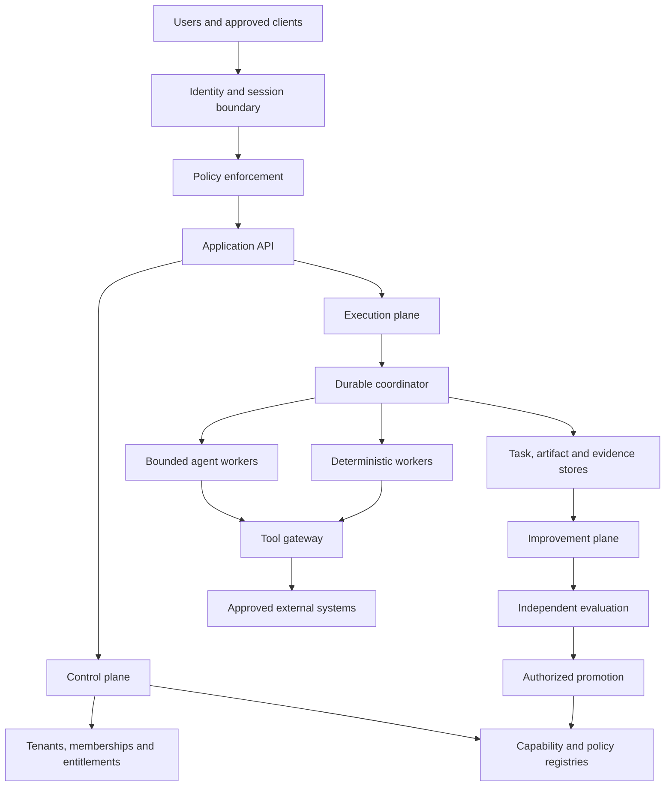
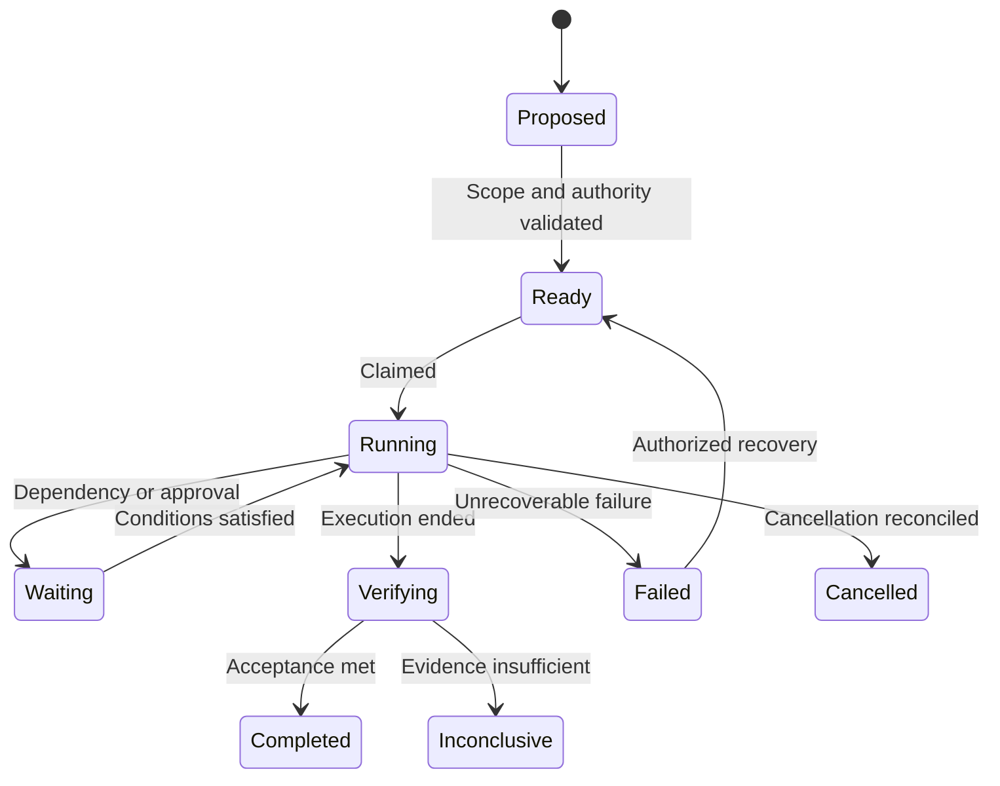
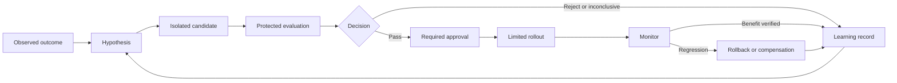

Below are two companion documents you can give your agents:

- `design.md`: how to discover, specify, and validate product and system behavior.
- `architecture.md`: how to structure, secure, operate, and evolve the implementation.

Both explicitly depend on your existing `documentation.md` policy. They do not replace it.

The governing principle is **evidence**: frameworks guide decisions, but implemented controls, tests, independent reviews, and observed outcomes establish whether requirements are met.

These documents define a proposed target and implementation policy—not a claim that your current repository already conforms to them.

***

# Document 2 — `architecture.md`

## 1. Document status and implementation boundary

| Field | Value |
|---|---|
| Purpose | Target architecture and architecture governance |
| Primary coordinator | CTO |
| Co-owners | CAIO, CDO, CISO, COO |
| Independent verification | Evaluation and designated reviewers |
| Governing documentation | Existing `documentation.md` |
| Status | Proposed target; current-state claims require evidence |

Begin with repository inspection. Reuse sound components and migrate incrementally.

Logical boundaries below do not require separate microservices.

## 2. Architecture objectives

Provide:

- Multi-tenant isolation.
- Multi-user collaboration.
- Fine-grained authorization.
- Durable agent execution.
- Deterministic control.
- Secure tool access.
- Evidence-backed outcomes.
- Governed recursive improvement.
- Observable operation.
- Controlled release and recovery.

Prefer a modular architecture until measured needs justify distributed deployment.

## 3. Architecture views

Maintain:

1. Business/capability view.
2. System-context view.
3. Application/container view.
4. Data and lineage view.
5. Runtime interaction view.
6. Deployment view.
7. Security/trust-boundary view.
8. Improvement-control-plane view.

Use C4 concepts where useful; do not generate every possible diagram merely for completeness. [c4model](https://c4model.com/diagrams)

Separate current, approved target, and transition states.

## 4. Logical platform structure



Trust boundaries must be documented in a dedicated security view; proximity in this diagram does not imply shared trust.

## 5. Plane responsibilities

| Plane | Responsibilities |
|---|---|
| Experience | User interfaces, APIs, notifications, accessible controls |
| Control | Identity, tenants, membership, policy, entitlements, approvals |
| Execution | Task graphs, scheduling, delegation, tools, recovery |
| Data | Operational records, artifacts, knowledge, lineage, retention |
| Improvement | Hypotheses, candidates, experiments, outcome learning |
| Assurance | Independent evaluation, security review, promotion evidence |
| Operations | Telemetry, alerts, incidents, releases, continuity |

Do not permit the improvement plane to bypass the control or assurance planes.

## 6. Cloud-native approach: tailored fifteen-factor profile

Adopt an explicit fifteen-factor interpretation based on *Beyond the Twelve-Factor App*. It is a methodology, not a certification. The referenced formulation includes API-first design, telemetry, and authentication/authorization alongside revised cloud-native factors. [developer.ibm](https://developer.ibm.com/articles/15-factor-applications/)

| Factor | Project interpretation |
|---|---|
| 1. One codebase, one application | Define deployable boundaries; a monorepo may contain several applications |
| 2. API first | Specify contracts before dependent implementation |
| 3. Dependency management | Declare, lock, review, and inventory dependencies |
| 4. Design/build/release/run | Separate stages and identify immutable artifacts |
| 5. Configuration/credentials/code | Separate deploy configuration and secrets from source |
| 6. Logs | Emit structured, redacted events |
| 7. Disposability | Support restart, cancellation, and checkpoint recovery |
| 8. Backing services | Access through explicit interfaces and credentials |
| 9. Environment parity | Minimize and document meaningful differences |
| 10. Administrative processes | Use versioned, authorized operational jobs |
| 11. Port binding | Apply to hosted processes; map to platform entrypoints for Workers |
| 12. Stateless processes | No reliance on accidental process memory; durable state has explicit ownership |
| 13. Concurrency | Bound work and enforce fairness |
| 14. Telemetry | Instrument outcomes, dependencies, and resource use |
| 15. Authentication/authorization | Enforce identity and policy at relevant boundaries |

Stateful agent runtimes are a deliberate adaptation: persistent state belongs in managed, recoverable storage, not undocumented process-local assumptions.

## 7. Agent and capability architecture

### Approved role classes

- Executive coordination agents.
- Meta-agents.
- Deep/task-coordinator agents.
- Domain agents.
- Micro-agents.
- Evaluators.
- Deterministic workers.

These are project responsibilities, not mandatory framework classes.

### Capability registry

Each capability must define:

```yaml
id: approved-capability
version: explicit-version
owner: accountable-owner
implementation: agent-or-deterministic
input_schema: reference
output_schema: reference
tools: []
data_scope: policy-reference
limits: policy-reference
evaluation: reference
approval_status: explicit-status
```

Runtime agents may instantiate approved templates within policy. They may not install arbitrary code or create privileged capabilities from a prompt.

### Framework profile

Where Cloudflare Think is approved:

- Verify installed APIs.
- Use supported top-level/sub-agent mechanisms.
- Avoid duplicate model/tool loops.
- Define durable task state separately from chat history.
- Test actual runtime paths.
- Keep exact services deterministic.

## 8. Task execution and coordination

Persist:

```text
Task ID and parent
Tenant/workspace
Initiating principal
Delegation
Plan version
Dependencies
Owner and claim version
Status
Budget
Checkpoint
Artifacts
Approvals
Failure/recovery state
```

Require:

- Atomic ownership or equivalent coordination.
- Lease/stale-worker handling.
- Fencing or equivalent rejection of stale owners.
- Event deduplication.
- Bounded retries.
- Cancellation propagation.
- Resource accounting across descendants.
- Reconciliation of uncertain external outcomes.



Task lifecycle and improvement lifecycle are separate state machines.

## 9. Identity, authorization, and accountability

### Canonical entities

```text
User
External identity
Tenant
Membership
Workspace
Role
Permission
Scoped role binding
Service principal
Agent instance/run
Delegation
Approval
Audit event
```

### Enforcement

Use a policy decision mechanism and enforcement points across APIs, tools, jobs, retrieval, and storage access.

Effective delegated authority must not exceed:

```text
Initiator authority
∩ tenant/resource policy
∩ tool policy
∩ explicit delegation
∩ current approval
```

Require stable identities, controlled account linking, secure sessions, appropriate step-up, revocation behavior, and attributable audit evidence.

Telemetry context is not an authorization credential.

## 10. Data architecture

Define authoritative stores and derived representations.

Separate:

- Conversation history.
- Durable task state.
- Business records.
- Agent memory.
- Knowledge sources.
- Artifacts.
- Evaluation data.
- Audit evidence.

For each asset specify:

```text
Owner
Tenant scope
Source
Schema
Purpose
Quality expectations
Retention
Deletion
Backup
Recovery
Permitted learning use
```

Prevent silent persistence failures. Verify critical writes through appropriate transaction, read-back, reconciliation, or other integrity mechanisms.

Use object storage, relational storage, search, or vector indexes according to measured requirements—not fashion.

## 11. Contracts and integration

Use approved formats as applicable:

- OpenAPI for HTTP APIs.
- JSON Schema for structured payloads.
- AsyncAPI where useful for asynchronous contracts.
- Explicit event envelopes.
- Versioned tool schemas.

Events include identity, version, tenant scope, correlation, and idempotency information where appropriate.

### Emerging protocols

Evaluate MCP for tool/data integration and agent-to-agent protocols only when interoperability is needed.

MCP connectivity does not replace application authorization. Cloudflare’s MCP guidance explicitly distinguishes authentication from delegated resource authorization and supports narrowly scoped integrations. [developers.cloudflare](https://developers.cloudflare.com/agents/model-context-protocol/)

Pin supported protocol versions and test compatibility.

## 12. RSI control plane



### Candidate classes

- Parameters/configuration.
- Prompts/models/routing.
- Tools/workflows.
- Architecture/code.
- Improvement policies.

Each class needs an appropriate evaluation path.

### Protected invariants

Candidates cannot alter their own:

- Passing criteria.
- Held-out promotion data.
- Permission boundaries.
- Spending limits.
- Approval requirements.
- Audit integrity.
- Reviewer independence.

Governance changes follow a separate human-governed process.

## 13. Reliability and service management

Define approved:

- Service indicators and objectives.
- Recovery point/time objectives.
- Error budgets where appropriate.
- Capacity and fairness policies.
- Degraded modes.
- Provider-failure handling.
- Incident severity.
- Runbooks.
- Continuity exercises.

Use ITIL-informed distinction between incident restoration, problem investigation, change authorization, release, deployment, and continual improvement.

Maintain PMI-informed ownership, dependencies, scope, resources, risk, and benefit tracking. Pin the adopted PMBOK edition rather than mixing edition-specific terminology. PMI guidance supports tailored predictive, agile, and hybrid approaches. [pmi](https://www.pmi.org/standards/pmbok)

## 14. Observability and audit

Instrument:

```text
Request
Tenant/workspace
Task
Agent run
Tool call
Approval
Candidate
Evaluation
Release
```

Use OpenTelemetry-compatible signals and context propagation where supported. OpenTelemetry separates traces, metrics, and logs and enables correlation through propagated context. [1002][1008]

Apply redaction, access controls, cardinality limits, and retention.

Keep audit evidence distinct from diagnostic logs. Define behavior when mandatory audit persistence fails.

## 15. Secure engineering and supply chain

Require:

- Maintained dependencies.
- Lockfiles.
- Secret scanning.
- Appropriate static/dependency analysis.
- Minimal automation permissions.
- Reviewed workflow changes.
- Artifact identification.
- Provenance/SBOM requirements appropriate to risk.
- Protected release environments.

Generated code is untrusted until reviewed and verified.

Authorized adversarial testing requires scope, methods, limits, stop conditions, and data-handling rules.

## 16. Release, migration, and rollback

Follow:

```text
Issue
→ specification
→ tests
→ implementation
→ PR
→ independent review
→ required CI
→ authorized merge
→ post-merge verification
→ authorized rollout
→ observation
```

Record:

```text
Source SHA
Artifact digest
Configuration version
Schema/migration version
Prompt/model/tool versions
Evaluation evidence
Approval
Environment
Recovery target
```

Prefer incremental migration and compatibility-preserving transitions.

Do not assume code rollback reverses database changes or external actions.

## 17. Emerging technology adoption gate

Evaluate new technologies through a bounded experiment.

| Candidate | Adopt only when it addresses |
|---|---|
| Graph-based orchestration | Explicit dependencies or adaptive branching |
| Sandboxed execution | Approved generated-code or untrusted-workload needs |
| Vector/hybrid retrieval | Demonstrated retrieval requirements |
| Policy engine | Meaningful policy complexity and consistent enforcement |
| Durable workflow runtime | Recovery and long-running coordination |
| MCP/agent protocols | Actual integration or interoperability requirements |
| Specialized models | Measurable quality, latency, or cost needs |

Document maturity, licensing, security, portability, cost, operational burden, and exit strategy.

“Emerging” is not a reason to bypass assurance.

## 18. Architecture verification

Required evidence depends on the change:

| Area | Evidence |
|---|---|
| Function | Unit/integration/end-to-end tests |
| Agent quality | Task-specific evaluations |
| Tenancy | Cross-tenant negative tests |
| Delegation | Scope and approval enforcement |
| Persistence | Integrity and recovery tests |
| Concurrency | Ownership, duplication, and stale-worker tests |
| Migration | Compatibility and rollback/compensation |
| Operations | Monitoring and recovery exercises |
| Performance | Controlled measurements |
| Documentation | Text, diagrams, contracts, and implementation agree |

Support accepted, rejected, blocked, and inconclusive outcomes.

## 19. Documentation and governance integration

Apply `documentation.md` to every task.

Maintain canonical:

- Strategy and roadmap links.
- Architecture views.
- ADRs.
- Contracts.
- Agent registry.
- Security model.
- Data lineage.
- Runbooks.
- Evaluation and outcome records.

Update relevant text and Mermaid source together. GitHub supports Mermaid in Markdown; syntax checks must still be paired with semantic review. [docs.github](https://docs.github.com/en/get-started/writing-on-github/working-with-advanced-formatting/creating-diagrams)

Historical decisions remain historical. Supersede rather than silently rewrite them.

## 20. Implementation sequence

| Stage | Deliverable | Gate |
|---|---|---|
| 0 | Repository baseline and document reconciliation | Current state understood |
| 1 | Identity, tenant, policy, and data ownership | Boundaries verified |
| 2 | One durable hybrid workflow | Recovery and permissions demonstrated |
| 3 | Independent evaluation and evidence | Bad candidate rejected |
| 4 | Controlled release and observation | Actual outcomes verified |
| 5 | Bounded adaptation | Budgets, audit, stop controls pass |
| 6 | Architecture-improvement candidates | Non-domain capability improved |
| 7 | Governed meta-improvement | Protected criteria remain intact |

Do not enable later-stage autonomy merely because its code exists.

## 21. First assignment to the agent fleet

> Read `AGENTS.md`, the existing `documentation.md`, `design.md`, and `architecture.md`. Assess current implementation against them and return a requirement-to-evidence matrix.
>
> Identify conflicts, missing decisions, and the smallest useful vertical slice. Produce issue-sized work with named owners, acceptance criteria, evaluations, risks, and recovery plans.
>
> Implement only after required authorization. Keep canonical documentation synchronized in the same PR. Independent issues may proceed in parallel on separate branches; complete each issue’s merge and required verification before marking that issue Done.
>
> Do not change governance, expand privileges, weaken evaluations, or claim conformance from documentation alone.

***

## Companion acceptance rule

These documents are successfully adopted when agents can demonstrate one complete, authorized improvement cycle:

> A real problem produces a versioned hypothesis; a bounded candidate is implemented; independent evidence accepts or rejects it; authorized rollout is observed; and the result informs the next decision—with the design, architecture, roadmap, and improvement record accurately synchronized under `documentation.md`.
