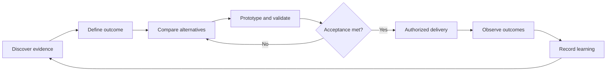

Below are two companion documents you can give your agents:

- `design.md`: how to discover, specify, and validate product and system behavior.
- `architecture.md`: how to structure, secure, operate, and evolve the implementation.

Both explicitly depend on your existing `documentation.md` policy. They do not replace it.

The governing principle is **evidence**: frameworks guide decisions, but implemented controls, tests, independent reviews, and observed outcomes establish whether requirements are met.

These documents define a proposed target and implementation policy—not a claim that your current repository already conforms to them.

***

# Document 1 — `design.md`

## 1. Document status and authority

| Field | Value |
|---|---|
| Purpose | Design policy and target design specification |
| Scope | Multi-tenant, multi-user, agentic SaaS and its agentic operating organization |
| Primary coordinators | CPO, CAIO, CTO |
| Required contributors | CDO, CISO, COO, Design, independent Evaluation |
| Approval | Designated human product/technology owners |
| Documentation policy | Existing `documentation.md` at its canonical repository path |
| Implementation status | Proposed until verified through approved delivery |

### Mandatory first action

Before implementation:

1. Locate and read `AGENTS.md`, `documentation.md`, and applicable nested instructions.
2. Identify existing canonical specifications and design assets.
3. Reconcile conflicts rather than creating competing documents.
4. Establish the current-state baseline.
5. Propose an incremental implementation sequence.

This document grants no additional access, spending, or deployment authority.

## 2. Purpose

Design a platform that lets authorized users and agents:

- Define goals and constraints.
- Select appropriate execution methods.
- Delegate bounded work.
- Coordinate dependencies.
- Inspect evidence and artifacts.
- Approve consequential actions.
- Recover from interruption.
- Evaluate outcomes.
- Propose and adopt improvements safely.

The platform must support deterministic, agentic, and hybrid workflows.

“Solves any problem” and “achieves ASI” are not acceptance criteria.

## 3. Design principles

1. Start with a user or organizational problem.
2. Prefer the simplest sufficient solution.
3. Preserve human accountability.
4. Separate proposing from authorizing.
5. Make consequential behavior understandable.
6. Keep exact rules outside model discretion.
7. Preserve tenant and resource boundaries.
8. Design failure and recovery before launch.
9. Evaluate actual outcomes, not agent activity.
10. Make improvement reversible or explicitly compensatable where practical.
11. Treat unknown and inconclusive outcomes as legitimate.
12. Build documentation and verification into delivery.

## 4. Standards, frameworks, and applicability

Adopt approved editions and profiles through the repository’s standards register.

| Reference | Design application |
|---|---|
| WCAG 2.2 AA | Accessibility requirements for complete supported journeys |
| WAI-ARIA Authoring Practices | Custom widget interaction and keyboard guidance |
| OWASP ASVS | Testable application-security requirements |
| NIST AI RMF and Generative AI Profile | AI risks, oversight, evaluation, monitoring |
| NIST SSDF | Secure development expectations |
| COBIT | Value, accountability, resources, risk, and assurance |
| TOGAF | Stakeholder concerns, architecture alternatives, transitions |
| ITIL | Service experience, change, incidents, continuity, improvement |
| PMI/approved PMBOK guidance | Scope, stakeholders, resources, risk, delivery, benefits |
| CISSP knowledge domains | Security-review coverage—not software certification |
| Design thinking / Double Diamond | Problem exploration, definition, alternatives, validation |
| Diátaxis | Tutorials, how-to, reference, and explanation documentation |

Tailor these references. Do not claim that implementing a checklist establishes certification.

The Double Diamond separates Discover, Define, Develop, and Deliver, encouraging problem understanding before solution commitment and small-scale testing before adoption. [1001]

TOGAF and COBIT can complement one another: architecture governance and transitions support enterprise governance decisions rather than replacing them. [isaca](https://www.isaca.org/resources/news-and-trends/industry-news/2020/cobit-resource-optimization-mapped-to-togafs-architecture-review-board)

## 5. Design process

### 5.1 Discover

Gather authorized evidence from:

- Customer research.
- Existing workflows.
- Support cases.
- Product analytics.
- Incidents.
- Architecture assessments.
- Evaluation results.
- Operating cost.

Label synthetic research and assumptions explicitly.

Deliver:

```text
Problem statement
Affected users
Current journey
Evidence
Unknowns
Constraints
Baseline
```

### 5.2 Define

Specify:

- Intended outcome.
- Scope and non-goals.
- Acceptance criteria.
- Authority and approval boundaries.
- Tenant and data implications.
- Quality and service expectations.
- Risks and dependencies.

### 5.3 Develop

Compare alternatives:

```text
No change
Documentation improvement
Workflow simplification
Deterministic automation
Single-agent assistance
Multi-agent coordination
Human-led execution
```

Prototype only what is needed to resolve uncertainty.

### 5.4 Deliver and learn

Validate the candidate, obtain approval, roll out within limits, observe outcomes, and update the next hypothesis.



## 6. Users and identities

Design for:

- Organization owners.
- Tenant administrators.
- Workspace administrators.
- Members.
- Viewers.
- Approvers.
- Auditors.
- Platform operators.
- Service principals.
- Delegated agent workloads.

A user may belong to several tenants. A role may differ between tenants or workspaces.

Role names must not substitute for explicit permissions.

## 7. Core product journeys

Each journey requires primary, failure, recovery, accessibility, and unauthorized-access cases.

| Journey | Required outcome |
|---|---|
| Onboarding | Correct identity, tenant, membership, and initial policy |
| Goal creation | Clear objective, inputs, constraints, and output |
| Plan review | Understand proposed work, permissions, cost, and limitations |
| Execution | Accurate progress and bounded delegation |
| Approval | Exact action and consequences are inspectable |
| Result review | Evidence, artifacts, and uncertainty are visible |
| Interruption | Work resumes, reconciles, or escalates safely |
| Cancellation | Remaining work and completed effects are explained |
| Collaboration | Ownership, handoffs, and versions are explicit |
| Improvement review | Baseline, candidate, guardrails, and results are comparable |
| Offboarding | Access, active work, exports, and retention are handled |

## 8. Design system

Use one coherent system rather than several overlapping libraries.

### Required layers

```text
Principles
→ primitive tokens
→ semantic tokens
→ reusable components
→ product patterns
→ page templates
```

### Token dimensions

- Color.
- Typography.
- Spacing.
- Density.
- Borders.
- Elevation.
- Focus.
- Motion.
- Responsive behavior.

Keep theme, density, typography, branding, and reduced motion independently configurable where supported.

Select one canonical token source. Generate other representations; do not maintain competing hand-edited values.

If cross-tool interoperability is needed, assess the Design Tokens Community Group format. It is a Community Group specification, not a W3C Recommendation. [designtokens](https://www.designtokens.org/TR/2025.10/format/)

### Mandatory product components

```text
Goal editor
Plan viewer
Task status
Activity timeline
Evidence panel
Artifact viewer/editor
Approval review
Budget indicator
Error/recovery panel
Memory management
Candidate comparison
Outcome report
```

## 9. Agentic interaction requirements

### Delegation contract

Before material execution, communicate:

```text
What will be done
What will not be done
Which systems will be accessed
What may change
What requires approval
Budget and time limits
Expected outputs
```

### Progress

- Report actual milestones.
- Label estimates.
- Do not fabricate percentages.
- Distinguish waiting, working, blocked, and disconnected.
- Explain material replanning.
- Expose delegation detail progressively.

### Explanations

Provide concise rationales, evidence, assumptions, and limitations.

Do not expose or require private chain-of-thought.

### Controls

Define exact meanings for:

- Pause.
- Resume.
- Cancel.
- Retry.
- Undo.
- Compensate.

Do not offer “undo” for an irreversible action or label an uncertain external outcome as a confirmed failure.

## 10. IAAA and authorization experience

Design Identification, Authentication, Authorization, and Accountability together.

Require:

- Stable identities.
- Secure provider linking.
- Explicit tenant/workspace context.
- Fine-grained permissions.
- Bounded agent delegation.
- Version-bound approvals.
- Audit visibility appropriate to role.
- Clear denial and recovery messages.

Authentication does not establish authorization.

An executive agent’s title does not grant platform-administrator powers.

## 11. Determinism contract

Every workflow must state:

| Question | Required answer |
|---|---|
| Which steps are deterministic? | Exact functions and rules |
| Which steps use model judgment? | Interpretation/planning boundaries |
| What is versioned? | Code, schemas, policy, prompts, tools, configuration |
| What can vary? | Provider behavior, source data, timing |
| What can replay reproduce? | Explicit guarantee and limitations |

Exact calculations, authorization, budget checks, and approval validity must not depend on unconstrained model judgment.

## 12. RSI design requirements

Every improvement must include:

```text
Observation
Baseline
Hypothesis
Candidate
Evaluation
Review
Approval
Rollout
Observed outcome
Next justified hypothesis
```

Separate:

- Task-level adaptation.
- Reusable system improvement.
- Meta-improvement of the improvement process.

A candidate cannot change its own protected acceptance criteria.

### Improvement review interface

Show:

- Baseline and candidate versions.
- Intended benefit.
- Changed behavior.
- Evaluation results.
- Regressions.
- Security and tenancy implications.
- Approval status.
- Rollout stage.
- Rollback target.
- Remaining uncertainty.

## 13. Acceptance and quality

Each feature must identify relevant evidence for:

- Functional correctness.
- Accessibility.
- Usability.
- Security.
- Tenant isolation.
- AI quality.
- Recovery.
- Performance.
- Cost.
- Compatibility.

Set numeric targets through accountable owners before release. Do not invent thresholds to fit observed results.

Automated accessibility checks supplement—not replace—manual journey assessment.

## 14. Documentation integration

Follow `documentation.md` for every task.

Maintain:

- Design intent.
- Journey diagrams.
- Interaction/state diagrams.
- Component and token guidance.
- Acceptance criteria.
- Evidence links.
- Known limitations.

Update affected artifacts in the implementation PR. Explain “no change required” where appropriate.

Do not automatically rewrite strategy for a routine bug fix.

## 15. Required design deliverables

Before coding a material capability:

1. Problem and evidence.
2. Current journey.
3. Alternatives.
4. Proposed behavior.
5. Permissions and data implications.
6. Text and relevant diagrams.
7. Acceptance criteria.
8. Evaluation plan.
9. Rollout and recovery.
10. Open decisions and approvals.

### Definition of Done

Design is complete when behavior is specified, risks are owned, acceptance is testable, diagrams agree with text, and implementation status is represented accurately.

***
