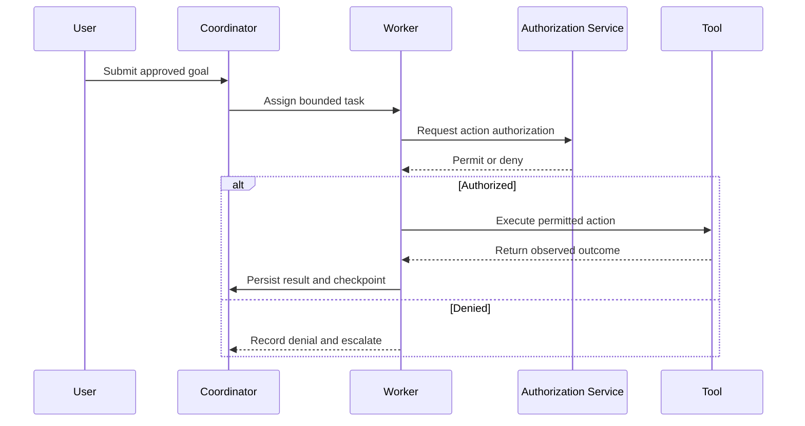

Add a “Documentation Impact and Synchronization” requirement to `AGENTS.md`.

The important distinction: agents must assess documentation for every task, but should update strategy, roadmap, and diagrams only when the task changes them. Otherwise, you will get cosmetic edits, invented strategic implications, and unnecessary merge conflicts.

Make documentation part of the same PR and **Definition of Done**, with an explicit “no change required” explanation where appropriate.

## 1. Ready-to-paste section for `AGENTS.md`

````markdown
# Documentation Impact, Synchronization, and Completion Policy

## Purpose

Keep the organization's strategy, roadmap, architecture, operating
knowledge, and improvement evidence synchronized with intended and
verified system behavior.

Documentation is part of the deliverable, not a follow-up task.

## Mandatory behavior for every task

### Before implementation

1. Read the applicable repository instructions.
2. Identify the approved objective, issue, and specification.
3. Locate the canonical documentation affected by the task.
4. Assess impacts on:
   - strategy and objectives;
   - roadmap and dependencies;
   - architecture and diagrams;
   - product behavior and user journeys;
   - APIs, events, schemas, and data;
   - identity, authorization, and tenant isolation;
   - agent roles, tools, memory, and delegation;
   - operations, monitoring, recovery, and release;
   - evaluation and improvement evidence.
5. Record the documentation impact in the issue or PR.

Do not assume documents are current. Record contradictions and resolve
material disagreements with the responsible owner.

### During implementation

1. Update affected canonical documents in the same PR as the change.
2. Keep explanatory text, diagrams, examples, and machine-readable
   contracts consistent.
3. Preserve traceability:
   objective → requirement → issue → implementation → test/evaluation
   → release → observed outcome.
4. Distinguish:
   proposed, approved, implemented, merged, deployed, and verified.
5. Do not document planned behavior as existing behavior.
6. Do not make unapproved strategy or roadmap commitments.

### Before requesting final review

1. Update the roadmap when scope, status, dependencies, sequencing,
   milestones, or completion evidence change.
2. Update strategy when findings affect approved assumptions,
   capability priorities, investment rationale, or strategic choices.
   Material changes require the strategy owner's approval.
3. Update architecture text and visuals when responsibilities,
   boundaries, integrations, state ownership, deployment, security,
   or runtime behavior change.
4. Update all other affected documentation.
5. Validate links, examples, schemas, and diagram syntax.
6. Include a documentation-impact summary in the PR.

If an artifact is unaffected, record "No change required" with a
specific reason. Do not make cosmetic edits to satisfy a checklist.

### After merge and rollout

1. Record the merge and applicable release evidence.
2. Mark behavior deployed or verified only after observing that stage.
3. Record outcomes, regressions, and unresolved limitations.
4. Update the improvement record and next justified hypothesis.
5. Perform follow-up repository writes through the approved workflow;
   never bypass protected branches to update status.

## Text and visual documentation

For material changes, update the relevant text and diagram together.

Use:
- context/container-style diagrams for architecture boundaries;
- sequence diagrams for interactions and approvals;
- state diagrams for task and lifecycle behavior;
- flowcharts for decisions, delegation, and recovery;
- entity-relationship diagrams for material data relationships;
- dependency diagrams or milestone views for roadmap structure.

Use diagrams only where they clarify the subject. Do not create a new
diagram for every small change.

Every diagram must:
- identify its scope;
- distinguish current state from proposed state;
- match the accompanying text;
- use meaningful labels and relationship directions;
- avoid secrets, private customer data, and fabricated components.

## Sources of truth

Use one canonical source for each fact.

- Approved strategy: strategic choices and constraints.
- GitHub issues/project: current work status and ownership.
- Roadmap: objectives, sequence, dependencies, and linked evidence.
- Specifications: intended feature behavior.
- Architecture documents: system structure and responsibilities.
- ADRs: decision history and trade-offs.
- Schemas/contracts: machine-readable interface definitions.
- Release/deployment records: what was delivered where.
- Evaluation/outcome records: what was actually demonstrated.

Link to authoritative records rather than maintaining conflicting copies.

## Governance boundaries

Agents may propose documentation changes within their role.

They may not independently:
- change organizational purpose;
- create binding roadmap commitments;
- alter risk appetite;
- weaken acceptance criteria;
- expand authority through documentation;
- rewrite historical evidence;
- claim certification or completion without evidence.

Changes to AGENTS.md, role charters, approval rules, and other protected
governance documents require the designated review process.

## Definition of Done

A task is complete only when:
- implementation meets approved acceptance criteria;
- required checks and reviews pass;
- affected documentation is updated;
- affected text and visuals agree;
- unchanged artifact categories have justified no-change decisions;
- traceability and evidence are recorded;
- deployment and verification status are stated accurately;
- remaining gaps are explicitly owned.

Do not mark an unmerged, unverified, or blocked task complete merely
because documentation was written.
````

GitHub can render Mermaid directly inside fenced `mermaid` blocks in Markdown. Keep editable diagram source in the repository rather than relying only on screenshots. [docs.github](https://docs.github.com/en/get-started/writing-on-github/working-with-advanced-formatting/creating-diagrams)

## 2. Which documents should agents maintain?

Start with the following catalog. These are canonical artifact categories—not a requirement to create a separate file for every category or every task.

| Artifact | Purpose | Update trigger | Recommended format / visual |
|---|---|---|---|
| Strategy | Goals, priorities, assumptions, non-goals | Evidence changes strategic choices or assumptions | Markdown; objective/capability map |
| Roadmap | Outcomes, sequencing, dependencies, milestones | Scope, priority, dependency, or delivery state changes | Markdown plus GitHub Project; dependency flowchart |
| Product specifications | Intended behavior and acceptance | Features or requirements change | Markdown; journeys and state diagrams |
| Architecture overview | Boundaries, responsibilities, integrations | Structural changes | Markdown; context and container-style diagrams |
| Runtime workflows | How important scenarios execute | Routing, delegation, approval, or recovery changes | Markdown; sequence/state diagrams |
| ADRs | Why a material decision was made | Significant architectural choice | Markdown; optional alternatives diagram |
| API/event contracts | Interoperable interface behavior | Endpoint, event, or compatibility changes | OpenAPI, AsyncAPI, JSON Schema as applicable |
| Data model/catalog | Meaning, ownership, storage, lineage | Schemas, sources, retention, or transformations change | Markdown + schemas/migrations; ER/lineage diagrams |
| Security and IAAA | Trust boundaries and enforcement | Identity, access, delegation, audit, or threat changes | Markdown + policy configuration; trust-boundary/sequence diagrams |
| Agent capability registry | Agent roles, tools, permissions, limits | Agent or capability behavior changes | Schema-validated YAML/JSON; fleet topology |
| UX/design system | Shared tokens, components, interactions | User behavior or design conventions change | Markdown + token/component sources; journey diagrams |
| Runbooks | Operate, diagnose, contain, recover | Operational behavior changes | Markdown; recovery flowcharts |
| Evaluation plan/results | Establish correctness and improvement | Candidate, benchmark, or evaluator changes | Markdown + JSON/CSV results |
| Release notes | User/operator-facing changes | Approved release | Markdown |
| Migration/deprecation plan | Safe transition between versions | Breaking changes, replacement, retirement | Markdown + scripts; transition diagram |
| Improvement record | Baseline, hypothesis, outcome, next cycle | Every RSI experiment | Markdown/YAML metadata + evidence links |

### Avoid excessive diagram detail

Use architecture diagrams at the level that helps the reader. C4 explicitly recommends only the levels that add value; context and container diagrams are sufficient for many teams. Deployment and dynamic diagrams serve different questions and should not be crammed into one picture. [c4model](https://c4model.com/diagrams)

## 3. Specific rules for strategy, roadmap, and architecture

These documents change at different rates.

### Strategy: review every task; change selectively

A bug fix usually does not change organizational strategy.

Update strategy when a task reveals something material, such as:

- A core assumption is false.
- A target workflow is economically unviable.
- A capability is unsupported.
- A provider creates unacceptable concentration risk.
- A different investment priority is justified.

Record a proposal and obtain the strategy owner’s approval.

Suggested structure:

```text
Purpose and objectives
Target users / beneficiaries
Strategic choices
Non-goals
Assumptions
Success measures
Constraints
Review triggers
Decision links
```

### Roadmap: update delivery implications

When completing work:

- Link the issue and PR.
- Update the relevant milestone or outcome.
- Resolve or revise dependencies.
- Record remaining work.
- Distinguish merged from released.
- Avoid marking an entire capability complete from one partial implementation.

Use a dependency flowchart when ordering matters. Use Gantt dates only when there is a credible schedule; do not invent dates merely to produce a visual.

### Architecture: maintain current and target separately

Use clearly separated sections or files:

```text
Current state — implemented and evidenced
Target state — approved direction
Transition state — migration path and temporary constraints
```

An approved design is not yet current architecture.

Historical ADRs should normally be superseded by a new decision rather than rewritten to pretend the earlier decision never existed.

## 4. Example architecture documentation

A single Markdown document can contain both narrative and a visual:

````markdown
# Task Execution Architecture

Status: Current
Owner role: CTO
Related issue: #812
Evidence: linked implementation and integration tests

## Responsibilities

The coordinator owns task lifecycle and checkpoints.
Workers perform bounded assignments.
The authorization service validates tool execution.
Consequential actions require a valid version-bound approval.

## Execution



## Failure and recovery

Describe retries, unknown outcomes, cancellation, and reconciliation.

## Limitations

State unimplemented or unverified behavior explicitly.
````

The prose explains responsibilities and limitations; the diagram explains interactions. Neither should contradict the other.

## 5. Suggested repository structure

Adapt this to the repository’s current layout. Do not create duplicate `strategy.md` or `architecture.md` files if canonical versions already exist.

```text
docs/
  index.md

  agentic-org/
    mission.md
    strategy.md
    collaboration.md
    roles/

  product/
    roadmap.md
    metrics.md
    journeys/

  architecture/
    overview.md
    current-state.md
    target-state.md
    transitions.md
    adr/

  security/
    threat-model.md
    iaaa.md
    authorization-model.md
    risk-register.md

  data/
    catalog.md
    lineage.md
    lifecycle.md

  operations/
    service-objectives.md
    runbooks/
    continuity.md

  guides/
    tutorials/
    how-to/

  reference/
    configuration.md
    permissions.md
    capabilities.md

specs/
  features/
  improvements/

contracts/
  openapi/
  events/
  schemas/

evaluations/
  manifests/
  results/
```

For user/developer documentation, Diátaxis is a useful organizing framework: tutorials teach, how-to guides help accomplish a task, reference describes exact facts, and explanations provide context. Keep these purposes distinct instead of mixing them into one long README. [diataxis](https://diataxis.fr/start-here/)

## 6. Add a documentation-impact table to every PR

```markdown
## Documentation impact

| Artifact | Updated / No change / Blocked | Reason or link |
|---|---|---|
| Strategy | | |
| Roadmap | | |
| Architecture text | | |
| Architecture visuals | | |
| Product/UX specification | | |
| API/events/data contracts | | |
| Security/IAAA | | |
| Agent registry | | |
| Runbooks/recovery | | |
| Evaluation/improvement record | | |
| Release notes | | |

## State represented
Proposed / approved / implemented / merged / deployed / verified

## Evidence
Tests:
Evaluation:
Runtime verification:
Related decisions:

## Follow-up
Owner:
Required approval:
Blocking issue:
```

“No change” needs a reason such as:

> Strategy unchanged: this restores already-approved behavior and does not change priorities, constraints, or assumptions.

That is more useful than making a meaningless edit to `strategy.md`.

## 7. Ownership for your executive agents

| Artifact | Primary coordinator | Relevant reviewers |
|---|---|---|
| Mission and strategy | CEO | Human governing owner and executive team |
| Roadmap and product specifications | CPO | CEO, CAIO, CTO, COO |
| AI capability/fleet design | CAIO | CTO, CDO, CISO, Evaluation |
| Technology architecture and ADRs | CTO | Affected executives |
| Data contracts and lineage | CDO | CTO, CISO |
| Security/IAAA | CISO | CTO, CDO, designated risk owner |
| Operations and recovery | COO | CTO, CISO |
| Evaluation integrity | Independent Evaluation | Domain owners, without surrendering independence |
| Improvement outcomes | Candidate owner | Independent reviewer and accountable human |

The implementation agent should draft the required changes. Ownership determines review and approval—not who is allowed to contribute a proposal.

## 8. Automation to make this enforceable

Add repository checks in stages:

1. Markdown linting and internal-link validation.
2. Mermaid syntax/render validation.
3. OpenAPI, JSON Schema, and other contract validation.
4. Generated documentation drift checks.
5. PR documentation-impact validation.
6. Path-based review routing.
7. Scheduled stale-document reports.
8. Checks that high-risk changes include the required artifacts.

Examples of routing:

```text
Authentication changes
→ security/IAAA review

Database migrations
→ data-model and migration documentation review

Agent tool/schema changes
→ capability registry and contract review

Task lifecycle changes
→ state diagram and recovery-runbook review
```

Automation can detect missing artifacts or invalid syntax. It cannot establish that a diagram accurately reflects runtime behavior; reviewers and tests must verify the meaning.

Do not treat a changed timestamp or “last reviewed” field as proof that a document was actually reviewed.

## 9. Preserve RSI evidence, not just documentation volume

For every improvement experiment, record:

```text
What was observed?
What was the baseline?
What hypothesis was tested?
What changed?
What evaluation ran?
What passed, failed, or remained inconclusive?
What was actually released?
What happened afterward?
What does that justify doing next?
```

Keep exact artifact/commit references in the evidence record. Do not require a document to contain its own final commit SHA, which creates a self-reference problem.

The objective is a trustworthy organizational memory—not an ever-growing folder of agent-generated plans.

## 10. Short instruction for the agents

> For every task, assess documentation impact and update affected canonical strategy, roadmap, architecture, contracts, runbooks, and improvement records in the same PR. Keep text and relevant Mermaid visuals consistent, distinguish proposed from verified behavior, and justify “no change” where appropriate; completion requires documentation review, evidence, and all applicable approvals.
