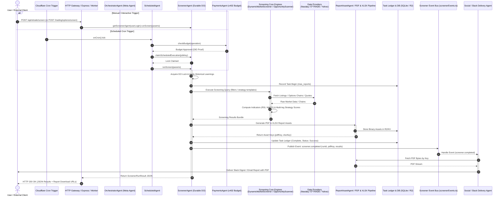
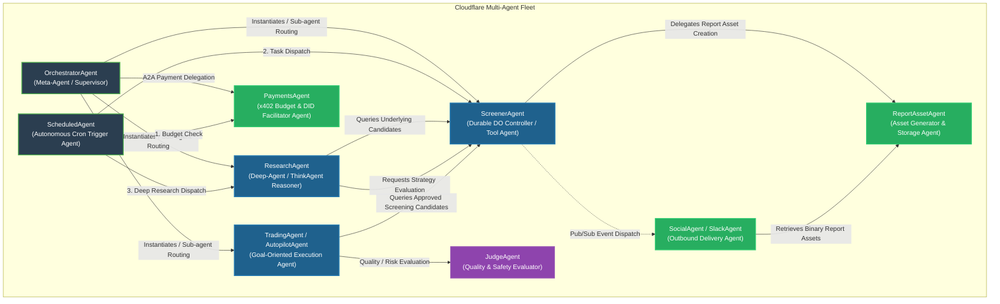
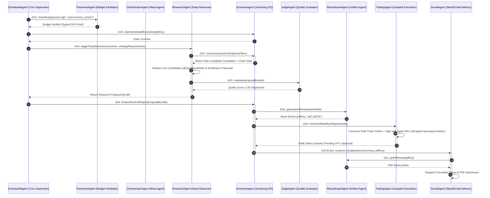
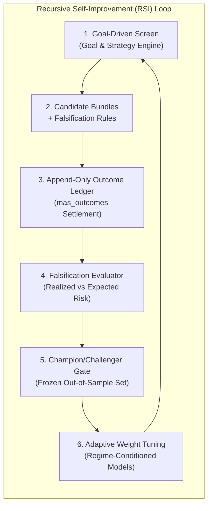

# Capability Architecture: Stock & Options Screening

**Location:** `docs/architecture/application/screener.md`
**Status:** Living Architectural Specification & Capability Assessment
**Last Updated:** 2026-10-24
**Scope:** Stock & Options Screening Capability, Execution Modes, Trigger Taxonomy, Parity Analysis, Agent Taxonomy Compliance, Agentic Component & Sequence Diagrams, Optimization Opportunities, and RSI (Recursive Self-Improvement) Enablement.

---

## 1. Executive Summary & Capability Overview

The **Stock & Options Screening Capability** is the core quantitative decisioning engine of the platform. It provides dynamic market scanning, filter-driven technical analysis, strategy discovery, options opportunity scanning, and recommendation bundle generation across all major US equity exchanges (NASDAQ, NYSE, AMEX) and options chains.

Screening serves both as a standalone analytical tool for traders and as the **primary discovery underlying engine** for downstream intelligence services (such as Options Flow, Autopilot execution, Portfolio Risk analysis, and Social/Slack/Email report generation).

---

## 2. Parity Analysis: Stock vs. Options Screening

An architectural evaluation confirms that the **Stock Screener** and **Options Screener** are **NOT built in functional or structural parity**. While both share the top-level `ScreenerAgent` Durable Object controller for task ledger tracking and PDF/XLSX report persistence, their underlying architectures diverge significantly across eight critical dimensions:

| Dimension | Stock Screener (`DynamicMarketScreener`) | Options Screener (`DynamicOptionsScreener` / `OpportunityScanner`) | Parity Status & Impact |
|---|---|---|---|
| **Data Source Resilience & Fallback** | Dual-layer fallback: Live Nasdaq REST API (`api.nasdaq.com/api/screener/stocks`) $\rightarrow$ Yahoo Finance historical price fallback $\rightarrow$ local curated universe (`curatedStockUniverse.json`). | Single-source dependency: E*TRADE live options chain API (`ETradeClient`). No FOSS or local offline chain fallback available. | **DIVERGENT (High Risk)**: Options screener fails entirely if E*TRADE session/OAuth is unauthenticated or throttled. |
| **Subrequest Bounding & Fan-Out** | Bounded: Fetches listing directory in 1 subrequest; technical indicators computed over historical bars or cached quote data. | Unbounded Fan-Out: Requires 1 expiry list fetch + up to 100 individual chain fetches per symbol. Exceeds Cloudflare Worker subrequest limit (1,000 subrequests/run cap) during multi-symbol runs. | **DIVERGENT (Critical Scale Deficit)**: Options screener requires strict subrequest budget bounding (#1204). |
| **Strategy & Evaluation Complexity** | Linear filter evaluation: Technical indicator filters (RSI, MACD, SMA, price, volume) evaluated independently per stock symbol. | Combinatorial graph evaluation: Evaluates multi-leg option setups (Iron Condors, Vertical Spreads, Straddles, Strangles) against IV surfaces, Greeks, DTE ranges, and earnings calendars. | **DIVERGENT (By Design)**: Options screening requires non-linear combinatorial leg assembly. |
| **Server Discovery Backend Duplication** | Single pipeline (`screenerPipeline.ts` / `screeningProvider.ts`). | Dual parallel backends: `serverDiscovery.ts` (serves UI Discovery panel) vs. `researchDiscovery` / `researchPipeline` (serves NLQ chat). | **DIVERGENT (Duplication Issue #29 / Epic #1096)**: Divergent strategy ranking logic between UI and Chat. |
| **Report Generation Engines** | Dedicated PDF (`screenerReportPdf.ts`) and XLSX (`screenerReportXlsx.ts`) generators tailored to equity metrics. | Dedicated PDF (`optionsReportPdf.ts`) and XLSX (`optionsReportXlsx.ts`) generators tailored to Greeks, leg strikes, and IV profiles. | **DIVERGENT (Schema Split)**: Four separate generators cause delivery hold edge cases (#1209). |
| **Execution Lock & State Persistence** | Fully integrated with `ScreenerAgent` DO state lock (`runScreenInner`). | Partial integration: Runs via `etradeOptionsScreen.ts` / `ScreenerAgent` but bypasses some DO state transition hooks. | **DIVERGENT (State Drift)**: Inconsistent state tracking in `mas_reports` ledger. |
| **Goal & Scenario Grid Integration** | Integrated via `executeGoalScreenRun` and `ScreeningProviderRegistry`. | Partially integrated: Strategy templates evaluated via `UnifiedOptionsService`, but lacks full financial goal mapping. | **DIVERGENT (Goal Alignment)**: Stock screener supports scenario grids better than options. |
| **A2A / MCP Expose Contract** | Exposed via `trading.screen_stocks` tool in MCP registry (`src/mcp/index.ts`). | Exposed via `trading.screen_options` tool in MCP registry. | **PARITY ACHIEVED**: Both expose normalized MCP tool contracts for external agents. |

### 2.1 Parity Convergence Recommendations
1. **FOSS Options Chain Fallback**: Implement a secondary options chain adapter (e.g., Yahoo Finance options feed fallback) to match stock screening resilience.
2. **Unified Server Discovery**: Merge `serverDiscovery.ts` into `researchDiscovery` so UI panel and NLQ chat evaluate option strategies on identical code paths.
3. **Canonical Report Artifact Pipeline**: Replace four distinct report generators with `unifiedReportPipeline.ts`.

---

## 3. Trigger Taxonomy & Execution Modes: Scheduled vs. Triggered Jobs

The screening capability supports five invocation triggers. The fundamental distinction lies between **Scheduled Jobs** and **Triggered Jobs**:

| Feature / Dimension | Scheduled Jobs (`ScheduledAgent` / Cron Ticks) | Triggered Jobs (Event-Driven / Webhooks / Alerts) |
|---|---|---|
| **Initiation Mechanism** | Time-periodic cron ticks (`/30` tick, Cloudflare Worker `onCron` handler in `ScheduledAgent`). | Asynchronous state changes, external Webhook payloads, price threshold alerts, or pub/sub events (`screenerEvents.ts`). |
| **Execution Pattern** | Batch execution across predefined or curated symbol universes (e.g., S&P 500, NASDAQ 100). | Single-target or narrow context reaction (e.g., price breach on `AAPL` triggers instant single-symbol option strategy re-evaluation). |
| **Concurrency & Claim Locking** | Enforces strict claim locking (`claimScheduledExecution`) in DO/SQLite state to prevent duplicate concurrent cron runs across worker instances. | Bypasses schedule claim locks; executes immediately in an isolated job context with transient request locks. |
| **Resource & Subrequest Guards** | Strict subrequest budget guards applied (caps execution to prevent exceeding Cloudflare Worker subrequest limits). | Bounded subrequest scope by nature of single-symbol target, prioritizing low-latency delivery. |
| **Artifact Persistence & Delivery** | Automatically generates durable PDF/XLSX report artifacts, stores them in R2/KV, and logs run summaries to `mas_reports`. | Emits transient pub/sub events (`screener.completed`); report generation is optional/on-demand based on subscriber preferences. |
| **Downstream Dispatch** | Dispatches periodic executive digests to scheduled Slack channels or email distribution lists (`screenerPublishers.ts`). | Triggers immediate reactionary workflows (e.g., Autopilot risk checks, alert webhooks, direct Slack alerts). |

---

## 4. Agent Taxonomy & Compliance Analysis

The platform orchestrates multiple specialized agents. The table below classifies every agent involved in screening, discovery, and delivery against established agentic taxonomies:

| Agent Name | Agent Class / Taxonomy | Implementation File | Primary Responsibilities & Operational Scope | Taxonomy Compliance & Architectural Safeguards |
|---|---|---|---|---|
| **`OrchestratorAgent`** | **Meta-Agent / Fleet Supervisor** | `src/agents/orchestrator.ts` | Central fleet supervisor; handles A2A routing, LLM chat turn orchestration, agent instantiation (`getScreenerAgent`, `getTradingAgent`), and tool call dispatching. | **Compliant**: Acts as pure Meta-Agent. Does not perform heavy calculations directly; delegates all domain tasks to specialized sub-agents. |
| **`ScreenerAgent`** | **Durable Controller / Agent-as-a-Tool** | `src/agents/screener-agent.ts` | Durable Object agent owning stock/options screening state, run locks, task ledgers, learning applications, and report artifact persistence. | **Compliant**: Exposes normalized RPC/MCP tools (`trading.screen_stocks`). Maintains DO state isolation and idempotency. |
| **`ResearchAgent`** | **Deep-Agent / ThinkAgent** | `src/agents/research-agent.ts` | Multi-stage deep research engine; executes iterative web/market analysis, strategy discovery pipelines, and generates structured research proposals. | **Compliant**: Uses Cloudflare `@cloudflare/think` reasoning models. Implements multi-stage DAG execution with evidence validation. |
| **`ScheduledAgent`** | **Autonomous Meta-Agent** | `src/agents/scheduled-agent.ts` | Time-triggered cron supervisor; budget-checks operations with `PaymentsAgent` before dispatching scheduled screening tasks to `ScreenerAgent`. | **Compliant**: Enforces pre-execution financial budget checks via `PaymentsAgent` before spawning compute work. |
| **`ReportAssetAgent`** | **Specialized Asset Tool Agent** | `src/agents/report-asset-agent.ts` | Pure fabrication agent specializing in rendering, storing, and serving PDF/XLSX binary assets in R2/KV storage. | **Compliant**: User-namespaced agent instance isolating file storage access per user login. |
| **`PaymentsAgent`** | **Budget & Policy Facilitator Agent** | `src/agents/payments-agent.ts` | x402 / MPP micropayment verification and budget enforcement agent. Verifies local wallet ledgers and DID proofs. | **Compliant**: Enforces hard spending limits and cryptographically verifies agent DID attestations before task execution. |
| **`TradingAgent` / `AutopilotAgent`** | **Goal-Oriented Execution Agent** | `src/agents/trading-agent.ts` | Autonomous execution agent for proposed trade bundles. Evaluates post-trade Greeks, CVaR penalties, and position limits. | **Compliant**: Strict Human-in-the-Loop (HITL) compliance. Generates draft orders signed with Agent DID (`did:agent:openaimp:trading`); never executes without explicit UI approval. |
| **`SocialAgent` / `SlackAgent`** | **Outbound Communication Agent** | `src/agents/slackAgent.ts` | Listens for screening event bus completions; formats executive summaries and delivers formatted PDF/XLSX reports to Slack/Email. | **Compliant**: Decoupled pub/sub listener. Operates asynchronously without blocking core screening execution. |
| **`JudgeAgent`** | **Quality Assurance & Verification Agent** | `src/agents/judge.ts` | Evaluates quality and safety of agent outputs, verifying schema contracts, hallucination boundaries, and risk compliance. | **Compliant**: Independent evaluator providing unbiased quality scoring before proposal promotion. |

---

## 5. Architectural Diagrams

### 5.1 End-to-End Capability Sequence Diagram (All Components)

The sequence diagram below details the end-to-end execution flow across triggers, intake controllers, agentic orchestrators, screening engines, external market data providers, persistence layers, and outbound delivery channels.

---

### 5.2 Agent-Only Component Diagram

This component diagram isolates and illustrates **ONLY the agentic nodes** in the system, detailing their Durable Object bindings, agent-to-agent (A2A) relationships, and tool interfaces.

---

### 5.3 Agent-Only Sequence Diagram

This sequence diagram details the direct **Agent-to-Agent (A2A)** interaction protocol during an autonomous research and screening cycle, excluding non-agent infrastructure nodes.

---

## 6. Implementation Analysis & Variations Count

An architectural audit of the codebase reveals **multiple parallel implementations and variations** of screening logic:

### 6.1 Stock Screener Implementations (2 Variations)
1. **`DynamicMarketScreener` (`src/trading/screener.ts`)**: Primary US stock screener. Fetches live listings from `api.nasdaq.com/api/screener/stocks` (~8,500 tickers) with automatic fallback to `src/config/curatedStockUniverse.json`.
2. **Yahoo Finance FOSS Screener (`src/trading/yahooHistory.ts`, `/api/foss/screen`)**: FOSS fallback engine that computes RSI, MACD, and SMA over Yahoo Finance historical price series.

### 6.2 Options Screener Implementations (3 Variations)
1. **`DynamicOptionsScreener` (`src/trading/optionsScreener.ts`)**: Raw option contract screener filtering chains by DTE, strike delta, volume, open interest, IV, and spread.
2. **`OpportunityScanner` (`src/trading/options/opportunityScanner.ts`)**: Strategy-level scanner evaluating multi-leg setups (Iron Condors, Vertical Spreads, Straddles) against implied volatility surfaces and earnings dates.
3. **`StrategyEngine` / `UnifiedOptionsService` (`src/trading/options/unifiedOptionsService.ts`)**: Multi-strategy candidate evaluator ranking 74+ strategy templates against live E*TRADE chains.

### 6.3 Discovery Pipeline Dual-Server Duplication (2 Parallel Backends)
- **Backend Variation A (`OptionsAgentPipeline` / `serverDiscovery.ts`, Issue #29)**: Server-side discovery pipeline used exclusively by the options UI Discovery panel for single-symbol strategy ranking.
- **Backend Variation B (`researchDiscovery` / `researchPipeline`, Epic #1096 Phase 2)**: Bidirectional discovery engine (name $\leftrightarrow$ strategy, including dynamic leg-graph composed structures) used exclusively by NLQ chat.

### 6.4 Report Generators (4 Parallel Generators)
- `screenerReportPdf.ts` / `screenerReportXlsx.ts` (Stock report generators)
- `optionsReportPdf.ts` / `optionsReportXlsx.ts` (Options report generators)
- `researchReportPdf.ts` (Research report generator)
- `ReportAssetAgent` (Agent-driven report generator)

---

## 7. Software Patterns & Architectural Principles Implemented

The screening capability adheres strictly to classical object-oriented, structural, GRASP, SOLID, and agentic design principles:

### 7.1 Object-Oriented & GRASP Principles
- **Information Expert**: `DynamicMarketScreener` encapsulates knowledge of exchange listing APIs, rate limits, and fallback strategies; `OpportunityScanner` encapsulates option chain volatility calculations.
- **Low Coupling & High Cohesion**: `ScreeningProviderRegistry` decouples screening consumers from concrete broker or market data adapters.
- **Controller Pattern**: `ScreenerAgent` acts as the durable controller mediating between user requests, background ticks, state persistence, and event notifications.
- **Pure Fabrication**: `unifiedReportPipeline.ts` and `screenerPublishers.ts` are manufactured domain services created to maintain separation of concerns between computational screening and report generation/delivery.

### 7.2 SOLID Principles
- **Single Responsibility Principle (SRP)**: Data fetching (`ETradeClient`), technical indicator calculation (`screeningIndicators.ts`), screening evaluation (`screener.ts`), and report rendering (`screenerReportPdf.ts`) are separated into distinct modules.
- **Open/Closed Principle (OCP)**: New screening providers can be added to `ScreeningProviderRegistry` via `register()` without modifying existing provider callers.
- **Liskov Substitution Principle (LSP)**: All stock screener implementations conform to `IMarketScreener`; all unified providers satisfy the `ScreeningProvider` contract.
- **Interface Segregation Principle (ISP)**: Narrow, purpose-built interfaces (`IMarketScreener`, `ScreeningProvider`, `Pick<DynamicOptionsScreener, "screenOptions">`) prevent implementations from depending on unused methods.
- **Dependency Inversion Principle (DIP)**: `createDefaultScreeningRegistry` accepts abstract dependencies (`IMarketScreener`, `DynamicOptionsScreener`) rather than hardcoding concrete instantiations.

### 7.3 GoF (Gang of Four) Design Patterns
- **Facade Pattern**: `ScreeningProviderRegistry.screen()` provides a single unified facade over stock and options screening subsystems.
- **Strategy Pattern**: Technical indicators (RSI, MACD) and strategy evaluation rules are encapsulated as interchangeable strategies inside `setupCatalog.ts` and `strategyEngine.ts`.
- **Observer / Pub-Sub Pattern**: `screenerEvents.ts` and `screenerPublishers.ts` implement an asynchronous event bus where delivery modules subscribe to `screener.completed` and `screener.failed` events.
- **Registry Pattern**: `ScreeningProviderRegistry` manages provider lifecycle, lookup, and provenance tagging.
- **Adapter Pattern**: `createStockScreeningProvider` and `createOptionsScreeningProvider` adapt disparate screener method signatures into the unified `ScreeningProvider` contract.

---

## 8. Optimization Roadmap: Elevating to Truly Agentic & RSI (Recursive Self-Improvement)

To elevate the current heuristic screening capability into a truly autonomous, self-improving agentic system under the **Adaptive RSI Framework** (`docs/agents/adaptive-RSI.md`), the implementation must transition from static parameter filtering to a closed-loop learning architecture:

### 8.1 Key RSI Enablement Initiatives

1. **Closed-Loop Settlement & Outcome Ledger Integration (`mas_outcomes`)**:
   - *Current Gap*: Screening outputs generate candidate recommendations, but post-run market performance (whether the screened options strategy won or lost upon option expiry) is not systematically fed back into `ScreenerAgent`.
   - *RSI Optimization*: Connect `mas_outcomes` trade settlement events directly to `ScreenerAgent.applyLearnings()`. Every expired or closed recommendation logs realized PnL, maximum drawdown, and IV crush variance back to the screening database.

2. **Objective Falsification & Automated Strategy Penalty Weighting**:
   - *Current Gap*: Strategy ranking scores are based on static heuristic formulas (e.g., probability of profit, delta, net credit).
   - *RSI Optimization*: Attach explicit falsification criteria (e.g., *"Falsified if underlying breaches $140 before 15 DTE"*) to every screening candidate. Strategies that frequently breach falsification thresholds automatically incur dynamic CVaR penalty multiplier adjustments in future runs.

3. **Isolated Champion / Challenger Backtesting Laboratory**:
   - *Current Gap*: Heuristic adjustments require manual code changes and PR deployment.
   - *RSI Optimization*: Establish an isolated sandbox where `ResearchAgent` can formulate candidate screening parameter adjustments, run backtests against historical options surfaces, and evaluate performance against a frozen out-of-sample evaluation set.

4. **Regime-Conditioned Adaptive Heuristic Scoring (Weights v2)**:
   - *Current Gap*: Screening formulas apply identical weights regardless of macro volatility regimes.
   - *RSI Optimization*: Implement dynamic regime classification (e.g., High IV / Rank > 80 vs. Low IV Mean Reversion) that dynamically adjusts strategy ranking weights based on verified regime-specific historical win rates.

5. **Immutable Safety Governance & HITL Boundaries**:
   - *Governance Boundary*: Self-improving optimization agents are strictly prohibited from altering maximum position sizing caps, account risk limits, human-in-the-loop (HITL) order confirmation requirements, or their own evaluation rubrics.

---

## 9. Conclusion & Implementation Roadmap

The Stock & Options Screening capability is a robust, pattern-driven core system. Completing the scheduled consolidation workstreams (Epic #1151 Slices C1-C5), resolving subrequest budget limits (#1204), achieving full stock/options feature parity, and establishing the RSI closed-loop outcome feedback loop will ensure institutional-grade reliability, performance, and adaptive self-improvement across all user-facing and agentic workflows.
