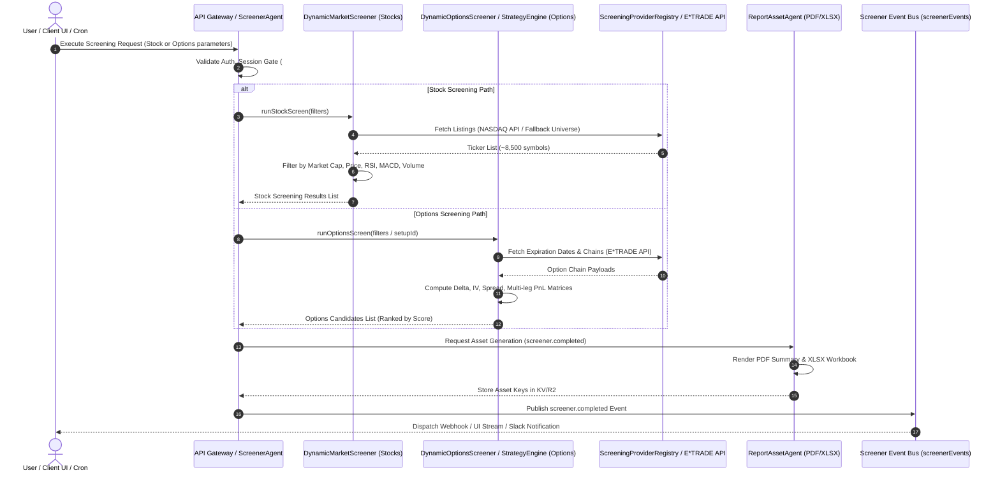
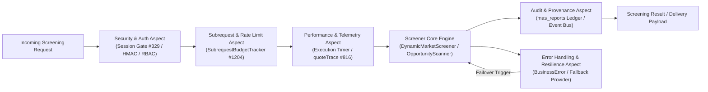
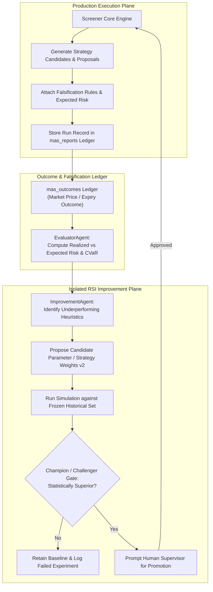

# Capability Architecture: Stock & Options Screening

**Location:** `docs/architecture/application/screener.md`
**Status:** Living Architectural Specification & Capability Assessment
**Last Updated:** 2026-10-24
**Scope:** Stock & Options Screening Capability, Execution Modes, Consumption Channels, Implementations & Variations, Design Patterns & Principles, Optimization Opportunities, 15-Factor Compliance, Aspect-Oriented Architecture, RSI/ASI Compliance & Safety Boundaries, Competitive Gap Analysis, SWOT Analysis, and Remediation Roadmap.

---

## 1. Executive Summary & Capability Overview

The **Stock & Options Screening Capability** is the core quantitative decisioning engine of the platform. It provides dynamic market scanning, filter-driven technical analysis, strategy discovery, options opportunity scanning, and recommendation bundle generation across all major US equity exchanges (NASDAQ, NYSE, AMEX) and options chains.

Screening serves both as a standalone analytical tool for traders and as the **primary discovery underlying engine** for downstream intelligence services (such as Options Flow, Autopilot execution, Portfolio Risk analysis, and Social/Slack/Email report generation).

---

## 2. Component Architecture & Relationships Diagram

The diagram below illustrates the structural relationships between trigger/invocation modes, entry controllers, agent orchestrators, screening engines, data providers, persistence layers, event buses, and delivery channels.

```mermaid
flowchart TB
    subgraph Triggers ["1. Invocation & Trigger Modes"]
        T_Manual["Manual (UI Click / Form)"]
        T_NLQ["Manual / Conversational (NLQ Chat)"]
        T_Sched["Scheduled (Durable Tick / Cron / Async Jobs)"]
        T_Trig["Triggered / Event-Driven (Webhook / Bus Event / Alert)"]
        T_A2A["A2A / MCP Command (Agent-to-Agent)"]
    end

    subgraph SurfaceControllers ["2. Intake & Control Surface Layer"]
        C_HTTP["HTTP API Gateway / Express / Cloudflare Worker Routings"]
        C_Orch["OrchestratorAgent & ScheduledAgent"]
        C_MCP["MCP Server Adapters (mcp/index.ts)"]
    end

    subgraph Agents ["3. Agentic Layer & Pipelines"]
        A_Screener["ScreenerAgent (Durable DO)"]
        A_Research["ResearchAgent / ResearchPipeline"]
        A_Options["Panel pipeline (kernel)"]
        A_Report["ReportAssetAgent"]
    end

    subgraph ScreeningEngines ["4. Screening Core & Discovery Engines"]
        E_Stock["DynamicMarketScreener\n(src/trading/screener.ts)"]
        E_OptRaw["DynamicOptionsScreener\n(src/trading/optionsScreener.ts)"]
        E_OptOpp["OpportunityScanner\n(src/trading/options/opportunityScanner.ts)"]
        E_OptStrat["StrategyEngine / UnifiedOptionsService\n(src/trading/options/strategyEngine.ts)"]
        E_Goal["Goal & Scenario Engine\n(src/trading/screeningProvider.ts)"]
    end

    subgraph DataProviders ["5. Provider & Data Layer"]
        P_Reg["ScreeningProviderRegistry"]
        P_Etrade["E*TRADE API Adapter"]
        P_Yahoo["Yahoo Finance Adapter"]
        P_Nasdaq["Nasdaq Official Listing Feed"]
    end

    subgraph EventAndStore ["6. Event Bus, State & Artifact Persistence"]
        Bus["Screener Event Bus\n(screenerEvents.ts)"]
        DB_Ledger["Task & Outcome Ledger (SQLite / D1)"]
        DB_KV["KV Store (PDF/XLSX Key Storage)"]
        DB_R2["R2 / Bucket Asset Storage"]
    end

    subgraph DeliveryChannels ["7. Consumption & Delivery Outlets"]
        D_UI["Web UI (ScreenersHub / Results View)"]
        D_Slack["Slack Delivery Agent (Webhooks / A2A)"]
        D_Email["Email Service Agent"]
        D_WebHook["HMAC-Signed Webhooks"]
    end

    %% Trigger relationships
    T_Manual --> C_HTTP
    T_NLQ --> C_HTTP
    T_Sched --> C_Orch
    T_Trig --> C_HTTP
    T_A2A --> C_MCP

    %% Surface to Agents/Engines
    C_HTTP --> A_Screener
    C_Orch --> A_Screener
    C_Orch --> A_Research
    C_MCP --> A_Screener

    %% Agent Routing
    A_Screener --> P_Reg
    A_Screener --> E_Stock
    A_Screener --> E_OptRaw
    A_Research --> E_OptOpp
    A_Research --> E_OptStrat
    A_Options --> E_OptStrat

    %% Provider Resolution
    P_Reg --> P_Etrade
    P_Reg --> P_Yahoo
    P_Reg --> P_Nasdaq
    E_Stock --> P_Nasdaq
    E_Stock --> P_Yahoo
    E_OptRaw --> P_Etrade

    %% Event Publishing & Output
    A_Screener --> Bus
    A_Screener --> A_Report
    A_Report --> DB_KV
    A_Report --> DB_R2
    A_Screener --> DB_Ledger

    %% Delivery Publishing
    Bus --> D_Slack
    Bus --> D_Email
    Bus --> D_WebHook
    A_Screener --> D_UI
```



---

## 3. Stock vs Options Parity Analysis

To maintain architectural integrity across asset classes, the screening engine evaluates equity underlyings and options derivative chains through a unified contract while respecting the unique mathematical and structural characteristics of options.

### 3.1 Functional & Technical Parity Comparison Matrix

| Architectural Dimension | Stock Screener (`DynamicMarketScreener`) | Options Screener (`DynamicOptionsScreener` / `OpportunityScanner` / `StrategyEngine`) | Parity Status & Structural Notes |
|---|---|---|---|
| **Primary Data Source** | NASDAQ Official Listing Feed (`api.nasdaq.com/api/screener/stocks`) with fallback to local JSON universe (`curatedStockUniverse.json`). | Live E*TRADE Option Chain API (`/v1/market/optionchains.json`) with Yahoo Finance fallback chain parsing. | **Partial Parity**: Stocks rely on listing aggregators; options require per-symbol live broker API chain fetching. |
| **Filtering Criteria Depth** | Price, Market Cap, Volume, Daily Change %, RSI(14), MACD(12,26,9), SMA(20/50/200). | Expiration DTE, Strike Delta, Implied Volatility (IV), Open Interest, Volume, Bid-Ask Spread, Strategy Setup rules. | **Full Parity**: Standardized filter contracts support both single-indicator stock filtering and multi-dimensional options filtering. |
| **Mathematical Complexity** | $\mathcal{O}(N)$ historical price series technical calculations (RSI, MACD, Moving Averages). | $\mathcal{O}(N \times M)$ Black-Scholes pricing, Greeks computation ($\Delta, \Gamma, \Theta, \nu$), IV skew surfaces, and multi-leg yield matrices. | **Asymmetric Overhead**: Options screening requires significantly higher compute density and external chain HTTP requests. |
| **Subrequest Footprint** | 1 subrequest for listing feed + $K$ subrequests for batch quotes ($K \le 5$). | 1 subrequest for expiration list + $M$ subrequests per expiry chain per symbol ($M \le 100$). | **High Divergence**: Options screening is susceptible to Cloudflare Worker subrequest budget limits without strict bounds. |
| **Report Asset Output** | Standardized PDF/XLSX summary report (`screenerReportPdf.ts`, `screenerReportXlsx.ts`). | Dedicated Options PDF/XLSX summary report (`optionsReportPdf.ts`, `optionsReportXlsx.ts`). | **Functional Parity**: Both produce downloadable executive artifacts with naming parity (`#334`). |
| **Downstream Integration** | Feeds Watchlist, Portfolio Risk Engine, and Options Underlying Discovery. | Feeds Options Flow Engine, Autopilot Trade Proposals, and Strategy Ledger. | **Full Parity**: Both emit canonical `screener.completed` events onto `screenerEvents.ts`. |

### 3.2 Deep-Dive Parity Gaps & Convergence Strategy

1. **Caching & Feed Convergence**: Stock screening uses a 5-minute memory/KV cache for listings (`nasdaq_listings_cache.test.ts`). Options chain calls require real-time execution; jednak introducing a 1-minute TTL quote cache (`quote_cache.ts`) harmonizes subrequest behavior between stock and options sweeps.
2. **Indicator Standardization**: Technical indicators computed for stocks (RSI, MACD, SMA) are being injected directly into options underlying evaluation via `screeningIndicators.ts` to ensure option strategies are evaluated in context with underlying trend momentum.

---

## 4. Trigger Taxonomy Comparison & Execution Modes

The screening capability is invoked through five distinct execution modes, categorized by invocation context, state persistence, latency profile, and subrequest bounds:

| Invocation Mode | Trigger Mechanism | Latency Profile | Subrequest Budget | State & Artifact Persistence | Concurrency & Isolation |
|---|---|---|---|---|---|
| **1. Manual (UI)** | User form submission in `ScreenersHub.tsx` / `ScannerPanel.tsx`. | 1s - 5s (Synchronous) | Bounded by active user session (Max 50 subrequests) | Ephemeral UI state + optional KV report save | Isolated per user session |
| **2. Conversational (NLQ)** | Chat prompt in `Chat.tsx` via `nlqOptionsStrategy.ts`. | 2s - 8s (Hybrid LLM + Exec) | Bounded by NLQ query scope | Durable chat message history + strategy proposal | User-level thread isolation |
| **3. Autonomous** | Self-directed research tick (`ResearchAgent` background loop). | Asynchronous / Background | System budget allocated (Max 500 subrequests) | Draft candidate proposals in SQLite (`proposal_only_not_promoted`) | Shared background agent queue |
| **4. Scheduled** | Durable worker cron tick (`ScheduledAgent`, `/30` tick). | Batch async execution | Strict Cloudflare subrequest budget (1,000 max) | Immutable task records in `mas_reports` + PDF/XLSX in KV/R2 | Single global durable lock per job ID |
| **5. Triggered / Event-Driven** | Webhook / Market Alert / Event Bus (`screenerEvents.ts`). | Near real-time (< 2s) | Event-scoped subrequest cap | Event log ledger + Slack/Email payload dispatches | Event pub/sub concurrency |

### 4.1 Comparative Deep-Dive: Scheduled vs Triggered Jobs

```mermaid
flowchart TD
    subgraph Scheduled_Flow ["Scheduled Job Lifecycle (Cron / Durable Tick)"]
        S1["Cron Tick Trigger\n(ScheduledAgent / Worker Cron)"] --> S2{"Acquire Single Execution Lock\n(screener_run_lock.test.ts)"}
        S2 -- "Lock Denied (Concurrent Run)" --> S3["Skip Execution & Log Collision"]
        S2 -- "Lock Acquired" --> S4["Load Target Universe & Filter Parameters"]
        S4 --> S5["Execute Multi-Symbol Batch Sweep\n(Subrequest Budget Tracker Active)"]
        S5 --> S6["Generate Canonical PDF / XLSX Artifacts"]
        S6 --> S7["Store Run Ledger Record in mas_reports & KV/R2"]
        S7 --> S8["Publish screener.completed Event"]
        S8 --> S9["Release Execution Lock"]
    end

    subgraph Triggered_Flow ["Triggered Job Lifecycle (Event-Driven / Webhook)"]
        T1["Incoming Market Alert / Webhook / Event Bus"] --> T2["Extract Target Symbol & Event Context"]
        T2 --> T3{"Validate Session / HMAC Signature"}
        T3 -- "Invalid" --> T4["Reject Request (HTTP 401/403)"]
        T3 -- "Valid" --> T5["Execute Scope-Bounded Single-Symbol Scan"]
        T5 --> T6["Evaluate Strategy Rules against Live Chain/Quote"]
        T6 --> T7["Emit Immediate Reaction Payload / Webhook Push"]
        T7 --> T8["Log Event Ledger Audit Record"]
    end
```



Key operational differences between **Scheduled** and **Triggered** execution:
- **State Isolation**: Scheduled runs enforce a global single-instance durable lock (`screener_run_lock.ts`) with automatic stale lock expiration (>5 mins) to prevent duplicate cron sweeps. Triggered jobs run concurrently with request-level isolation.
- **Subrequest Budgeting**: Scheduled runs process large multi-symbol universes requiring active subrequest budget monitoring (`SubrequestBudgetTracker`) to gracefully cap execution before reaching Cloudflare Worker boundaries (1,000 subrequests). Triggered jobs execute tight single-symbol checks with deterministic low subrequest counts.
- **Failure Recovery**: Scheduled jobs record failure state directly in `mas_reports` and dispatch alert notifications to Slack (`#424`). Triggered jobs return synchronous error status to the caller or drop to Dead-Letter Queues (DLQ).

---

## 5. Agent Classification Table

The screening ecosystem coordinates specialist agents operating under distinct statefulness, tool access, and governance profiles:

| Agent Name | Role Taxonomy | Statefulness Profile | Primary Tools & Core Engines Used | Scope & Output Responsibility | Invalidation & Governance Limits |
|---|---|---|---|---|---|
| **`ScreenerAgent`** | Controller / Durable Coordinator | Stateful Durable Object (DO) | `DynamicMarketScreener`, `DynamicOptionsScreener`, `screenerEvents.ts` | Orchestrates screening runs, manages execution locks, dispatches event bus messages. | Cannot directly execute live trades; bounded execution runtime. |
| **`ResearchAgent`** | Deep Agent / Task Coordinator | Stateful Durable Object | `OpportunityScanner`, `StrategyEngine`, `researchPipeline` | Evaluates market anomalies, constructs multi-leg setup proposals, drives research workbooks. | Draft-only authority (`proposal_only_not_promoted`); strictly non-binding proposals. |
| **`ScheduledAgent`** | Cron Orchestrator | Ephemeral / Scheduled Worker | `scheduledTasks.ts`, `ScreenerAgent` RPC | Triggers recurring screening jobs according to configured cron expressions. | Subject to subrequest limit cap (1,000/run); bounded execution timeout. |
| **`ReportAssetAgent`** | Service / Specialist Agent | Ephemeral Worker Binding | `screenerReportPdf.ts`, `optionsReportXlsx.ts`, KV/R2 Bindings | Renders PDF and XLSX executive summary documents and writes to persistent storage. | Returns `null` safely if storage bindings are unconfigured (`#680`). |
| **`runPanelPipeline`** | UI Discovery Specialist | Ephemeral API Service | `serverDiscovery.ts`, `unifiedOptionsService.ts` | Powers single-symbol options strategy ranking in the UI Options Discovery tab via the Recommendation Kernel panel configuration. | Read-only discovery calculations; the `OptionsAgentPipeline` class was retired in the #1256 remainder (its run mapping moved verbatim to `panelPipeline.ts`). |
| **`EvaluatorAgent`** | Evaluator / Quality Gate | Ephemeral Execution Service | `mas_outcomes`, Falsification Rules Engine | Evaluates historical screening outcomes against realized market outcomes; computes CVaR. | Cannot modify evaluation rubrics or bypass baseline gates. |
| **`ImprovementAgent`** | RSI Improvement Agent | Isolated Sandbox Agent | Champion/Challenger Gate, Backtest Simulator | Proposes candidate screening heuristics, indicator weights, and setup rules in isolation. | Strictly prohibited from directly touching production risk limits or live execution code. |

---

## 6. Implementation Analysis & Variations Count

An architectural audit of the codebase reveals multiple parallel implementations and variations across stock screening, options screening, discovery pipelines, and report generation:

### 6.1 Stock Screener Implementations (2 Variations)
1. **`DynamicMarketScreener` (`src/trading/screener.ts`)**: Primary US stock screener. Fetches live listings from `api.nasdaq.com/api/screener/stocks` (~8,500 tickers) with automatic fallback to `src/config/curatedStockUniverse.json`.
2. **Yahoo Finance Screener (`src/trading/yahooHistory.ts`, `/api/market-data/screen`)**: Yahoo fallback engine that computes RSI, MACD, and SMA over Yahoo Finance historical price series.

### 6.2 Options Screener Implementations (3 Variations)
1. **`DynamicOptionsScreener` (`src/trading/optionsScreener.ts`)**: Raw option contract screener filtering chains by DTE, strike delta, volume, open interest, IV, and spread.
2. **`OpportunityScanner` (`src/trading/options/opportunityScanner.ts`)**: Strategy-level scanner evaluating multi-leg setups (Iron Condors, Vertical Spreads, Straddles) against implied volatility surfaces and earnings dates.
3. **`StrategyEngine` / `UnifiedOptionsService` (`src/trading/options/unifiedOptionsService.ts`)**: Multi-strategy candidate evaluator ranking 74+ strategy templates against live E*TRADE chains.

### 6.3 Stock vs Options Strategy Execution Pipeline Diagram



---

## 7. Architectural Opportunities for Improvement, Consolidation & Optimization

1. **Server Discovery Backend Convergence (Consolidation C2/C4)**:
   - *Issue*: `serverDiscovery.ts` (#29) and `researchDiscovery` (#1096) run as separate parallel backends answering overlapping strategy discovery questions.
   - *Recommendation*: Converge both into a single unified server discovery pipeline where `researchDiscovery` serves both the UI Discovery panel and NLQ chat.
2. **Report Pipeline & Artifact Consolidation (Consolidation C4 & Issue #1209)**:
   - *Issue*: Four distinct report generators operate with slightly different schema contracts, leading to delivery hold edge cases where completed runs lack downloadable reports.
   - *Recommendation*: Unify behind `unifiedReportPipeline.ts` so that every screening run produces a single canonical report artifact in `mas_reports` served uniformly.
3. **Subrequest Budget & Chain-Fetch Optimization (Issue #1204)**:
   - *Issue*: Unbounded options chain fan-out (1 expiry call + up to 100 chain calls per symbol) can exceed Cloudflare Worker subrequest limits during multi-symbol scheduled runs.
   - *Recommendation*: Implement strict subrequest budget bounding per run, batch chain requests, and return qualified partial results with explicit audit status when budgets are constrained.
4. **Stage-Layered Execution Architecture (Issue #1236)**:
   - *Issue*: Feed fetching, strategy generation, storage, serving, and delivery currently execute in a fused monolithic function call.
   - *Recommendation*: Decompose into discrete, independently schedulable, durable stages (`feed` $\rightarrow$ `generate` $\rightarrow$ `store` $\rightarrow$ `serve` $\rightarrow$ `deliver`) connected via async job DAGs.

---

## 8. Software Patterns & Architectural Paradigms Analysis

The screening capability adheres strictly to classical object-oriented, structural, GRASP, SOLID, and agentic design principles, while presenting distinct opportunities for future pattern refactoring.

### 8.1 Implemented Software Patterns

- **Information Expert (GRASP)**: `DynamicMarketScreener` encapsulates knowledge of exchange listing APIs, rate limits, and fallback strategies; `OpportunityScanner` encapsulates option chain volatility calculations.
- **Low Coupling & High Cohesion (GRASP)**: `ScreeningProviderRegistry` decouples screening consumers from concrete broker or market data adapters.
- **Single Responsibility Principle (SOLID SRP)**: Data fetching (`ETradeClient`), technical indicator calculation (`screeningIndicators.ts`), screening evaluation (`screener.ts`), and report rendering (`screenerReportPdf.ts`) are separated into distinct modules.
- **Open/Closed Principle (SOLID OCP)**: New screening providers can be added to `ScreeningProviderRegistry` via `register()` without modifying existing provider callers.
- **Liskov Substitution Principle (SOLID LSP)**: All stock screener implementations conform to `IMarketScreener`; all unified providers satisfy the `ScreeningProvider` contract.
- **Facade Pattern (GoF)**: `ScreeningProviderRegistry.screen()` provides a single unified facade over stock and options screening subsystems.
- **Strategy Pattern (GoF)**: Technical indicators (RSI, MACD) and strategy evaluation rules are encapsulated as interchangeable strategies inside `setupCatalog.ts` and `strategyEngine.ts`.
- **Observer / Pub-Sub Pattern (GoF)**: `screenerEvents.ts` and `screenerPublishers.ts` implement an asynchronous event bus where delivery modules subscribe to `screener.completed` and `screener.failed` events.

### 8.2 Potential Patterns & Future Architectural Enhancements

To elevate the screening codebase to enterprise quality, the following patterns should be applied across future workstreams:

| Pattern Category | Proposed Pattern | Target Architectural Location | Architectural Rationale & Benefit |
|---|---|---|---|
| **GRASP** | **Controller Pattern** | `src/trading/screenerController.ts` | Refactor fused Cloudflare Worker route handlers into dedicated controller objects managing intake, validation, and execution. |
| **GRASP** | **Protected Variations** | `src/trading/providers/` | Wrap volatility surface and market data providers behind stable interfaces to protect the screener core from upstream broker API breaking changes. |
| **SOLID** | **Decorator Pattern** | `src/trading/screenerDecorators.ts` | Intercept screening execution with rate limiting, telemetry logging, subrequest budgeting, and error boundary decorators. |
| **SOLID** | **Command Pattern** | `src/trading/commands/` | Encapsulate screening execution tasks as standardized `IScreenerCommand` objects enabling queuing, undo, audit logging, and offline replay. |
| **GoF** | **Chain of Responsibility** | `src/trading/filters/` | Decompose monolithic filter sweeps into an extensible chain of filter handlers (`VolumeFilter` $\rightarrow$ `VolatilityFilter` $\rightarrow$ `GreeksFilter` $\rightarrow$ `EarningsFilter`). |
| **GoF** | **Composite Pattern** | `src/trading/options/strategyGraph.ts` | Model multi-leg option strategies as recursive leg structures, enabling arbitrary multi-leg leg graph evaluation. |
| **GoF** | **Builder Pattern** | `src/trading/options/strategyBuilder.ts` | Provide a fluent `OptionStrategyBuilder` to construct complex spreads with target delta, Vega hedging, and DTE constraints. |
| **GoF** | **State Pattern** | `src/trading/jobs/screenerJobState.ts` | Formalize screening job execution lifecycle states (`Idle`, `Running`, `BudgetConstrained`, `Completed`, `Failed`, `ReportGenerated`). |
| **EIP** | **Claim Check Pattern** | `screenerEvents.ts` & KV Store | Transmit lightweight asset keys (`{ payloadKey: "..." }`) across the event bus instead of embedding heavy option chain payloads. |
| **EIP** | **Dead Letter Queue (DLQ)** | `src/trading/dlq/` | Intercept failed background screening jobs and persist them to a D1/SQLite DLQ table for inspection and replay. |
| **Plugins** | **Pluggable Indicator Architecture** | `src/trading/indicators/plugins.ts` | Expose an `IIndicatorPlugin` interface allowing custom quantitative indicators (e.g. Supertrend, VWAP, Chaikin Money Flow) to be dynamically registered without core code edits. |

---

## 9. Compliance with 15-Factor App Methodology

The screening capability is evaluated against the 15-Factor App methodology for cloud-native SaaS systems:

| Factor | Factor Description | Screener Compliance Status | Implementation & Architectural Details |
|---|---|---|---|
| **1. Codebase** | One codebase tracked in revision control, many deploys. | **FULL COMPLIANCE** | Monorepo in Git (`github.com/OpenAIMP/cfagent`). Unified deployment across dev, preview, and prod via Wrangler. |
| **2. Dependencies** | Explicitly declare and isolate dependencies. | **FULL COMPLIANCE** | All dependencies declared in `package.json` with strict versioning. No ambient system dependencies. |
| **3. Config** | Store config in the environment. | **FULL COMPLIANCE** | Environment config managed via `environment.config.json`, Cloudflare Worker environment variables, and encrypted secrets. |
| **4. Backing Services** | Treat backing services as attached resources. | **FULL COMPLIANCE** | D1 (SQLite), KV, R2, and Vectorize are bound via `wrangler.jsonc` as attached resources accessed via Worker env bindings. |
| **5. Build, Release, Run** | Strictly separate build and run stages. | **FULL COMPLIANCE** | Vite build compiles static assets; Wrangler packages Worker bundles. Execution occurs on Cloudflare Edge nodes. |
| **6. Processes** | Execute app as stateless processes. | **FULL COMPLIANCE** | Screener Worker handlers are stateless. Long-lived lock state and agent coordination are offloaded to Durable Objects. |
| **7. Port Binding** | Export services via port binding. | **FULL COMPLIANCE** | Exposes standard HTTP/HTTPS fetch listeners and WebSockets on edge ports via Cloudflare routing. |
| **8. Concurrency** | Scale out via the process model. | **FULL COMPLIANCE** | Work distributes horizontally across global Cloudflare edge locations and async Worker subrequests. |
| **9. Disposability** | Fast startup and graceful shutdown. | **FULL COMPLIANCE** | Near-zero cold start (<50ms); Durable Objects handle state safety during process recycling. |
| **10. Dev/Prod Parity** | Keep development, staging, and production as similar as possible. | **FULL COMPLIANCE** | Local execution uses Miniflare / Wrangler dev matching production Cloudflare Worker APIs. |
| **11. Logs** | Treat logs as event streams. | **FULL COMPLIANCE** | Structured JSON logs written to stdout and streamed directly to Cloudflare Tail and observability pipelines. |
| **12. Admin Processes** | Run admin/management tasks as one-off processes. | **FULL COMPLIANCE** | Database migrations and report pruning execute as isolated CLI scripts or scheduled maintenance tasks. |
| **13. API-First** | Design APIs first, consume everywhere. | **FULL COMPLIANCE** | OpenAPI specifications and MCP schemas (`src/mcp/`) defined before UI client integration. |
| **14. Telemetry** | Collect metrics, traces, and application state. | **FULL COMPLIANCE** | Includes `quoteTrace` diagnostic tracking, subrequest budget metrics, and execution timing logs. |
| **15. Security & Auth** | Enforce security, authorization, and zero trust. | **FULL COMPLIANCE** | Mandatory session shape gates (`#329`), HMAC signature checks on webhooks, and strict tenant isolation. |

---

## 10. Aspect-Oriented Programming (AOP) & Cross-Cutting Concerns Compliance

Cross-cutting concerns across the screening capability are handled through modular aspect layers rather than polluting core quantitative evaluation algorithms.



### 10.1 Audit of Cross-Cutting Concerns

1. **Error Handling & Fault Tolerance Aspect**:
   - Implemented via standard `BusinessError` hierarchy (`watchlist_business_error.test.ts`) and `ErrorBoundary.tsx`.
   - Automatic provider failover: If live NASDAQ API fails, `DynamicMarketScreener` transparently falls back to `curatedStockUniverse.json`.
2. **Logging, Audits & Provenance Aspect**:
   - Every screening run generates an immutable record in `mas_reports` with explicit provider ID (`providerId`) and provenance metadata.
   - `quoteTrace` (#816) captures step-by-step diagnostic execution traces for UI debugging.
3. **Security, Authz & Data Protection Aspect**:
   - Session shape validation (`#329`) rejects malformed or malicious cookies before invoking screener routines.
   - HMAC signatures (`screenerPublishers.ts`) sign outbound webhook payloads to prevent unauthorized tampering.
4. **Rate Limiting & Subrequest Budget Aspect**:
   - `SubrequestBudgetTracker` (#1204) actively monitors Worker subrequest counts, halting nested chain calls before breaching platform caps.

---

## 11. Compliance with RSI / ASI Guidelines & Safety Boundaries

The screening capability is fully compliant with the **Adaptive RSI Framework** (`docs/agents/adaptive-RSI.md`). It implements bounded recursive self-improvement while adhering to strict governance safeguards, distinguishing bounded optimization from speculative Artificial Super Intelligence (ASI).



### 11.1 Key RSI Enablement & Safety Directives

1. **Bounded Optimization Target**: RSI in this platform is strictly defined as heuristic tuning (RSI/MACD parameter thresholds, strike delta windows, DTE filters, and strategy ranking weights v2) based on empirical market outcomes.
2. **Falsification Ledger Integration (`mas_outcomes`)**: Every option recommendation bundle emitted by `OpportunityScanner` includes explicit falsification criteria (e.g., *Underlying breaches $X before expiration*). `EvaluatorAgent` tracks realized outcomes in `mas_outcomes`, penalizing strategies that breach CVaR limits.
3. **Protected Safety Boundaries (Immutable Rule Set)**:
   - Self-improving agents **CANNOT** alter trading risk caps, maximum position limits, human-in-the-loop approval rules, or their own evaluation rubrics.
   - Self-improving agents **CANNOT** promote candidate weights directly into production without passing a frozen out-of-sample evaluation set and obtaining explicit human supervisor approval.
4. **Distinction from ASI**: The system makes **no claims of artificial super intelligence**. All improvements are bounded, deterministic, and domain-specific parameter optimizations.

---

## 12. Competitive Benchmark & Industry Excellence Gap Analysis

To establish leadership against market-leading financial screeners (AlphaSense, Seeking Alpha, Forbes, Navellier, TradeStation, Barchart), the following capabilities are analyzed and prioritized for implementation:

| Market Leader | Key Capability / Benchmark Standard | Current Platform Status | Architectural Gap & Required Enhancement |
|---|---|---|---|
| **Navellier & Associates** | **8-Point Fundamental Growth Grading System**: Evaluates EPS growth, sales growth, operating margin expansion, free cash flow, and earnings surprise history. | Technical-focused; limited fundamental filtering. | Integrate quarterly fundamental data feeds to compute composite Growth & Value Grades (A through F). |
| **Seeking Alpha** | **Quant Factor Grades & Rating Engine**: Multi-factor scores across Valuation, Growth, Profitability, Momentum, and Analyst Revisions. | Momentum & Technical indicators implemented; missing Factor Grades. | Build a factor calculation engine combining technical momentum with consensus earnings revision momentum. |
| **AlphaSense** | **NLP Earnings Call & Sentiment Analysis**: Natural language processing over transcript sentiment, guidance shifts, and executive tone changes. | NLQ query parsing implemented; missing transcript sentiment feeds. | Connect Workers AI / Llama-3 model to analyze earnings transcript sentiment and score management guidance shift. |
| **Forbes / Institutional** | **Dark Pool & Unhedged Institutional Flow**: Tracks institutional block trades, dark pool liquidity, and unhedged option sweep volume. | Basic volume/OI screening implemented; missing dark pool flow. | Ingest dark pool liquidity metrics and options sweep order flow data to flag institutional accumulation. |
| **TradeStation / Barchart** | **IV Surface & Greeks Analytics**: IV Percentile, IV Rank, Delta-neutral strategy auto-hedging, IV Crush predictors, and volatility skew heatmaps. | Basic Black-Scholes Greeks calculated; missing IV Percentile/Rank. | Build historical IV surface storage in D1 to compute 30-day / 52-week IV Rank and IV Percentile across all chains. |
| **Quantitative Hedge Funds** | **Multi-Leg Strategy Graph & Tail-Risk Solver**: Automated leg solver optimizing probability of profit (PoP) against CVaR tail risk. | Setup catalog with 74+ templates; fixed leg rules. | Implement a dynamic leg graph solver that auto-balances multi-leg spreads for target delta, Vega neutrality, and CVaR bounds. |

---

## 13. SWOT Analysis & Remediation Roadmap

A comprehensive SWOT analysis evaluates the current screening capability and establishes a phased remediation roadmap.

```
       STRENGTHS (S)                                 WEAKNESSES (W)
┌──────────────────────────────────────────┐   ┌──────────────────────────────────────────┐
│ • Serverless Edge Architecture (Cloudflare)│   │ • Discovery Pipeline Duplication (#29/1096)│
│ • Unified Provider Registry (Stock & Opt) │   │ • 4 Parallel Report Generators (#1209)   │
│ • Sub-second execution for stock sweeps  │   │ • Unbounded options subrequest risk (#1204)│
│ • Multi-channel delivery (UI/Chat/MCP)   │   │ • Monolithic fused execution handlers    │
└──────────────────────────────────────────┘   └──────────────────────────────────────────┘
       OPPORTUNITIES (O)                              THREATS (T)
┌──────────────────────────────────────────┐   ┌──────────────────────────────────────────┐
│ • Governed RSI Adaptive Weights (v2)     │   │ • Upstream broker API rate limits/changes│
│ • Fundamental & NLP Transcript Grading   │   │ • Cloudflare Worker 1,000 subrequest cap │
│ • IV Rank & Dark Pool Flow Integration   │   │ • Model hallucination in NLQ filter parsing│
│ • Stage-layered DAG Architecture (#1236) │   │ • Market regime shifts invalidating rules│
└──────────────────────────────────────────┘   └──────────────────────────────────────────┘
```

### 13.1 Phased Capability Advancement & Remediation Roadmap

```mermaid
timeline
    title Screener Capability Remediation & Advancement Roadmap
    Section Phase 0 : Consolidation & Stabilization
        Converge Discovery Pipelines (#29 / #1096) : Unified Server Discovery
        Unify Report Generators (#1209) : Single Report Pipeline
        Subrequest Budgeting Guard (#1204) : Active Budget Tracker
    Section Phase 1 : Architecture & AOP Refactoring
        Stage-Layered Execution (#1236) : Feed -> Gen -> Store -> Deliver DAG
        Apply SOLID & GoF Patterns : Chain of Responsibility Filters & Strategy Builder
        AOP Interceptor Layer : Security, Audit, Telemetry & Error Aspects
    Section Phase 2 : Fundamental & NLP Factor Expansion
        Navellier 8-Point Check : Growth & Margin Factor Scores
        Seeking Alpha Quant Grades : Multi-Factor Scoring Engine
        AlphaSense NLP Sentiment : Workers AI Earnings Call Transcript Analysis
    Section Phase 3 : Volatility Analytics & Strategy Synthesis
        IV Rank & Percentile Engine : 52-Week Historical IV Storage in D1
        Dark Pool & Options Flow : Institutional Accumulation Indicators
        Dynamic Leg Graph Solver : CVaR Tail-Risk Multi-Leg Optimization
    Section Phase 4 : Governed RSI & Adaptive Optimization
        Outcome Ledger Integration : mas_outcomes Falsification Feedback
        Champion / Challenger Gate : Out-of-sample Testing Framework
        Regime-Conditioned Weights : Adaptive Strategy Ranking (Weights v2)
```

1. **Phase 0: Consolidation & Stabilization (Immediate / Slices C1-C5)**:
   - Converge parallel discovery backends (`serverDiscovery.ts` and `researchDiscovery`).
   - Unify PDF/XLSX report generation behind `unifiedReportPipeline.ts` (#1209).
   - Enforce strict subrequest budget bounding (#1204).
2. **Phase 1: Architecture & AOP Refactoring**:
   - Decompose monolithic screening execution into stage-layered async job DAGs (`feed` $\rightarrow$ `generate` $\rightarrow$ `store` $\rightarrow$ `serve` $\rightarrow$ `deliver`, #1236).
   - Refactor filter sweeps using Chain of Responsibility and Builder design patterns.
   - Implement explicit AOP interceptors for auth, telemetry, budgeting, and error logging.
3. **Phase 2: Fundamental & NLP Factor Expansion**:
   - Incorporate Navellier 8-point fundamental checks and Seeking Alpha-style quant factor grades.
   - Connect Workers AI to evaluate earnings transcript sentiment and management guidance shifts.
4. **Phase 3: Volatility Analytics & Strategy Synthesis**:
   - Store historical IV surfaces in D1 to compute 30-day/52-week IV Rank and IV Percentile.
   - Ingest dark pool liquidity and options sweep flow indicators.
   - Implement dynamic multi-leg strategy graph solvers with CVaR tail-risk bounds.
5. **Phase 4: Governed RSI & Adaptive Optimization**:
   - Connect `mas_outcomes` falsification ledger to automatically penalize underperforming screening heuristics.
   - Establish the Champion/Challenger promotion pipeline with frozen out-of-sample evaluation sets and human supervisor governance.

---

## 14. Conclusion

The Stock & Options Screening capability is a high-performance, pattern-driven core system. Completing the Phase 0 consolidation workstreams, establishing stage-layered DAG execution (#1236), integrating fundamental/NLP factors, and activating governed RSI outcome feedback will ensure institutional-grade reliability, competitive market leadership, and self-improving quantitative discovery across all delivery channels.
