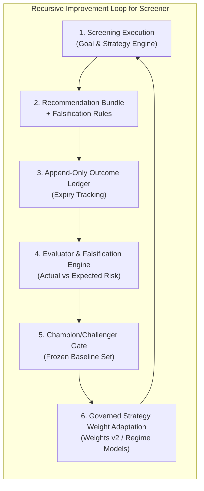

# Capability Architecture: Stock & Options Screening

**Location:** `docs/architecture/application/screening.md`
**Status:** Living Architectural Specification & Capability Assessment
**Last Updated:** 2026-10-24
**Scope:** Stock & Options Screening Capability, Execution Modes, Consumption Channels, Implementations & Variations, Scope Boundaries (Questions Answered vs. Not Answered), Design Patterns & Principles, Optimization Opportunities, and RSI (Recursive Self-Improvement) Enablement.

---

## 1. Executive Summary & Capability Overview

The **Stock & Options Screening Capability** is the core quantitative decisioning engine of the platform. It provides dynamic market scanning, filter-driven technical analysis, strategy discovery, options opportunity scanning, and recommendation bundle generation across all major US equity exchanges (NASDAQ, NYSE, AMEX) and options chains.

Screening serves both as a standalone analytical tool for traders and as the **primary discovery underlying engine** for downstream intelligence services (such as Options Flow, Autopilot execution, Portfolio Risk analysis, and Social/Slack/Email report generation).

---

## 2. Scope Boundaries: Questions Answered vs. Not Answered

To establish clear operational expectations and safety posture, the screening capability explicitly delineates the questions it is designed to answer from those outside its scope.

### 2.1 Questions the Screening Capability ANSWERS

1. **Which US Equities Meet Specific Technical or Fundamental Filter Criteria?**
   - Filters active US stocks (~8,500 listings across NASDAQ/NYSE/AMEX) by market cap, share price floor ($3.00+ default to prevent penny/OTC slippage), 14-day daily RSI, MACD momentum indicators, exchange, and daily gainers/losers.
2. **Which Option Chains Offer Favorable Implied Volatility and Greek Profiles?**
   - Scans raw options chains for target DTE windows (e.g. 30-45 DTE), strike deltas (e.g. 0.15 - 0.30 delta), minimum volume/open interest, maximum bid-ask spread constraints, and Implied Volatility (IV) percentile/rank.
3. **Which Multi-Leg Option Strategies Best Fit a Given Symbol and Market Thesis/Goal?**
   - Ranks 74+ strategy templates (e.g., Bull Put Spreads, Iron Condors, Covered Calls, Straddles, Butterflies) or dynamically composes leg-graph structures against live option chains for a selected symbol.
4. **What is the Objective Portfolio Impact and CVaR Risk of a Candidate Trade?**
   - Evaluates recommendation candidate bundles against the user's existing E*TRADE portfolio book, calculating post-trade delta, gamma, theta, vega exposure, Conditional Value at Risk (CVaR) penalties, and ranked alternatives (including an explicit *no-trade* decision).
5. **What Are the Specific Falsification Criteria for a Screening Recommendation?**
   - Pairs every recommended trade with quantifiable falsification conditions (e.g., underlying price threshold breach, IV drop threshold, or max holding period cutoff) to govern trade exit and track-record evaluation.
6. **Which Market Underlyings Currently Exhibit High Volatility or Unusual Options Flow?**
   - Serves as the primary underlying discovery engine for Options Flow and Autopilot execution, identifying dynamic market underlyings partitioned by market cap rather than relying on static ticker lists.

### 2.2 Questions the Screening Capability DOES NOT ANSWER (Explicit Exclusions)

1. **Does This Screen Guarantee Future Price Appreciation or Profitability?**
   - *No.* Screening identifies historical patterns, probabilistic setups, and risk-reward asymmetry; it does **not** predict future market prices or guarantee trade execution outcomes.
2. **How Will the Stock/Option Perform During Unpredictable Macro "Black Swan" Events?**
   - *No.* Screening evaluations rely on quantitative indicators, earnings dates, and option pricing models; they cannot model unannounced geopolitical events, emergency regulatory shifts, or macroeconomic shocks.
3. **Should the System Automatically Execute This Trade Without Human Approval?**
   - *No.* Screening outputs are strictly **draft-only** recommendation bundles. The screening layer does **not** make trade authorization decisions or execute orders without explicit Human-in-the-Loop (HITL) approval in the Web UI.
4. **Which Low-Liquidity OTC, Penny Stock, or Non-US Global Assets Are Hot?**
   - *No.* The stock screener defaults to major US exchange listings (NASDAQ, NYSE, AMEX) with strict price and liquidity filters to prevent illiquid OTC slippage and non-optionable ticker noise.
5. **What Are the Tax, Legal, or Individual Financial Planning Implications of This Trade?**
   - *No.* The screening engine performs quantitative data processing and algorithmic strategy matching; it does not provide tax, legal, or personalized investment advisory services.

---

## 3. Component Architecture & Relationships Diagram

The diagram below illustrates the structural relationships between trigger/invocation modes, entry controllers, agent orchestrators, screening engines, data providers, persistence layers, event buses, and delivery channels.

```mermaid
flowchart TB
    subgraph Triggers ["1. Invocation & Trigger Modes"]
        T_Manual["Manual (UI Click / Form)"]
        T_NLQ["Manual / Conversational (NLQ Chat)"]
        T_Sched["Scheduled (Durable Tick / Cron / Async Jobs)"]
        T_Trig["Triggered / Event-Driven (Webhook / Bus Event / Alert)"]
        T_A2A["A2A / MCP Command (Agent-to-Agent)"]
    end

    subgraph SurfaceControllers ["2. Intake & Control Surface Layer"]
        C_HTTP["HTTP API Gateway / Express / Cloudflare Worker Routings"]
        C_Orch["OrchestratorAgent & ScheduledAgent"]
        C_MCP["MCP Server Adapters (mcp/index.ts)"]
    end

    subgraph Agents ["3. Agentic Layer & Pipelines"]
        A_Screener["ScreenerAgent (Durable DO)"]
        A_Research["ResearchAgent / ResearchPipeline"]
        A_Options["OptionsAgentPipeline"]
        A_Report["ReportAssetAgent"]
    end

    subgraph ScreeningEngines ["4. Screening Core & Discovery Engines"]
        E_Stock["DynamicMarketScreener\n(src/trading/screener.ts)"]
        E_OptRaw["DynamicOptionsScreener\n(src/trading/optionsScreener.ts)"]
        E_OptOpp["OpportunityScanner\n(src/trading/options/opportunityScanner.ts)"]
        E_OptStrat["StrategyEngine / UnifiedOptionsService\n(src/trading/options/strategyEngine.ts)"]
        E_Goal["Goal & Scenario Engine\n(src/trading/screeningProvider.ts)"]
    end

    subgraph DataProviders ["5. Provider & Data Layer"]
        P_Reg["ScreeningProviderRegistry"]
        P_Etrade["E*TRADE API Adapter"]
        P_Yahoo["Yahoo Finance / FOSS Adapter"]
        P_Nasdaq["Nasdaq Official Listing Feed"]
    end

    subgraph EventAndStore ["6. Event Bus, State & Artifact Persistence"]
        Bus["Screener Event Bus\n(screenerEvents.ts)"]
        DB_Ledger["Task & Outcome Ledger (SQLite / D1)"]
        DB_KV["KV Store (PDF/XLSX Key Storage)"]
        DB_R2["R2 / Bucket Asset Storage"]
    end

    subgraph DeliveryChannels ["7. Consumption & Delivery Outlets"]
        D_UI["Web UI (ScreenersHub / Results View)"]
        D_Slack["Slack Delivery Agent (Webhooks / A2A)"]
        D_Email["Email Service Agent"]
        D_WebHook["HMAC-Signed Webhooks"]
    end

    %% Trigger relationships
    T_Manual --> C_HTTP
    T_NLQ --> C_HTTP
    T_Sched --> C_Orch
    T_Trig --> C_HTTP
    T_A2A --> C_MCP

    %% Surface to Agents/Engines
    C_HTTP --> A_Screener
    C_Orch --> A_Screener
    C_Orch --> A_Research
    C_MCP --> A_Screener

    %% Agent Routing
    A_Screener --> P_Reg
    A_Screener --> E_Stock
    A_Screener --> E_OptRaw
    A_Research --> E_OptOpp
    A_Research --> E_OptStrat
    A_Options --> E_OptStrat

    %% Provider Resolution
    P_Reg --> P_Etrade
    P_Reg --> P_Yahoo
    P_Reg --> P_Nasdaq
    E_Stock --> P_Nasdaq
    E_Stock --> P_Yahoo
    E_OptRaw --> P_Etrade

    %% Event Publishing & Output
    A_Screener --> Bus
    A_Screener --> A_Report
    A_Report --> DB_KV
    A_Report --> DB_R2
    A_Screener --> DB_Ledger

    %% Delivery Publishing
    Bus --> D_Slack
    Bus --> D_Email
    Bus --> D_WebHook
    A_Screener --> D_UI
```

---

## 4. Execution Modes & Trigger Taxonomy

The screening capability is invoked through five distinct execution modes:

| Mode | Invocation Mechanism | Characteristics | Typical Latency & Constraints |
|---|---|---|---|
| **1. Manual (Interactive UI)** | Web Hub form submission in `ScreenersHub.tsx` or `ScannerPanel.tsx`. | Synchronous or polling HTTP request (`POST /api/etrade/screen` or `POST /trading/options/screen`). Direct user parameters. | 1s - 5s execution; bounded by client timeout. |
| **2. Conversational / NLQ** | User prompt in Chat window (`Chat.tsx` / `nlqOptionsStrategy.ts`). | Hybrid model-directed interpretation -> deterministic query execution. Extracts ticker, delta, DTE, strategy requirements. | 2s - 8s execution including LLM parsing and schema validation. |
| **3. Autonomous** | Self-directed research tick (`ResearchAgent` / `ScreenerAgent` background loop). | Runs without explicit prompt; evaluates market conditions, identifies anomaly/iv-crush candidates, writes candidate proposals (`proposal_only_not_promoted`). | Asynchronous / background execution. |
| **4. Scheduled** | Durable worker cron tick (`ScheduledAgent`, `/30` tick, `scheduledTasks.ts`). | Batch screening across predefined or curated universes. Generates artifacts (PDF/XLSX reports), persists run records in `mas_reports` / SQLite. | Multi-symbol batch; subject to Cloudflare Worker subrequest limits (1,000 subrequests/run cap). |
| **5. Triggered / Event-Driven** | External Webhook, market alert, or upstream event bus (`screenerEvents.ts`). | Reactionary screening triggered by price threshold breaches, earnings announcements, or strategy state changes. | Event-driven pub/sub; asynchronous delivery. |

---

## 5. How the Capability is Consumed & Used

Screening results and candidate structures are consumed across six primary channels:

1. **Web UI (`ScreenersHub.tsx`, `ScannerPanel.tsx`, `ScreeningResultsView.tsx`)**:
   - Interactive filtering across market cap, price, volume, daily gainers/losers, RSI, MACD, and option IV/Greeks.
   - Live result preview, detailed option chain overlays, downloadable PDF/XLSX reports, and CSV export.
2. **Chat & Conversational Interface (`Chat.tsx`, `AgentChatTabContent.tsx`)**:
   - Natural language queries (e.g., *"Find AAPL bull put spreads with 30-45 DTE and delta < 0.3"*) are converted to structured screening filters and executed against the strategy pipeline.
3. **Agent-to-Agent (A2A) / MCP Endpoints (`src/mcp/etradeCommands.ts`, `src/mcp/index.ts`)**:
   - External or internal autonomous agents query `trading.screen_stocks` or `trading.screen_options` via standard MCP protocols or A2A agent cards (`.well-known/agent-card.json`).
4. **Scheduled Background Reports & Notifications**:
   - Periodic scheduled runs aggregate multi-asset screening outcomes into executive PDF summaries and XLSX spreadsheets for archival and review.
5. **Outbound Channel Delivery (Slack, Email, Webhooks)**:
   - Pub/sub subscribers in `screenerPublishers.ts` listen for `screener.completed` events and dispatch digest summaries, PDF attachments, or HMAC-signed webhook payloads to configured endpoints.
6. **Downstream Strategy & Trading Pipelines**:
   - Options Flow, Autopilot Execution, and Portfolio Risk Engine query `DynamicMarketScreener` as their primary liquid underlying discovery engine before constructing multi-leg trade proposals.

---

## 6. Implementation Analysis & Variations Count

An architectural audit of the codebase reveals **multiple parallel implementations and variations** of screening logic:

### 6.1 Stock Screener Implementations (2 Variations)
1. **`DynamicMarketScreener` (`src/trading/screener.ts`)**: Primary US stock screener. Fetches live listings from `api.nasdaq.com/api/screener/stocks` (~8,500 tickers) with automatic fallback to `src/config/curatedStockUniverse.json`.
2. **Yahoo Finance FOSS Screener (`src/trading/yahooHistory.ts`, `/api/foss/screen`)**: FOSS fallback engine that computes RSI, MACD, and SMA over Yahoo Finance historical price series.

### 6.2 Options Screener Implementations (3 Variations)
1. **`DynamicOptionsScreener` (`src/trading/optionsScreener.ts`)**: Raw option contract screener filtering chains by DTE, strike delta, volume, open interest, IV, and spread.
2. **`OpportunityScanner` (`src/trading/options/opportunityScanner.ts`)**: Strategy-level scanner evaluating multi-leg setups (Iron Condors, Vertical Spreads, Straddles) against implied volatility surfaces and earnings dates.
3. **`StrategyEngine` / `UnifiedOptionsService` (`src/trading/options/unifiedOptionsService.ts`)**: Multi-strategy candidate evaluator ranking 74+ strategy templates against live E*TRADE chains.

### 6.3 Discovery Pipeline Dual-Server Duplication (2 Parallel Backends)
- **Backend Variation A (`OptionsAgentPipeline` / `serverDiscovery.ts`, Issue #29)**: Server-side discovery pipeline used exclusively by the options UI Discovery panel for single-symbol strategy ranking.
- **Backend Variation B (`researchDiscovery` / `researchPipeline`, Epic #1096 Phase 2)**: Bidirectional discovery engine (name $\leftrightarrow$ strategy, including dynamic leg-graph composed structures) used exclusively by NLQ chat.

### 6.4 Report Generators (4 Parallel Generators)
- `screenerReportPdf.ts` / `screenerReportXlsx.ts` (Stock report generators)
- `optionsReportPdf.ts` / `optionsReportXlsx.ts` (Options report generators)
- `researchReportPdf.ts` (Research report generator)
- `ReportAssetAgent` (Agent-driven report generator)

---

## 7. Architectural Opportunities for Improvement, Consolidation & Optimization

1. **Server Discovery Backend Convergence (Consolidation C2/C4)**:
   - *Issue*: `serverDiscovery.ts` (#29) and `researchDiscovery` (#1096) run as separate parallel backends answering overlapping strategy discovery questions.
   - *Recommendation*: Converge both into a single unified server discovery pipeline where `researchDiscovery` serves both the UI Discovery panel and NLQ chat.
2. **Report Pipeline & Artifact Consolidation (Consolidation C4 & Issue #1209)**:
   - *Issue*: Four distinct report generators operate with slightly different schema contracts, leading to delivery hold edge cases where completed runs lack downloadable reports.
   - *Recommendation*: Unify behind `unifiedReportPipeline.ts` so that every screening run produces a single canonical report artifact in `mas_reports` served uniformly.
3. **Subrequest Budget & Chain-Fetch Optimization (Issue #1204)**:
   - *Issue*: Unbounded options chain fan-out (1 expiry call + up to 100 chain calls per symbol) can exceed Cloudflare Worker subrequest limits during multi-symbol scheduled runs.
   - *Recommendation*: Implement strict subrequest budget bounding per run, batch chain requests, and return qualified partial results with explicit audit status when budgets are constrained.
4. **Stage-Layered Execution Architecture (Issue #1236)**:
   - *Issue*: Feed fetching, strategy generation, storage, serving, and delivery currently execute in a fused monolithic function call.
   - *Recommendation*: Decompose into discrete, independently schedulable, durable stages (`feed` $\rightarrow$ `generate` $\rightarrow$ `store` $\rightarrow$ `serve` $\rightarrow$ `deliver`) connected via async job DAGs.

---

## 8. Software Patterns & Architectural Principles Implemented

The screening capability adheres strictly to classical object-oriented, structural, GRASP, SOLID, and agentic design principles:

### 8.1 Object-Oriented & GRASP Principles
- **Information Expert**: `DynamicMarketScreener` encapsulates knowledge of exchange listing APIs, rate limits, and fallback strategies; `OpportunityScanner` encapsulates option chain volatility calculations.
- **Low Coupling & High Cohesion**: `ScreeningProviderRegistry` decouples screening consumers from concrete broker or market data adapters.
- **Controller Pattern**: `ScreenerAgent` acts as the durable controller mediating between user requests, background ticks, state persistence, and event notifications.
- **Pure Fabrication**: `unifiedReportPipeline.ts` and `screenerPublishers.ts` are manufactured domain services created to maintain separation of concerns between computational screening and report generation/delivery.

### 8.2 SOLID Principles
- **Single Responsibility Principle (SRP)**: Data fetching (`ETradeClient`), technical indicator calculation (`screeningIndicators.ts`), screening evaluation (`screener.ts`), and report rendering (`screenerReportPdf.ts`) are separated into distinct modules.
- **Open/Closed Principle (OCP)**: New screening providers can be added to `ScreeningProviderRegistry` via `register()` without modifying existing provider callers.
- **Liskov Substitution Principle (LSP)**: All stock screener implementations conform to `IMarketScreener`; all unified providers satisfy the `ScreeningProvider` contract.
- **Interface Segregation Principle (ISP)**: Narrow, purpose-built interfaces (`IMarketScreener`, `ScreeningProvider`, `Pick<DynamicOptionsScreener, "screenOptions">`) prevent implementations from depending on unused methods.
- **Dependency Inversion Principle (DIP)**: `createDefaultScreeningRegistry` accepts abstract dependencies (`IMarketScreener`, `DynamicOptionsScreener`) rather than hardcoding concrete instantiations.

### 8.3 GoF (Gang of Four) Design Patterns
- **Facade Pattern**: `ScreeningProviderRegistry.screen()` provides a single unified facade over stock and options screening subsystems.
- **Strategy Pattern**: Technical indicators (RSI, MACD) and strategy evaluation rules are encapsulated as interchangeable strategies inside `setupCatalog.ts` and `strategyEngine.ts`.
- **Observer / Pub-Sub Pattern**: `screenerEvents.ts` and `screenerPublishers.ts` implement an asynchronous event bus where delivery modules subscribe to `screener.completed` and `screener.failed` events.
- **Registry Pattern**: `ScreeningProviderRegistry` manages provider lifecycle, lookup, and provenance tagging.
- **Adapter Pattern**: `createStockScreeningProvider` and `createOptionsScreeningProvider` adapt disparate screener method signatures into the unified `ScreeningProvider` contract.

### 8.4 Architectural "ilities"
- **Reliability & Resiliency**: Automatic fallback from live Nasdaq feeds to curated local stock lists; subrequest budget guards against Cloudflare Worker resource exhaustion.
- **Observability**: Execution runs, provenance IDs, audit stamps (`discovery.mode`), and failure reasons are logged to `mas_reports` and screening activity logs.
- **Auditability & Provenance**: Every screening result is tagged with its provider ID (`providerId`) and source metadata.
- **Maintainability**: Centralized provider descriptor table (`SCREENING_PROVIDER_DESCRIPTORS`) serves as the single source of truth for both runtime and UI client adapters.

### 8.5 Agentic Principles
- **Goal-Directed Execution**: Supports intent-driven screening based on financial goals and scenario grids rather than rigid parameter inputs.
- **Human-in-the-Loop (HITL) Governance**: Screening outputs generate **draft-only** recommendation bundles; external channels cannot execute trades directly without explicit human approval in the Web UI.
- **Evidence-Backed Recommendations**: Recommendations pair proposed trades with explicit falsification criteria, post-trade greeks, and CVaR risk penalties.

---

## 9. Opportunities for RSI (Recursive Self-Improvement) Enablement

To elevate the screening capability into a self-improving, adaptive system under the **Adaptive RSI Framework** (`docs/agents/adaptive-RSI.md`), the following architectural enhancements are identified:

### 9.1 Key RSI Enablement Initiatives
1. **Isolated Strategy Experimentation Laboratory**:
   - Establish an isolated sandbox where improvement agents can propose, test, and backtest candidate screening parameters, indicator thresholds, and strategy weighting models against historical market data without altering production screening configs.
2. **Objective Falsification & Outcome Ledger Feedback**:
   - Connect `mas_outcomes` to `OpportunityScanner` and `strategyEngine.ts`. Screened strategies that breach their falsification criteria in live markets automatically register negative feedback, adjusting the strategy's CVaR penalty in future screening runs.
3. **Champion / Challenger Promotion Gate**:
   - Require proposed screening heuristic adjustments to pass a frozen out-of-sample evaluation set with statistically significant outperformance before prompting a human supervisor for promotion.
4. **Regime-Conditioned Adaptive Weights (Weights v2)**:
   - Enable dynamic strategy ranking adjustments based on prevailing market regime (e.g., high vs. low IV environment, trending vs. mean-reverting) verified against real historical outcomes.
5. **Protected Governance Safeguards**:
   - Enforce immutable safety boundaries: self-improving agents cannot alter risk caps, maximum position limits, human-in-the-loop approval requirements, or their own evaluation rubrics.

---

## 10. Conclusion & Implementation Roadmap

The Stock & Options Screening capability is a robust, pattern-driven core system. Completing the scheduled consolidation workstreams (Epic #1151 Slices C1-C5), resolving subrequest budget limits (#1204), and establishing the RSI outcome feedback loop will ensure institutional-grade reliability, performance, and adaptive self-improvement across all user-facing and agentic workflows.
