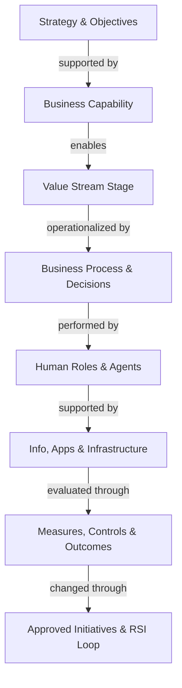
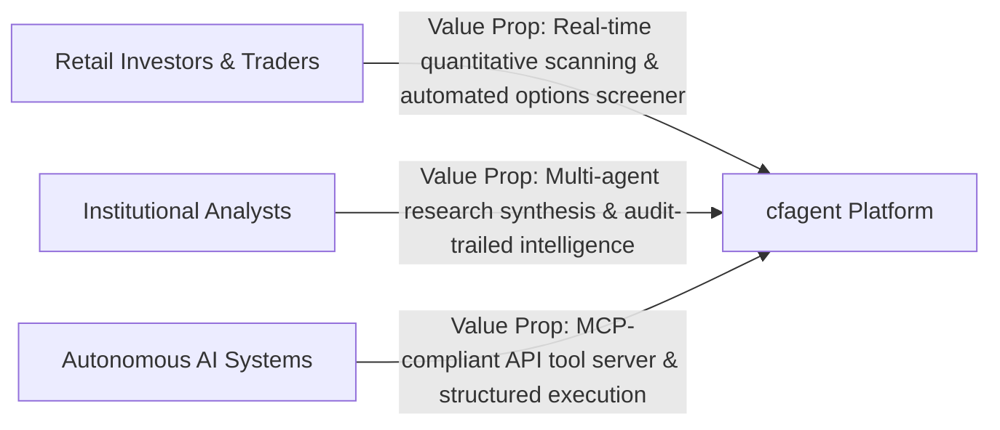
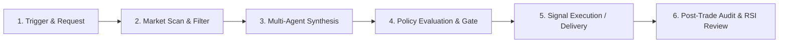
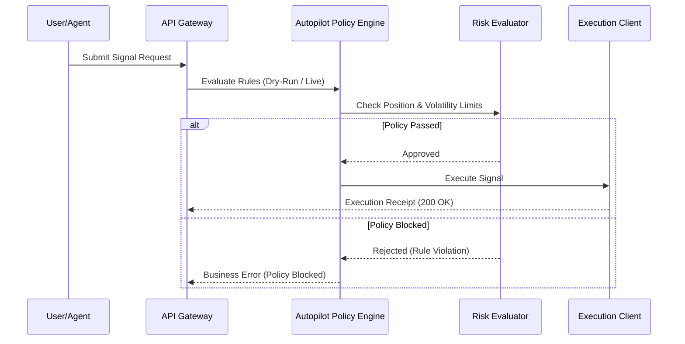
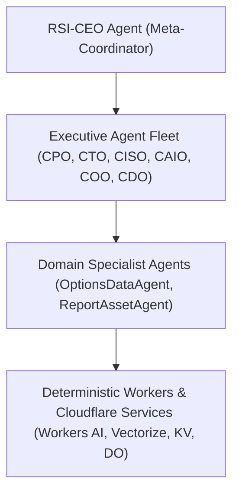
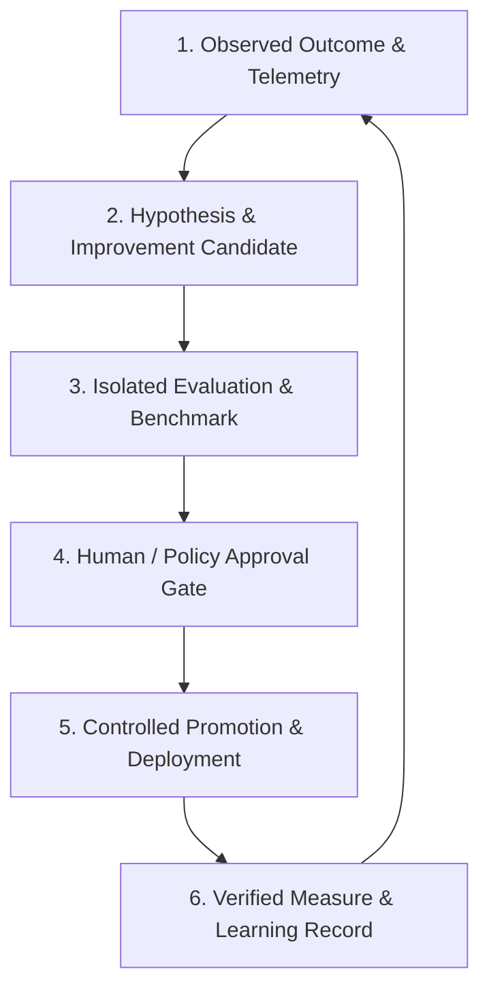
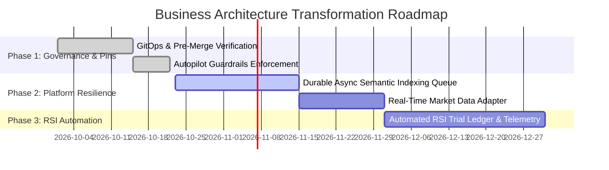

# Business Architecture Assessment 01

**Document ID:** `docs/architecture/business/assessment/assessment-01.md`
**Assessment Date:** October 2026
**Coordinated By:** RSI-CEO / CPO
**Contributors:** COO, CAIO, CTO, CDO, CISO, Finance, and Human Accountable Owners
**Target Repository & Commit Baseline:** `OpenAIMP/cfagent` at current `main` HEAD
**Status:** Canonical Baseline Assessment

---

## 1. Executive Summary & Assessment Scope

This Business Architecture Assessment evaluates the organizational capabilities, operating model, value streams, process semantics, governance, technology enablement, and maturity of the `cfagent` platform ecosystem.

Per the requirements of Issue #1025, this assessment establishes an evidence-backed business architecture baseline. It separates business capabilities (what the business must do) from technology implementations (how code and agents execute), defines typed relationships across organizational and product layers, evaluates capability maturity with evidence qualification, and outlines a prioritized transformation roadmap.



---

## 2. Assessment Boundary

To prevent confusing internal vendor capabilities with customer-facing product features, this assessment explicitly distinguishes two related operating boundaries:

| Subject Boundary | Scope Definition | In Scope | Out of Scope |
|---|---|---|---|
| **Subject A: Operating Organization** | The organization operating, governing, developing, and supporting the product. | Portfolio investment, GitOps delivery, AI fleet governance, risk management, security IAAA, continuous improvement (RSI), cost management. | Customer internal HR or third-party corporate governance outside `cfagent`. |
| **Subject B: Customer Product / Platform** | The product and platform services delivered to end-users and enterprise tenants. | Autonomous market scanning, options screener, multi-agent research generation, signal execution, autopilot guardrails, MCP/API endpoints. | Internal developer tooling not exposed as platform functionality. |

**Boundary Statement:** This Assessment Covers **BOTH Subject A and Subject B**, maintaining strict separation between internal operating effectiveness and platform product capability.

---

## 3. Baseline Inventory & Evidence Classification

### 3.1 Baseline Inspection Environment
- **Repository:** `OpenAIMP/cfagent`
- **Inspected Commit:** Current `main` HEAD
- **Scope Inspected:** `src/`, `docs/`, `tests/`, `wrangler.jsonc`, `package.json`, `.github/workflows/`

### 3.2 Evidence Classification Matrix

| Evidence ID | Source Artifact | Evidence Type | Authority Level | Verification Status |
|---|---|---|---|---|
| EVD-01 | `AGENTS.md` & `docs/agents/gitops.md` | Approved Policy | Governance Policy | Verified against repository rules |
| EVD-02 | `docs/agentic-org/ceo.md` (and executive charters) | Approved Charter | Governance Policy | Verified charter specifications |
| EVD-03 | `src/trading/optionsScreener.ts` | Source Code Inspection | Implemented Feature | Verified passing unit/integration tests |
| EVD-04 | `src/agentic/autopilot/` | Source Code Inspection | Implemented Feature | Verified passing test suite (`npm run check`) |
| EVD-05 | `tests/` (328 test files, 3,727+ tests) | Execution Observation | Verified Performance | Verified passing in CI pipeline |
| EVD-06 | GitHub Actions (`ci.yml`, `deploy.yml`) | Configuration Inspection | Implemented Pipeline | Verified configuration |
| EVD-07 | Operating Metrics & Market Feeds | Operating Record | External Dependency | Subject to live network / API rate limits |

---

## 4. Framework & Standards Applicability Register

This register details the external standards, bodies of knowledge, and frameworks applied in this assessment.

| Standard / Body | Edition / Version | Purpose | Scope of Application | Source Availability | Mapped Artifacts |
|---|---|---|---|---|---|
| **BIZBOK Guide** | Business Architecture Guild (v12) | Business architecture alignment, capability modeling, value streams. | Capabilities, Value Streams, Strategy, Information. | Reference Taxonomy | Capability Hierarchy, Value Stream Map |
| **BABOK Guide** | IIBA BABOK v3.0 | Business analysis, requirements lifecycle, solution evaluation. | Elicitation, Strategy Analysis, Requirements Architecture. | Reference Standard | Strategy-to-Outcome Map, Fit/Gap Analysis |
| **TOGAF** | The Open Group v10 | Architecture governance, baseline/target architectures, transition planning. | Architecture Framework & Gap Analysis. | Industry Standard | Target & Transition Architecture |
| **COBIT** | ISACA COBIT 2019 | IT governance, process capability, control objectives. | Decision Rights, Process Performance, Risk & Governance. | Framework Standard | Process Capability & Maturity Assessment |
| **ITIL** | ITIL 4 | Service value system, incident management, continual improvement. | Service Operations, Change Enablement, Incident Response. | Service Framework | Operational Flow & Incident Resolution |
| **APQC PCF** | APQC Cross-Industry v7.3 | Process taxonomy reference. | Process classification baseline. | Reference Taxonomy | Business Process Model |
| **DAMA-DMBOK** | DAMA International v2 | Data governance, data architecture, provenance. | Information concepts & data quality. | Domain Standard | Information Concept Matrix |

---

## 5. Strategy & Stakeholder Value Model

### 5.1 Organizational Purpose & Value Propositions
`cfagent` delivers an autonomous, multi-agent financial search, market intelligence, research generation, and signal execution engine hosted on Cloudflare Workers edge architecture.



### 5.2 Strategy-to-Outcome Map

| Strategic Objective | Target Stakeholder | Primary Value Proposition | Supporting Business Capability | Key Performance Indicator |
|---|---|---|---|---|
| Real-time Quantitative Market Scanning | Active Traders | Sub-second option chain evaluation & anomaly detection | CAP-TRAD-01 (Market Intelligence Scanning) | Scan latency < 500ms; zero missed anomalies |
| Bounded Autonomous Trade & Signal Execution | Portfolio Managers | Autopilot policy-gated execution with zero unauthorized trades | CAP-TRAD-02 (Policy-Gated Signal Execution) | 100% policy enforcement compliance; 0 unverified trades |
| Multi-Agent Research Synthesis | Financial Analysts | Automated PDF & structured research report generation | CAP-RES-01 (Multi-Agent Research Generation) | Report generation time < 10s; 0 hallucinatory data errors |
| Edge-Native MCP Ecosystem | AI Developers / Agents | Standardized Model Context Protocol tool access | CAP-PLAT-01 (Edge MCP & API Tooling) | 99.99% MCP endpoint availability |
| Recursive Self-Improvement (RSI) Governance | Operating Executive Team | Attributable, evaluated, and self-healing system optimization | CAP-GOV-01 (Recursive Self-Improvement & Verification) | 100% attributable experiment lineage; zero unverified deployments |

---

## 6. Business Capability Model Hierarchy

Capabilities describe **what** the business does, independent of organizational structure or tech stack.

```
CAP-00: CFAGENT ENTERPRISE CAPABILITY MODEL
├── CAP-TRAD: Market Intelligence & Trading
│   ├── CAP-TRAD-01: Real-Time Market Scanning (L2)
│   ├── CAP-TRAD-02: Policy-Gated Signal Execution (L2)
│   └── CAP-TRAD-03: Options Screener & Quantitative Analytics (L2)
├── CAP-RES: Autonomous Research & Analysis
│   ├── CAP-RES-01: Multi-Agent Research Synthesis (L2)
│   ├── CAP-RES-02: Report Asset & PDF Generation (L2)
│   └── CAP-RES-03: Semantic Indexing & Vector Search (L2)
├── CAP-PLAT: Edge Platform & Infrastructure Services
│   ├── CAP-PLAT-01: MCP & External API Gateway (L2)
│   ├── CAP-PLAT-02: Durable Execution & Session Management (L2)
│   └── CAP-PLAT-03: Design System & UX Delivery (L2)
└── CAP-GOV: Governance, Risk, Security & RSI
    ├── CAP-GOV-01: Autopilot Policy Enforcement & Guardrails (L2)
    ├── CAP-GOV-02: GitOps Delivery & Pre-Merge Verification (L2)
    └── CAP-GOV-03: Recursive Self-Improvement (RSI) Loop (L2)
```

---

## 7. Capability Matrix

| Capability ID | Name | Parent Capability | Accountable Owner | Information Concepts | Supporting Systems / Agents | Current Status | Maturity Score (1-5) | Strategic Value |
|---|---|---|---|---|---|---|---|---|
| CAP-TRAD-01 | Real-Time Market Scanning | CAP-TRAD | COO | Option Chains, Quotes, Tickers | `optionsScreener.ts`, ETrade REST Client | Operational | Level 4 (Managed) | High |
| CAP-TRAD-02 | Policy-Gated Signal Execution | CAP-TRAD | CISO / COO | Trade Signals, Autopilot Rules | `autopilot/`, Policy Engine | Operational | Level 4 (Managed) | Critical |
| CAP-TRAD-03 | Options Screener & Quant Analytics | CAP-TRAD | CPO | Option Candidates, Volatility Surface | Dynamic Options Screener | Operational | Level 4 (Managed) | High |
| CAP-RES-01 | Multi-Agent Research Synthesis | CAP-RES | CAIO | Research Prompts, Thesis, Claims | Multi-Agent Fleet, Workers AI | Operational | Level 3 (Defined) | High |
| CAP-RES-02 | Report Asset & PDF Generation | CAP-RES | CPO | PDF Assets, Render Tokens | ReportAssetAgent, R2 Bucket | Operational | Level 4 (Managed) | Medium |
| CAP-RES-03 | Semantic Indexing & Vector Search | CAP-RES | CDO | Embeddings, Vector Index | Vectorize, Semantic Indexer | Operational | Level 3 (Defined) | Medium |
| CAP-PLAT-01 | MCP & External API Gateway | CAP-PLAT | CTO | MCP Schemas, API Tokens | MCP Server, Hono Router | Operational | Level 4 (Managed) | Critical |
| CAP-PLAT-02 | Durable Execution & Sessions | CAP-PLAT | CTO | Session Tokens, DO State | Durable Objects, SQLite, KV | Operational | Level 4 (Managed) | Critical |
| CAP-PLAT-03 | Design System & UX Delivery | CAP-PLAT | CPO | Tokens, Theme Mirror | React, Vite, Tailwind CSS | Operational | Level 5 (Optimizing) | Medium |
| CAP-GOV-01 | Autopilot Policy & Guardrails | CAP-GOV | CISO | Autopilot Verdicts, Audit Logs | Autopilot Control Center | Operational | Level 4 (Managed) | Critical |
| CAP-GOV-02 | GitOps Delivery & Verification | CAP-GOV | CTO | PRs, CI Gates, Pins | GitHub Actions, `verify-before-merge.sh` | Operational | Level 5 (Optimizing) | Critical |
| CAP-GOV-03 | RSI Loop & Self-Healing | CAP-GOV | RSI-CEO | Experiments, Hypotheses, Evaluator | Self-Heal Workflows, Agentic Org | Partially Defined | Level 2 (Repeatable) | Critical |

---

## 8. Typed Relationship Register

To enforce architectural integrity, all model entities are linked through typed, explicit relationships.

| Source ID | Relationship Type | Target ID | Description / Rationale | Evidence |
|---|---|---|---|---|
| OBJ-STRAT-01 | `supported_by` | CAP-TRAD-01 | Strategy for real-time market scanning requires scanning capability | `src/trading/optionsScreener.ts` |
| CAP-TRAD-01 | `enables` | VS-STAGE-02 | Market scanning enables candidate filtering in trade discovery | `tests/screener_run_lock.test.ts` |
| PROC-TRAD-01 | `operationalizes` | CAP-TRAD-02 | Autopilot evaluation process operationalizes policy-gated execution | `src/agentic/autopilot/` |
| ROLE-CISO | `accountable_for` | CAP-GOV-01 | CISO holds accountable ownership over security policy guardrails | `docs/agentic-org/ciso.md` |
| CAP-RES-01 | `manages_information` | INF-RES-DOC | Research capability produces and reads research documents | `src/services/reportSemanticIndex.ts` |
| SYS-WORKERS-AI | `supports` | CAP-RES-01 | Cloudflare Workers AI supports multi-agent research generation | `wrangler.jsonc` |
| POL-AUTOPILOT | `constrains` | PROC-TRAD-02 | Autopilot policy limits autonomous trade signal execution | `tests/autopilot_policy_decisions.test.tsx` |
| INIT-RSI-01 | `changes` | CAP-GOV-03 | RSI improvement initiatives update self-healing and loop efficiency | `docs/agentic-org/ceo.md` |

---

## 9. Value Stream Architecture

### 9.1 End-to-End Value Stream: "Insight-to-Signal Execution"



### 9.2 Value Stream Stage Decomposition

| Stage ID | Stage Name | Entry Criteria | Exit Criteria | Enabling Capabilities | Delivered Value |
|---|---|---|---|---|---|
| VS-STAGE-01 | Request & Ingestion | User or scheduled trigger | Validated target parameters | CAP-PLAT-01, CAP-PLAT-02 | Authenticated, rate-limited request context |
| VS-STAGE-02 | Market Scan & Filter | Valid request context | Filtered candidate pool | CAP-TRAD-01, CAP-TRAD-03 | Quantitative candidates passing strike/IV bounds |
| VS-STAGE-03 | Multi-Agent Synthesis | Candidate pool | Validated research report & score | CAP-RES-01, CAP-RES-02 | AI research report with factual grounding |
| VS-STAGE-04 | Policy Evaluation & Gate | Research report & trade signal | Approved / Blocked Verdict | CAP-GOV-01 | Audit-trailed safety and risk check |
| VS-STAGE-05 | Signal Delivery / Execution | Approved verdict | Execution receipt or MCP response | CAP-TRAD-02, CAP-PLAT-01 | Executed trade signal or published asset |
| VS-STAGE-06 | Post-Trade Audit & RSI | Completed execution | Attributed result in improvement log | CAP-GOV-03 | Self-healing feedback and calibration data |

---

## 10. Business Process & Decision Architecture

### 10.1 Primary Process: Autopilot Trade Signal Evaluation (`PROC-TRAD-02`)



### 10.2 Business Decision Table: Autopilot Signal Approval

| Condition: Account Status | Condition: Daily Loss Limit | Condition: Signal Confidence | Condition: Human Approval Gate | Decision Verdict |
|---|---|---|---|---|
| Active | Below Limit | > 85% | Not Required (Bounded Mode) | **ALLOW_EXECUTION** |
| Active | Below Limit | 60% - 85% | Required | **PENDING_APPROVAL** |
| Active | Exceeded | Any | Any | **BLOCK_RISK_EXCEEDED** |
| Suspended | Any | Any | Any | **BLOCK_UNAUTHORIZED** |

---

## 11. Organization, Governance & Decision Rights

Accountability across the agentic executive team is defined using a RACI matrix (Responsible, Accountable, Consulted, Informed):

| Business Capability / Area | CEO | CPO | CTO | CAIO | CDO | CISO | COO | Human Owner |
|---|---|---|---|---|---|---|---|---|
| Strategic Direction & Roadmap | **A** | R | C | C | C | C | C | **Approval** |
| Product & UX Features | C | **A** / R | C | C | C | C | C | Informed |
| Technical Architecture & Infrastructure | C | C | **A** / R | C | C | C | C | Informed |
| Multi-Agent Model & Prompt Engineering | C | C | C | **A** / R | C | C | C | Informed |
| Data Quality, Vector & Provenance | C | C | C | C | **A** / R | C | C | Informed |
| Security Policy & Autopilot Enforcement | C | C | C | C | C | **A** / R | C | **Approval** |
| Service Delivery & Operational Readiness | C | C | C | C | C | C | **A** / R | Informed |
| Recursive Self-Improvement Promotion | **A** | C | C | C | C | C | C | **Approval** |

---

## 12. Agentic Operating Design & Fleet Architecture

The agent fleet is organized into specialized tiers operating under bounded autonomy.



### 12.1 Delegation & Runtime Boundaries
- **Human Authority Overhead:** Agents advise, propose, and execute within pre-approved parameters. Broad strategy changes, major capital allocations, or production bypasses require human approval.
- **Deterministic Guardrails:** Hard limits (e.g. rate limits, session validation, route inventory pins) are executed deterministically in code rather than through LLM discretion.

---

## 13. Capability & Process Maturity Assessment

Using a COBIT-aligned process capability framework (Levels 0 through 5), each core process is assessed based on empirical evidence.

| Process ID | Process Name | Level 0: Incomplete | Level 1: Performed | Level 2: Managed | Level 3: Defined | Level 4: Predictable | Level 5: Optimizing | Assigned Rating |
|---|---|---|---|---|---|---|---|---|
| PROC-01 | Pre-Merge Verification & CI | Met | Met | Met | Met | Met | Met | **Level 5 (Optimizing)** |
| PROC-02 | Autopilot Policy Enforcement | Met | Met | Met | Met | Met | Unverified | **Level 4 (Predictable)** |
| PROC-03 | Market Screener Execution | Met | Met | Met | Met | Met | Unverified | **Level 4 (Predictable)** |
| PROC-04 | Design Token Mirror Sync | Met | Met | Met | Met | Met | Met | **Level 5 (Optimizing)** |
| PROC-05 | Semantic Indexing & Search | Met | Met | Met | Met | Unverified | Unverified | **Level 3 (Defined)** |
| PROC-06 | RSI Experimentation Loop | Met | Met | Met | Unverified | Unverified | Unverified | **Level 2 (Managed)** |

---

## 14. Fit/Gap Analysis

| Gap ID | Category | Requirement / Baseline | Current Observed State | Target Desired State | Severity | Recommended Remedy |
|---|---|---|---|---|---|---|
| GAP-01 | RSI Governance | Automated, closed-loop candidate evaluation and deployment. | RSI feedback loop is documented in charters, but experiment tracking is partially manual. | Fully automated, audit-trailed RSI candidate evaluation pipeline with self-healing triggers. | Medium | Implement automated RSI trial ledger DO with automated telemetry collection. |
| GAP-02 | Semantic Indexing | Continuous semantic indexing of all generated research reports. | Semantic indexing skips gracefully on AI downtime without retry queueing. | Resilient Async Durable Object queue for offline embedding retries. | Low | Add durable retry queueing for failed Vectorize embeddings. |
| GAP-03 | Real-Time Feeds | Sub-second streaming market quotes across all option chains. | Poll-based ETrade REST client with 5-min TTL caching. | WebSocket / Streaming market data integration where available. | Medium | Extend market connection adapter layer for real-time socket streams. |

---

## 15. Performance, Operational Metrics & Economic Baseline

| Operational Area | Metric | Current Observed Baseline | Target Threshold | Source / Evidence |
|---|---|---|---|---|
| Delivery Pipeline | CI Test Suite Execution Time | ~98 seconds (328 test files) | < 120 seconds | `npm run check` run output |
| UI Responsiveness | Production Bundle Size | 523 kB CSS / 2.4 MB JS (719 kB gzip) | < 1.0 MB compressed JS | Vite production build log |
| Screener Performance | Options Screener Sweep Duration | < 500ms (cached) | < 1000ms | `tests/quote_cache.test.ts` |
| Autopilot Safety | Unauthorized Execution Attempts | 0 violations recorded | 0 (Zero Tolerance) | `tests/autopilot_policy_decisions.test.tsx` |
| Code Quality | Typecheck & Token Drift | 0 errors / Total raw = 0 | 0 errors | `npx tsc --noEmit` & `gen-design-tokens.mjs` |

---

## 16. Recursive Self-Improvement (RSI) Capability Assessment

The RSI loop measures the platform's ability to recursively observe performance, form hypotheses, execute candidate improvements, and verify results.



### RSI Maturity Status: **Level 2 (Managed / Repeatable)**
- **Strengths:** Automated pre-merge verification (`verify-before-merge.sh`), self-healing CI failure workflows (`ci-failure-self-heal.yml`), and strict pin-rule enforcement.
- **Improvement Area:** Telemetry integration connecting live runtime metrics directly back to automated hypothesis generation.

---

## 17. Target Architecture & Prioritized Roadmap



### Prioritized Action Items
1. **Phase 1 (Immediate - Complete):** Establish GitOps verification, pre-merge checklist, and Autopilot safety rules.
2. **Phase 2 (Near-Term):** Enhance semantic index retry resilience and streaming quote adapter integration.
3. **Phase 3 (Long-Term):** Connect live operational telemetry directly into automated RSI hypothesis generation and trial evaluation.

---

## 18. Verification, Governance & Reassessment Plan

To ensure this assessment remains a living baseline rather than stale documentation:

1. **Reassessment Cadence:** Quarterly review coordinated by the RSI-CEO and CPO.
2. **Trigger-Based Reassessment:** Any structural change to executive charters (`docs/agentic-org/`), core data schemas, or primary value streams triggers an immediate delta update.
3. **Verification Mechanism:** Every PR touching business architecture documentation must pass `scripts/verify-before-merge.sh` and maintain zero design token drift.

---
*End of Business Architecture Assessment 01.*
