# Code Architecture, Taxonomy & Agentic Maturity Assessment: cfagent

**Document ID:** ARCH-CODE-TAXONOMY-01
**Target Repository:** `cfagent` (`ai-search-agent`)
**Scope:** Functional Component Taxonomy (Feed, Gather, Analysis, Generate, Store, Serve, Deliver, Scheduling, and Missing/Related), Pipelines, DAGs, Channel Mapping, NLQ Readiness, Agentic Maturity & RSI/ASI Evolution
**Assessment Date:** October 2026
**Status:** Complete & Approved

---

## 1. Executive Summary & Evaluation Methodology

### 1.1 Executive Summary
This document delivers an exhaustive, component-level architectural analysis and taxonomy assessment for the `cfagent` platform, benchmarking the codebase against the target architecture established in `docs/architecture/code/overall-01.md`.

`cfagent` is an edge-native, autonomous financial research, quantitative stock/options screening, and algorithmic trading execution engine operating on Cloudflare Workers, Durable Objects, D1, R2, and Vectorize. The platform processes high-frequency market feeds, enriches quantitative signals, conducts multi-strategy option spread discovery (e.g., Iron Condors, Calendar Spreads, Volatility Swaps), generates multi-format artifacts (PDF, XLSX, CSV), and routes actionable intelligence or automated execution across multiple interaction channels (React UX, Slack, Email, Voice, MCP, and Agent-to-Agent A2A).

This analysis categorizes the system into **eight primary functional component pillars** plus **three critical supporting/cross-cutting pillars**, assesses their sync/async execution behavior, identifies existing pipelines and DAGs, details unrealized orchestrations, evaluates NLQ/chat workflow generation readiness, and establishes a concrete transformation roadmap toward **Recursive Self-Improvement (RSI)** and **Artificial Superintelligence (ASI)**.

---

### 1.2 Evaluation Methodology & Criteria

Each component category is evaluated across five weighted architectural metrics scored on a 1-to-5 scale:

```
Total Architectural Risk / Criticality Score = Complexity + Criticality + Usage Volume + Operational Risk
```

| Metric | Assessment Focus | Strategic Implication |
| :--- | :--- | :--- |
| **Complexity (1-5)** | Algorithmic depth, statefulness, state machine branching, line count (LOC), and asynchronous coordination. | Highlights components prone to concurrency deadlocks, race conditions, and high cognitive load. |
| **Criticality (1-5)** | Direct impact on capital placement, identity verification, state persistence, or platform availability. | Identifies failure points that trigger financial loss, unauthorized operations, or compliance breaches. |
| **Usage / Volume (1-5)** | Request frequency, event loop invocation rate, cron tick density, and subrequest throughput. | Reveals edge subrequest ceilings, memory pressure, and CPU execution time bottlenecks. |
| **Operational Risk (1-5)** | Sensitivity to external third-party rate limits, API deprecations, token expiration, or LLM non-determinism. | Uncovers external fragility and crash vulnerabilities during edge execution. |

---

## 2. Architectural Scoring Matrix Across Component Categories

The matrix below provides a comparative evaluation across all 11 component categories in `cfagent`.

| Component Category | Primary Code Locations | Complexity (1-5) | Criticality (1-5) | Usage (1-5) | Risk (1-5) | Total Score | Risk Level | Primary Risk Driver |
| :--- | :--- | :---: | :---: | :---: | :---: | :---: | :---: | :--- |
| **1. Feed Components** | `src/trading/etrade/client.ts`, `dataProviders/` | 4 | 5 | 5 | 5 | **19** | **CRITICAL** | Broker API rate limits (429), OAuth 1.0a token refresh race, XML/JSON parsing |
| **2. Gather Components** | `src/services/marketDataResearch.ts`, `ivCollector.ts` | 4 | 4 | 4 | 4 | **16** | **HIGH** | Unstructured web scraping timeouts, LLM context budget saturation |
| **3. Analysis Components** | `screenerPipeline.ts`, `strategyEngine.ts` | 5 | 5 | 4 | 4 | **18** | **CRITICAL** | Complex greeks mathematical calculations, multi-factor scoring performance |
| **4. Generate Components** | `screenerReportPdf.ts`, `runExport.ts` | 3 | 3 | 3 | 2 | **11** | **LOW** | PDF binary compilation overhead in edge memory runtime |
| **5. Store Components** | `SessionStore` DO, `d1GovernanceAdapter.ts` | 4 | 5 | 5 | 5 | **19** | **CRITICAL** | Dual-write drift between Durable Object SQLite and Cloudflare D1 query models |
| **6. Serve Components** | `src/server.ts`, `src/mcp/` | 4 | 5 | 5 | 4 | **18** | **CRITICAL** | Monolithic route dispatcher, MCP tool schema validation failures |
| **7. Deliver Components** | `ETradeTradingHub.tsx`, `slack/agent.ts` | 4 | 4 | 4 | 3 | **15** | **MEDIUM** | Multi-channel state drift, client-side re-render performance in 3K+ LOC files |
| **8. Scheduling Components**| `scheduledTasks.ts`, `scheduled-agent.ts` | 5 | 5 | 4 | 5 | **19** | **CRITICAL** | Cloudflare Workers 5-cron trigger ceiling forcing piggybacked tick queues |
| **9. Related: Governance** | `iaaaGates.ts`, `iaaaPdpSeam.ts` | 3 | 5 | 5 | 5 | **18** | **CRITICAL** | Auth gate bypass in newly added endpoints, PDP permission resolution |
| **10. Related: Payment** | `agenticPayments.ts`, `budget-guard.ts` | 3 | 4 | 2 | 4 | **13** | **MEDIUM** | Base-Sepolia crypto settlement latency, budget guard breaches |
| **11. Related: Orchestrator**| `orchestrator.ts`, `execution.ts` | 5 | 5 | 5 | 5 | **20** | **CRITICAL** | Unbounded LLM agent action loops, non-deterministic order sizing |

---

## 3. Comprehensive Deep-Dive Component & Risk Analysis

### 3.1 Feed Components (Market & Data Data-Plane Ingress)
* **Code References:** `src/trading/etrade/client.ts` (3,496 LOC), `src/trading/dataProviders/adapters.ts` (1,311 LOC), `src/trading/dataProviders/captureStore.ts` (795 LOC), `src/trading/dataProviders/lifecycle.ts` (618 LOC), `src/services/publicData.ts` (706 LOC), `src/services/marketStream.ts` (445 LOC), `src/trading/alpaca/platform.ts` (209 LOC), `src/services/nasdaqListings.ts` (144 LOC).
* **Role & Functionality:** Acquires live and historical market data, option chains, order book depth, dark pool volume estimates, and ticker metadata from external sources (E*TRADE OAuth1.0a REST, Alpaca, NASDAQ HTTP listings, Yahoo Finance public endpoints, and synthetic quote streams).
* **Key Operational Risks:**
  1. *E*TRADE OAuth1.0a Session Disruption:* Access tokens expire or invalidate during high-volatility market events, throwing `AUTH_003` preflight blocks.
  2. *Upstream HTTP 429 Rate Limiting:* Rapid ticker scanning causes IP or API key throttling without automated circuit-breaker isolation.
  3. *Payload Schema Mutations:* Inconsistent quote responses (e.g. missing bid/ask implied volatility fields in option chains) causing downstream null pointer crashes.

### 3.2 Gather Components (Signal Enrichment & Alternative Data Ingest)
* **Code References:** `src/services/marketDataResearch.ts` (2,893 LOC), `src/trading/options/ivCollector.ts` (320 LOC), `src/services/aiSearch.ts` (319 LOC), `src/trading/technicals.ts` (277 LOC), `src/services/eventCalendar.ts` (236 LOC), `src/trading/factorGrades.ts` (216 LOC), `src/trading/options/flows/newsSentiment.ts` (160 LOC), `src/trading/screeningIndicators.ts` (149 LOC).
* **Role & Functionality:** Enriches raw price feeds with technical indicators (RSI, MACD, Bollinger Bands, ATR), Implied Volatility (IV) rank/percentile calculations, news sentiment extraction via Workers AI / GLM-4, earnings event calendar lookups, open-source repository intelligence analysis, and quantitative factor grades.
* **Key Operational Risks:**
  1. *LLM Inference Timeouts:* Unbounded latency when extracting news sentiment or market-data research summaries, stalling worker execution threads.
  2. *IV History Desynchronization:* Stale IV percentile calculations leading to mispriced option volatility spreads.

### 3.3 Analysis Components (Screening, Strategy Discovery & Decision Kernel)
* **Code References:** `src/trading/screenerPipeline.ts` (1,920 LOC), `src/services/recommendationKernel.ts` (1,683 LOC), `src/trading/options/unifiedOptionsService.ts` (1,435 LOC), `src/trading/options/strategyEngine.ts` (1,373 LOC), `src/trading/options/opportunityScanner.ts` (1,343 LOC), `src/trading/optionsScreener.ts` (999 LOC), `src/services/goalScenarioEngine.ts` (953 LOC), `src/trading/screener.ts` (780 LOC), `src/services/cvarOptimizer.ts` (151 LOC).
* **Role & Functionality:** Executes quantitative multi-criteria stock and option screening rules (e.g., Bull Put Spreads, Iron Condors, Covered Calls, Volatility Swaps), multi-factor portfolio scoring (`recommendationKernel.ts`), Conditional Value at Risk (CVaR) optimization, and natural language goal-driven scenario evaluation (`goalScenarioEngine.ts`).
* **Key Operational Risks:**
  1. *Subrequest & CPU Limit Saturation:* Evaluating 1,000+ option combinations across multiple expiration dates exceeding Cloudflare edge CPU limits.
  2. *Option Leg Inconsistency:* Synthetic option chain calculations generating illegal strike/expiration combinations for live broker execution.

### 3.4 Generate Components (Artifact Compilation & Export Engine)
* **Code References:** `src/client/runExport.ts` (1,353 LOC), `src/trading/screenerReportPdf.ts` (411 LOC), `src/trading/researchReportPdf.ts` (361 LOC), `src/trading/optionsReportXlsx.ts` (272 LOC), `src/trading/screenerReportCsv.ts` (268 LOC), `src/trading/optionsReportPdf.ts` (253 LOC), `src/trading/screenerReportXlsx.ts` (235 LOC).
* **Role & Functionality:** Compiles structured screening runs, portfolio risk assessments, and research discoveries into downloadable, high-fidelity PDF documents, formatted Excel spreadsheets (.xlsx), raw CSV files, and structured JSON export bundles.
* **Key Operational Risks:**
  1. *Edge Memory Exhaustion:* Compiling large PDF binaries with embedded chart visuals exceeding Worker memory boundaries.

### 3.5 Store Components (State Persistence & Memory Infrastructure)
* **Code References:** `src/agents/scheduled-agent.ts` (1,085 LOC), `src/security/durableKv.ts` (257 LOC), `src/memory/vector-memory.ts` (199 LOC), `src/data/d1ChainScheduleAdapter.ts` (187 LOC), `src/services/reportBlobStore.ts` (174 LOC), `src/data/d1ShardJobAdapter.ts` (145 LOC), `src/services/reportSemanticIndex.ts` (139 LOC), `src/data/d1GovernanceAdapter.ts` (133 LOC), `src/security/kvResilience.ts` (130 LOC), `SessionStore` DO.
* **Role & Functionality:** Manages multi-tiered storage: stateful Durable Object SQLite databases (`SessionStore`, `ScreenerAgent`, `ResearchAgent`), transactional Cloudflare D1 relational projections (`AGENT_DB`), Vectorize semantic memory (`VECTOR_MEMORY`), Cloudflare R2 object storage (`REPORTS_BUCKET`), and resilient KV key-value stores.
* **Key Operational Risks:**
  1. *Dual-Write Desynchronization:* Failure to update D1 query projections following local Durable Object SQLite commits.
  2. *Vector Schema Mismatches:* Incompatible embedding dimensionalities (1536 vs 768) corrupting semantic memory lookup.

### 3.6 Serve Components (API Gateway, Protocol Translators & Webhooks)
* **Code References:** `src/server.ts` (2,701 LOC), `src/mcp/commands.ts` (1,084 LOC), `src/mcp/goalChainCommands.ts` (613 LOC), `src/mcp/index.ts` (493 LOC), `src/services/tradingWebhooks.ts` (413 LOC), `src/mcp/etradeCommands.ts` (300 LOC), `src/services/cfpayA2A.ts` (198 LOC), `src/security/iaaaGates.ts` (52 LOC), `src/security/iaaaPdpSeam.ts` (55 LOC).
* **Role & Functionality:** Acts as the unified edge ingress. Dispatches HTTP REST requests, exposes Model Context Protocol (MCP) tools for LLM agent interaction, handles Agent-to-Agent (A2A) protocol exchanges, processes incoming webhooks, and enforces IAAA Policy Decision Point (PDP) security gates.
* **Key Operational Risks:**
  1. *Monolithic Router Instability:* Single unhandled exception in `server.ts` taking down all web API and webhook listeners.
  2. *MCP Payload Schema Violations:* Invalid JSON-RPC parameter validation blocking external agent command execution.

### 3.7 Deliver Components (Multi-Channel Delivery & User Experience)
* **Code References:** `src/client/ETradeTradingHub.tsx` (3,286 LOC), `src/client/Chat.tsx` (2,141 LOC), `src/client/WorkflowsHub.tsx` (1,844 LOC), `src/trading/slack/agent.ts` (1,825 LOC), `src/client/ScannerPanel.tsx` (1,666 LOC), `src/client/ScreenersHub.tsx` (1,394 LOC), `src/trading/email/agent.ts` (1,175 LOC), `src/trading/voice/agent.ts` (1,187 LOC), `src/client/ScheduledOptionsManager.tsx` (953 LOC), `src/services/screeningDelivery.ts` (397 LOC), `src/services/screenerSlackDelivery.ts` (243 LOC), `src/trading/channels/approval.ts` (211 LOC).
* **Role & Functionality:** Renders single-page React interfaces at the edge and broadcasts alerts, executive digests, trade approval requests, and interactive voice/text dialogs across Slack, Email, Webhooks, Voice, and A2A channels.
* **Key Operational Risks:**
  1. *Slack/Email Webhook Rate Limits:* Exceeding Slack API rate limits during bulk market screening alert triggers.
  2. *Unauthenticated Approval Links:* Security risks in human-in-the-loop trade approval tokens delivered over unencrypted channels.
* **Page shell (S5, #1804):** the SPA files above share one shell standard: a single route table (`src/client/routes.ts`) drives nav/breadcrumbs/content switch, and every left-nav page except `chat` renders inside the `PageShell` primitive (trading pages via one outlet shell in `ETradeTradingHub`). Home doc: `docs/architecture/UX/design-system-01.md` (§2–§3); conformance pinned by `tests/shell_conformance_1804.json` (25 of 26; `chat` deferred, ADR-0021).

### 3.8 Scheduling Components (Job Orchestration & Cron Execution)
* **Code References:** `src/services/scheduledTasks.ts` (3,545 LOC), `src/agents/orchestrator/asyncJobs.ts` (1,254 LOC), `src/agents/scheduled-agent.ts` (1,085 LOC), `src/orchestrate.ts` (625 LOC), `src/services/shardJobs.ts` (529 LOC), `src/schedule.ts` (266 LOC).
* **Role & Functionality:** Coordinates delayed, recurring, and asynchronous background jobs using Cloudflare Cron Triggers (`*/30 * * * *`), Cloudflare Workflows (`TradingTradeWorkflow`), Durable Object scheduled ticks, and distributed shard job executors.
* **Key Operational Risks:**
  1. *Cron Trigger Ceiling:* Reaching Cloudflare Workers' 5-cron trigger limit, requiring complex piggybacked tick routing in `scheduledTasks.ts`.
  2. *Duplicate Job Execution:* Lack of distributed locks causing concurrent executions of market research passes.

### 3.9 Related / Cross-Cutting Pillars
* **Governance & PDP:** `src/security/iaaaGates.ts`, `iaaaPdpSeam.ts`, `iaaaLogin.ts` – Mandates session validation, identity resolution, and PDP access control before route handler dispatch.
* **Payment & x402 Wallet:** `src/services/agenticPayments.ts`, `src/payments/budget-guard.ts` – Governs micro-settlements over Base-Sepolia and enforces strict per-agent operational budget caps.
* **Agent Orchestrator Runtime:** `src/agents/orchestrator.ts` (2,129 LOC), `src/agents/nlq/execution.ts` (2,299 LOC) – Handles multi-agent reasoning, plan graph expansion, and tool execution loops.

---

## 4. Complete System Component & Communication Classification Diagram

```mermaid
graph TD
    %% Interaction Channels & Ingress
    subgraph Channels & Clients [Deliver / Ingress Layer]
        UX[React Single Page Application]
        Slack[Slack Bot & Webhooks]
        Email[Email Agent / SendGrid]
        Voice[Twilio Voice Agent]
        MCP_Client[External MCP Client]
        A2A_Client[External A2A Agent]
        Cron[Cloudflare Cron Triggers]
    end

    %% Ingress & Gateway (Serve / Governance)
    subgraph Edge Gateway [Serve & Governance Layer]
        Server[src/server.ts Edge Router]
        IAAAGate[src/security/iaaaGates.ts PDP]
        MCP_Router[src/mcp/index.ts]
        A2A_Router[src/services/cfpayA2A.ts]
    end

    %% Asynchronous Job Scheduling & Workflow Engine
    subgraph Scheduler & Workflows [Scheduling Tier]
        SchedTasks[src/services/scheduledTasks.ts]
        SchedAgent[src/agents/scheduled-agent.ts DO]
        CF_Workflow[Cloudflare Workflows / TradingTradeWorkflow]
        ShardJobs[src/services/shardJobs.ts]
    end

    %% Core Agent Runtime
    subgraph Agent Runtime [Orchestration Tier]
        Orchestrator[src/agents/orchestrator.ts]
        NLQExec[src/agents/nlq/execution.ts]
        GoalEngine[src/services/goalScenarioEngine.ts]
    end

    %% Market Data & Enrichment (Feed & Gather)
    subgraph Data Acquisition [Feed & Gather Layer]
        Feed_Etrade[E*TRADE Client OAuth1.0a]
        Feed_Alpaca[Alpaca Platform Client]
        Feed_Public[Public Market Data & NASDAQ]
        Gather_IV[IV Collector & Technicals]
        Gather_MarketData[Market Data Research & News Sentiment]
    end

    %% Business Intelligence & Screening (Analysis)
    subgraph Analytics & Strategy [Analysis Tier]
        ScreenerPipe[src/trading/screenerPipeline.ts]
        OptService[src/trading/options/unifiedOptionsService.ts]
        StratEngine[src/trading/options/strategyEngine.ts]
        RecomKernel[src/services/recommendationKernel.ts]
        CVarOpt[src/services/cvarOptimizer.ts]
    end

    %% Artifact Generation (Generate)
    subgraph Document Engine [Generate Layer]
        PdfGen[screenerReportPdf / optionsReportPdf]
        XlsxGen[screenerReportXlsx / optionsReportXlsx]
        CsvGen[screenerReportCsv]
        RunExport[src/client/runExport.ts]
    end

    %% Persistence & State (Store)
    subgraph State Infrastructure [Store Tier]
        SessionDO[SessionStore DO SQLite]
        AgentDB[(Cloudflare D1 AGENT_DB)]
        R2Bucket[(Cloudflare R2 REPORTS_BUCKET)]
        VectorDB[(Cloudflare Vectorize)]
    end

    %% Synchronous Interactions (Solid Lines)
    UX -->|Sync HTTP / REST| Server
    MCP_Client -->|Sync JSON-RPC| Server
    A2A_Client -->|Sync HTTP A2A| Server
    Server --> IAAAGate
    IAAAGate --> MCP_Router
    IAAAGate --> A2A_Router
    IAAAGate --> Orchestrator
    Orchestrator --> NLQExec
    NLQExec --> GoalEngine
    GoalEngine --> ScreenerPipe
    ScreenerPipe --> Gather_IV
    ScreenerPipe --> Gather_MarketData
    Gather_IV --> Feed_Etrade
    Gather_IV --> Feed_Public
    OptService --> StratEngine
    StratEngine --> RecomKernel
    RecomKernel --> CVarOpt
    Orchestrator --> PdfGen
    Orchestrator --> XlsxGen
    Orchestrator --> SessionDO

    %% Asynchronous Interactions (Dotted Lines)
    Cron -.->|Async Trigger| SchedTasks
    SchedTasks -.->|Async Queue| SchedAgent
    SchedAgent -.->|Async Dispatch| CF_Workflow
    CF_Workflow -.->|Async Processing| ShardJobs
    ShardJobs -.->|Async Execution| ScreenerPipe
    ScreenerPipe -.->|Async Save| AgentDB
    PdfGen -.->|Async Upload| R2Bucket
    Gather_MarketData -.->|Async Index| VectorDB
    SchedAgent -.->|Async Push Alert| Slack
    SchedAgent -.->|Async Push Digest| Email
    SchedAgent -.->|Async Outbound Call| Voice
```



---

## 5. Agentic Maturity Assessment & Transformation Roadmap (RSI / ASI)

### 5.1 Current Agentic Maturity Level
`cfagent` currently operates at **Level 3 (Autonomous Task Execution with Human-in-the-Loop Safeguards)**.

* **Capabilities Demonstrated:** Multi-step autonomous plan execution (`orchestrator.ts`), scheduled background research sweeps (`scheduledTasks.ts`), multi-channel notifications (Slack, Email, Voice), and tool-assisted portfolio analysis.
* **Level 3 Limitations:** Plan generation is governed by fixed prompt templates; self-reflection loops (`src/services/reflection.ts`) store performance logs but do not dynamically mutate agent code or modify underlying prompt instructions without developer intervention.

---

### 5.2 Transformation Roadmap to RSI (Recursive Self-Improvement) & ASI

```
+---------------------------------------------------------------------------------------------------+
| LEVEL 3: CURRENT STATE                                                                            |
| Semi-Autonomous Multi-Agent System with Fixed Heuristics, Tool Calling & Human Safeguards         |
+---------------------------------------------------------------------------------------------------+
                                                  |
                                                  v
+---------------------------------------------------------------------------------------------------+
| LEVEL 4: RECURSIVE SELF-IMPROVEMENT (RSI)                                                         |
| • Closed-Loop Strategy Weight Optimization (`src/services/strategyWeightsV2.ts`).                |
| • Dynamic Prompt Optimization & Autonomous Few-Shot Example Insertion (`reflection.ts`).          |
| • Automated Strategy Falsification & Champion-Challenger Promotion (`championChallenger.ts`).    |
| • Self-Healing Code Patching via Open-Source Repository Analysis (`src/qa/self-healing.ts`).            |
+---------------------------------------------------------------------------------------------------+
                                                  |
                                                  v
+---------------------------------------------------------------------------------------------------+
| LEVEL 5: ARTIFICIAL SUPERINTELLIGENCE (ASI) GOVERNANCE                                            |
| • Multi-Agent Autonomous Capital Allocation across Arbitrage & Risk Swaps.                        |
| • Cross-Agent Sub-Swarm Synthesis (Self-Assembling Domain Specialists).                           |
| • Zero-Human Market Operations with Formal Verification Gates (`mlsecops/evalGate.ts`).           |
+---------------------------------------------------------------------------------------------------+
```

#### Key Architecture Enhancements Required for RSI:
1. **Algorithmic Weight Mutation Loop:** Connect `outcomeTracking.ts` directly to `strategyWeightsV2.ts` to automatically adjust screening strategy scoring weights based on 30-day realized PnL.
2. **Dynamic Meta-Prompting Registry:** Upgrade `modelPromptRegistry.ts` to allow agents to generate, test, and register updated system prompts in Durable Object SQLite storage.
3. **Automated Champion-Challenger Sandbox:** Utilize `sandboxAgent.ts` to run shadow screening strategies in parallel with live strategies, automatically promoting challengers that achieve higher Sharpe Ratios.

---

## 6. Enabled Workflows & Channel Mapping (Inputs & Outputs)

The following table maps the primary end-to-end workflows currently active in `cfagent`.

| Workflow Name | Initiating Channel & Input | Processing Components | Output & Destination Channel |
| :--- | :--- | :--- | :--- |
| **1. Natural Language Option Strategy Discovery** | **UX / Chat:** User enters prompt e.g., *"Find bullish spreads on NVDA with high IV Rank"* | `Chat.tsx` -> `server.ts` -> `nlqOptionsStrategy.ts` -> `unifiedOptionsService.ts` -> `E*TRADE Client` | **UX:** Interactive Option Payoff Diagram & Leg Execution Card |
| **2. Scheduled Daily Volatility Screening** | **Cron Trigger:** `0 13 * * 1-5` (Market Open) | `scheduledTasks.ts` -> `ScheduledAgent` DO -> `screenerPipeline.ts` -> `opportunityScanner.ts` | **Slack / Email:** Executive Morning Digest PDF & Slack Alert Block |
| **3. Automated Trade Approval & Order Placement** | **Slack:** User clicks *"Approve Iron Condor"* button | `slack/agent.ts` -> `channels/approval.ts` -> `iaaaGates.ts` -> `TradingAgent` DO -> `etrade/client.ts` | **E*TRADE / Slack:** Live Order Confirmation ID & Slack Status Thread |
| **4. MCP Natural Language Goal Execution** | **MCP Client:** JSON-RPC tool call `execute_goal_chain` | `mcp/goalChainCommands.ts` -> `orchestrator.ts` -> `goalScenarioEngine.ts` -> `d1GovernanceAdapter` | **MCP Client:** Structured Execution Result JSON Payload |
| **5. Voice-Driven Portfolio Risk Query** | **Twilio Voice:** Inbound phone call / spoken prompt | `voice/agent.ts` -> `portfolioRisk.ts` -> `recommendationKernel.ts` | **Voice Channel:** Spoken Audio Summary via Speech Synthesis |
| **6. Open-Source Intelligence Assessment** | **UX / Market Data Research Hub:** Repository URL submission | `MarketDataResearchHub.tsx` -> `marketDataResearch.ts` -> `aiSearch.ts` -> `vector-memory.ts` | **UX / R2:** Rendered Open-Source Security Report & PDF Download Link |

---

## 7. Unrealized & Unenabled Orchestrations

The codebase contains component interfaces for advanced orchestrations that are partially built but currently unenabled or disconnected.

| Orchestration Name | Required Components | Missing Wiring / Blocking Factor | Potential Business Value |
| :--- | :--- | :--- | :--- |
| **1. Closed-Loop Autonomous Portfolio Rebalancing** | `portfolioRisk.ts`, `cvarOptimizer.ts`, `TradingAgent`, `etrade/client.ts` | Lacks automated execution trigger from `cvarOptimizer.ts` to `TradingAgent`; requires human gate override in `iaaaGates.ts`. | Enables fully autonomous delta-neutral portfolio hedging without manual intervention. |
| **2. Cross-Agent Peer-to-Peer Micro-Payments (A2A x402)** | `cfpayA2A.ts`, `agenticPayments.ts`, `budget-guard.ts` | Settlement handlers in `x402Pay.ts` are mocked for Sepolia testnet and lack live mainnet gas estimation feeds. | Allows autonomous sub-agents to purchase specialized market research from third-party agents. |
| **3. Automated Multi-Leg Spread Repair Engine** | `repairPolicies.ts`, `repairProposals.ts`, `opportunityScanner.ts` | Proposal bridge (`proposalChallengerBridge.ts`) does not automatically construct multi-leg E*TRADE order payloads. | Automatically adjusts losing options positions (e.g., rolling down put legs during unexpected market dips). |
| **4. Cross-Platform Arbitrage Execution (E*TRADE vs Alpaca)** | `etrade/client.ts`, `alpaca/platform.ts`, `marketStream.ts` | Quote streams are evaluated in isolated silos without a cross-venue pricing ticker bridge. | Exploits fleeting pricing discrepancies between institutional brokers and retail platforms. |

---

## 8. NLQ/Chat Goal-Based Workflow Generation Readiness

### 8.1 Readiness Assessment Matrix
`cfagent` achieves an overall **NLQ Goal-Driven Readiness Score of 82/100 (Production Ready with Guardrails)**.

```
+---------------------------------------------------------------------------------------------------+
| Natural Language Prompt: "Hedge my tech exposure using out-of-the-money SPY put spreads"           |
+---------------------------------------------------------------------------------------------------+
                                                  |
                                                  v
+---------------------------------------------------------------------------------------------------+
| 1. INTENT PARSING & GOAL EXPANSION                                                                |
| Component: `src/services/goalScenarioEngine.ts` (953 LOC)                                         |
| Status: READY (Parses sector concentration, target delta, and max risk budget).                   |
+---------------------------------------------------------------------------------------------------+
                                                  |
                                                  v
+---------------------------------------------------------------------------------------------------+
| 2. CANONICAL PRESET RESOLUTION & PLAN GRAPH BUILD                                                |
| Component: `src/services/screenerPresetResolution.ts` & `src/agents/orchestrator.ts`            |
| Status: READY (Maps goal intent to quantitative screening parameters).                            |
+---------------------------------------------------------------------------------------------------+
                                                  |
                                                  v
+---------------------------------------------------------------------------------------------------+
| 3. MULTI-LEG OPTION SYNTHESIS & RISK VALIDATION                                                  |
| Component: `src/trading/options/strategyEngine.ts` & `src/payments/budget-guard.ts`               |
| Status: READY (Calculates greeks, strikes, expirations, and max loss ceilings).                   |
+---------------------------------------------------------------------------------------------------+
                                                  |
                                                  v
+---------------------------------------------------------------------------------------------------+
| 4. INTERACTIVE APPROVAL & BROKER EXECUTION                                                        |
| Component: `src/client/ETradeTradingHub.tsx` & `src/security/iaaaGates.ts`                        |
| Status: GUARDED (Requires explicit human-in-the-loop signature before order routing).             |
+---------------------------------------------------------------------------------------------------+
```

### 8.2 NLQ Readiness Gaps & Remediation
1. **Unstructured Multi-Goal Disambiguation:** Complex prompts containing conflicting constraints (e.g., *"Maximize yield while eliminating delta risk and maintaining 100% liquidity"*) occasionally fail in `goalScenarioEngine.ts`.
2. **Dynamic Tool Schema Synthesis:** While fixed MCP tools exist in `mcp/commands.ts`, the NLQ engine cannot currently auto-compose new MCP tool definitions at runtime.

---

## 9. Identified Pipelines & Graphs / DAGs in Codebase

### 9.1 Core Execution Pipelines

```
PIPELINE 1: Quantitative Stock Screening Pipeline
[Market Data Ingest] -> [Technicals / Indicators] -> [Preset Rule Filtering] -> [Factor Ranking] -> [CSV/PDF Report]
Files: `nasdaqListings.ts` -> `technicals.ts` -> `screenerPipeline.ts` -> `recommendationKernel.ts` -> `screenerReportPdf.ts`

PIPELINE 2: Options Strategy Discovery & Execution Pipeline
[E*TRADE Chain Fetch] -> [IV Percentile Collector] -> [Spread Leg Compiler] -> [Payoff / Greeks Engine] -> [E*TRADE Order Payload]
Files: `etrade/client.ts` -> `ivCollector.ts` -> `opportunityScanner.ts` -> `strategyEngine.ts` -> `optionOrders.ts`

PIPELINE 3: Open-Source Research Pipeline
[GitHub Repo Crawl] -> `aiSearch.ts` -> [LLM Intelligence Extraction] -> [Vector Memory Indexing] -> [Market Data Research Hub UI]
Files: `marketDataResearch.ts` -> `aiSearch.ts` -> `vector-memory.ts` -> `reportSemanticIndex.ts` -> `MarketDataResearchHub.tsx`
```

### 9.2 Execution Graphs / DAGs (Directed Acyclic Graphs)

```
GRAPH 1: Agent Orchestrator Multi-Step Goal Graph (`src/agents/orchestrator.ts`)
Nodes: User Goal -> Sub-Goal Decomposer -> Search Agent -> Screener Agent -> Risk Evaluator -> Synthesizer
Edges: Strict DAG with topological ordering and maximum execution step ceiling (MAS_MAX_STEPS = 4).

GRAPH 2: Stage Chain Promotion DAG (`src/services/stageChain.ts`)
Nodes: Candidate Strategy -> Backtest Gate -> Paper Trading Gate -> Portfolio Fit Gate -> Live Production Gate
Edges: Forward-only conditional state transitions governed by `promotionGate.ts` and `evalGate.ts`.

GRAPH 3: Cloudflare Workflows Execution DAG (`src/orchestrate.ts` & `TradingTradeWorkflow`)
Nodes: Trigger -> Fetch Account State -> Validate Options Chain -> Evaluate Margin Budget -> Place Order -> Notify Channels
Edges: Durable retry state machine with step-level rollback handlers.
```

---

## 10. Failure-Point Analysis & SWOT Evaluation

### 10.1 Failure-Point Analysis

| Failure Mode | Affected Components | Blast Radius | Automated Mitigation Strategy |
| :--- | :--- | :--- | :--- |
| **E*TRADE OAuth Token Refresh Failure** | `SessionStore` DO, `etrade/client.ts` | Halts all live market quote fetches and order executions. | Implement background proactive token renewal in `scheduledTasks.ts` 15 mins prior to expiry. |
| **Cloudflare Worker Subrequest Ceiling (50 Limit)** | `server.ts`, `orchestrator.ts` | Causes worker invocation crash (HTTP 500) during deep screening passes. | Parallelize external subrequests using `Promise.all` batching; cache quote streams in KV. |
| **LLM Tool Call JSON Corruption** | `nlq/execution.ts`, `mcp/commands.ts` | Agent loops fail to parse tool call arguments. | Enforce strict Zod schema validation and automatic JSON reparsing retries. |
| **D1 Database Concurrent Write Lock** | `d1GovernanceAdapter.ts` | Async job audit logs drop entries during concurrent cron ticks. | Route all write operations through a Durable Object queue buffer. |

---

### 10.2 SWOT Assessment

```
+-------------------------------------------------------------------+-------------------------------------------------------------------+
|                            STRENGTHS                              |                            WEAKNESSES                             |
| • Comprehensive 8-pillar modular architecture.                    | • Monolithic route dispatcher in `server.ts` (2,700+ LOC).        |
| • Edge-native low-latency execution via Cloudflare Workers & DO.   | • Large UI files (`ETradeTradingHub.tsx`, 3,200+ LOC).            |
| • Multi-channel delivery (React, Slack, Email, Voice, MCP, A2A).  | • Disconnected components in autonomous spread repair engine.     |
| • Strict IAAA PDP security boundaries & session isolation.        | • Cloudflare 5-cron trigger ceiling workaround overhead.          |
+-------------------------------------------------------------------+-------------------------------------------------------------------+
|                           OPPORTUNITIES                           |                              THREATS                              |
| • Transition to Level 4 Agentic Maturity (RSI Closed-Loop).       | • E*TRADE API rate limit enforcement during volatile sessions.   |
| • Enable unrealized cross-broker arbitrage (E*TRADE / Alpaca).    | • Upstream LLM reasoning drift altering option sizing output.     |
| • Formalize OpenTelemetry tracing across edge worker nodes.       | • Subrequest and memory boundary limits on Cloudflare Free tier.  |
+-------------------------------------------------------------------+-------------------------------------------------------------------+
```

---

## 11. Phased Implementation & Remediation Roadmap

```
+--------------------------------------------------------------------------------------------------+
| PHASE 1: Immediate Reliability & Edge Resilience (Weeks 1-2)                                     |
| • Implement circuit breaker pattern in `src/trading/etrade/client.ts`.                           |
| • Implement DO-backed write queue for D1 relational projections to eliminate dual-write drift.    |
| • Add automated JSON schema repair to `src/agents/nlq/execution.ts`.                             |
+--------------------------------------------------------------------------------------------------+
                                                 |
                                                 v
+--------------------------------------------------------------------------------------------------+
| PHASE 2: Modular Decoupling & Router Refactoring (Weeks 3-4)                                     |
| • Decompose `src/server.ts` into modular domain sub-routers (`/routes/trading`, `/routes/mcp`). |
| • Refactor `ETradeTradingHub.tsx` into atomic sub-components under 500 LOC.                      |
| • Enable automated option spread repair pipeline (`repairPolicies.ts` -> `etrade/client.ts`).   |
+--------------------------------------------------------------------------------------------------+
                                                 |
                                                 v
+--------------------------------------------------------------------------------------------------+
| PHASE 3: RSI Transformation & Closed-Loop Weight Tuning (Weeks 5-6)                              |
| • Connect `outcomeTracking.ts` directly to `strategyWeightsV2.ts` for dynamic scoring updates.    |
| • Enable shadow screening backtests in `sandboxAgent.ts` for automatic strategy promotion.        |
| • Expand MCP tool registry with dynamic multi-goal scenario synthesis.                            |
+--------------------------------------------------------------------------------------------------+
                                                 |
                                                 v
+--------------------------------------------------------------------------------------------------+
| PHASE 4: ASI Governance & Multi-Broker Arbitrage (Weeks 7-8)                                     |
| • Activate cross-broker pricing ticker bridge between E*TRADE and Alpaca.                        |
| • Enforce formal verification gates in `mlsecops/evalGate.ts` for zero-human trading executions. |
| • Integrate OpenTelemetry exporter endpoints across all Durable Object instances.                |
+--------------------------------------------------------------------------------------------------+
```

---
*End of Architectural Code Analysis Document ARCH-CODE-TAXONOMY-01.*
