# Code Architecture & Operational Risk Assessment: cfagent

**Document ID:** ARCH-CODE-OVERALL-01
**Target Repository:** `cfagent` (`ai-search-agent`)
**Scope:** Full Source Code Base (`src/`), Cloudflare Edge Runtime, Durable Objects, Integrations, Security & UX
**Assessment Date:** October 2026
**Status:** Complete & Approved

---

## 1. Executive Summary & Evaluation Methodology

### 1.1 Executive Summary
This document provides a comprehensive, risk-based, and architecture-based code analysis of the `cfagent` platform. `cfagent` is an edge-native, autonomous financial research and algorithmic option-trading system deployed on Cloudflare Workers, Durable Objects, D1, R2, and Vectorize.

The system implements a stateful, multi-agent architecture capable of executing autonomous goal chains, screener pipelines, complex option spread discovery (e.g., Iron Condors, Calendar Spreads, Volatility Swaps), automated web crawling, and live E*TRADE order placement.

The objective of this analysis is to evaluate codebase complexity, operational risk, change frequency, dependency coupling, and cross-cutting system aspects. Through this analysis, we identify technical debt, critical single points of failure, security boundaries, and prioritize high-risk areas where **80% of operational risk and future maintenance costs reside**.

---

### 1.2 Evaluation Methodology & Criteria

To ensure an objective and actionable assessment, codebase items are evaluated across five key architectural dimensions, each scored on a 1-to-5 scale:

```
Total Risk / Criticality Score = Complexity + Criticality + Usage + Risk
```

| Criterion | What It Assesses | Why It Matters | Areas of Concern |
| :--- | :--- | :--- | :--- |
| **Complexity (1-5)** | Cyclomatic complexity, statefulness, concurrency, line count (LOC), and control flow depth. | Complex components are prone to subtle regression bugs, concurrency deadlocks, and high maintenance overhead. | Asynchronous state machine race conditions in Durable Objects; multi-step agent decision trees. |
| **Criticality (1-5)** | Impact on core business functions (trading, payment execution, security, data integrity). | Failure directly causes financial loss, unauthorized access, or complete service disruption. | Unsanitized trading order execution, credential leakage, broken auth gate enforcement. |
| **Usage / Execution Volume (1-5)** | Request frequency, invocation rate, and background job schedule density. | High-throughput components amplify latency bottlenecks, memory leaks, and Cloudflare CPU/subrequest limits. | Edge server router (`server.ts`), scheduled task processing (`scheduledTasks.ts`), options flow services. |
| **Operational Risk (1-5)** | Exposure to external vendor outages, unhandled runtime exceptions, data corruption, or compliance breaches. | Identifies vulnerabilities to external instability or state corruption during worker crashes. | External REST rate-limiting (E*TRADE 429), OAuth token expiration, LLM hallucination in trade sizing. |
| **Change Frequency (Hotspot)** | Commit density and frequency of code modification over time. | High change velocity combined with high complexity is the leading indicator of software defects. | Monolithic route handlers (`server.ts`), strategy discovery engines, and agent orchestrators. |

---

## 2. Architectural Scoring Matrix

The scoring matrix below prioritizes all core functional modules based on their combined **Complexity**, **Criticality**, **Usage Volume**, and **Operational Risk**.

**Key Insight:** As indicated by the Pareto principle, the top 4 areas (**Agent Runtime**, **Workflow Engine**, **DB & State Layer**, and **Auth / Security**) score 18–20 out of 20 and represent **80% of total operational risk and future maintenance costs**.

| Area / Component | Complexity (1-5) | Criticality (1-5) | Usage (1-5) | Risk (1-5) | Total Score | Risk Level | Primary Risk Driver |
| :--- | :---: | :---: | :---: | :---: | :---: | :---: | :--- |
| **Agent Runtime** | 5 | 5 | 5 | 5 | **20** | **CRITICAL** | Autonomous action execution, LLM nondeterminism, trade placement |
| **Workflow Engine** | 5 | 5 | 4 | 5 | **19** | **CRITICAL** | Durable state machine persistence, step retry & rollback logic |
| **DB & State Layer** | 4 | 5 | 5 | 5 | **19** | **CRITICAL** | Dual DO SQLite / D1 transactional consistency, state isolation |
| **Auth & Security** | 3 | 5 | 5 | 5 | **18** | **HIGH** | Identity lifecycle, E*TRADE OAuth token store, IAAA PDP enforcement |
| **E*TRADE Integration** | 4 | 5 | 4 | 4 | **17** | **HIGH** | Third-party broker API instability, rate limiting, token refresh race |
| **API Server Layer** | 3 | 4 | 5 | 4 | **16** | **HIGH** | Monolithic route dispatcher (`server.ts`), subrequest ceilings |
| **Trading & Options Engine**| 4 | 4 | 3 | 4 | **15** | **MEDIUM** | Mathematical volatility modeling, option pricing, leg generation |
| **Payments & x402 Wallet**| 3 | 4 | 2 | 4 | **13** | **MEDIUM** | Base-Sepolia crypto settlement, budget guard enforcement |
| **MCP Protocol Layer** | 3 | 3 | 3 | 3 | **12** | **MEDIUM** | Model Context Protocol tool routing and payload schema validation |
| **UX & Frontend Layer** | 3 | 3 | 4 | 2 | **12** | **LOW** | Client state rehydration, React bundle size, UI error boundaries |
| **Observability & Aspects**| 2 | 3 | 4 | 2 | **11** | **LOW** | Structured log capture overhead, context propagation |

---

## 3. Deep-Dive Component & Risk Analysis (Ranked by Priority Score)

### 3.1 Agent Runtime & Agentic Components (Score: 20/20)
* **Components:** `src/agents/orchestrator.ts` (2,120 LOC), `src/agents/nlq/execution.ts` (2,299 LOC), `src/agents/screener-agent.ts` (1,468 LOC), `src/agents/routes/screenerResearch.ts` (1,460 LOC), `src/agents/nlqOptionsStrategy.ts` (1,343 LOC).
* **Assessment & Purpose:** Evaluates autonomous multi-step plan execution, natural language tool call resolution, options trade synthesis, and sub-agent delegation (`OrchestratorAgent`, `SearchAgent`, `ScreenerAgent`, `ResearchAgent`, `TradingAgent`).
* **Why Assessed:** The Agent Runtime is the primary intelligence driver. It directly generates trade orders, interacts with external financial markets, and mutates user state.
* **Areas of Concern:**
  1. *LLM Nondeterminism & Tool Hallucination:* Unbounded tool call loops when LLMs emit malformed JSON schemas.
  2. *Excessive Subrequests:* Complex agent loops exceeding Cloudflare Workers' subrequest limit per invocation.
  3. *Unsanitized Order Intent:* LLM-generated leg quantities or strike prices bypassing human safety parameters before hitting `TradingAgent`.

---

### 3.2 Workflow Engine & Agent Orchestration (Score: 19/20)
* **Components:** `src/orchestrate.ts` (22,117 LOC total entry orchestration), `TradingTradeWorkflow` (`wrangler.jsonc`), `src/mcp/goalChainCommands.ts`, `src/services/scheduledTasks.ts` (3,545 LOC).
* **Assessment & Purpose:** Evaluates durable multi-step workflows executed via Cloudflare Workflows and cron triggers (`*/30 * * * *`, daily options research). Handles goal-chain step state, retry timeouts, and transaction boundaries.
* **Why Assessed:** Workflows span multiple edge instances and asynchronous execution windows. Unhandled step failures can result in orphan trades, incomplete research runs, or corrupt state.
* **Areas of Concern:**
  1. *Idempotency & Replay Vulnerabilities:* Step re-execution during network retries causing duplicate order submission to E*TRADE.
  2. *Distributed Concurrency Deadlocks:* Multiple cron routines attempting concurrent writes to the same `ScheduledAgent` DO instance.
  3. *Cron Ceiling Saturation:* Reaching the Cloudflare Workers Free limit (5 triggers) forcing complex workaround routing via piggybacked ticks (`scheduledTasks.ts`).

---

### 3.3 Database, State Management & Data Access Layer (Score: 19/20)
* **Components:** `src/orm/index.ts` (996 LOC), `src/orm/schema.ts`, `SessionStore` DO, `src/memory/vector-memory.ts` (199 LOC), `src/data/d1GovernanceAdapter.ts`, `REPORTS_BUCKET` R2.
* **Assessment & Purpose:** Assesses the persistence hybrid architecture: authoritative transactional state inside Durable Object SQLite instances (`SessionStore`, `ScreenerAgent`, `ResearchAgent`), cross-agent query projection via Cloudflare D1 (`AgentDB`), semantic retrieval via Vectorize (`VECTOR_MEMORY`), and blob storage via R2 (`screener` bucket).
* **Why Assessed:** Data consistency across edge nodes is critical for financial auditability and session safety.
* **Areas of Concern:**
  1. *Dual-Write Inconsistency:* Lack of distributed transaction commit between Durable Object SQLite and D1 read models (`AgentDB`).
  2. *Vector Index Desynchronization:* Failure during RAG vector embedding insertion leading to missing semantic memory.
  3. *Migration Drift:* Schema changes across DO classes without backward-compatible SQLite migration handlers (`wrangler.jsonc` tag v1–v9).

---

### 3.4 Auth, Security Boundaries & Security Components (Score: 18/20)
* **Components:** `src/security/executionContext.ts` (791 LOC), `src/security/iaaaLogin.ts` (745 LOC), `src/security/etradeOAuth.ts` (712 LOC), `src/security/publicOAuth.ts`, `src/security/iaaaMigration.ts`, `src/security/iaaaPdpSeam.ts`.
* **Assessment & Purpose:** Evaluates identity management, IAAA PDP (Policy Decision Point) authorization, E*TRADE OAuth1.0a session tokens stored in `SessionStore`, GitHub/Google OIDC integration, and emergency authority overrides.
* **Why Assessed:** Security controls protect brokerage credentials, prevent unauthorized order routing, and guarantee identity isolation across multi-tenant spaces.
* **Areas of Concern:**
  1. *OAuth Token Cache Invalidation:* Race conditions in refreshing E*TRADE access tokens leading to mid-flight `AUTH_003` authorization failures.
  2. *PDP Bypasses:* Direct endpoint invocation in `server.ts` missing `iaaaGates.ts` middleware wrapping.
  3. *Derived Identity Collisions:* Cryptographic collisions or mapping bugs in derived stable identity calculation (`docs/architecture/adr/0001-derived-stable-identity.md`).

---

### 3.5 API Layer, Integration & Network Components (Score: 16/20)
* **Components:** `src/server.ts` (2,516 LOC monolithic edge router), `src/trading/etrade/client.ts` (3,496 LOC), `src/trading/alpaca/platform.ts`, `src/services/marketDataResearch.ts` (2,893 LOC), `src/a2a/`.
* **Assessment & Purpose:** Assesses HTTP REST/RPC request routing, external third-party REST integrations (E*TRADE OAuth1.0a, OpenAi/Glm-4, Alpaca), webhooks, and A2A (Agent-to-Agent) protocol inter-op.
* **Why Assessed:** `server.ts` is the single ingress point for all web traffic, API requests, and webhook callbacks. External integrations present major operational risk due to rate limits and upstream failures.
* **Areas of Concern:**
  1. *Monolithic Router Complexity:* `server.ts` containing 2,500+ LOC mixing static asset rendering, session validation, route dispatching, and error formatting.
  2. *E*TRADE Rate Limiting & Outages:* Broker API returning HTTP 429/503 during market opening spikes without automated circuit breaker backoff.
  3. *Unbounded HTTP Timeouts:* Subrequests hanging on external web scraping or LLM endpoints, blocking worker execution threads.

---

### 3.6 UX & Frontend Components (Score: 12/20)
* **Components:** `src/client/options/StrategyDiscoveryPanel.tsx` (3,802 LOC), `src/client/ETradeTradingHub.tsx` (3,286 LOC), `src/client/Chat.tsx` (2,141 LOC), `src/client/WorkflowsHub.tsx` (1,934 LOC).
* **Assessment & Purpose:** Evaluates single-page React frontend rendered at the edge, client-side state hooks, trading preview modals, and real-time polling updates.
* **Why Assessed:** High UI complexity causes client memory bloat, render slowdowns, and potential user input errors during order placement.
* **Areas of Concern:**
  1. *Large Component Files:* Monolithic React files exceeding 3,000 LOC blending state logic, calculations, and JSX markup.
  2. *Uncontrolled Client Polling:* Polling loops (`usePolling.ts`) hammering worker endpoints when browser tabs are inactive.

---

## 4. Architectural Categorization & Codebase Mapping

### 4.1 Categorization by Component Type

```
                                +-----------------------------------------------------------------+
                                |                     UX / FRONTEND LAYER                         |
                                |  StrategyDiscoveryPanel | ETradeTradingHub | Chat | WorkflowsHub |
                                +-----------------------------------------------------------------+
                                                                 |
                                                                 v
                                +-----------------------------------------------------------------+
                                |                    API & APPLICATION LAYER                      |
                                |       server.ts (Edge Router) | scheduledTasks.ts (Cron)        |
                                +-----------------------------------------------------------------+
                                     |                           |                          |
             +-----------------------+                           |                          +-----------------------+
             |                                                   v                                                  |
             v                                    +------------------------------+                                  v
+--------------------------+                      |     SECURITY & IAAA LAYER    |                      +--------------------------+
|  AGENT & WORKFLOW ENGINE |                      |  executionContext | iaaaLogin|                      |   BUSINESS LOGIC CORE    |
| orchestrator | nlqExec   |                      |  etradeOAuth | PDP Seams     |                      | flowService | screener   |
| TradingTradeWorkflow     |                      +------------------------------+                      | unifiedOptionsService    |
+--------------------------+                                                                            +--------------------------+
             |                                                                                                      |
             v                                                                                                      v
+--------------------------+                                                                            +--------------------------+
|   DATA ACCESS & STATE    |                                                                            |  INTEGRATION & NETWORK   |
| Durable Objects SQLite   |                                                                            | E*TRADE Client | Alpaca  |
| D1 AgentDB | Vectorize   |                                                                            | LLM Providers | MCP      |
+--------------------------+                                                                            +--------------------------+
```

#### 1. Most Complex Components
* `src/client/options/StrategyDiscoveryPanel.tsx` (3,802 LOC): Complex option payoff diagrams, multi-leg selection, dynamic Black-Scholes greeks.
* `src/trading/etrade/client.ts` (3,496 LOC): OAuth 1.0a signing, XML/JSON parsing, quote payload normalization, order placement state machine.
* `src/services/scheduledTasks.ts` (3,545 LOC): Centralized background tick dispatcher managing multi-agent scheduled tasks, cron idempotency, and daily research passes.
* `src/agents/orchestrator.ts` (2,120 LOC) & `src/agents/nlq/execution.ts` (2,299 LOC): Stateful LLM action graph, sub-agent spawning, tool routing.

#### 2. Components with Most Business Logic
* `src/trading/options/flows/flowService.ts` (2,439 LOC): Unusual option flow detection, dark pool volume analysis, put/call ratio calculations.
* `src/trading/screenerPipeline.ts` (1,920 LOC): Quantitative stock/option screening engine executing multi-indicator rules (RSI, MACD, IV Rank, Volume).
* `src/services/recommendationKernel.ts` (1,683 LOC): Multi-factor portfolio scoring, AI confidence weightings, and strategy recommendations.
* `src/services/marketDataResearch.ts` (2,893 LOC): Automated repository analysis, documentation evaluation, and open-source intelligence scoring.

#### 3. Most Frequently Executed Components & Paths
* **Path 1 (Ingress Gateway):** `src/server.ts` -> `src/security/executionContext.ts` -> Route Handler. (Executes on every incoming HTTP request).
* **Path 2 (Scheduled Tick Loop):** `scheduledTasks.ts` -> `ScheduledAgent` DO -> `ScreenerAgent` / `ResearchAgent`. (Executes every 30 minutes via Cloudflare Cron).
* **Path 3 (E*TRADE Market Data Fetch):** `src/trading/options/unifiedOptionsService.ts` -> `SessionStore` (token retrieve) -> `src/trading/etrade/client.ts` -> E*TRADE API.

#### 4. Most Frequently Changed Hotspots
* `src/server.ts`: High commit density due to continuous route expansion.
* `src/client/ETradeTradingHub.tsx`: Rapid UI feature iteration for trading tools.
* `src/agents/orchestrator.ts`: Frequent updates to prompt templates, tool definitions, and routing heuristics.
* `wrangler.jsonc`: Cloudflare binding configurations, migrations, and environment variables.

---

## 5. Architectural Tier Assessment

### 5.1 Infrastructure, Network & Data Tiers

#### Data Components & Data Access Layer
* **Authoritative Persistence:** Durable Object SQLite storage (`SearchAgent`, `ScreenerAgent`, `ResearchAgent`, `SessionStore`, `TradingAgent`). High performance, local edge latency, strict isolated consistency per DO instance.
* **Relational Projections:** Cloudflare D1 (`AGENT_DB`). Used for cross-agent reporting, SQL querying, and platform metrics.
* **Vector Memory:** Cloudflare Vectorize (`VECTOR_MEMORY`). Stores 1536-dimensional embeddings for semantic context search and past trade memory retrieval.
* **Object Store:** Cloudflare R2 (`REPORTS_BUCKET`). Stores generated PDF/XLSX research reports and exported historical screener datasets.

#### Network Components & External Integrations
* **E*TRADE REST API:** Uses OAuth 1.0a signatures for market data quotes, option chains, and account order submission. Highly sensitive to timeout and rate-limit errors.
* **Alpaca Trading API:** Alternative brokerage integration for paper/live stock execution.
* **Cloudflare Workers AI / External LLMs:** Endpoint bindings (`@cf/zai-org/glm-4.7-flash`, AI Search Endpoint) for natural language reasoning and query generation.
* **A2A & MCP Protocol:** Agent-to-Agent protocol (`src/a2a/`) and Model Context Protocol (`src/mcp/`) exposing standardized tools to external clients.

---

### 5.2 Security Boundaries & Governance Layer

```
                        +--------------------------------------------------+
                        |           INCOMING HTTP / EVENT REQUEST          |
                        +--------------------------------------------------+
                                                 |
                                                 v
                        +--------------------------------------------------+
                        |  src/security/executionContext.ts                |
                        |  - Validates Session Cookie / OAuth Token        |
                        |  - Resolves Derived Stable Identity              |
                        +--------------------------------------------------+
                                                 |
                                                 v
                        +--------------------------------------------------+
                        |  src/security/iaaaGates.ts & iaaaPdpSeam.ts      |
                        |  - Policy Decision Point (PDP) Authorization     |
                        |  - Evaluates Tenant / Admin Membership           |
                        +--------------------------------------------------+
                                                 |
                                    +------------+------------+
                                    | ALLOW                   | DENY
                                    v                         v
                        +-----------------------+   +-------------------+
                        | ROUTE / AGENT EXECUTE |   | HTTP 401 / 403    |
                        +-----------------------+   | AUTH_003 / PDP_001|
                                                    +-------------------+
```

* **Identity & Authentication:** Managed by `src/security/iaaaLogin.ts`, `publicOAuth.ts` (GitHub/Google OIDC), and derived stable identities (`docs/architecture/adr/0001-derived-stable-identity.md`).
* **Authorization (PDP):** Policy Decision Point seam (`iaaaPdpSeam.ts`) evaluates access control rules before allowing access to administrative or trading routes.
* **Credential Vault:** E*TRADE OAuth consumer keys and access tokens reside strictly in encrypted Durable Object state (`SessionStore`) or Cloudflare Secrets (`wrangler secret`), never in plain text KV or environment variables.

---

## 6. Cross-Cutting System Aspects

### 6.1 Observability & Logging
* **Observability Pipeline:** Configured in `wrangler.jsonc` via `observability: { enabled: true, logs: { invocation_logs: true, head_sampling_rate: 1 } }`. Provides 100% head sampling of edge invocation metadata.
* **Logging Aspect:** Structured logging implemented in `src/aspects/loggingAspect.ts` capturing execution context, duration, correlation IDs, and error metadata.

### 6.2 Exception Handling & Failure Point Analysis
* **Global Error Boundary:** `src/security/workerErrorBoundary.ts` wraps edge worker handlers, intercepting unhandled runtime errors and formatting standardized JSON error payloads matching `src/aspects/errorCodes.ts`.
* **Circuit Breakers & Retries:** External API clients (E*TRADE, Alpaca) utilize exponential backoff retries, but lack automated circuit breaker isolation when third-party hosts experience sustained downtime.

```
+--------------------------+---------------------------------+-----------------------------------+----------------------------------------+
| Failure Mode             | Affected Component              | Blast Radius                      | Mitigation / Remediation               |
+--------------------------+---------------------------------+-----------------------------------+----------------------------------------+
| E*TRADE OAuth Expiration | SessionStore / etradeClient.ts  | Trading execution halted          | Auto-refresh token routine in DO tick  |
| LLM Tool Call Loop       | Agent Orchestrator              | High CPU & Workers AI cost spike  | Enforce MAS_MAX_STEPS = 4 ceiling      |
| D1 Write Failure         | d1GovernanceAdapter.ts          | Reporting projection out of sync  | Asynchronous retry queue / DO fallback |
| Subrequest Limit (50/100)| server.ts / scheduledTasks.ts   | Worker invocation crashes (500)   | Batch external subrequests into parallel|
+--------------------------+---------------------------------+-----------------------------------+----------------------------------------+
```

### 6.3 Synchronous vs. Asynchronous Communication
* **Synchronous:** Web client HTTP REST calls, E*TRADE quote fetches, MCP tool executions.
* **Asynchronous:** Scheduled cron ticks (`scheduledTasks.ts`), Cloudflare Workflows (`TradingTradeWorkflow`), vector embedding generation, report PDF generation (`ReportAssetAgent`).

---

## 7. SWOT Analysis (Strengths, Weaknesses, Opportunities, Threats)

```
+-------------------------------------------------------------------+-------------------------------------------------------------------+
|                            STRENGTHS                              |                            WEAKNESSES                             |
| • Edge-native performance with near-zero cold starts.             | • Monolithic file sizes (`server.ts`, `StrategyDiscoveryPanel`).  |
| • State isolation via Durable Object SQLite databases.            | • Lack of automated circuit breakers for broker APIs.              |
| • Strict IAAA security PDP gates & derived stable identities.     | • Dual-write inconsistency risks between DO and D1.               |
| • Comprehensive multi-agent architecture with MCP & A2A support.  | • High reliance on cron tick piggybacking due to trigger limits.  |
+-------------------------------------------------------------------+-------------------------------------------------------------------+
|                           OPPORTUNITIES                           |                              THREATS                              |
| • Refactor `server.ts` into modular, domain-driven sub-routers.   | • Third-party broker API changes (E*TRADE REST deprecation).      |
| • Extract complex UI components into standalone atomic modules.   | • Cloudflare Worker platform limits (subrequest caps, CPU time).  |
| • Introduce automated backtesting engine for options strategies.  | • LLM model behavior changes causing tool call regressions.       |
+-------------------------------------------------------------------+-------------------------------------------------------------------+
```

---

## 8. Complete System Component & Relationship Diagram

```mermaid
graph TD
    %% Clients & Gateways
    Client[Web Browser / React Client]
    MCPClient[MCP Client / External Agent]
    Cron[Cloudflare Cron Triggers]

    %% Ingress & Edge Router
    subgraph Edge Worker Ingress
        Server[src/server.ts Router]
        ExecCtx[src/security/executionContext.ts]
        IAAAGate[src/security/iaaaGates.ts PDP]
    end

    %% Durable Object Agents
    subgraph Durable Object State Tier
        SessionStore[SessionStore DO]
        OrchestratorDO[OrchestratorAgent DO]
        ScreenerDO[ScreenerAgent DO]
        ResearchDO[ResearchAgent DO]
        TradingDO[TradingAgent DO]
        PaymentsDO[PaymentsAgent DO]
    end

    %% Engine & Services
    subgraph Core Engine Services
        OptEngine[src/trading/options/strategyEngine.ts]
        FlowService[src/trading/options/flows/flowService.ts]
        ScreenerPipe[src/trading/screenerPipeline.ts]
        RecomKernel[src/services/recommendationKernel.ts]
    end

    %% Storage & Database Bindings
    subgraph Storage Infrastructure
        D1[Cloudflare D1 AGENT_DB]
        R2[Cloudflare R2 REPORTS_BUCKET]
        Vector[Cloudflare Vectorize VECTOR_MEMORY]
    end

    %% External Integrations
    subgraph External Services
        ETrade[E*TRADE API OAuth 1.0a]
        Alpaca[Alpaca API]
        WorkersAI[Cloudflare Workers AI]
    end

    %% Flows & Relationships
    Client -->|HTTP / REST| Server
    MCPClient -->|MCP Protocol| Server
    Cron -->|Scheduled Event| Server

    Server --> ExecCtx
    ExecCtx --> IAAAGate
    IAAAGate --> OrchestratorDO
    IAAAGate --> SessionStore

    OrchestratorDO --> OptEngine
    OrchestratorDO --> ScreenerPipe
    OrchestratorDO --> RecomKernel

    ScreenerDO --> FlowService
    ScreenerDO --> D1
    ResearchDO --> R2
    OrchestratorDO --> Vector

    TradingDO --> SessionStore
    TradingDO -->|Execute Orders| ETrade
    TradingDO -->|Execute Stocks| Alpaca
    OrchestratorDO -->|Inference| WorkersAI
```



---

## 9. Recommendations & Phased Remediation Plan

### 9.1 Core Architectural Recommendations

1. **Monolith Decoupling & Router Modularization:**
   * Break down `src/server.ts` (2,516 LOC) into lightweight sub-routers using modular route handlers (e.g., `src/routes/auth.ts`, `src/routes/trading.ts`, `src/routes/research.ts`).
2. **Frontend Component Splitting:**
   * Refactor large frontend monoliths (`StrategyDiscoveryPanel.tsx`, `ETradeTradingHub.tsx`) into sub-components under 500 LOC to improve rendering performance and testability.
3. **Resilience & Circuit Breaker Implementation:**
   * Introduce a explicit Circuit Breaker pattern around `src/trading/etrade/client.ts` to automatically fail fast and preserve subrequest limits during broker outages.
4. **State Transactional Consistency:**
   * Implement two-phase write validation or outbox messaging patterns when propagating transactional DO SQLite updates to Cloudflare D1 query models (`AGENT_DB`).

---

### 9.2 Phased Remediation Plan & Implementation Roadmap

```
+--------------------------------------------------------------------------------------------------+
| PHASE 1: Immediate Safety & Operational Risk Mitigation (Weeks 1-2)                              |
| • Implement circuit breaker pattern in E*TRADE integration client (`client.ts`).                  |
| • Add explicit subrequest limit protection and logging across multi-agent loops.                 |
| • Enforce strict validation schemas on LLM tool outputs in `orchestrator.ts`.                    |
+--------------------------------------------------------------------------------------------------+
                                                 |
                                                 v
+--------------------------------------------------------------------------------------------------+
| PHASE 2: Core Refactoring & Router Modularization (Weeks 3-4)                                    |
| • Decompose `src/server.ts` into modular domain route controllers.                                |
| • Standardize DO SQLite to D1 write synchronization via outbox handler.                          |
| • Optimize client polling (`usePolling.ts`) with adaptive backoff during inactivity.             |
+--------------------------------------------------------------------------------------------------+
                                                 |
                                                 v
+--------------------------------------------------------------------------------------------------+
| PHASE 3: Frontend Modularization & Performance Optimization (Weeks 5-6)                        |
| • Refactor `StrategyDiscoveryPanel.tsx` and `ETradeTradingHub.tsx` into atomic components.      |
| • Add bundle splitting and asset caching for client JS bundles.                                  |
| • Expand automated Playwright E2E verification suites for key trading flows.                    |
+--------------------------------------------------------------------------------------------------+
                                                 |
                                                 v
+--------------------------------------------------------------------------------------------------+
| PHASE 4: Enterprise Scalability & Advanced Observability (Weeks 7-8)                              |
| • Integrate OpenTelemetry exporter endpoints into Cloudflare Worker observability settings.      |
| • Expand backtesting engine capabilities for multi-leg option strategies.                       |
| • Conduct complete IAAA security audit and emergency failover drills.                            |
+--------------------------------------------------------------------------------------------------+
```

---
*End of Architectural Code Analysis Document ARCH-CODE-OVERALL-01.*
