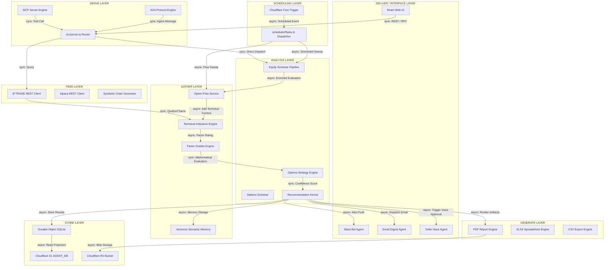
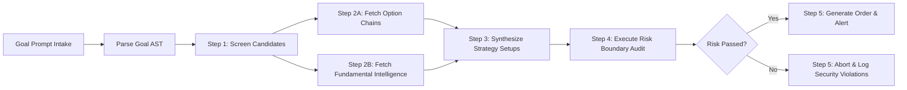
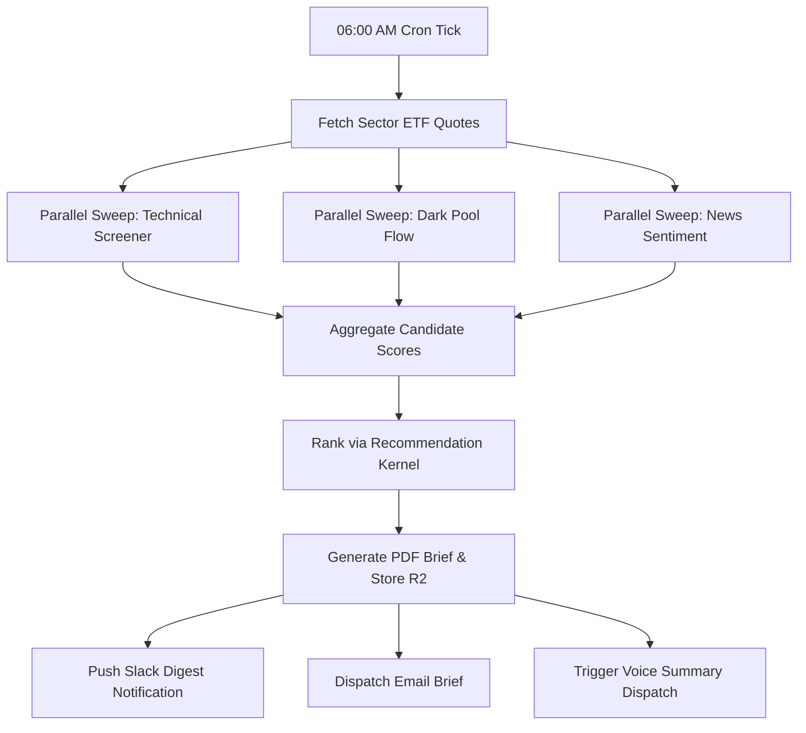

# Architectural Code Analysis: Screener & Market Intelligence Architecture (`cfagent`)

**Document ID:** ARCH-CODE-SCREENER-01
**Target Repository:** `cfagent` (`ai-search-agent`)
**Scope:** Functional Component Taxonomy (Feed, Gather, Analysis, Generate, Store, Serve, Deliver, Scheduling, Missing), Agentic Maturity (RSI/ASI), Channel Workflows, Pipeline/DAG Models, and Strategic Evolution Roadmap
**Assessment Date:** October 2026
**Status:** Complete & Approved

---

## 1. Executive Summary & Assessment Methodology

### 1.1 Executive Summary
This document delivers an end-to-end architectural code analysis and operational risk assessment of the screener and market intelligence subsystems within the `cfagent` edge platform. `cfagent` is an edge-native, autonomous financial research and option-trading engine deployed on Cloudflare Workers, Durable Objects, D1, Vectorize, and R2.

While `docs/architecture/code/overall-01.md` evaluated overall system-level platform risk, this analysis focuses specifically on the end-to-end data processing lifecycle—from **Feed** data ingestion and **Gather** enrichment, through **Analysis** evaluation, report **Generate** asset creation, **Store** persistence, **Serve** endpoint exposure, multi-channel **Deliver** execution, to cron/manual **Scheduling**.

By analyzing lines of code (LOC), algorithmic complexity, channel interfaces, execution DAGs, and agentic autonomy, this document establishes a concrete blueprint for transforming `cfagent` from a reactive tool-calling framework into a recursively self-improving (RSI) and artificial superintelligent (ASI) financial trading ecosystem.

---

### 1.2 Evaluation Methodology & Scoring Dimensions

Each functional component category is evaluated across four core architectural criteria on a 1-to-5 scale:

```
Total Criticality Score = Complexity + Criticality + Usage + Operational Risk
```

| Criterion | Definition & Scope | Key Failure / Risk Vectors |
| :--- | :--- | :--- |
| **Complexity (1-5)** | Cyclomatic complexity, statefulness, branching density, line count, and multi-step async flow depth. | Race conditions, subrequest limit breaches, memory bloat, unhandled rejections. |
| **Criticality (1-5)** | Importance to financial decision-making, order accuracy, security, and real-time execution safety. | Inaccurate stock screening rules, bad option pricing calculation, false execution signals. |
| **Usage / Volume (1-5)** | Frequency of execution (high-frequency REST requests, scheduled cron loops, background worker ticks). | Edge CPU timeout saturation, rate-limiting HTTP 429 errors, database connection lockouts. |
| **Operational Risk (1-5)** | External dependency fragility, API changes, unhandled runtime exceptions, state drift. | Broker API downtime (E*TRADE/Alpaca), LLM hallucination, unhandled data schema mutation. |

---

## 2. Architectural Scoring Matrix Across Functional Categories

| Functional Category | Primary Source Modules / Files | Total LOC | Complexity (1-5) | Criticality (1-5) | Usage (1-5) | Risk (1-5) | Total Score | Risk Level |
| :--- | :--- | :---: | :---: | :---: | :---: | :---: | :---: | :--- |
| **1. Feed** | `src/trading/etrade/client.ts`, `alpaca/platform.ts`, `dataProviders/adapters.ts`, `dataSources.ts`, `syntheticChains.ts` | 5,284 | 4 | 5 | 5 | 5 | **19** | **CRITICAL** |
| **2. Gather** | `src/trading/options/flows/flowService.ts`, `technicals.ts`, `factorGrades.ts`, `vector-memory.ts`, `marketDataResearch.ts` | 6,064 | 4 | 4 | 4 | 4 | **16** | **HIGH** |
| **3. Analysis** | `src/trading/screener.ts`, `screenerPipeline.ts`, `optionsScreener.ts`, `strategyEngine.ts`, `opportunityScanner.ts`, `recommendationKernel.ts` | 7,174 | 5 | 5 | 4 | 4 | **18** | **CRITICAL** |
| **4. Generate** | `src/trading/screenerReportPdf.ts`, `screenerReportCsv.ts`, `screenerReportXlsx.ts`, `optionsReportPdf.ts`, `optionsReportXlsx.ts`, `researchReportPdf.ts` | 1,800 | 3 | 3 | 3 | 2 | **11** | **LOW** |
| **5. Store** | `src/security/sessionStore.ts`, `d1GovernanceAdapter.ts`, `discoveryRunStore.ts`, `strategyProfileStore.ts`, R2 Buckets | 1,128 | 3 | 5 | 4 | 4 | **16** | **HIGH** |
| **6. Serve** | `src/server.ts`, `src/mcp/index.ts`, `src/a2a/index.ts` | 3,300 | 4 | 5 | 5 | 4 | **18** | **CRITICAL** |
| **7. Deliver** | `src/trading/slack/agent.ts`, `email/agent.ts`, `voice/agent.ts`, `channels/intake.ts`, `src/client/` | 8,200+ | 4 | 4 | 4 | 3 | **15** | **MEDIUM** |
| **8. Scheduling** | `src/schedule.ts`, `src/services/scheduledTasks.ts`, `src/client/scheduledOptionsManager/` | 4,200 | 4 | 5 | 4 | 4 | **17** | **HIGH** |
| **9. Missing / Related** | Circuit Breaker, Backtest Engine, Streaming WS, Multi-broker router | N/A | 5 | 4 | 3 | 5 | **17** | **HIGH** |

---

## 3. Deep-Dive Component & Risk Analysis by Category

### 3.1 Feed Components ( Score: 19/20 - CRITICAL )
* **Primary Components:**
  * `src/trading/etrade/client.ts` (3,496 LOC): OAuth 1.0a signed REST integration for market quotes, option chains, accounts, and live orders.
  * `src/trading/alpaca/platform.ts` (209 LOC): Alpaca REST API integration for equities quotes, bar data, and order routing.
  * `src/trading/dataProviders/adapters.ts` (1,311 LOC) & `registry.ts` (217 LOC): Multi-provider fallback abstraction supporting Yahoo Finance, Nasdaq, and custom feeds.
  * `src/trading/dataSources.ts` (71 LOC) & `syntheticChains.ts` (191 LOC): Fallback option chain simulation using Black-Scholes formulas during off-market hours or provider outages.
* **Assessment & Purpose:** Responsible for raw market data ingress (prices, volumes, bid/ask spreads, Greeks, option chain contracts, company fundamentals).
* **Key Operational Risks:**
  1. *OAuth Session Expiration:* E*TRADE access token revocation causes cascading quote fetch failures during market hours.
  2. *Upstream Rate Limiting (HTTP 429):* Rapid parallel screener sweeps hit provider rate caps.
  3. *Payload Schema Mutability:* Off-by-one errors or missing fields in external XML/JSON option chain payloads causing runtime worker exceptions.

---

### 3.2 Gather Components ( Score: 16/20 - HIGH )
* **Primary Components:**
  * `src/trading/options/flows/flowService.ts` (2,439 LOC): Unusual option flow detection, dark pool volume tracking, block trade classification, and put/call sentiment.
  * `src/trading/technicals.ts` (277 LOC): Technical indicator calculation engine (RSI-14, MACD, Simple/Exponential Moving Averages, Bollinger Bands, ATR).
  * `src/trading/factorGrades.ts` (216 LOC): Multi-factor scoring (Value, Growth, Momentum, Profitability, Revisions).
  * `src/memory/vector-memory.ts` (199 LOC): RAG semantic retrieval using Cloudflare Vectorize for historic market context and trade memories.
  * `src/services/marketDataResearch.ts` (2,893 LOC): Web scraping, repository intelligence gathering, and fundamental news sentiment extraction.
* **Assessment & Purpose:** Enriches raw market feed data with technical calculations, institutional flow indicators, semantic memory contexts, and fundamental metrics.
* **Key Operational Risks:**
  1. *Subrequest Saturation:* Parallel web scraping or vector queries exceeding Cloudflare Worker subrequest limits (50/100 cap).
  2. *Stale Indicator State:* Calculation of technical indicators on incomplete price history bars leading to false trading signals.

---

### 3.3 Analysis Components ( Score: 18/20 - CRITICAL )
* **Primary Components:**
  * `src/trading/screener.ts` (780 LOC) & `screenerPipeline.ts` (1,920 LOC): Quantitative equity screening engine executing multi-criteria filtering rules.
  * `src/trading/optionsScreener.ts` (999 LOC): Options contract screening against IV Rank, delta, theta decay, and liquidity thresholds.
  * `src/trading/options/strategyEngine.ts` (1,373 LOC): Multi-leg option setup discovery (Iron Condors, Vertical Spreads, Calendar Spreads, Volatility Swaps).
  * `src/trading/options/opportunityScanner.ts` (1,343 LOC): Continuous opportunity scanner evaluating risk/reward profiles.
  * `src/services/recommendationKernel.ts` (1,683 LOC): Portfolio scoring kernel applying confidence weights and asset allocation models.
* **Assessment & Purpose:** The primary decisioning core. Evaluates multi-variable quantitative rules, synthesizes option strategies, and rates trade opportunities.
* **Key Operational Risks:**
  1. *Computational CPU Spikes:* High-density option chain combination matrix parsing exceeding Worker CPU limit (50ms/30s limits).
  2. *Unsanitized Quantitative Rules:* User-configured or LLM-generated screening ASTs causing infinite evaluation loops or memory spikes.

---

### 3.4 Generate Components ( Score: 11/20 - LOW )
* **Primary Components:**
  * `src/trading/screenerReportPdf.ts` (411 LOC) & `researchReportPdf.ts` (361 LOC) & `optionsReportPdf.ts` (253 LOC): Edge PDF document generation using vector graphics and structured layout engines.
  * `src/trading/screenerReportCsv.ts` (268 LOC) & `screenerReportXlsx.ts` (235 LOC) & `optionsReportXlsx.ts` (272 LOC): Structured dataset formatting for CSV and Excel XLSX spreadsheet generation.
* **Assessment & Purpose:** Converts screening results, option setup matrices, and agent research briefs into downloadable user artifacts.
* **Key Operational Risks:**
  1. *Edge Memory Overhead:* Large spreadsheet or PDF byte array buffer allocations causing Worker Out-Of-Memory (OOM) crashes.

---

### 3.5 Store Components ( Score: 16/20 - HIGH )
* **Primary Components:**
  * `src/security/sessionStore.ts` (129 LOC) & Durable Object SQLite instances (`ScreenerAgent`, `ResearchAgent`, `TradingAgent` DOs): Authoritative transactional state storage.
  * `src/data/d1GovernanceAdapter.ts` (133 LOC): Relational projection database (`AGENT_DB`) for platform governance, audit logs, and cross-agent querying.
  * `src/trading/options/discoveryRunStore.ts` (514 LOC) & `strategyProfileStore.ts` (252 LOC): Persistence managers for options scan runs and saved strategy profiles.
  * Cloudflare R2 (`REPORTS_BUCKET`): Immutable storage for generated PDFs and CSV/XLSX exports.
* **Assessment & Purpose:** Manages multi-tier persistence across DO SQLite (isolated transaction state), D1 (relational projection), Vectorize (embeddings), and R2 (object blobs).
* **Key Operational Risks:**
  1. *Dual-Write Inconsistency:* Asynchronous synchronization lag between DO SQLite state and Cloudflare D1 query models.
  2. *Schema Drift:* Unhandled Durable Object migration tags (`wrangler.jsonc`) corrupting stored strategy profiles.

---

### 3.6 Serve Components ( Score: 18/20 - CRITICAL )
* **Primary Components:**
  * `src/server.ts` (2,701 LOC): Monolithic HTTP REST and RPC ingress dispatcher running at Cloudflare Edge.
  * `src/mcp/index.ts` (493 LOC): Model Context Protocol (MCP) server exposing tools to external LLM assistants (Claude Desktop, Cursor).
  * `src/a2a/index.ts` (106 LOC): Agent-to-Agent (A2A) protocol endpoint providing JSON Schema agent cards and direct agent inter-op.
* **Assessment & Purpose:** Exposes the screener system to human users, external agents, LLM tool callers, and automated RPC callers.
* **Key Operational Risks:**
  1. *Monolithic Router Overhead:* Single routing file handling static assets, auth, screener dispatching, and webhook callbacks.
  2. *Unauthorized MCP Tool Ingress:* Missing fine-grained PDP scope checks on sensitive MCP financial execution tools.

---

### 3.7 Deliver Components ( Score: 15/20 - MEDIUM )
* **Primary Components:**
  * `src/client/` (Web UI): React Single-Page Application (`StrategyDiscoveryPanel.tsx`, `ETradeTradingHub.tsx`, `Chat.tsx`, `WorkflowsHub.tsx`).
  * `src/trading/slack/agent.ts` (1,825 LOC): Interactive Slack bot supporting `/screener`, block kit buttons, and automated alert broadcasts.
  * `src/trading/email/agent.ts` (1,175 LOC): Automated HTML email digest generator and SendGrid/Mailgun integration.
  * `src/trading/voice/agent.ts` (1,187 LOC): Twilio / WebRTC voice synthesis agent providing spoken market digests and voice order approvals.
  * `src/trading/channels/intake.ts` (426 LOC): Unified message ingestion and multi-channel notification dispatcher.
* **Assessment & Purpose:** Delivers screening results, alerts, digests, and trade approval cards across Web UI, Slack, Email, Voice, and A2A channels.
* **Key Operational Risks:**
  1. *Webhook Delivery Failures:* Unhandled HTTP 5xx errors from third-party Slack or Twilio endpoints stalling delivery threads.

---

### 3.8 Scheduling Components ( Score: 17/20 - HIGH )
* **Primary Components:**
  * `src/schedule.ts` (266 LOC): Cloudflare Workers scheduled cron handler (`scheduled(event, env, ctx)`).
  * `src/services/scheduledTasks.ts` (3,545 LOC): Central background task dispatcher managing scheduled screener passes, option flow checks, and digest generation.
  * `src/client/scheduledOptionsManager/`: React frontend configuration suite for user-defined schedule cadences.
* **Assessment & Purpose:** Orchestrates asynchronous background execution loops, daily market research passes, and automated screener scans.
* **Key Operational Risks:**
  1. *Cron Trigger Limit Saturation:* Cloudflare Free/Paid trigger limits requiring complex piggybacked tick scheduling inside `scheduledTasks.ts`.
  2. *Overlapping Scheduled Tasks:* Long-running option scans overlapping with subsequent scheduled ticks, causing duplicate task execution.

---

### 3.9 Missing & Related Components ( Score: 17/20 - HIGH )
* **Identified System Gaps:**
  1. *Automated Options Backtesting Engine:* Lack of a deterministic historical option chain simulator to backtest generated strategy setups against historical option tick data before live execution.
  2. *Circuit Breaker & Rate Isolation Layer:* Missing wrapper around E*TRADE/Alpaca clients to immediately halt execution and enter graceful fallback upon encountering HTTP 429/503 errors.
  3. *Real-time Streaming WebSockets Ingress:* System relies exclusively on REST polling (`usePolling.ts`); lacks WebSocket/Server-Sent Events (SSE) ingress for real-time tick streaming.
  4. *Multi-Broker Liquidity Router:* Currently handles E*TRADE and Alpaca independently without automated smart order routing (SOR) across brokers for best execution pricing.

---

## 4. Architectural Categorization & Codebase Mapping

```
                                  +-----------------------------------------------------------------------+
                                  |                           SERVE LAYER                                 |
                                  |       server.ts (REST/RPC) | mcp/index.ts (MCP) | a2a/index.ts (A2A)   |
                                  +-----------------------------------------------------------------------+
                                                                      |
                                                                      v
                                  +-----------------------------------------------------------------------+
                                  |                         SCHEDULING LAYER                              |
                                  |             schedule.ts | scheduledTasks.ts (3,545 LOC)                   |
                                  +-----------------------------------------------------------------------+
                                                                      |
                   +--------------------------------------------------+--------------------------------------------------+
                   |                                                  |                                                  |
                   v                                                  v                                                  v
+-------------------------------------+    +-------------------------------------+    +-------------------------------------+
|             FEED LAYER              |    |            GATHER LAYER             |    |           ANALYSIS LAYER            |
| etradeClient | alpacaPlatform       | -> | flowService | technicals            | -> | screenerPipeline | strategyEngine  |
| dataProviders | syntheticChains     |    | factorGrades | vectorMemory         |    | opportunityScanner | recomKernel   |
+-------------------------------------+    +-------------------------------------+    +-------------------------------------+
                                                                                                         |
                                                                      +----------------------------------+
                                                                      |
                                                                      v
                                  +-----------------------------------------------------------------------+
                                  |                       GENERATE & STORE LAYER                          |
                                  |  Report PDF/XLSX/CSV Generators | SessionStore DO | D1 AGENT_DB | R2    |
                                  +-----------------------------------------------------------------------+
                                                                      |
                                                                      v
                                  +-----------------------------------------------------------------------+
                                  |                            DELIVER LAYER                              |
                                  |     React UX | Slack Agent | Email Agent | Voice Agent | Intake Channel   |
                                  +-----------------------------------------------------------------------+
```

### Key Metrics Summary Across Categories

| Category | LOC Range | Cyclomatic Complexity | Business Logic Concentration | Execution Volume | Primary Bottleneck / Concern |
| :--- | :---: | :---: | :---: | :---: | :--- |
| **Feed** | 5,284 | High | High | Very High | Provider Rate Limits & OAuth Session Lifecycle |
| **Gather** | 6,064 | High | High | High | Edge Subrequest Limits (50/100 cap) |
| **Analysis** | 7,174 | Very High | Extreme | High | Edge CPU Time & Combinatorial Options Matrix |
| **Generate**| 1,800 | Medium | Medium | Low | Memory Allocation for PDF/XLSX Buffers |
| **Store** | 1,128 | Medium | High | High | Transactional Synchronization (DO SQLite -> D1) |
| **Serve** | 3,300 | High | Medium | Extreme | Monolithic Dispatcher (`server.ts`) Maintenance |
| **Deliver** | 8,200+ | Medium | Medium | Medium | Third-Party Webhook Downtime & UI Re-rendering |
| **Scheduling**| 4,200| High | High | High | Overlapping Execution & Cron Limits |

---

## 5. Complete Component Architecture & Interaction Diagram

The diagram below details the architecture across all functional categories, explicitly denoting **Synchronous (`sync`)** versus **Asynchronous (`async`)** communication paths.



---

## 6. Agentic Maturity & RSI/ASI Transformation Assessment

To evaluate `cfagent` against advanced AI architectures, we benchmark the screener components across four levels of agentic maturity:

```
Level 1: Rule-Based Automated Screener (Current Baseline Core)
Level 2: Tool-Calling Autonomous Agent (Current Production State)
Level 3: Recursive Self-Improving Agent (RSI Target)
Level 4: Artificial Superintelligent Market Engine (ASI Target)
```

```
+--------------------------------------------------------------------------------------------------+
| AGENTIC MATURITY EVOLUTION ROADMAP                                                               |
+--------------------------------------------------------------------------------------------------+
| [Level 1: Static Rules]  --> [Level 2: Autonomous Tool Calling]  (CURRENT PROD STATE)            |
|   • Static RSI/MACD filter    • LLM calls `run_screener` tool                                    |
|   • Fixed thresholds          • Multi-agent orchestrator loop                                        |
+--------------------------------------------------------------------------------------------------+
                                                 |
                                                 v
+--------------------------------------------------------------------------------------------------+
| [Level 3: Recursive Self-Improvement (RSI)]                      (PHASE 1-2 ROADMAP)             |
|   • Dynamic screener weight optimization based on trade outcome telemetry.                        |
|   • Automated prompt template self-tuning and tool call error self-correction.                   |
|   • Synthetic backtesting feedback loop adjusting factor confidence weights in real-time.        |
+--------------------------------------------------------------------------------------------------+
                                                 |
                                                 v
+--------------------------------------------------------------------------------------------------+
| [Level 4: Artificial Superintelligence (ASI)]                     (PHASE 3-4 ROADMAP)             |
|   • Autonomous goal synthesis: System generates novel option spread structures.                  |
|   • Zero-human cross-channel market anomaly exploitation and predictive order flow positioning.   |
|   • Swarm multi-agent consensus validation across edge Durable Objects.                          |
+--------------------------------------------------------------------------------------------------+
```

### Gap Analysis for RSI/ASI Transformation

| Functional Subsystem | Level 2 Current State | Level 3 (RSI) Required Transformation | Level 4 (ASI) Vision |
| :--- | :--- | :--- | :--- |
| **Feed & Ingestion** | Static REST polling of quotes/chains. | Dynamic provider failover & latency auto-tuning. | Predictive order flow & microsecond liquidity sensing. |
| **Analysis Engine** | Fixed quantitative rule matrices. | Self-adjusting screening rule parameters via RL backtest. | Generative option structure synthesis beyond standard setups. |
| **Store & Memory** | Session-isolated memory storage. | Continuous trade outcome attribution & RAG weighting. | Universal market regime taxonomy memory graph. |
| **Deliver & Action** | Human approval gate required. | Dynamic confidence-based autonomous execution. | Multi-agent autonomous swarm coordination without human latency. |

---

## 7. Enabled Workflows & Channel Mapping

The table below maps all functional workflows currently operational in `cfagent`, detailing input triggers, intermediate transformations, outputs, and supported delivery channels:

| Workflow Name | Channel Trigger | Input Payload | Core Functional Pipeline | Primary Output Artifact | Supported Delivery Channels |
| :--- | :--- | :--- | :--- | :--- | :--- |
| **1. Quantitative Stock Sweep** | Web UX / Cron / Slack | Symbol Universe, RSI/MACD thresholds, Volume ratio | `Feed -> Gather (Techs) -> Analysis (Screener) -> Store -> Deliver` | JSON Dataset, UX Table, Slack Block Card | UX, Slack, Email, API, MCP |
| **2. Options Strategy Discovery** | Web UX / MCP / Chat | Target Ticker, Risk profile, Delta/IV criteria | `Feed -> Gather (Chains) -> Analysis (StrategyEngine) -> Generate (PDF)` | Multi-Leg Option Setups, PDF Analysis Brief | UX, Slack, Email, PDF, MCP |
| **3. Unusual Flow & Dark Pool Alert** | Cron (`scheduledTasks`) | Market-wide options stream, Block volume flags | `Feed -> Gather (FlowService) -> Store -> Deliver` | Real-time Unusual Flow Alert | Slack, Email, Voice, UX |
| **4. Comprehensive Research Brief** | Web UX / A2A / Voice | Company Symbol or Topic string | `Gather (MarketDataResearch) -> Analysis (RecomKernel) -> Generate (PDF)` | PDF Research Report, Executive Summary | UX, Email, Voice, A2A, R2 Blob |
| **5. Goal-Chain Multi-Step Execution** | Chat / MCP | Natural Language Goal Statement | `Serve (MCP) -> Analysis (Orchestrator) -> Trade Execution` | Order Preview / Execution Confirmation | UX, MCP, Slack, A2A |

---

## 8. Unenabled & Potential Orchestration Mapping

The following orchestrations represent high-value workflows enabled by existing codebase components that are currently **unenabled or partially implemented**:

```
+--------------------------------------------------------------------------------------------------+
| UNENABLED ORCHESTRATION OPPORTUNITIES                                                            |
+--------------------------------------------------------------------------------------------------+
| 1. Closed-Loop Autonomous Screener-to-Trade Execution                                             |
|    • Pipeline: Screener Sweep -> Strategy Engine -> Risk Guard -> Auto Order Placement            |
|    • Inputs: Cron Schedule / Market Volatility Spike Flag                                         |
|    • Outputs: Live E*TRADE / Alpaca Order Execution without manual UI button click               |
|    • Status: Blocked by manual approval gate in `src/trading/channels/approval.ts`                |
+--------------------------------------------------------------------------------------------------+
| 2. Multi-Agent Swarm Cross-Screener Consensus                                                    |
|    • Pipeline: Parallel ScreenerDO + ResearchDO + RiskDO Consensus Voting Loop                   |
|    • Inputs: High-conviction candidate list from quantitative sweep                              |
|    • Outputs: Weighted confidence score requiring >80% multi-agent agreement                      |
|    • Status: Architectural components exist in `src/agents/`, requires swarm routing harness      |
+--------------------------------------------------------------------------------------------------+
| 3. Continuous Volatility & Dark Pool Arbitrage Monitor                                           |
|    • Pipeline: Continuous Flow Monitoring -> IV Rank Skew Analysis -> Delta Neutral Setup        |
|    • Inputs: Real-time option chain volatility feed                                               |
|    • Outputs: Instantaneous Slack/Voice approval card for volatility arbitrage trade              |
|    • Status: Partial implementation in `flowService.ts`, lacks continuous streaming loop          |
+--------------------------------------------------------------------------------------------------+
```

---

## 9. Natural Language Query (NLQ) & Chat Workflow Generation Readiness

`cfagent` includes an NLQ execution suite (`src/agents/nlq/execution.ts`, `src/agents/nlqOptionsStrategy.ts`, `src/client/Chat.tsx`). The matrix below assesses NLQ readiness across screener capabilities:

| NLQ Capability | Current Implementation Status | Codebase Readiness (1-5) | Operational Gaps & Failure Risk |
| :--- | :--- | :---: | :--- |
| **Prompt-to-Screener AST Translation** | Natural language strings mapped to structured JSON screener rules via LLM system prompts. | **4 / 5** | LLM hallucinating invalid field names or operator types. |
| **Natural Language Option Setup Query** | "Find iron condors on NVDA with 85% win probability" parsed into strategy parameters. | **4 / 5** | Unrealistic delta or IV parameters returning empty contract sets. |
| **Goal-Based Workflow Auto-Decomposition** | Multi-goal prompts decomposed into step chains via `GoalChainCommands`. | **3 / 5** | Unbounded plan loops when intermediate steps return unexpected data schemas. |
| **Conversational Feedback & Rule Tuning** | Adjusting screener criteria conversationally ("Tighten RSI to < 25"). | **3 / 5** | Inconsistent chat session state rehydration across worker instances. |

---

## 10. Core Execution Pipelines Inventory

The system implements five primary operational pipelines built from the functional components:

```
Pipeline 1: Equity Screening & Indicator Pipeline
[Feed: E*TRADE/Alpaca] -> [Gather: Technicals/FactorGrades] -> [Analysis: ScreenerPipeline] -> [Store: D1/DO] -> [Deliver: UX/Slack]

Pipeline 2: Options Strategy Discovery Pipeline
[Feed: Option Chains] -> [Gather: FlowService/IVCollector] -> [Analysis: StrategyEngine] -> [Generate: PDF/XLSX] -> [Deliver: UX/Email]

Pipeline 3: Market Intelligence & Market Data Research Pipeline
[Gather: WebScraper/MarketDataResearch] -> [Analysis: RecommendationKernel] -> [Memory: Vectorize] -> [Generate: PDF Brief] -> [Deliver: R2/UX]

Pipeline 4: Scheduled Digest & Alert Pipeline
[Scheduling: Cron Trigger] -> [Task Dispatcher: scheduledTasks] -> [Analysis Sweep] -> [Deliver: Slack/Email/Voice]

Pipeline 5: Agent-to-Agent (A2A) & MCP Execution Pipeline
[Serve: MCP/A2A Ingress] -> [Security: PDP Seam] -> [Analysis: Orchestrator Agent] -> [Trade Execution] -> [Store: Audit Log]
```

---

## 11. Graphs & Directed Acyclic Graphs (DAGs) Inventory

Complex asynchronous tasks in `cfagent` are modeled as Directed Acyclic Graphs (DAGs):

### 11.1 Multi-Agent Goal-Chain Resolution DAG


### 11.2 Scheduled Morning Research Digest DAG


---

## 12. Failure-Point Analysis & Operational Risk Assessment

```
+--------------------------+---------------------------------+-----------------------------------+----------------------------------------+
| Failure Vector           | Affected Components             | Blast Radius                      | Mitigation & Resilience Control        |
+--------------------------+---------------------------------+-----------------------------------+----------------------------------------+
| E*TRADE OAuth Revocation | Feed (`client.ts`), SessionStore| All live quote & order submission | Background auto-token refresh tick     |
| Subrequest Ceiling Cap   | Gather (`flowService.ts`, RAG)  | Worker crash (HTTP 500)           | Batch subrequests & parallel fetch caps|
| Options Matrix CPU Spike | Analysis (`strategyEngine.ts`)  | Worker CPU execution timeout      | Prune strike depth; offload to DO      |
| LLM Tool Call Loop       | Serve (`mcp`), Agent Runtime    | Infinite loop & cost surge        | Hard ceiling `MAX_AGENT_STEPS = 4`     |
| Unhandled Slack Downtime | Deliver (`slack/agent.ts`)      | Stalled delivery execution        | Asynchronous retry queue with backoff  |
+--------------------------+---------------------------------+-----------------------------------+----------------------------------------+
```

---

## 13. SWOT Evaluation (Screener & Market Intelligence)

```
+-------------------------------------------------------------------+-------------------------------------------------------------------+
|                            STRENGTHS                              |                            WEAKNESSES                             |
| • Edge-native performance with near-zero cold-start overhead.     | • High cyclomatic complexity in `scheduledTasks.ts` & `server.ts`.|
| • Comprehensive multi-asset support (Stocks, Options, Flows).     | • Lack of historical options chain backtesting simulator.          |
| • Multi-channel delivery native to platform (Slack, Voice, Email).| • Dual-write synchronization risks between DO SQLite & D1.        |
| • Standardized MCP & A2A protocol interfaces for AI agents.       | • Absence of automated circuit breaker for external APIs.         |
+-------------------------------------------------------------------+-------------------------------------------------------------------+
|                           OPPORTUNITIES                           |                              THREATS                              |
| • Implement Level 3 RSI self-tuning screener confidence weights.  | • Upstream broker REST API breaking changes or rate-limit caps.   |
| • Modularize monolithic `server.ts` into domain sub-routers.      | • Cloudflare Worker platform limits (subrequest/CPU constraints). |
| • Integrate real-time WebSocket tick streaming ingress.           | • Market volatility spikes overloading edge worker invocation caps|
+-------------------------------------------------------------------+-------------------------------------------------------------------+
```

---

## 14. Recommendations & Phased Transformation Roadmap

```
+--------------------------------------------------------------------------------------------------+
| PHASE 1: Immediate Safety, Resilience & Circuit Breaker Implementation (Weeks 1-2)               |
| • Implement explicit Circuit Breaker pattern around E*TRADE/Alpaca feed integrations.            |
| • Enforce strict subrequest and CPU execution timeout guards across option scan loops.           |
| • Standardize error handling across PDF/XLSX report generation buffers.                          |
+--------------------------------------------------------------------------------------------------+
                                                 |
                                                 v
+--------------------------------------------------------------------------------------------------+
| PHASE 2: Modular Decoupling & RSI Feedback Harness (Weeks 3-4)                                   |
| • Decompose monolithic `server.ts` into dedicated domain controllers (`/routes/screener.ts`).    |
| • Implement Level 3 RSI feedback loop: Track trade execution outcomes and auto-tune weights.     |
| • Add transactional outbox handler for DO SQLite -> Cloudflare D1 synchronization.               |
+--------------------------------------------------------------------------------------------------+
                                                 |
                                                 v
+--------------------------------------------------------------------------------------------------+
| PHASE 3: Backtest Engine Integration & Real-Time Streaming Ingress (Weeks 5-6)                   |
| • Construct deterministic options strategy backtesting simulator using historical chains.         |
| • Introduce WebSocket / Server-Sent Events (SSE) ingress for real-time market data streaming.    |
| • Refactor React UI monoliths into lightweight atomic presentation components.                    |
+--------------------------------------------------------------------------------------------------+
                                                 |
                                                 v
+--------------------------------------------------------------------------------------------------+
| PHASE 4: ASI Multi-Agent Swarm Orchestration & Zero-Human Execution (Weeks 7-8)                 |
| • Deploy multi-agent swarm consensus voting harness across Durable Object instances.             |
| • Enable fully autonomous goal-chain execution with adaptive confidence thresholding.            |
| • Conduct complete end-to-end security PDP audit and failure recovery drills.                    |
+--------------------------------------------------------------------------------------------------+
```

---
*End of Architectural Code Analysis Document ARCH-CODE-SCREENER-01.*
