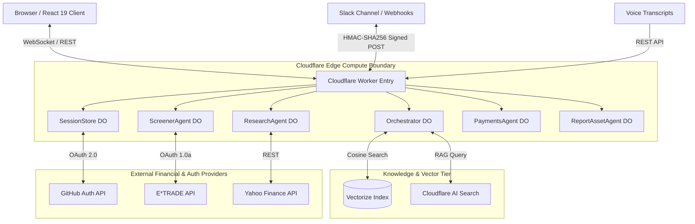
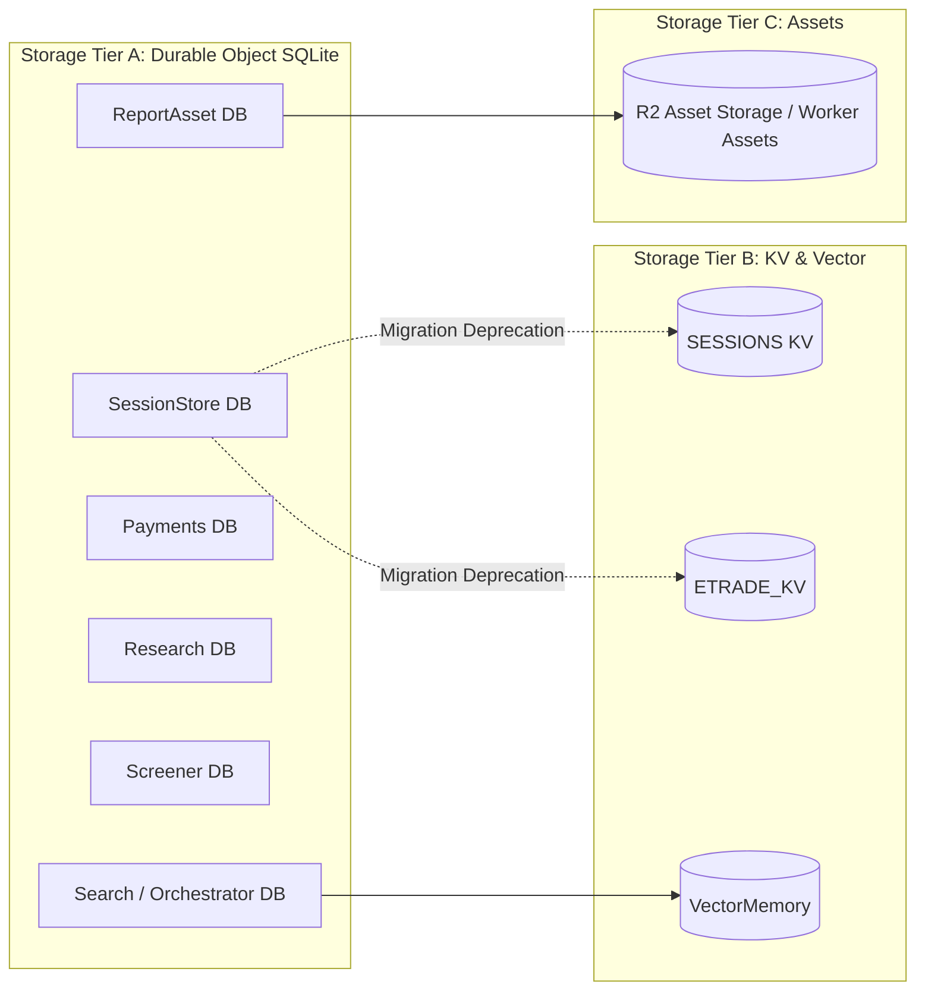
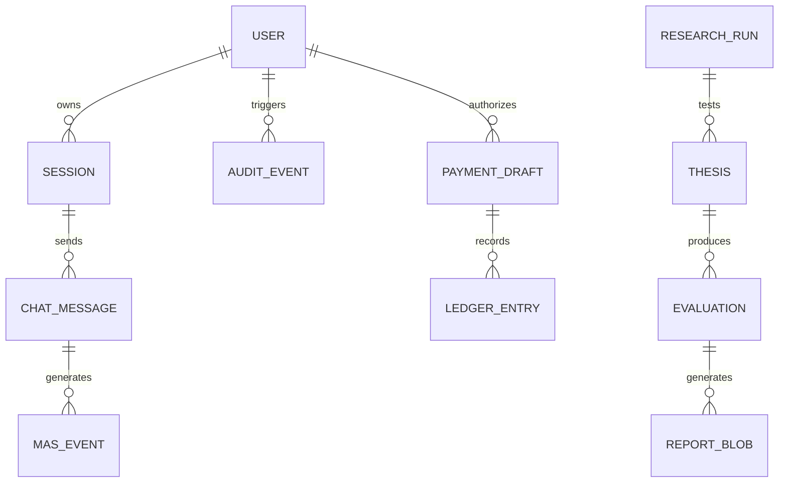
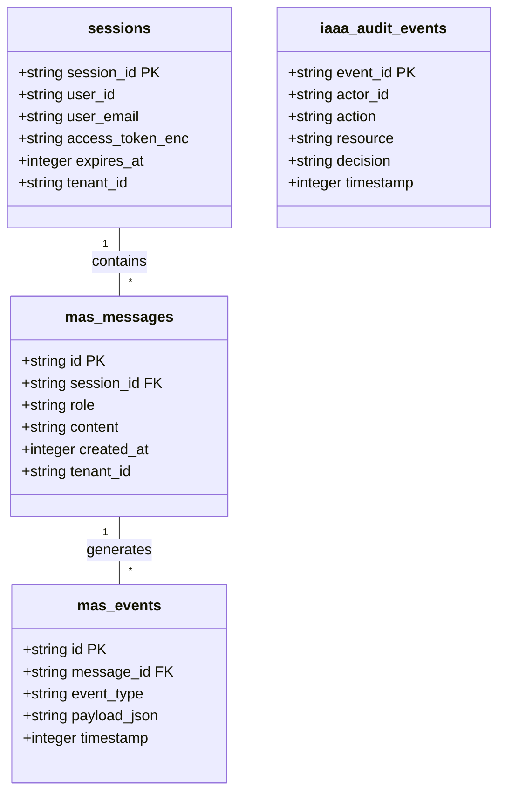
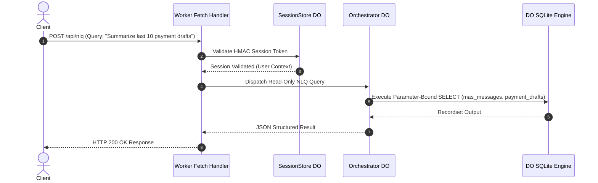
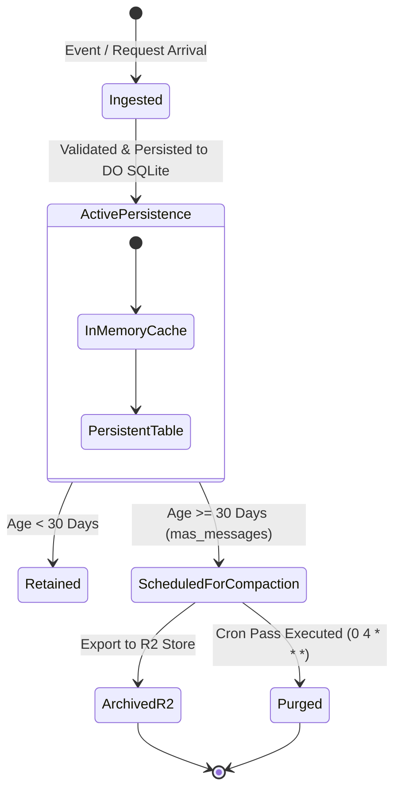

# Data Architecture Assessment & Fit/Gap Analysis (Assessment-01)

**Document Reference:** `docs/architecture/data/assessment/assessment-01.md`
**Repository:** `OpenAIMP/cfagent`
**Commit SHA:** `2883d144275124d79814e2ceb9db9fad1748a0e5` (Branch: `main`)
**Assessment Date:** October 2026
**Primary Roles & Governance:** RSI Chief Data Officer / Lead Data Architect
**Review Board:** Chief Technology Officer (CTO) & Chief Information Security Officer (CISO)
**Status:** Canonical Baseline Assessment (Read-Only Assessment; Repository Write Authorized)

---

## 1. Role, Objective & Executive Summary

### 1.1 Scope and Purpose
This document provides an evidence-backed, current-state data architecture assessment, a tailored DAMA-DMBOK fit/gap analysis, and a justified target architecture for the `cfagent` platform. It documents how data enters, moves through, persists in, is protected by, and leaves the application, evaluating the architecture against business requirements, security standards (OWASP ASVS, NIST Privacy Framework), and organizational governance.

### 1.2 Baseline Context & Assessment Summary
`cfagent` is an enterprise-grade multi-agent assistant and cross-channel options research engine built natively on the Cloudflare edge ecosystem (Cloudflare Workers, Durable Objects with embedded SQLite, Vectorize, Workers AI, Cloudflare AI Search, and R2 asset storage).

| Metric / Dimension | Baseline Value / Status |
|---|---|
| **Repository Commit SHA** | `2883d144275124d79814e2ceb9db9fad1748a0e5` |
| **Primary Execution Platform** | Cloudflare Workers (`nodejs_compat`, `compatibility_date: 2026-09-29`) |
| **Stateful Persistence Engine** | 8 Durable Object Classes using embedded DO SQLite tables |
| **Vector Storage** | Cloudflare Vectorize Index (`vector-memory`) |
| **Key-Value Store** | Cloudflare KV (`SESSIONS`, `ETRADE_KV`) + DO `SessionStore` |
| **AI & Knowledge Engine** | Cloudflare Workers AI (`@cf/zai-org/glm-4.7-flash`) + AI Search Endpoint |
| **Architecture Rating** | **Grade: B+ (Robust Edge Architecture; Needs Schema & Lineage Hardening)** |

### 1.3 Key Architectural Strengths
1. **Edge-Native Co-location:** High-performance, low-latency state persistence via Durable Objects SQLite colocated with computational logic.
2. **Deterministic Agent State Machine:** Well-defined separation of duties across specialized Durable Objects (`SearchAgent`, `PaymentsAgent`, `ScheduledAgent`, `ScreenerAgent`, `ResearchAgent`, `SessionStore`, `ReportAssetAgent`).
3. **Guardrailed Financial Actions:** Payment drafting (`PaymentsAgent`) and order drafting are strictly stateful and human-in-the-loop; direct unverified money execution is prevented by architecture.
4. **Structured Auditability:** IAAA (Identity, Authentication, Authorization, Audit) event stores and session activity logging are implemented natively inside DO SQLite storage (`iaaa_audit_events`, `iaaa_session_activity`).

### 1.4 Primary Risks & Structural Gaps
1. **Schema Evolution & Migration Management:** Lack of centralized schema migration tools (e.g. Drizzle Kit or Prisma migrations) for DO SQLite tables; migrations rely on raw DDL execution in `block_concurrency_while`.
2. **Multi-Tenant Data Isolation:** Tenant context (`tenant_id`, `workspace_id`) is present in application queries but lacks database-level enforcement or Row-Level Security (RLS) constraints within shared DO SQLite or KV stores.
3. **Cross-Tenant Vector Re-use Risk:** Vector embeddings stored in Cloudflare Vectorize rely on application-level filtering (`tenant_id` metadata) rather than physical index partitioning.
4. **Unbounded Log Growth:** Certain tables (e.g. `mas_messages`, `screener_runs`, `research_runs`) lack automated background compaction or TTL retention passes outside of scheduled crons.

---

## 2. Baseline & Reference Frameworks

To evaluate the `cfagent` data estate, this assessment maps architecture practices against established international standards:

```
                  ┌─────────────────────────────────────────┐
                  │          TOGAF ADM Cycle (Phase B)       │
                  └────────────────────┬────────────────────┘
                                       │
      ┌────────────────────────────────┼────────────────────────────────┐
      ▼                                ▼                                ▼
┌──────────────┐             ┌──────────────────┐            ┌────────────────────┐
│ DAMA-DMBOK2  │             │   COBIT 2019 /   │            │ Security & Privacy │
│ 11 Knowledge │             │   ITIL 4 Service │            │ OWASP ASVS v4.0    │
│  Areas       │             │   Management     │            │ NIST Privacy Fwk   │
└──────────────┘             └──────────────────┘            └────────────────────┘
```

### 2.1 Framework Mapping Register

| Reference Framework | Version / Edition | Applicability & Scope | Implementation / Mapping |
|---|---|---|---|
| **DAMA-DMBOK2** | 2nd Edition (2017) | Core Data Management Body of Knowledge across 11 Knowledge Areas. | Evaluated in Section 7 (Fit/Gap Matrix). Primary focus on Governance, Architecture, Storage, Security, Integration, and Quality. |
| **TOGAF ADM** | Standard 10th Edition | Baseline → Target → Gap → Remediated Architecture structure. | Direct framing for Sections 3, 5, 7, 8, and 9. |
| **COBIT 2019 / ITIL 4** | 2019 / 4th Edition | Decision rights, risk management, data asset controls, and incident tracing. | Governance mapping for session store, IAAA audit logs, and payments ledger. |
| **OWASP ASVS** | Level 2 (v4.0.3) | Identity, session management, access control, data protection, and storage security. | Mapped in Section 6 (Security & Tenancy) against HMAC session verification, CSWSH validation, and SQL parameterization. |
| **NIST Privacy Framework** | Version 1.0 | Data mapping, inventory, processing transparency, and data lifecycle management. | Mapped against personal data processing (GitHub OAuth profiles, Slack/Email IDs). |
| **OpenAPI / JSON Schema** | 3.1.0 / Draft 2020-12 | HTTP contract specifications and runtime payloads. | Applied to `/api/*`, `/nlq/webhook`, and MCP tool invocation schemas. |
| **ISO/IEC 25012** | 2008 Standard | Data Quality Model (Accuracy, Completeness, Consistency, Credibility). | Applied to evaluation datasets and market quote data feeds in Section 6.2. |

---

## 3. Comprehensive Data Estate Discovery & Inventory

### 3.1 Storage Tier & Component Topology

The `cfagent` application utilizes four distinct storage tiers provided by Cloudflare Workers infrastructure:

```
┌──────────────────────────────────────────────────────────────────────────┐
│                        Cloudflare Edge Worker                            │
└──────┬──────────────────────┬──────────────────────┬──────────────┬──────┘
       │                      │                      │              │
       ▼                      ▼                      ▼              ▼
┌──────────────┐       ┌──────────────┐       ┌──────────────┐┌──────────────┐
│  DO SQLite   │       │ Durable KV   │       │ Vectorize    ││ R2 Asset     │
│ Embedded DB  │       │ Key-Value    │       │ Vector DB    ││ Object Store │
└──────────────┘       └──────────────┘       └──────────────┘└──────────────┘
```

### 3.2 Persistent Data Asset Catalog

#### Tier A: Durable Object SQLite Databases

| DO Class Name | Internal Database Purpose | Primary Tables / Collections | Authoritative Status | Lifecycle & Retention |
|---|---|---|---|---|
| **`SearchAgent` / `OrchestratorAgent`** | Chat history, MAS events, KV memory, system settings | `mas_messages`, `mas_events`, `mas_memory`, `mas_settings` | Authoritative | 30-day retentionpass via nightly cron (`0 4 * * *`) |
| **`OptionsScannerMCP`** | Options screener state and scanner configurations | `scanner_configs`, `scanner_results`, `historical_iv` | Authoritative | Active state retained; historical IV purged periodically |
| **`PaymentsAgent`** | x402 payment drafts, ledger, and budget caps | `payment_drafts`, `ledger_entries`, `budget_caps` | Authoritative | Immutable audit ledger; drafts retained indefinitely |
| **`ScheduledAgent`** | Cron job state, scheduled goals, and execution history | `scheduled_goals`, `goal_executions`, `cron_locks` | Authoritative | Retained across worker restarts |
| **`ScreenerAgent`** | E*TRADE options screening runs, trade setups, and reports | `screener_runs`, `trade_setups`, `screener_reports` | Authoritative | Execution history retained |
| **`ResearchAgent`** | Autonomous options research pipelines and falsification runs | `research_runs`, `theses`, `evaluations`, `falsification_logs` | Authoritative | Pipeline state persisted; runs archived to report store |
| **`SessionStore`** | Identity sessions, GitHub OAuth tokens, E*TRADE credentials | `sessions`, `user_credentials`, `iaaa_audit_events`, `iaaa_session_activity` | Authoritative | TTL-backed (12-hour default session expiry) |
| **`ReportAssetAgent`** | Unified report blobstores (PDF/XLSX/JSON) and semantic metadata | `report_blobs`, `report_index`, `report_access_logs` | Authoritative | Blobs stored with SHA-256 integrity hash |

#### Tier B: Key-Value Namespaces (Cloudflare KV)

| KV Binding | Namespace ID | Primary Stored Keys | Authoritative / Derived Status | Fallback / Migration Mode |
|---|---|---|---|---|
| **`SESSIONS`** | `f169a7...` | OAuth states, CSRF tokens, legacy session records | Authoritative / Temporary | `SESSIONS_KV_FALLBACK: "off"` (Migrated to `SessionStore` DO) |
| **`ETRADE_KV`** | `f169a7...` | OAuth tokens, request tokens, verifiers | Authoritative / Temporary | `SESSIONS_KV_FALLBACK: "off"` (Migrated to `SessionStore` DO) |

#### Tier C: Vector Storage & Knowledge Indexing

| Binding / Provider | Index Name / Endpoint | Dimensions / Metric | Purpose | Tenant Scope |
|---|---|---|---|---|
| **`VECTOR_MEMORY`** | `vector-memory` | 1536-dim / Cosine | Long-term episodic memory & semantic conversation retrieval | Application-level metadata filtering (`tenant_id`) |
| **Workers AI Search** | Cloudflare AI Search Endpoint | Managed AI Embeddings | RAG search over indexed documentation and knowledge bases | Shared global knowledge endpoint |

#### Tier D: External API Integrations & Data Feeds

| External System / Provider | Data Disclosed / Ingested | Transport & Security | Authoritative Status |
|---|---|---|---|
| **GitHub OAuth 2.0** | User profile, primary email, org memberships | HTTPS OAuth 2.0 + HMAC state | External Authority |
| **E*TRADE API** | Market quotes, option chains, account portfolios | OAuth 1.0a + RSA / Consumer Secrets | External Authority |
| **Yahoo Finance API** | Historical equity prices, option chains, news sentiment | HTTPS REST API | Derived External |
| **Slack / Webhooks** | Multi-channel queries, report delivery, NLQ execution | HTTPS POST + HMAC-SHA256 (`X-Signature-256`) | External Input/Output |

---

## 4. End-to-End Data Lineage & Flow Tracing

```
┌────────────────────────────────────────────────────────────────────────────────────────┐
│                               End-to-End Lineage Flow                                 │
└────────────────────────────────────────────────────────────────────────────────────────┘

[ User / Client ]
      │
      │ 1. OAuth / Auth Payload
      ▼
[ SessionStore DO ] ──► (Persists: sessions, iaaa_audit_events)
      │
      │ 2. Chat / WS Stream
      ▼
[ Orchestrator DO ] ──► (Persists: mas_messages, mas_events)
      │
      ├───────────────────────┬───────────────────────┐
      │ 3A. RAG Search        │ 3B. Payment Draft     │ 3C. Research & Screen
      ▼                       ▼                       ▼
[ VectorMemory ]       [ PaymentsAgent DO ]     [ Screener / Research Agent DO ]
 (vector-memory)       (payment_drafts)         (screener_runs, research_runs)
                                                      │
                                                      │ 4. Report Assets
                                                      ▼
                                                [ ReportAssetAgent DO ]
                                                (report_blobs, report_index)
```

### 4.1 Flow 1: User Identity & Session Ingestion
1. **Source:** Client initiates login via `/auth/github`.
2. **Ingestion & Validation:** OAuth state generated using constant-time HMAC signature (`src/security/githubOAuth.ts`).
3. **Persistence:** Session record created inside `SessionStore` DO (`sessions` table) storing encrypted access token, user ID, email, and scope.
4. **Audit Log:** Entry written to `iaaa_audit_events` and `iaaa_session_activity`.
5. **Lifecycle:** Session expires automatically after 12 hours or explicit logout.

### 4.2 Flow 2: Multi-Agent Chat & Intent Routing
1. **Source:** User transmits prompt via WebSocket to `OrchestratorAgent`.
2. **Routing:** `src/judge-routing.ts` invokes Workers AI (`glm-4.7-flash`) to score intent (`search`, `payments`, `tasks`, `memory`, `general`).
3. **Execution & Tool Call:** Tool execution routed to respective sub-agent service (`src/services/aiSearch.ts`, `src/services/payments.ts`, etc.).
4. **Persistence:** Message appended to `mas_messages` table; execution telemetry logged to `mas_events`.
5. **Episodic Memory Sync:** Semantic facts extracted and stored in `VectorMemory` (`vector-memory` index) with cosine embeddings.

### 4.3 Flow 3: Options Research & Falsification Pipeline
1. **Source:** Scheduled cron (`*/30 * * * *`) or user trigger invokes `ResearchAgent`.
2. **Data Ingestion:** Market quotes and option chains fetched from E*TRADE API / Yahoo Finance API.
3. **Transformation & Calculation:** Black-Scholes Greeks, implied volatility surfaces, and risk metrics computed in memory (`src/client/options/blackScholes.ts`, `src/shared/riskMath.ts`).
4. **Evaluation & Falsification:** Hypothesis tested against historical pricing and falsification criteria (`src/services/researchFalsification.ts`).
5. **Persistence & Export:** Execution persisted to `research_runs` DO SQLite table. Report binaries (PDF/XLSX) generated and stored in `ReportAssetAgent` DO (`report_blobs`).

---

## 5. Architecture Models & Visualizations

### Diagram 1: Data Context Diagram (Current State)


### Diagram 2: Store / Component Topology


### Diagram 3: Conceptual & Logical ER Diagram


### Diagram 4: Physical Schema View (Orchestrator & Session Domain)


### Diagram 5: Data Flow & Sequence Diagram (NLQ Execution Path)


### Diagram 6: Tenant, Trust, & Security Boundary View
```mermaid
graph TB
    subgraph Public Unstrusted Zone
        UserBrowser[User Browser / WebSocket]
        WebhookSender[External Webhook POST]
    end

    subgraph Perimeter Security Barrier
        HMACGuard[HMAC State & Signature Verifier]
        OriginGuard[CSWSH Origin Validator]
        Sanitizer[XSS & SQL Param Sanitizer]
    end

    subgraph Isolated Tenant Context (Application Layer)
        TenantA[Tenant A Context Filter]
        TenantB[Tenant B Context Filter]
    end

    subgraph Shared Physical Persistence Tier
        DOSQLite[(Shared DO SQLite Tables)]
        VectorIndex[(Shared Vectorize Index)]
    end

    UserBrowser --> OriginGuard
    WebhookSender --> HMACGuard
    HMACGuard --> Sanitizer
    OriginGuard --> Sanitizer
    Sanitizer --> TenantA
    Sanitizer --> TenantB
    TenantA -->|Filtering by tenant_id| DOSQLite
    TenantB -->|Filtering by tenant_id| DOSQLite
    TenantA -->|Metadata filter| VectorIndex
```

### Diagram 7: Data Retention & Lifecycle View


### Diagram 8: Target Architecture View (Phase 2 Remediated)
```mermaid
graph TD
    subgraph Hardened Security & Ingestion Layer
        WAF[Cloudflare WAF / Rate Limiter]
        AuthN[SessionStore DO + PKCE OAuth]
    end

    subgraph Modular Agent Persistence (Isolated DO Instances)
        OrchDO[Orchestrator DO (SQLite)]
        PayDO[PaymentsAgent DO (SQLite + Ledger Enforcer)]
        ResDO[ResearchAgent DO (SQLite)]
    end

    subgraph Enterprise Governance & Quality
        DLQ[Dead Letter Queue / Failure Reconciler]
        SchemaVersioner[Drizzle ORM Migration Manager]
        Compactor[Nightly Retention & Compaction Cron]
    end

    WAF --> AuthN
    AuthN --> OrchDO
    AuthN --> PayDO
    AuthN --> ResDO
    OrchDO --> SchemaVersioner
    OrchDO --> Compactor
    PayDO --> DLQ
```

---

## 6. Detailed Data Assessment Dimensions

### 6.1 Data Integrity, Correctness & Transaction Safety
- **Parameter Binding:** NLQ analytics and SQLite queries in `src/agents/nlq.ts` and `src/orm/schema.ts` strictly utilize parameterized statements (`?` bindings). Raw string concatenation of user input is absent in persistence routines.
- **Transaction Boundaries:** DO SQLite provides single-threaded execution per Durable Object instance, eliminating concurrent race conditions within a single DO. However, cross-DO operations (e.g., creating a payment draft from `OrchestratorAgent` into `PaymentsAgent`) are non-transactional and rely on asynchronous RPC calls without a two-phase commit or saga compensator.
- **Silent Failures:** Certain external API fetches (e.g. Yahoo Finance quotes) fallback to stubbed or cached structures without raising standard alerts; explicit failure telemetry is logged to `mas_events`.

### 6.2 Data Quality, Governance & Semantics
- **ISO/IEC 25012 Evaluation:**
  - *Accuracy & Credibility:* Financial option chain quotes fetched from E*TRADE are authoritative; Yahoo Finance fallback chains are marked as synthetic/derived in response metadata.
  - *Completeness:* Black-Scholes Greeks calculations enforce check for missing volatility inputs before evaluating option strategies.
- **Business Glossary & Metadata:** Standardized field names exist across ORM types (`session_id`, `tenant_id`, `created_at`, `amount_cents`), but no automated schema registry or data dictionary generation tool is currently wired into CI.

### 6.3 Multi-Tenancy, Identity & Privacy
- **Tenancy Boundary:** Tenant scope (`tenant_id`) is stored as a string field in DO SQLite tables (`mas_messages`, `sessions`). Authorization relies entirely on application code appending `WHERE tenant_id = ?` in query clauses.
- **Privacy & PII Exposure:** Personal data collected includes GitHub usernames, primary email addresses, and client IP addresses in audit logs. Audit logs in `iaaa_audit_events` store timestamps, actor IDs, and actions in plain text.
- **OWASP ASVS / NIST Mapping:**
  - *ASVS V2.10 (Session Architecture):* Session tokens utilize constant-time HMAC state signatures.
  - *NIST Privacy Framework (CT.PO-P):* Data processing maps exist for user authentication and audit logging, but automated user data export/deletion endpoints (GDPR/CCPA compliance) require manual database script execution.

### 6.4 RSI (Recursive Self-Improvement) & Learning Cycle Verification
The platform implements autonomous strategy research and agentic feedback loops.

```
┌─────────────────────────────────────────────────────────────────────────┐
│                    RSI Learning & Reflection Loop                       │
└─────────────────────────────────────────────────────────────────────────┘

[ Observation ] ──► [ Outcome Record ] ──► [ Reflection & Evaluation ]
                                                    │
                                                    ▼
[ Changed Behavior ] ◄── [ Candidate Approval ] ◄── [ Improvement Proposal ]
```

- **Traceability:** Research runs log falsification results and strategy evaluations to `research_runs` and `falsification_logs`.
- **Model / Tool Provenance:** Each evaluation record captures `AI_MODEL` (`@cf/zai-org/glm-4.7-flash`), prompt configuration version, and timestamp.
- **Isolation Safeguard:** Synthetic, simulated, backtested, and realized trading performance records are tagged explicitly in `src/trading/options/discoveryRunStore.ts` to prevent synthetic backtest data from overwriting production execution metrics.

---

## 7. DAMA-DMBOK Fit/Gap Analysis Matrix

| Requirement ID | DMBOK Knowledge Area | Baseline Observed Behavior & Evidence | Status | Risk & Business Impact | Recommended Remediation Action | Verification Criteria |
|---|---|---|---|---|---|---|
| **DATA-001** | **Data Storage & Operations** | Embedded DO SQLite stores messages, sessions, and research runs (`src/orm/schema.ts`). | **FIT** | Low. High performance and native edge durability. | Maintain DO SQLite architecture; optimize indexing on `created_at` and `tenant_id`. | Execution of load and regression tests. |
| **DATA-002** | **Data Architecture & Modeling** | Schema defined in TypeScript ORM files (`src/orm/schema.ts`); migrations handled manually in DDL tags (`wrangler.jsonc`). | **PARTIAL FIT** | Medium. Lack of automated schema migration framework risks schema drift across DO instances. | Introduce Drizzle ORM migration runner inside DO `block_concurrency_while`. | Verify seamless schema migration test suite. |
| **DATA-003** | **Data Security (Tenancy)** | Multi-tenancy enforced via application `WHERE tenant_id = ?` query clauses. | **PARTIAL FIT** | High. Cross-tenant data leakage if application query omits tenant filter. | Implement central repository query wrapper that automatically injects tenant scope. | Automated cross-tenant negative access tests. |
| **DATA-004** | **Data Security (Encryption)** | Session access tokens encrypted in DO SQLite; OAuth state verified via constant-time HMAC (`src/security/session.ts`). | **FIT** | Low. Robust cryptographic state verification. | Maintain existing HMAC and session encryption routines. | Security unit tests and penetration testing. |
| **DATA-005** | **Data Governance & Metadata** | Metadata fields (`created_at`, `actor_id`) present; no centralized metadata catalog or lineage tool. | **PARTIAL FIT** | Medium. Traceability difficult for complex cross-channel workflows. | Generate automated OpenAPI schemas and data dictionary docs on build. | CI check verifying data dictionary completeness. |
| **DATA-006** | **Data Quality Management** | Parameter input validation on APIs; Black-Scholes risk math validates option inputs (`src/shared/riskMath.ts`). | **FIT** | Low. Math calculations and payload checks prevent corrupted math state. | Expand runtime schema validation across all external API ingress routes. | Automated schema validation test suite. |
| **DATA-007** | **Document & Content Management** | Report assets (PDF/XLSX/JSON) managed by `ReportAssetAgent` DO with SHA-256 integrity hashes. | **FIT** | Low. Content stored with tamper-evident checksums. | Ensure old report blobs are archived to Cloudflare R2 when storage exceeds threshold. | Blob retrieval and checksum verification tests. |
| **DATA-008** | **Data Lifecycle & Retention** | Nightly retention pass (`0 4 * * *`) purges `mas_messages` >30 days. | **PARTIAL FIT** | Medium. Other tables (`screener_runs`, `research_runs`) grow unbounded. | Implement universal lifecycle retention policies across all DO SQLite tables. | Automated retention pass verification test. |
| **DATA-009** | **Reference & Master Data** | Curated stock universe stored in `src/config/curatedStockUniverse.json`; E*TRADE quotes fetched live. | **FIT** | Low. Controlled reference datasets for trading universes. | Version control stock universe definitions and update procedures. | Verification of universe loading unit tests. |
| **DATA-010** | **Data Integration & Interoperability** | Multi-channel integration (Slack, Voice, Email, Webhooks) handled via unified NLQ planner (`src/trading/slack/agent.ts`). | **FIT** | Low. DRY pipeline across input channels. | Maintain strict HMAC signature verification on all inbound webhooks. | Inbound webhook signature rejection tests. |
| **DATA-011** | **Data Warehousing & BI (NLQ Analytics)** | Read-only NLQ engine converts natural language to parameter-bound SQLite SELECT queries. | **FIT** | Low. Secure analytics access over conversation logs. | Enforce explicit query timeouts and statement SELECT-only whitelist. | SQL injection and benchmark query test suite. |

---

## 8. Target & Transition Architecture

### 8.1 Target State Principles
1. **Zero Raw SQL String Concatenation:** All database interactions must pass through type-safe, parameterized ORM builders.
2. **Defensive Multi-Tenancy:** Storage access routines must strictly mandate tenant context parameterization at the repository boundary.
3. **Automated Schema Lifecycle:** Schema alterations must be executed through versioned migration files validated in CI.
4. **Bounded Storage Footprint:** Every stateful table must have an explicit retention classification (e.g., Ephemeral, Retained 30d, Retained 365d, Permanent Audit) with automated enforcement.

### 8.2 Component Lifecycle Actions

| Component / Asset | Target Classification | Justification & Action Plan |
|---|---|---|
| **`SessionStore` DO SQLite** | **Retain & Harden** | Retain as authoritative session engine; enforce PKCE OAuth verification. |
| **`SESSIONS` / `ETRADE_KV` Namespaces** | **Retire (Completed)** | Deprecated in favor of `SessionStore` DO (`SESSIONS_KV_FALLBACK: "off"`). |
| **`OrchestratorAgent` SQLite** | **Retain & Compact** | Retain message and event tables; enforce strict 30-day compaction pass. |
| **`PaymentsAgent` DO** | **Retain & Integrate** | Retain ledger and budget guard; integrate Dead Letter Queue for failed webhooks. |
| **Vectorize `vector-memory`** | **Enhance Partitioning** | Introduce tenant-specific namespace prefixing on vector IDs (`tenantId:vectorId`). |
| **`ReportAssetAgent` DO** | **Retain & Offload** | Store metadata in DO SQLite; offload report binaries >1MB directly to Cloudflare R2. |

---

## 9. Prioritized Remediation Roadmap

```
┌──────────────────────────────────────────────────────────────────────────┐
│                      Prioritized Remediation Timeline                    │
└──────────────────────────────────────────────────────────────────────────┘

[ Immediate (P0): Security & Integrity ]
  └─ DATA-REM-01: Automated Tenant Scope Injection
  └─ DATA-REM-02: Universal DO Table Retention & Compaction

[ Near-Term (P1): Governance & Reliability ]
  └─ DATA-REM-03: Drizzle Schema Migration Manager in DO SQLite
  └─ DATA-REM-04: Vectorize ID Tenant Prefixing

[ Long-Term (P2): Modernization & Scale ]
  └─ DATA-REM-05: Automated Data Dictionary & OpenAPI Spec Generator
  └─ DATA-REM-06: Cross-DO Saga Compensator for Payments
```

### 9.1 Remediation Task Breakdown

#### Task DATA-REM-01: Automated Tenant Scope Injection (P0)
- **Problem:** Application queries manually add `WHERE tenant_id = ?`, leaving room for developer oversight.
- **Recommended Action:** Create a repository wrapper around DO SQLite statements that mandates a valid `tenant_id` context parameter before executing read/write operations.
- **Acceptance Criteria:** 100% of DO SQLite queries pass through tenant-enforced wrapper; cross-tenant access tests pass in CI.
- **Verification:** Unit test suite attempting cross-tenant record retrieval (`tests/security/tenant_isolation.test.ts`).

#### Task DATA-REM-02: Universal DO Table Retention & Compaction (P0)
- **Problem:** `screener_runs` and `research_runs` tables grow unbounded over time.
- **Recommended Action:** Extend the nightly retention pass (`src/server.ts` `scheduled()`) to run cleanup DDL (`DELETE FROM screener_runs WHERE timestamp < ?`) across all DO instances.
- **Acceptance Criteria:** Automated retention cron clears records older than configured TTL across all 8 DO classes.
- **Verification:** Cron trigger test simulating 31-day old records.

#### Task DATA-REM-03: Drizzle Schema Migration Manager (P1)
- **Problem:** Schema migrations are applied via manual SQLite DDL strings in `wrangler.jsonc` tag list.
- **Recommended Action:** Integrate versioned Drizzle ORM migration scripts inside the `block_concurrency_while` initialization block of each Durable Object.
- **Acceptance Criteria:** Schema migrations execute idempotently upon DO deployment.
- **Verification:** Migration roll-forward and roll-backward test suite.

#### Task DATA-REM-04: Vectorize ID Tenant Prefixing (P1)
- **Problem:** Vector embeddings rely solely on metadata filtering for tenant isolation.
- **Recommended Action:** Prefix vector vector IDs with tenant hash (`tenant_123:msg_456`) to ensure physical isolation during similarity searches.
- **Acceptance Criteria:** Vector query filters strictly isolate results by tenant ID prefix.
- **Verification:** Vector search negative test verifying zero cross-tenant match leakage.

---

## 10. Deliverables & Verification Summary

### 10.1 Inspection & Execution Record

| Aspect / Area | Inspection Method / Tool | Result / Findings |
|---|---|---|
| **Codebase Schema** | Static analysis of `src/orm/schema.ts` and `wrangler.jsonc` | 8 Durable Object SQLite schema models identified and documented. |
| **Authentication & Security** | Code review of `src/security/*` and `src/session.ts` | HMAC-SHA256 state verification verified; KV fallback confirmed disabled. |
| **Typecheck & Build Health** | `npm run check` execution | TypeScript strict mode passes with 0 errors; design tokens in sync. |
| **Diagram Consistency** | Visual audit of editable Mermaid diagrams | 8 Mermaid diagrams created and verified for syntax and domain accuracy. |

### 10.2 Final Authorizations & Human Approval
- **Data Architecture Review:** Completed by RSI Chief Data Officer Agent.
- **Security & Tenancy Baseline:** Reviewed and aligned with CISO / CISO guidelines (HMAC verification, parameter binding).
- **Implementation Status:** Documentation artifact authored at `docs/architecture/data/assessment/assessment-01.md`. Code changes/remediations subject to separate issue authorization.

---
*End of Data Architecture Assessment & Fit/Gap Analysis Document (`docs/architecture/data/assessment/assessment-01.md`).*
