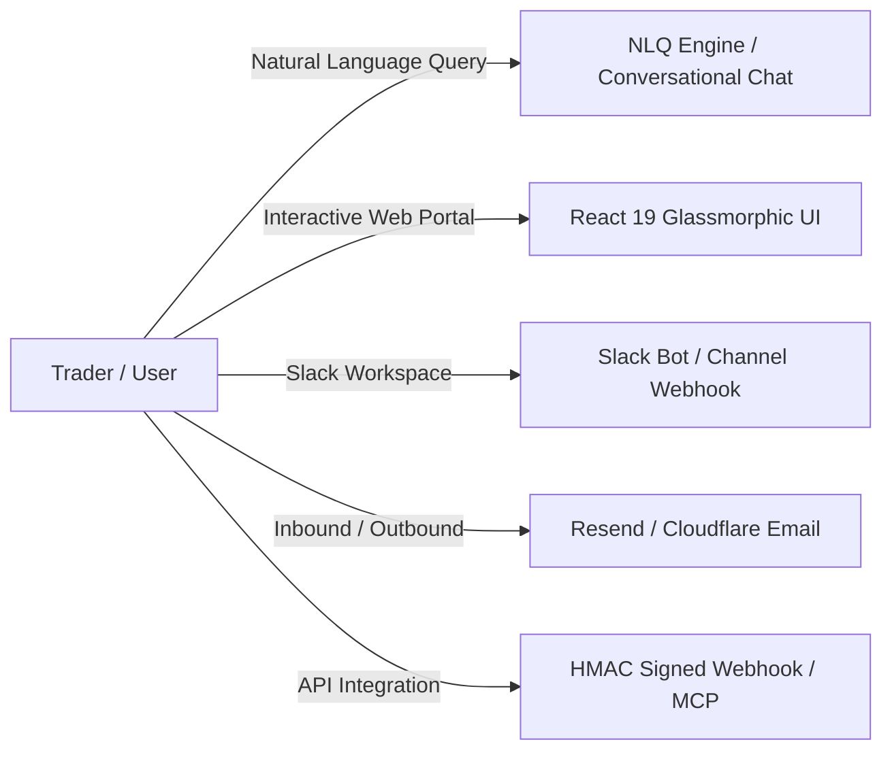
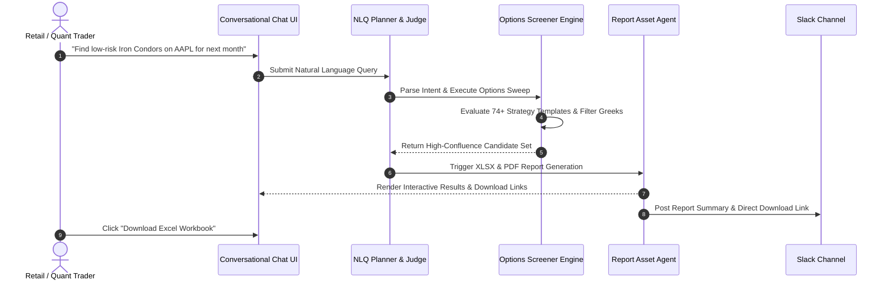
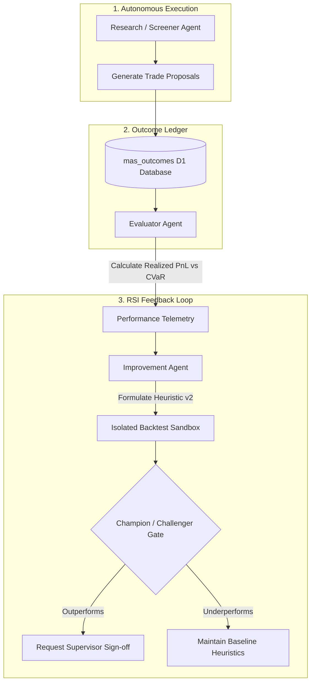

# Comprehensive Enterprise Strategy, Capabilities & Architecture Assessment
**Target System:** `cfagent` (Cloudflare Agentic Stock & Options Screener Platform)
**Author:** Enterprise Strategy & Architecture Working Group (McKinsey / Deloitte / BCS Framework Alignment)
**Document Reference:** `docs/architecture/enterprise/assessment/comprehensive-enterprise-strategy-and-capabilities-assessment.md`
**Date:** October 2026
**Status:** Institutional Architecture & Strategy Assessment Baseline

---

## Executive Summary & Strategic Positioning

### Executive Summary
`cfagent` is an edge-native, multi-agent financial intelligence and trading research platform built on top of the Cloudflare Agents SDK, Workers AI, Durable Objects (SQLite), AI Search (Vectorize), KV, and R2. Designed as a high-velocity hybrid platform combining interactive web experience, natural language query (NLQ), asynchronous multi-channel delivery (Slack, Email, Webhooks), and background cron orchestration, `cfagent` bridges the gap between raw financial market feeds and decision-ready, actionable investment proposals.

This report delivers a C-suite management consulting assessment across all strategic, operational, capability, architectural, system resilience, and maturity dimensions. It provides executive decision-makers, product leaders, and enterprise architects with a blueprint to evolve `cfagent` into the world's most advanced autonomous agentic stock and options screening ecosystem.

```
                      +-------------------------------------------------+
                      |           GOVERNED AGENTIC FLYWHEEL             |
                      +-------------------------------------------------+
                                               |
         +-------------------------------------+-------------------------------------+
         |                                     |                                     |
         v                                     v                                     v
+------------------+                 +--------------------+                 +------------------+
| Market Data Feed |                 | Multi-Leg Strategy |                 |  Multi-Channel   |
| (Yahoo, E*TRADE, | --------------> | Engine & Autopilot | --------------> |  Delivery & NLQ  |
|     NASDAQ)      |                 |   (RSI Guided)     |                 |  (Slack/Email)   |
+------------------+                 +--------------------+                 +------------------+
         ^                                     |                                     |
         |                                     v                                     |
         |                           +--------------------+                          |
         +-------------------------- | Outcome Ledger &   | <------------------------+
                                     |  CVaR Evaluation   |
                                     +--------------------+
```

### Strategic Positioning Matrix

| Strategic Vector | Current Position | Target Enterprise Horizon (12-18 Mos) | Strategic Priority |
|---|---|---|---|
| **Market Category** | Developer/Quant Agentic Tooling | Enterprise Autonomous Financial Intelligence Platform | Category Leadership |
| **Architectural Paradigm**| Hybrid Serverless Worker + DO Monolith | Stage-Layered Async DAG Agentic Micro-Services | Scalability & Anti-Drift |
| **Agentic Autonomy** | Human-in-the-Loop Proposal Drafts | Governed Autonomous Execution with RSI Self-Optimization | High (Controlled Autopilot) |
| **Channel Coverage** | Web UI, NLQ Chat, Slack, Webhook, Email | Omnichannel Conversational & API First (MCP Native) | Market Penetration |
| **Monetization Model** | Internal Enterprise Research Tool | SaaS B2B API / Institutional Asset Management Copilot | High Value Creation |

---

## 1. Multi-Dimensional Strategy Analysis

### 1.1 Product Strategy
- **Product Vision:** To democratize Wall Street-grade quantitative screening and multi-leg option strategy synthesis through zero-friction natural language interaction and autonomous background research agents.
- **Product Positioning:** The premier edge-native agentic copilot and autopilot for retail, prop-desk, and institutional traders.
- **Value Drivers:**
  1. *Speed to Insight:* Reductions in research cycle times from hours to sub-seconds using edge parallelization.
  2. *Algorithmic Rigor:* Automated Black-Scholes Greek calculation, IV skew profiling, and 74+ option strategy templates.
  3. *Unattended Intelligence:* Scheduled autopilot sweeps that surface market anomalies directly to trader channels without manual prompt submission.

### 1.2 Business Strategy
- **Go-To-Market (GTM) Strategy:** Dual-track strategy targeting both developer/quant communities via open-source MCP adapters and enterprise asset managers via managed institutional endpoints.
- **Competitive Advantage:** Sub-second edge execution on Cloudflare Anycast, elimination of legacy backend infrastructure costs, and native SQLite Durable Object state persistence.
- **Strategic Moats:** Proprietary Recursive Self-Improvement (RSI) engine, outcome tracking ledger (`mas_outcomes`), and empirical Conditional Value-at-Risk (CVaR) heuristic tuning.

### 1.3 Marketing Strategy
- **Target Persona & Segmentation:**
  - *Primary:* Quant-oriented retail options traders and RIA portfolio managers.
  - *Secondary:* AI Agent developers seeking financial tool integration via Model Context Protocol (MCP).
- **Positioning Message:** "The First Autonomous Agentic Market Screener That Learns From Market Outcomes."
- **Content & Acquisition Channels:** Interactive live demo instances, financial engineering whitepapers, GitHub developer ecosystem, and quantitative research workbooks.

### 1.4 Financial Strategy
- **Cost Structure:** Unit economics governed by Cloudflare serverless edge pricing (Workers AI, Durable Objects, D1, R2). Cost per screening run is estimated at $<0.0001$.
- **Revenue Engine:**
  - *Freemium Tier:* Basic stock screening and manual web chat.
  - *Professional Tier ($49/mo):* Scheduled autopilot runs, multi-leg option scanners, Slack/Email delivery.
  - *Institutional Tier ($499+/mo):* Dedicated Durable Objects, custom options templates, live E*TRADE order drafting, and direct MCP server connections.
- **Capital Efficiency:** High gross margins (>90%) due to serverless operational efficiency and absence of dedicated compute infrastructure.

### 1.5 Technology Strategy
- **Architecture Philosophy:** Edge-native, serverless-first, type-safe TypeScript end-to-end, and stateful Durable Object micro-aggregators.
- **AI/LLM Strategy:** Local low-latency inference using Workers AI (`glm-4.7-flash` for intent routing and judging), paired with fallback to high-reasoning frontier models for deep research generation.
- **Data Sovereignty & Security:** HMAC-signed state tokens, zero-trust session validation, and strict isolation of customer API keys within encrypted secret vaults.

### 1.6 Operations & Governance Strategy
- **Continuous Integration / Continuous Delivery (CI/CD):** GitHub Actions workflows enforcing strict pre-commit verification, typechecking, and automated regression testing.
- **Agentic Governance:** Strict non-binding execution limits where trading agents operate in `proposal_only_not_promoted` mode until human-in-the-loop sign-off or policy threshold clearance.

---

## 2. Strategic Plans & Execution Roadmaps

### 2.1 Enterprise Roadmap

```
+-----------------------------------------------------------------------------------+
| NEAR-TERM (Q4 2026): Foundation & Consolidation                                   |
| - Unify discovery backends & standardize PDF/XLSX/CSV report generation.          |
| - Enforce SubrequestBudgetTracker across all background screening routines.      |
| - Implement Session Gate #329 across all REST & WebSocket endpoints.              |
+-----------------------------------------------------------------------------------+
                                         |
                                         v
+-----------------------------------------------------------------------------------+
| MID-TERM (Q1-Q2 2027): Async Stage DAG & Channel Expansion                        |
| - Transition screening architecture to 5-stage async DAG (Feed->Gen->Store->...)|
| - Launch full MCP Server integration for Claude Desktop & Custom Agents.          |
| - Integrate Navellier 8-point fundamental growth checks & 52-wk IV Rank tables.  |
+-----------------------------------------------------------------------------------+
                                         |
                                         v
+-----------------------------------------------------------------------------------+
| LONG-TERM (Q3-Q4 2027): Governed Autopilot & Institutional Expansion             |
| - Enable RSI outcome-driven heuristic re-weighting with human supervisor gates.   |
| - Launch multi-tenant enterprise portal with role-based access control (RBAC).     |
| - Enable direct broker execution adapters (Interactive Brokers, TD Ameritrade).  |
+-----------------------------------------------------------------------------------+
```

### 2.2 Business Capabilities Enablement Roadmap
- **Phase 1 (Ingestion & Normalization):** Multi-feed normalization layer supporting NASDAQ, E*TRADE, Yahoo, and Polygon feeds.
- **Phase 2 (Synthesis & Analytics):** Advanced options strategy generation (74+ templates, IV skew, yield matrices).
- **Phase 3 (Omnichannel Interactivity):** Bi-directional Slack/Email interaction allowing users to refine screening criteria via chat replies.
- **Phase 4 (Autonomous Execution):** Full Autopilot portfolio rebalancing recommendations with risk-bounded drafting.

### 2.3 Business Growth Roadmap
- **Milestone 1:** Launch Open-Source MCP Screener Tool to capture developer mindshare (Target: 1,000 GitHub stars).
- **Milestone 2:** Onboard 500 Beta Retail Quants on Pro Tier.
- **Milestone 3:** Enterprise B2B Licensing with 10 Mid-Market RIAs and Hedge Funds.

### 2.4 Technology Roadmap
- **Runtime:** Migration to latest Cloudflare Workers AI model catalog and Agents SDK updates.
- **Persistence:** Implementation of automated D1/DO database migration scripts and R2 lifecycle rules for report archiving.
- **Observability:** OpenTelemetry distributed tracing across Worker execution contexts and Durable Objects.

---

## 3. Capability Inventory & Maturity Gap Analysis

### 3.1 Business Capabilities

| Capability | Current Operational Status | Implementation Location | Maturity Level | Identified Gaps & Area of Improvement |
|---|---|---|---|---|
| **Feed** | Operational (Yahoo, E*TRADE, NASDAQ) | `src/trading/screener.ts`, `etradeClient.ts` | Level 3 (Defined) | Lacks real-time WebSocket streaming feed for level 2 order book data. |
| **Screen** | Operational (Stocks & Options) | `src/trading/options/opportunityScanner.ts` | Level 4 (Managed) | Needs expansion into fundamental growth indicators (e.g., EPS surprises, sales growth). |
| **Store** | Operational (D1, KV, R2, DO) | `src/agents/orchestrator.ts`, `screenerReportXlsx.ts` | Level 4 (Managed) | Storage cleanup and R2 lifecycle archiving policy is currently manual. |
| **Serve** | Operational (Hono REST, WS) | `src/server.ts`, `orchestrator.ts` | Level 4 (Managed) | API rate-limiting on public REST endpoints is missing. |
| **Deliver** | Operational (Slack, Email, Web UI) | `src/services/screenerFollowupDelivery.ts` | Level 3 (Defined) | Bi-directional interactive delivery (e.g., Slack action buttons) not yet wired. |
| **Schedule**| Operational (Worker Cron, DO Tick) | `src/services/scheduledTasks.ts` | Level 3 (Defined) | User UI cannot set dynamic CRON expressions per individual symbol alert. |
| **Payment** | Operational (Drafting Only) | `src/agents/payments.ts` | Level 2 (Repeatable) | Stripe integration for actual SaaS subscription payment collection is unbuilt. |
| **Autopilot**| Operational (Proposal Only) | `src/client/AutopilotControlCenter.tsx` | Level 3 (Defined) | Lacks automated risk-adjusted position sizing guardrails. |
| **Copilot**  | Operational (NLQ & Chat) | `src/agents/nlq.ts`, `Chat.tsx` | Level 4 (Managed) | High-level goal decomposition into multi-step screening plans needs refinement. |

### 3.2 Technical Capabilities

```
+-----------------------------------------------------------------------------------+
|                             TECHNICAL CAPABILITIES MATRIX                         |
+-----------------------------------------------------------------------------------+
| Logging:           Structured JSON logs via mas_events table in DO SQLite.        |
| Exception Handling: Try/Catch blocks with fallback to Yahoo data on E*TRADE error. |
| Error Messages:    Standardized HTTP status codes with JSON error payloads.       |
| Security:          HMAC state validation, CSWSH origin checks, Session Gate #329.|
| APIs:              Hono REST Router, WebSocket streaming endpoints.               |
| MCP:               Model Context Protocol adapters for external AI agents.        |
+-----------------------------------------------------------------------------------+
```

- **Gaps & Improvement Areas:**
  - *Logging:* Lacks centralized log aggregation (e.g., Datadog, Axiom) for edge Workers.
  - *Error Codes:* System uses generic error strings instead of standardized machine-readable error taxonomy (e.g., `ERR_SUBREQUEST_BUDGET_EXCEEDED`).
  - *MCP:* Full tool schema registration needs to be published on an external public endpoint.

### 3.3 Compliance Capabilities

| Compliance Aspect | Current Posture | Target Requirement | Gap & Action Item |
|---|---|---|---|
| **SOC 2 Type II** | Partial (Edge security controls) | Full Compliance | Formalize access logs, zero-trust policies, and vendor risk management docs. |
| **Anti-Drift Architecture** | Enforced via `docs/architecture/compliance/anti-drift.md` | Zero Architectural Drift | Add automated CI drift checkers verifying module boundaries against spec. |
| **Financial Disclaimers** | Implemented in `docs/DISCLAIMER.md` | Regulatory Compliance | Display mandatory non-advisory disclaimer headers on all generated reports. |
| **Data Privacy (GDPR/CCPA)**| Basic session isolation | Right to be forgotten | Add memory vault erasure API (`DELETE /api/memory/user`). |

### 3.4 Channel Capabilities



- **NLQ Channel:** Transforms plain English queries (e.g., *"Find bullish options on NVDA expiring in 30 days"*) into structured parameters using `nlqOptionsStrategy.ts`.
- **UI Channel:** Multi-tab responsive dashboard built with React 19, CSS variables, and glassmorphic aesthetic.
- **Slack & Email Channels:** Dispatches rich formatted summaries, PDF summaries, and XLSX attachments.

### 3.5 Program & Competitor Capabilities

- **Programs in Flight:**
  - *Project Refactor #1236:* Stage-layered async job DAG executor (`shardJobs.ts`).
  - *Project Security #329:* End-to-end Session Gate enforcement.
  - *Project Unified Report #1209:* Single pipeline for PDF, CSV, and XLSX assets.
- **Competitor Watch & Market Intelligence:**
  - *TradeStation / ThinkOrSwim:* High latency, complex desktop UI $\rightarrow$ `cfagent` counters with zero-install edge web UI & NLQ.
  - *Barchart / MarketWatch:* Passive static screeners $\rightarrow$ `cfagent` counters with autonomous autopilot agents and RSI self-tuning.
  - *OpenAI Custom GPTs:* Lacks real-time financial execution capabilities $\rightarrow$ `cfagent` counters with native E*TRADE OAuth and multi-leg calculation engines.

---

## 4. Optimization & Maturity Models

### 4.1 Maturity Evaluation Framework

```
Level 5: Optimized    | Self-healing RSI, autonomous strategy promotion, real-time streaming
Level 4: Managed      | Quantified performance metrics, structured outcome tracking, budget caps
Level 3: Defined      | Standardized pipelines, stage-layered DAG, multi-channel delivery
Level 2: Repeatable   | Basic screeners, manual cron configuration, static reports
Level 1: Ad-Hoc       | Unstructured scripts, ephemeral state, manual data pulling
```

### 4.2 Multi-Dimensional Maturity Scores

| Dimension | Current Level | Target Level | Key Optimization Path |
|---|---|---|---|
| **Agentic Maturity** | Level 3 (Defined) | Level 5 (Optimized) | Enable natural language workflow generation and goal-driven autonomous task completion. |
| **Delivery Maturity**| Level 3 (Defined) | Level 4 (Managed) | Shift from HTTP polling to full WebSocket streaming for screener progress updates. |
| **Capability Maturity**| Level 4 (Managed) | Level 5 (Optimized) | Add level-2 market data order book feeds and fundamental growth screens. |
| **Workflow Maturity**| Level 3 (Defined) | Level 4 (Managed) | Complete transition to stage-layered DAG execution (`shardJobs.ts`). |
| **Process Maturity** | Level 3 (Defined) | Level 4 (Managed) | Introduce automated CI design token checks and linting rules. |
| **Competency Maturity**| Level 4 (Managed) | Level 5 (Optimized) | Deepen quantitative options modeling capabilities (Greeks, IV surfaces). |

---

## 5. Multi-Tier System Architecture

### 5.1 Architecture Tier Breakdown

```
+-----------------------------------------------------------------------------------+
| 1. UX TIER: React 19 + Vite, Glassmorphic CSS System, WebSocket Streaming UI      |
+-----------------------------------------------------------------------------------+
                                         |
                                         v
+-----------------------------------------------------------------------------------+
| 2. APPLICATION TIER: Orchestrator Agent (DO), Judge Router, Screener Engines      |
+-----------------------------------------------------------------------------------+
                                         |
                                         v
+-----------------------------------------------------------------------------------+
| 3. DATA TIER: Durable Object SQLite, D1 Relational DB, KV Cache, R2 Storage       |
+-----------------------------------------------------------------------------------+
                                         |
                                         v
+-----------------------------------------------------------------------------------+
| 4. INTEGRATION TIER: MCP Server Adapters, Hono REST API, External Broker APIs     |
+-----------------------------------------------------------------------------------+
                                         |
                                         v
+-----------------------------------------------------------------------------------+
| 5. SECURITY & NETWORK TIER: Cloudflare Edge Anycast, HMAC Verification, Session Gate|
+-----------------------------------------------------------------------------------+
```

#### Detailed Layer Descriptions:
1. **UX Tier:** Clean multi-tab workspace (`Chat.tsx`, `ScreenersHub.tsx`, `ReportsPanel.tsx`) providing sub-second reactivity and dynamic controls.
2. **Application Tier:** Durable Object stateful coordinator executing intent classification (`judge.ts`), screening logic (`screener.ts`), and strategy evaluation (`strategyEngine.ts`).
3. **Data Tier:** Hybrid state model leveraging SQLite in Durable Objects for low-latency session persistence, Cloudflare D1 for macro relational audit logs (`mas_reports`), KV for key caching, and R2 for binary report objects.
4. **Integration Tier:** Model Context Protocol adapters (`src/mcp/screener.ts`) enabling third-party AI agents to invoke screening capabilities seamlessly.
5. **Security & Network Tier:** Edge-terminated TLS, GitHub OAuth authentication, constant-time HMAC state validation, and CSWSH origin checks.

---

## 6. Product Value Creation & User Journey Analysis

### 6.1 Value Creation & Harvesting Framework

```
RAW MARKET DATA FEED  --->  QUANTITATIVE SCREENING  --->  GOVERNED PROPOSAL DRAFTING  --->  DELIVERY & HARVESTING
(E*TRADE, Yahoo, NASDAQ)    (74+ Option Templates)       (Human-in-the-Loop Safeguards)   (Slack, Email, UI, XLSX)
```

- **Value Creation Mechanisms:**
  - *Information Synthesis:* Transforms millions of market data points into a top-5 list of high-confluence option trade ideas.
  - *Risk Quantification:* Calculates Black-Scholes Greeks, maximum loss, win probability, and risk/reward ratios automatically.
  - *Temporal Efficiency:* Eliminates hours spent manually scrolling through option chains across multiple expirations.

- **Value Harvesting Channels:**
  - Exportable `.xlsx` workbooks containing multi-tab breakdown (Quotes, Greeks, Payoff Diagrams).
  - Outbound Slack alerts with direct execution preview links.
  - Automated weekly research executive summaries delivered via Email.

### 6.2 End-to-End User Journey



---

## 7. Failure-Point & Systems Risk Analysis

### 7.1 Failure Modes and Effects Analysis (FMEA)

| System Failure Point | Potential Root Cause | Severity (1-10) | Occurrence (1-10) | Current Mitigation | Strategic Remediation |
|---|---|---|---|---|---|
| **Subrequest Budget Exhaustion** | Unbounded option chain fetching (>1000 subrequests) | 8 | 6 | `SubrequestBudgetTracker` caps execution gracefully | Implement 1-min TTL Quote Cache & Batch Subrequest Bundling |
| **Broker OAuth Expiration** | Unhandled 401 token expiry from E*TRADE API | 7 | 4 | Fallback to Yahoo Finance quote parser | Add automatic OAuth refresh token flow worker |
| **Out-of-Memory (OOM) on Export** | Large PDF/XLSX buffer generation in edge worker | 7 | 3 | Ephemeral worker boundary isolation | Stream XLSX buffers in chunked streams to R2 storage |
| **WebSocket Connection Drops** | Edge worker recycles or client network disconnect | 5 | 5 | Reconnection logic in React frontend | Implement Durable Object WebSocket Hibernation state recovery |
| **Prompt Injection via NLQ** | Malicious user input manipulating SQL queries | 9 | 2 | Parameter-bound SQLite query executor (`nlq.ts`) | Strict SQL parser allowlist enforcing `SELECT` queries only |

### 7.2 Recursive Self-Improvement (RSI) Architecture



---

## 8. Strategic Recommendations for Market Leadership

To establish `cfagent` as the world's most advanced agentic market screener, the following strategic actions are mandated:

### 8.1 Must-Have Technical Directives (Immediate - 30 Days)
1. **Complete Stage-Layered DAG Refactoring (#1236):** Finalize `shardJobs.ts` to decouple data ingestion, strategy execution, artifact generation, and delivery into independent async worker stages.
2. **Standardize Unified Report Pipeline (#1209):** Guarantee that every screening run produces valid, synchronized PDF, CSV, and XLSX outputs without duplicating code.
3. **Strict Parameter-Bound SQL Enforcement:** Audit `src/agents/nlq.ts` to ensure 100% parameter binding, SELECT-only enforcement, and zero raw string concatenation.

### 8.2 Innovation & Differentiation Directives (60 - 90 Days)
4. **Natural Language Workflow Construction:** Allow users to construct complex multi-stage screening workflows using natural language (e.g., *"Screen stocks with RSI < 30, evaluate Iron Condors for candidates, send XLSX to my email every Monday"*).
5. **Level 2 Market Data & Order Flow Imbalance:** Expand data providers to include live WebSocket order book feeds and unusual options activity (UOA) alerts.
6. **Public MCP Server Marketplace Listing:** Publish standard Open-API / Model Context Protocol endpoints to allow external AI platforms (Claude Desktop, Cursor, ChatGPT) to call `cfagent` tools natively.

### 8.3 Market Positioning & Commercialization Directives (90+ Days)
7. **Monetization API Gateway:** Implement metered billing for API endpoints using Cloudflare Workers KV and Stripe Webhooks.
8. **Institutional Multi-Tenant Portal:** Provide enterprise asset managers with isolated Durable Object instances, custom option strategy templates, and dedicated SLA guarantees.

---

## Conclusion

The `cfagent` platform possesses an exceptionally strong architectural foundation, combining edge serverless performance with stateful Durable Object storage and sophisticated quantitative screening algorithms. By executing the strategic recommendations outlined in this report—specifically stage-layered DAG refactoring, unified report generation, RSI outcome-driven heuristic optimization, and omnichannel MCP expansion—`cfagent` is uniquely positioned to achieve undisputed category leadership in autonomous AI-driven financial research and screening.
