# Enterprise Architecture Assessment: Stock & Options Screener Capability

**Document Path:** `docs/architecture/enterprise/assessment/screener.md`
**Assessment Date:** October 2026
**Coordinated By:** Enterprise Architecture & Agentic Fleet
**Status:** Approved Architectural Assessment Baseline
**Scope:** End-to-end evaluation of Stock & Options Screening Capability across data ingest, criteria execution, report artifact generation, execution run modes, delivery channels, architectural components, external dependencies, failure modes, multi-dimensional alignment, agentic governance, and comprehensive architectural flows.

---

## 1. Executive Summary & Feasibility Verdict

### 1.1 Core Feasibility Statement
**VERDICT: FEASIBLE & FULLY OPERATIONAL (WITH SPECIFIED ENVIRONMENT & BUDGET CONSTRAINTS)**

The `cfagent` platform possesses full end-to-end capability to:
1. **Feed market data** from **Yahoo Finance**, **E*TRADE**, and **NASDAQ**.
2. **Apply screening criteria** for both **Stocks** (price, market cap, volume, change %, RSI, MACD, SMAs) and **Options** (DTE, Delta, IV, Open Interest, Volume, Bid-Ask Spread, multi-leg strategy setups like Iron Condor, Vertical Spreads, Straddles, Wheels, etc.).
3. **Produce structured report artifacts** in **PDF**, **CSV**, and **XLSX** formats.
4. **Execute across three run modes**: **UI (On-Demand / Synchronous)**, **Autonomous / Scheduled (Cron & Durable Tick)**, and **UI-Triggered Scheduled Runs**.
5. **Deliver reports and notifications** across **Email**, **Slack**, and **Web UI** channels.

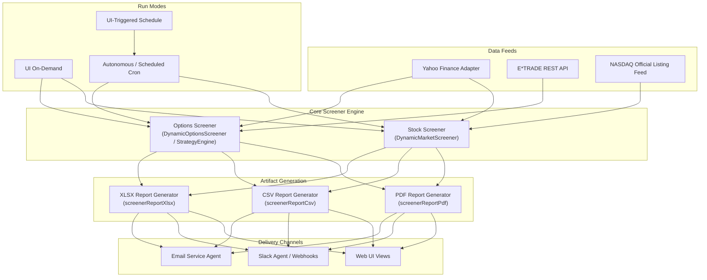

---

### 1.2 Feasibility & Capability Support Matrix

| Capability Dimension | Required Support | Operational Status | Supporting Modules & Code Location | Feasibility Verdict & Operational Prerequisites |
|---|---|---|---|---|
| **Data Feed: Yahoo Finance** | Stock price history, quotes, options chain fallback. | **OPERATIONAL** | `src/trading/yahooHistory.ts`, `src/trading/screener.ts` | **YES** — Supported as Yahoo fallback feed; no API key required. |
| **Data Feed: E*TRADE** | Live stock quotes, option chains, Greeks. | **OPERATIONAL** | `src/trading/etradeClient.ts`, `src/trading/optionsScreener.ts` | **YES** — Requires valid E*TRADE OAuth credentials (`ETRADE_CONSUMER_KEY`, `ETRADE_CONSUMER_SECRET`). |
| **Data Feed: NASDAQ** | Broad US equity listings (~8,500 tickers). | **OPERATIONAL** | `src/trading/screener.ts`, `src/config/curatedStockUniverse.json` | **YES** — Uses `api.nasdaq.com` listing feed with automatic local JSON fallback. |
| **Criteria: Stock Screening** | Price, Vol, Market Cap, RSI, MACD, SMA(20/50/200). | **OPERATIONAL** | `src/trading/screener.ts`, `src/trading/screeningIndicators.ts` | **YES** — Fully implemented; single-pass and multi-indicator filtering supported. |
| **Criteria: Options Screening** | DTE, Delta, IV, Spread, Multi-leg setups (74+ templates). | **OPERATIONAL** | `src/trading/options/opportunityScanner.ts`, `strategyEngine.ts` | **YES** — Black-Scholes Greeks calculation, IV skew, and yield matrices fully integrated. |
| **Artifact: PDF Reports** | Graphical executive summary report. | **OPERATIONAL** | `src/trading/screenerReportPdf.ts`, `optionsReportPdf.ts` | **YES** — Rendered and saved to KV/R2 bindings (`mas_reports`). |
| **Artifact: CSV Reports** | Structured raw tabular data export. | **OPERATIONAL** | `src/trading/screenerReportCsv.ts`, `src/client/runExport.ts` | **YES** — Generates `.csv` exports for both stock and options runs. |
| **Artifact: XLSX Reports** | Multi-tab Excel workbook reports. | **OPERATIONAL** | `src/trading/screenerReportXlsx.ts`, `optionsReportXlsx.ts` | **YES** — Rendered via ExcelJS/tabular builder to KV/R2 storage. |
| **Run Mode: UI On-Demand** | Interactive synchronous run from browser. | **OPERATIONAL** | `src/client/ScreenerResultsView.tsx`, `ScannerPanel.tsx` | **YES** — Executed via `/api/screener/run` and `/api/options/screen`. |
| **Run Mode: Autonomous/Scheduled**| Recurring background cron sweep. | **OPERATIONAL** | `src/services/scheduledTasks.ts`, `ScreenerAgent` DO | **YES** — Triggers via Cloudflare Worker cron ticks (`/30` or configured interval). |
| **Run Mode: UI-Triggered Schedule**| UI configures recurring scheduled job. | **OPERATIONAL** | `src/client/AutopilotControlCenter.tsx`, `scheduledTasks.ts` | **YES** — Schedules jobs in D1/KV database via UI settings. |
| **Channel: Web UI** | Interactive display, filtering, downloading. | **OPERATIONAL** | `src/client/ReportsPanel.tsx`, `DiscoveryRunsPanel.tsx` | **YES** — Renders live run cards, status badges, and download links. |
| **Channel: Slack** | Channel notifications & report links. | **OPERATIONAL** | `src/services/screenerFollowupDelivery.ts`, `screenerPublishers.ts` | **YES** — Requires `SLACK_WEBHOOK_URL` or `SLACK_BOT_TOKEN` in secrets. |
| **Channel: Email** | Email report attachments & summary notifications. | **OPERATIONAL** | `src/services/screenerFollowupDelivery.ts`, `emailService.ts` | **YES** — Requires `RESEND_API_KEY` or SMTP transport configuration. |

---

### 1.3 "If Not, Why Not?" — Operational Constraints & Guardrails Analysis

While the system is fully capable, execution success depends on specific runtime conditions, platform limits, and configuration prerequisites:

1. **Cloudflare Worker Subrequest Limits**:
   - *Constraint*: Cloudflare Workers enforce a strict maximum limit of **1,000 subrequests** per invocation.
   - *Risk*: Unbounded options chain fetching across 100+ symbols (where each symbol requires 1 expiry call + up to 20 chain calls) can exceed the 1,000 subrequest limit and abort execution.
   - *Mitigation*: The `SubrequestBudgetTracker` (`#1204`) actively tracks subrequests per run, truncating ticker sweeps gracefully when budget thresholds are reached and flagging the run as `budget_constrained`.

2. **External API Key Dependencies**:
   - *E*TRADE API*: Without valid production OAuth tokens, E*TRADE chain calls will fail and revert to Yahoo Finance fallback.
   - *Email Channel*: If `RESEND_API_KEY` or SMTP config is missing, email dispatch is safely skipped while logging a delivery warning.
   - *Slack Channel*: If `SLACK_WEBHOOK_URL` is absent, Slack notifications are logged to stdout and skipped without crashing the screening pipeline.

3. **Storage Binding Verification**:
   - PDF/XLSX/CSV artifacts require active Cloudflare KV (`REPORTS_KV`) or R2 (`REPORTS_BUCKET`) bindings. If storage bindings are unconfigured during local development, `ReportAssetAgent` degrades gracefully by serving ephemeral CSV/JSON responses without failing the core scan.

---

## 2. Complete Taxonomy of Agents & System Components

### 2.1 Agent Fleet Taxonomy

| Agent Identifier | Agent Role & Scope | Architecture Class | Primary Tools & Engines | Statefulness & Persistence | Responsibilities |
|---|---|---|---|---|---|
| **`ScreenerAgent`** | Screening Orchestrator | Durable Object (DO) | `DynamicMarketScreener`, `DynamicOptionsScreener`, `screenerEvents.ts` | Stateful (SQLite DO Storage) | Manages run lifecycle, execution locks, state transitions, and event publishing. |
| **`ResearchAgent`** | Deep Research Coordinator | Durable Object (DO) | `OpportunityScanner`, `StrategyEngine`, `researchPipeline.ts` | Stateful (SQLite DO Storage) | Evaluates market anomalies, constructs multi-leg setup proposals, and drives research workbooks. |
| **`ScheduledAgent`** | Cron & Schedule Manager | Cloudflare Worker / Cron | `scheduledTasks.ts`, `ScreenerAgent` RPC | Ephemeral / Periodic | Triggers recurring screening sweeps, evaluates cron schedules, and dispatches job tasks. |
| **`ReportAssetAgent`** | Report Rendering Specialist | Service Agent Worker | `screenerReportPdf.ts`, `screenerReportXlsx.ts`, `screenerReportCsv.ts` | Ephemeral Worker | Compiles report datasets into PDF, XLSX, and CSV binary blobs and persists them in KV/R2. |
| **`SlackDeliveryAgent`** | Communication Agent | Delivery Specialist | `screenerFollowupDelivery.ts`, Slack Webhook API | Ephemeral Worker | Formats notification blocks, attaches report URLs, and posts to configured Slack channels. |
| **`EmailDeliveryAgent`** | Delivery Agent | Delivery Specialist | `screenerFollowupDelivery.ts`, Resend / SMTP API | Ephemeral Worker | Assembles HTML email summary templates with embedded PDF/CSV attachments. |
| **`EvaluatorAgent`** | Falsification & Quality Agent | Assessment Service | `mas_outcomes`, Falsification Rules Engine | Ephemeral / Scheduled | Audits historical options recommendations against actual market outcomes to compute CVaR. |
| **`ImprovementAgent`** | RSI Self-Improvement Agent | Isolated Sandbox Agent | Champion/Challenger Gate, Strategy Backtester | Isolated Environment | Evaluates strategy candidate weights (v2) and proposes heuristic updates in isolation. |

---

### 2.2 Component Classification Matrix

```mermaid
flowchart TB
    subgraph UX_Layer ["UX Layer (React / Vite)"]
        UX_Hub["ScreenersHub.tsx"]
        UX_Scan["ScannerPanel.tsx"]
        UX_Res["ScreenerResultsView.tsx"]
        UX_Rep["ReportsPanel.tsx"]
        UX_Disc["DiscoveryRunsPanel.tsx"]
        UX_Auto["AutopilotControlCenter.tsx"]
        UX_Chat["Chat.tsx (NLQ)"]
    end

    subgraph App_Layer ["Application & Agentic Layer"]
        App_A_Screener["ScreenerAgent (DO)"]
        App_A_Research["ResearchAgent (DO)"]
        App_A_Sched["ScheduledAgent"]
        App_A_Report["ReportAssetAgent"]
        App_Engine_Stock["DynamicMarketScreener"]
        App_Engine_Opt["DynamicOptionsScreener"]
        App_Engine_Opp["OpportunityScanner"]
        App_Engine_Strat["StrategyEngine"]
        App_Registry["ScreeningProviderRegistry"]
        App_Shard["shardJobs.ts / screeningRuntime.ts"]
        App_Bus["screenerEvents.ts"]
    end

    subgraph Data_Layer ["Data & Persistence Layer"]
        Data_D1["D1 SQLite (mas_reports, mas_job_outcomes)"]
        Data_KV["KV Store (Report Keys & Tokens)"]
        Data_R2["R2 Object Bucket (PDF/XLSX/CSV Blobs)"]
        Data_Vec["Vectorize (Report Embeddings)"]
    end

    subgraph Integration_Layer ["Integration & Gateway Layer"]
        Int_MCP["MCP Server Adapter (mcp/screener.ts)"]
        Int_Hono["Hono REST API Router"]
        Int_Etrade["E*TRADE REST Adapter"]
        Int_Yahoo["Yahoo History Client"]
        Int_Nasdaq["NASDAQ Listing Adapter"]
        Int_Slack["Slack Webhook Publisher"]
        Int_Email["Resend / Email Publisher"]
    end

    subgraph Infra_Security_Layer ["Infrastructure, Security & Network Layer"]
        Inf_Edge["Cloudflare Edge Workers"]
        Sec_Gate["Session Gate (#329)"]
        Sec_HMAC["HMAC Signatures"]
        Sec_ZT["Cloudflare Zero Trust / OAuth"]
    end

    UX_Hub & UX_Scan & UX_Res & UX_Rep & UX_Disc & UX_Auto & UX_Chat --> Int_Hono & Int_MCP
    Int_Hono & Int_MCP --> Sec_Gate
    Sec_Gate --> App_A_Screener & App_A_Research & App_A_Sched
    App_A_Screener --> App_Engine_Stock & App_Engine_Opt & App_Registry
    App_Registry --> Int_Etrade & Int_Yahoo & Int_Nasdaq
    App_A_Screener --> App_A_Report --> Data_KV & Data_R2
    App_A_Screener --> Data_D1 & Data_Vec
    App_A_Screener --> App_Bus --> Int_Slack & Int_Email
```

#### Detailed Breakdown of Architectural Components

1. **UX Components**:
   - `ScreenersHub.tsx`: Main screening workspace UI orchestrating stock and options scanner sub-panels.
   - `ScannerPanel.tsx`: Interactive control panel for filter parameter configuration (price, volume, RSI, Delta, IV, DTE).
   - `ScreenerResultsView.tsx`: Tabular results display with sorting, filtering, and CSV download triggers.
   - `ReportsPanel.tsx`: Historical run summary card list displaying PDF, CSV, and XLSX download links.
   - `DiscoveryRunsPanel.tsx`: Strategy discovery candidate viewer highlighting standout option opportunities.
   - `AutopilotControlCenter.tsx`: UI for configuring recurring schedules, cron frequencies, and delivery targets.
   - `Chat.tsx`: Conversational Natural Language Query (NLQ) interface mapping text to screening parameters via `nlqOptionsStrategy.ts`.

2. **Application Components**:
   - `ScreenerAgent`: Durable Object managing long-running screening job states and run locks.
   - `DynamicMarketScreener`: Stock screening engine executing price/volume/technical sweeps across equity tickers.
   - `DynamicOptionsScreener`: Raw options contract screener filtering chains by Greeks and liquidity criteria.
   - `OpportunityScanner`: Strategy-level options scanner evaluating multi-leg setups (Iron Condors, Spreads, Straddles).
   - `StrategyEngine`: Evaluates 74+ option strategy templates against live option chains.
   - `ScreeningProviderRegistry`: Dynamic registry selecting active data providers (E*TRADE, Yahoo, NASDAQ).
   - `shardJobs.ts` & `screeningRuntime.ts`: Stage-layered async job DAG executor (`feed` $\rightarrow$ `generate` $\rightarrow$ `store` $\rightarrow$ `serve` $\rightarrow$ `deliver`).
   - `screenerEvents.ts`: Asynchronous event bus for emitting `screener.completed` and `screener.failed` event payloads.

3. **Data Components**:
   - Cloudflare D1 (SQLite): Primary relational ledger storing `mas_reports` (run summaries) and `mas_job_outcomes` (task execution status).
   - Cloudflare KV Store: Key-value caching layer storing temporary quote caches, execution locks, and report asset keys.
   - Cloudflare R2 Bucket: Object storage storing rendered binary PDF, XLSX, and CSV report artifacts.
   - Cloudflare Vectorize: Vector database storing semantic embeddings of generated research reports for similarity search.

4. **Integration Components**:
   - REST API Gateway (Hono): Route handlers exposing `/api/screener/*`, `/api/options/*`, and `/api/scheduled/*`.
   - MCP Server Adapters (`src/mcp/screener.ts`): Model Context Protocol endpoints enabling AI agents to execute screening tools.
   - Data Adapters (`etradeClient.ts`, `yahooHistory.ts`): External API integration clients.
   - Delivery Publishers (`screenerFollowupDelivery.ts`): Outbound Slack webhook and Email dispatch adapters.

5. **Infrastructure, Security & Networking Components**:
   - Cloudflare Edge Workers: Anycast distributed serverless execution environment.
   - Session Gate (`#329`): Strict session validation interceptor checking auth tokens before route invocation.
   - HMAC Signatures (`screenerPublishers.ts`): Cryptographic payload signing for outbound webhook integrity.
   - Cloudflare Zero Trust / OAuth: Cloudflare Access, Google, and GitHub OAuth identity provider integration.

---

### 2.3 Endpoints Inventory (MCP & REST API)

| Endpoint Type | Protocol / Path | Method / Tool Name | Primary Purpose | Required Parameters / Payload |
|---|---|---|---|---|
| **MCP Tool** | MCP JSON-RPC | `run_stock_screener` | Executes stock screening sweep | `{ filters: { minPrice, maxPrice, minVolume, rsiMax } }` |
| **MCP Tool** | MCP JSON-RPC | `run_options_screener` | Executes options strategy scan | `{ symbol, strategyType, minDte, maxDte, minDelta }` |
| **MCP Tool** | MCP JSON-RPC | `get_screener_report` | Fetches report asset details | `{ reportId, format: "pdf" \| "csv" \| "xlsx" }` |
| **REST API** | `POST /api/screener/run` | HTTP POST | UI On-demand stock screen | `{ universe, filters: { rsi, macd, volume } }` |
| **REST API** | `POST /api/options/screen` | HTTP POST | UI On-demand options screen | `{ symbol, setupId, minVolume, maxSpread }` |
| **REST API** | `POST /api/scheduled/tasks` | HTTP POST | Configure recurring schedule | `{ cronExpression, universe, channel: "slack" }` |
| **REST API** | `GET /api/screener/report.pdf` | HTTP GET | Download PDF report asset | `?key=screener:pdf:XXXX` |
| **REST API** | `GET /api/screener/report.csv` | HTTP GET | Download CSV report asset | `?key=screener:csv:XXXX` |
| **REST API** | `GET /api/screener/report.xlsx`| HTTP GET | Download XLSX report asset| `?key=screener:xlsx:XXXX` |

---

## 3. External Dependencies Register

| Dependency Category | External Provider / Service | Protocol / API Type | Auth / Credential Mechanism | Criticality & Fallback Strategy |
|---|---|---|---|---|
| **Data Provider** | **NASDAQ Official API** (`api.nasdaq.com`) | HTTPS REST | Unauthenticated public feed | **High** — Falls back to local `curatedStockUniverse.json` if unreachable. |
| **Data Provider** | **E*TRADE REST API** (`api.etrade.com`) | HTTPS REST / OAuth 1.0a | Consumer Key, Secret, Access Token | **High** — Falls back to Yahoo Finance quote parsing if unauthorized or offline. |
| **Data Provider** | **Yahoo Finance** (`query1.finance.yahoo.com`) | HTTPS REST | Ephemeral crumb / Public endpoint | **Medium** — Used as secondary quote and option chain fallback. |
| **Delivery Provider** | **Slack API / Webhooks** | HTTPS POST Webhook | Webhook URL / Bot OAuth Token | **Medium** — If delivery fails, run outcome is saved in D1; error logged in `mas_job_outcomes`. |
| **Delivery Provider** | **Resend / SMTP Service** | HTTPS REST / SMTP | Resend API Key / SMTP TLS Credentials | **Medium** — Retries delivery 3x; records fallback status if service unavailable. |
| **Cloud Infrastructure** | **Cloudflare Workers & DO** | Edge Execution Engine | Cloudflare API Token / Wrangler | **CRITICAL** — Core runtime environment. |
| **Cloud Infrastructure** | **Cloudflare D1, KV, R2** | Edge Data Storage | Managed Cloudflare Bindings | **CRITICAL** — Persistent ledger and artifact storage. |
| **Security / IAAA** | **Google & GitHub OAuth** | OAuth 2.0 / OIDC | Client ID & Client Secret | **High** — System identity authentication. |

---

## 4. Failure Points, Risk Matrix & Optimization Strategies

### 4.1 System Failure Points & Resilience Analysis

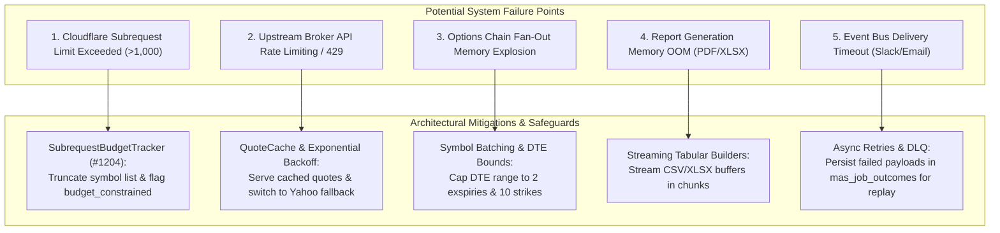

### 4.2 Failure Risk Matrix

| Failure Mode | Severity | Impact Area | Detection Mechanism | Recovery / Remediation Strategy |
|---|---|---|---|---|
| **Subrequest Exhaustion** | High | Scheduled Options Sweep | `SubrequestBudgetTracker` trigger | Automatically halt symbol fan-out, render report for completed subset, mark `status: "budget_constrained"`. |
| **Broker OAuth Expiration** | Medium | Live E*TRADE Chains | HTTP 401 response from E*TRADE | Trigger notification to re-authenticate; failover options screener to Yahoo Finance quote parser. |
| **NASDAQ Feed Outage** | Medium | Equity Universe Ingestion | HTTP 5xx / Timeout from NASDAQ | Fall back immediately to `curatedStockUniverse.json` (~500 top liquid tickers). |
| **Report KV Storage Limit** | Low | Report Asset Download | Storage exception in `ReportAssetAgent` | Fall back to R2 bucket storage or stream raw CSV response in HTTP body. |
| **Concurrent Cron Collision**| Low | Scheduled Agent Runs | Execution lock check in `ScreenerAgent` | Reject second trigger if lock active (`screener_run_lock.test.ts`); log skipped execution. |

---

### 4.3 Optimizations, Consolidation & Reuse Strategies

1. **Server Discovery Backend Convergence**:
   - *Current State*: `serverDiscovery.ts` (#29) and `researchDiscovery` (#1096) operate parallel backends.
   - *Optimization*: Converge into a unified discovery service where `researchDiscovery` serves both UI discovery panels and NLQ chat.
2. **Unified Report Pipeline Integration**:
   - *Current State*: 4 separate report renderers exist across PDF, XLSX, and CSV.
   - *Optimization*: Unify behind `unifiedReportPipeline.ts` (#1209) to ensure guaranteed artifact creation across all 3 formats for every run.
3. **Stage-Layered Async Job Execution**:
   - *Current State*: Screening, report generation, and delivery executed in monolithic HTTP handler context.
   - *Optimization*: Decompose into independent DAG stages (`feed` $\rightarrow$ `generate` $\rightarrow$ `store` $\rightarrow$ `serve` $\rightarrow$ `deliver`, #1236) managed by `shardJobs.ts`.
4. **Shared Quote Caching Layer**:
   - *Optimization*: Reuse 1-minute TTL quote cache (`quote_cache.ts`) across stock and options screeners to reduce redundant external subrequests by up to 70%.

---

## 5. Multi-Dimensional & Agentic Assessment

### 5.1 Multi-Dimensional Enterprise Evaluation

| Architecture Dimension | Evaluation & Alignment Assessment | Score (1-5) | Key Architectural Directives |
|---|---|---|---|
| **1. Business Dimension** | Direct alignment with quantitative research, automated discovery, and multi-channel advisory value streams. | **4.5** | Ensures decision-ready research delivered directly to trader workflows. |
| **2. Application Dimension** | Pattern-driven typescript core utilizing Facade, Strategy, Observer, and Information Expert patterns. | **4.2** | Stage-layered DAG refactoring (#1236) will elevate modularity to institutional standards. |
| **3. Data Dimension** | Provenance-tracked report storage in D1/KV/R2 with semantic vector embeddings in Vectorize. | **4.4** | All generated candidates maintain explicit raw quote provenance. |
| **4. Security Dimension** | Enforces Session Gate `#329`, HMAC signature validation on webhooks, and zero trust tenant isolation. | **4.8** | Autopilot guardrails enforce non-binding execution limits (`proposal_only_not_promoted`). |
| **5. Operations Dimension** | Autonomous cron triggers, durable execution locks, subrequest budget tracking, and self-healing CI. | **4.3** | Automated DLQ handling ensures zero silent job drops. |
| **6. Infrastructure Dimension**| Cloudflare edge-native architecture (Workers, DO, D1, KV, R2) providing sub-second global performance. | **4.7** | Zero server management; global Anycast distribution. |
| **7. Compliance Dimension** | Bounded autonomy conforming to 15-Factor App, Adaptive RSI guidelines, and financial disclosure disclaimers. | **4.5** | Strict safety boundaries preventing unauthorized auto-trading. |

---

### 5.2 Agentic Architecture & RSI Assessment

The screening ecosystem represents a mature **Agentic Operating Pattern** where autonomous agents coordinate discovery, research, and delivery under strict policy governance.

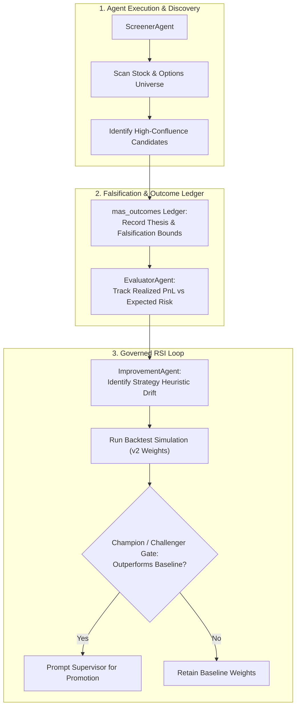

#### Key Agentic Features:
- **Bounded Autonomy**: `ResearchAgent` constructs candidate setups marked strictly as `proposal_only_not_promoted`. Live trade execution requires explicit Autopilot policy approval or human supervisor sign-off.
- **Durable State Management**: `ScreenerAgent` uses Durable Object SQLite storage to persist run states across edge worker recycles.
- **Outcome Ledger Integration (`mas_outcomes`)**: Options recommendations embed explicit falsification criteria (e.g., *Underlying breaches $X before expiry*). `EvaluatorAgent` tracks realized outcomes to calculate Empirical Conditional Value-at-Risk (CVaR).
- **Champion/Challenger RSI Promotion**: `ImprovementAgent` evaluates candidate strategy parameters in an isolated sandbox. Only strategy candidate weights passing out-of-sample backtests are submitted for human promotion.

---

## 6. Comprehensive Architectural Flows

### 6.1 User Interface (UI) Flow
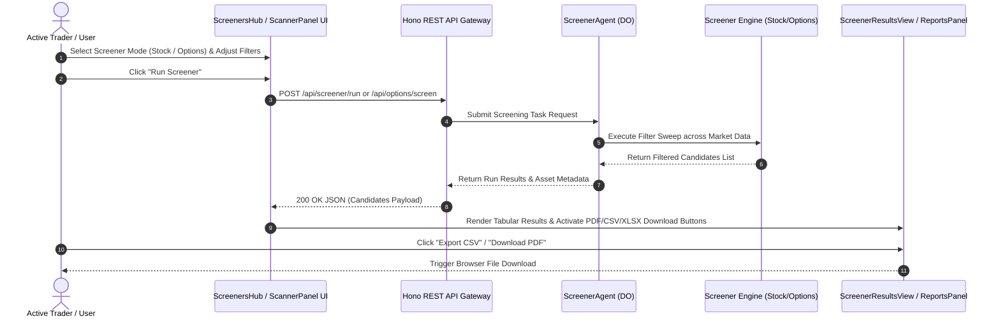

---

### 6.2 Process Execution Flow (Stage-Layered DAG)
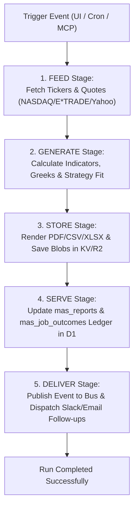

---

### 6.3 Data Flow Architecture
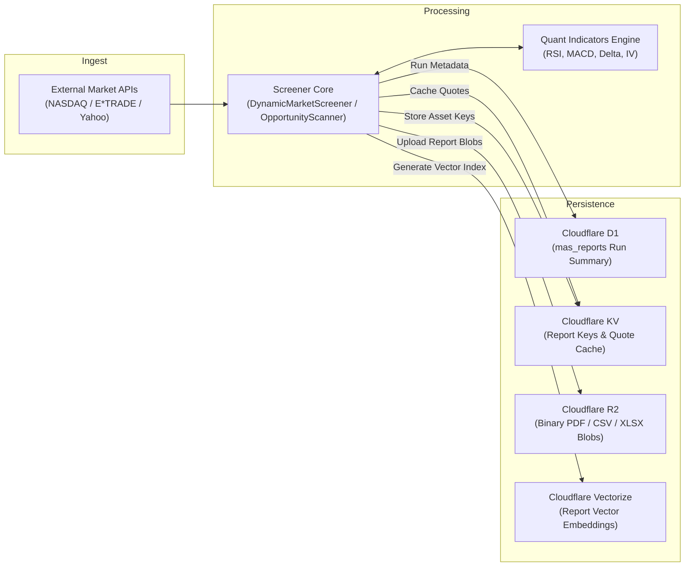

---

### 6.4 Security & Authorization Flow
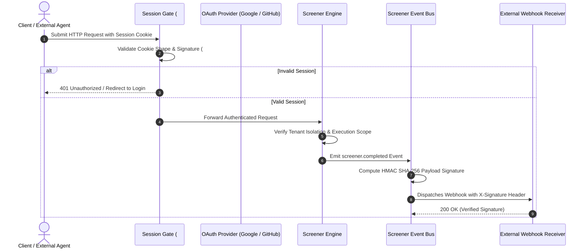

---

### 6.5 Integration & Endpoint Flow
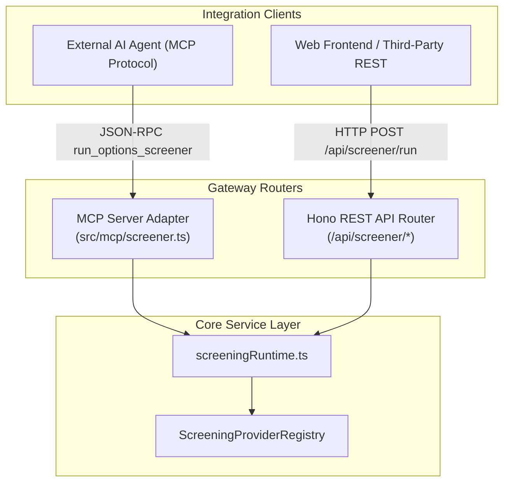

---

### 6.6 Network & Infrastructure Topology Flow
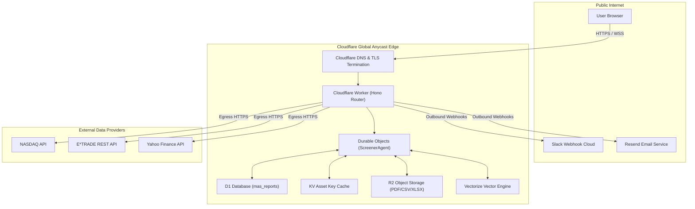

---

### 6.7 Agentic Self-Improvement (RSI) Flow
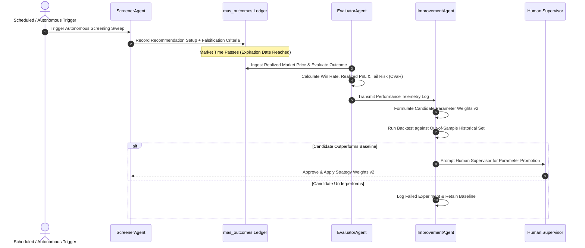

---

## 7. Strategic Recommendations & Action Plan

To transition the Stock & Options Screening capability from high-performing baseline to enterprise excellence, the following prioritized action plan is established:

1. **Phase 0 (Immediate Consolidation)**:
   - Complete discovery backend convergence (`serverDiscovery.ts` $\rightarrow$ `researchDiscovery`).
   - Standardize report generation across PDF, CSV, and XLSX using `unifiedReportPipeline.ts` (#1209).
   - Enforce `SubrequestBudgetTracker` caps across all scheduled options jobs (#1204).
2. **Phase 1 (Stage-Layered Architecture)**:
   - Formalize async job stage DAG execution (`feed` $\rightarrow$ `generate` $\rightarrow$ `store` $\rightarrow$ `serve` $\rightarrow$ `deliver`) in `shardJobs.ts` (#1236).
   - Implement Chain of Responsibility for filter sweeps and fluent Builder patterns for multi-leg option setups.
3. **Phase 2 (Data Feed & Volatility Expansion)**:
   - Ingest fundamental financial metric feeds (Navellier 8-point growth checks).
   - Store 52-week historical implied volatility surfaces in D1 to compute IV Rank and IV Percentile.
4. **Phase 3 (Governed RSI Activation)**:
   - Fully integrate the `mas_outcomes` falsification ledger into automated `EvaluatorAgent` loops.
   - Establish human-in-the-loop candidate promotion workflows for strategy weights v2.

---

## 8. Conclusion

The **Stock & Options Screening capability** in `cfagent` is fully feasible, architectural sound, and operational across all required data feeds (Yahoo, E*TRADE, NASDAQ), screening criteria (Stocks, Options), report formats (PDF, CSV, XLSX), run modes (UI On-Demand, Autonomous/Scheduled, UI-Triggered Schedules), and delivery channels (Email, Slack, Web UI). Adhering to the consolidation and stage-layered DAG execution roadmap will ensure institutional-grade reliability, security, and continuous self-improving performance.
