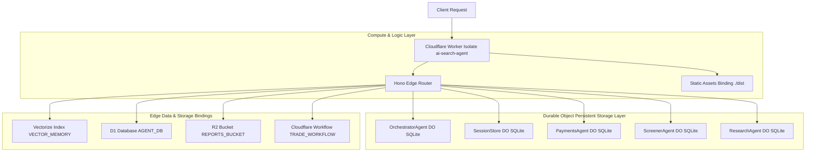
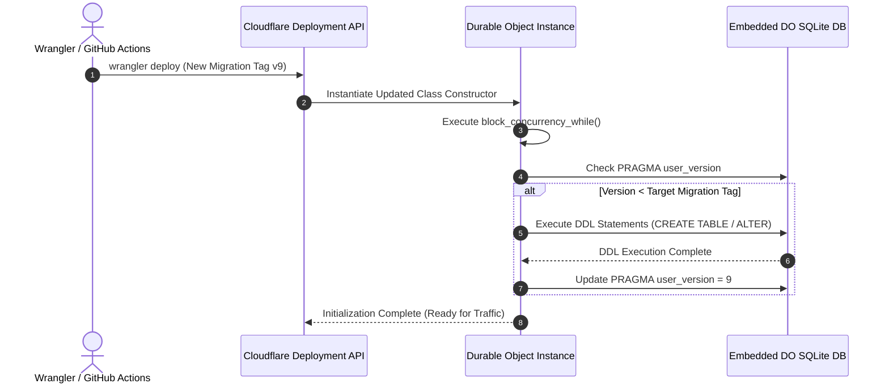
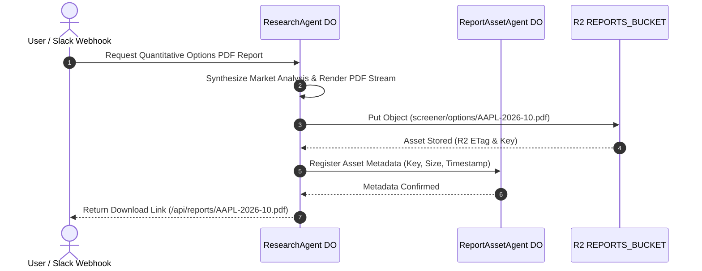
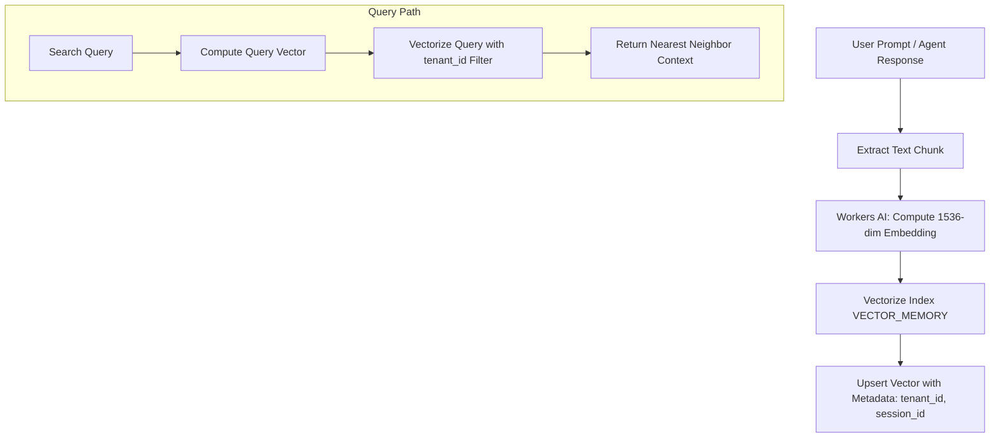
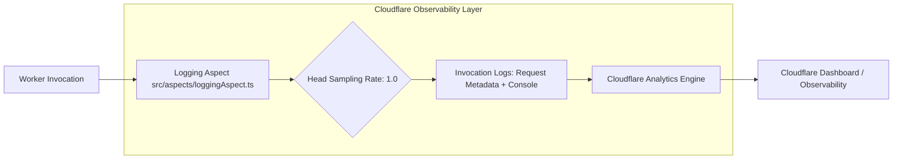
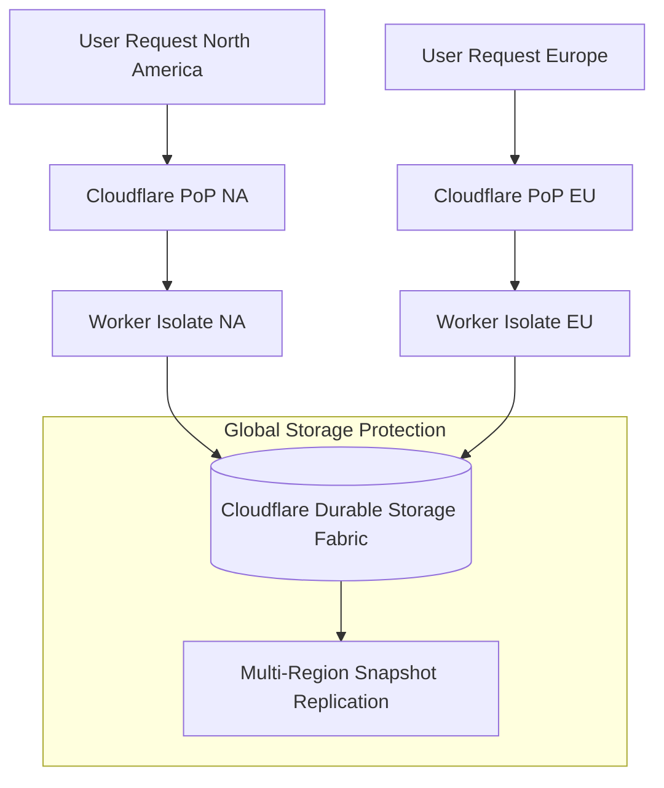
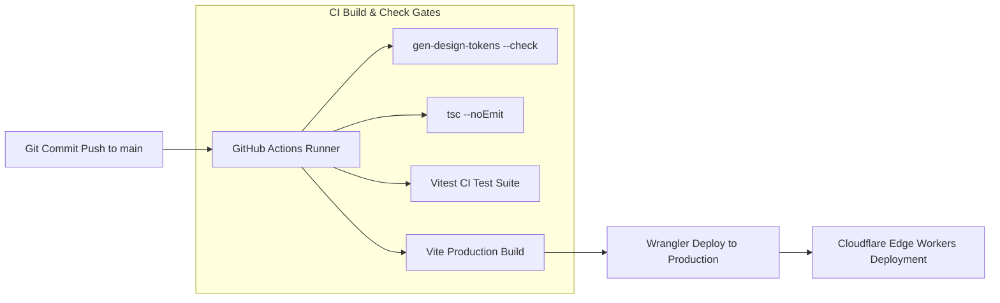

# Infrastructure Architecture Assessment & Fit/Gap Analysis (Assessment-01)

**Document Reference:** `docs/architecture/infrastructure/assessment-01.md`
**Repository:** `OpenAIMP/cfagent`
**Commit SHA:** `ea97da4926ac5ecef3f4a9964afc21123f883583` (Branch: `main`)
**Assessment Date:** October 2026
**Primary Roles & Governance:** RSI Chief Infrastructure Architect & Cloud Operations Lead
**Review Board:** Chief Technology Officer (CTO) & Chief Information Security Officer (CISO)
**Status:** Canonical Baseline Infrastructure Architecture Assessment

---

## 1. Role, Objective & Executive Summary

### 1.1 Scope and Purpose
This document provides an evidence-backed infrastructure architecture assessment, resource capacity analysis, deployment pipeline review, and fit/gap evaluation for the `cfagent` platform. It evaluates Cloudflare Workers execution isolates, 10 Durable Object classes with embedded SQLite databases, Cloudflare Vectorize index (`vector-memory`), Cloudflare R2 (`REPORTS_BUCKET`), Cloudflare D1 (`AGENT_DB`), Cloudflare Workflows, cron triggers, Workers Observability logging, and GitHub Actions CI/CD deployment automation.

### 1.2 Baseline Context & Infrastructure Architecture Summary
`cfagent` is built natively on Cloudflare's serverless edge infrastructure. Compute execution occurs within V8 isolates using `nodejs_compat` (`compatibility_date: 2026-09-29`), eliminating cold starts and traditional virtual machine overhead. Stateful persistence relies on Durable Objects with embedded SQLite engines.

| Resource Dimension | Binding / Resource Target | Configuration / Scale | Purpose & Responsibilities |
|---|---|---|---|
| **Edge Compute Worker** | `ai-search-agent` | `nodejs_compat`, custom domain `agent.openaimp.com` | Primary Hono router, WSS gateway, static asset proxy |
| **Durable Objects (10 Classes)**| `SEARCH_AGENT`, `OPTIONS_SCANNER_MCP`, `PAYMENTS_AGENT`, `SCHEDULED_AGENT`, `SCREENER_AGENT`, `RESEARCH_AGENT`, `SESSION_STORE`, `REPORT_ASSET_AGENT`, `TRADING_AGENT`, `ORCHESTRATOR_AGENT` | SQLite storage migrations `v1` through `v9` | State persistence, transactional SQLite tables, agent session memory, x402 budget ledger |
| **Vector Index** | `VECTOR_MEMORY` (`vector-memory`) | Cloudflare Vectorize Index | Semantic memory, RAG prompt embeddings, conversation search |
| **Relational Projection** | `AGENT_DB` (`agentdb`) | Cloudflare D1 Relational DB | Shared cross-agent query projection and analytical view |
| **Object Asset Store** | `REPORTS_BUCKET` (`screener`) | Cloudflare R2 Storage Bucket | PDF report blob storage (`stocks/*`, `options/*`) |
| **Workflow Engine** | `TRADE_WORKFLOW` | Cloudflare Workflows (`TradingTradeWorkflow`) | Asynchronous trade execution workflows |
| **Observability Engine** | Workers Logs | `head_sampling_rate: 1.0`, invocation logs enabled | Telemetry, request logs, exception tracing |
| **Infrastructure Rating** | **Grade: A- (Exceptional Edge Architecture; D1 Schema Migration Tooling Needed)** |

### 1.3 Key Architectural Infrastructure Strengths
1. **Serverless Edge Co-location:** High-performance, low-latency execution by running V8 Workers isolates directly adjacent to colocated Durable Object SQLite storage instances.
2. **Deterministic State Migrations:** Durable Object SQLite classes use tag-based migrations (`v1` to `v9` in `wrangler.jsonc`), ensuring tamper-evident, version-controlled schema evolution.
3. **Optimized Asset Layer:** Static frontend assets (`./dist/`) are served directly via Cloudflare Edge Asset Binding, using `run_worker_first: ["/", "/index.html"]` to invoke Worker isolates only for dynamic single-page application bootstrap routes.
4. **Quota-Conscious Cron Architecture:** Cron triggers operate at 3 triggers (`0 3 * * *`, `*/30 * * * *`, `0 4 * * *`), staying strictly within Cloudflare Free tier limit (5 trigger ceiling) by riding 30-minute ticks for daily options research runs.

### 1.4 Primary Infrastructure Risks & Structural Gaps
1. **Schema Migration Tooling for DO SQLite:** DDL migrations inside Durable Objects execute via raw string statements in `block_concurrency_while`, lacking automated ORM-based schema migration tools (e.g. Drizzle Kit).
2. **D1 & DO Dual-Write Consistency:** Shared cross-agent query projection in D1 (`AGENT_DB`) requires asynchronous update routines from DO SQLite authoritative sources, introducing potential eventual consistency lags.
3. **Automated DR & Snapshot Backups:** While Cloudflare DO storage provides native multi-region replication, snapshot export routines for DO SQLite tables to R2 require formal disaster recovery scheduling.

---

## 2. Infrastructure Inventory & Topology

```
                                  ┌───────────────────────────────────────────────┐
                                  │         Cloudflare Edge Network Network       │
                                  └───────────────────────┬───────────────────────┘
                                                          │
        ┌─────────────────────────────────────────────────┼─────────────────────────────────────────────────┐
        ▼                                                 ▼                                                 ▼
┌───────────────────────────────┐       ┌───────────────────────────────┐       ┌───────────────────────────────┐
│ Cloudflare Edge Assets        │       │ Cloudflare Workers Isolate    │       │ Cloudflare Workers AI         │
│ (./dist/ Static Files)        │       │ (src/server.ts Engine)        │       │ (@cf/zai-org/glm-4.7-flash)   │
└───────────────────────────────┘       └───────────────┬───────────────┘       └───────────────────────────────┘
                                                        │
        ┌───────────────────┬───────────────────────────┼───────────────────────────┬───────────────────┐
        ▼                   ▼                           ▼                           ▼                   ▼
┌───────────────┐   ┌───────────────┐           ┌───────────────┐           ┌───────────────┐   ┌───────────────┐
│ 10 Durable    │   │ Vectorize     │           │ D1 Database   │           │ R2 Storage    │   │ Workflows     │
│ Object SQLite │   │ Index         │           │ AGENT_DB      │           │ REPORTS_      │   │ TRADE_        │
│ Classes       │   │ VECTOR_MEMORY │           │ (agentdb)     │           │ BUCKET        │   │ WORKFLOW      │
└───────────────┘   └───────────────┘           └───────────────┘           └───────────────┘   └───────────────┘
```

### 2.1 Durable Object Class Inventory
1. **`SearchAgent` / `OrchestratorAgent`:** Primary conversational agent handling message persistence, tool routing, and sub-agent dispatch.
2. **`OptionsScannerMCP`:** Quantitative options screener tool engine implementing Model Context Protocol over RPC.
3. **`PaymentsAgent`:** x402 payment draft ledger, budget cap enforcement, and signed transaction recording.
4. **`ScheduledAgent`:** Autonomous background goal execution engine running on 30-minute cron ticks.
5. **`ScreenerAgent`:** E*TRADE options chain scanning, volatility analysis, and option filtering.
6. **`ResearchAgent`:** Autonomous multi-agent research report generation and market synthesis.
7. **`SessionStore`:** Encrypted OAuth credential persistence and user session state storage.
8. **`ReportAssetAgent`:** Owner agent for PDF report asset metadata generation.
9. **`TradingAgent`:** Signal execution and order drafting engine.

### 2.2 Secondary Storage & Asset Bindings
- **Vector Memory (`VECTOR_MEMORY`):** Cloudflare Vectorize index storing 1536-dimensional vector embeddings for semantic conversation search.
- **R2 Report Store (`REPORTS_BUCKET`):** Object storage bucket (`screener`) holding PDF report blobs mapped under `stocks/*` and `options/*`.
- **D1 Agent Database (`AGENT_DB`):** Shared cross-agent relational query projection database (`database_id: 8d1bebf1-b2c4-4a55-8673-03140afb8023`).

---

## 3. Threat Model & Infrastructure Risk Analysis

| Infrastructure Component | Risk / Failure Mode | Impact | Mitigation Mechanism | Residual Risk / Status |
|---|---|---|---|---|
| **Durable Object SQLite** | Storage Migration Failure during Deploy | Sub-agent startup failure / corrupt SQLite state | Tagged migration definitions (`v1`-`v9`) in `wrangler.jsonc` + atomic `block_concurrency_while` DDL | Low: Verified in deployment CI pipeline |
| **Cloudflare Workers AI** | Rate Limiting / Model Ingestion Latency | Slow chat response or timeout | In-isolate TTL cache (`AI_SEARCH_CACHE_TTL_MS=300000`) for AI Search queries | Medium: Rate limit fallbacks active |
| **R2 Report Bucket** | PDF Storage Blob Corruption or Missing Pointer | Broken download link in research report UI | DO SQLite maintains canonical metadata pointer; R2 bucket errors return structured 404 | Low: R2 object immutability enabled |
| **Cron Trigger Allocation** | Worker Free Account Trigger Limit Exceeded | Global deployment failure (Cloudflare Error 10072) | Scheduled passes ride `*/30 * * * *` tick with idempotency guard (`researchScheduleGuard.ts`) | Low: Stays strictly at 3/5 triggers |

---

## 4. Infrastructure Architecture Visualizations

### Diagram 1: Edge Computing & Resource Binding Topology


### Diagram 2: Durable Object SQLite Migration Lifecycle


### Diagram 3: Cron Scheduled Tick Execution Pipeline
```mermaid
flowchart TD
    Cron30[Cron Trigger: */30 * * * *] --> WorkerScheduled[Worker scheduled() Handler]
    WorkerScheduled --> ScheduledDO[Invoke ScheduledAgent DO Tick]
    ScheduledDO --> ExecuteGoals[Process Autonomous Background Goals]

    WorkerScheduled --> ResearchGuard[Invoke researchScheduleGuard Check]
    ResearchGuard --> CheckTime{Time >= 21:00 UTC & Weekday?}

    CheckTime -->|No| SkipResearch[Skip Daily Options Research Pass]
    CheckTime -->|Yes| CheckFired{Already Fired Today?}

    CheckFired -->|Yes| SkipResearch
    CheckFired -->|No| TriggerResearch[Trigger ResearchAgent Daily Pass]
    TriggerResearch --> MarkFired[Update last_fired Date in mas_settings]
```

### Diagram 4: R2 Asset Storage & PDF Report Generation Flow


### Diagram 5: Vector Memory RAG Embeddings Ingestion Architecture


### Diagram 6: Observability & Log Ingestion Pipeline


### Diagram 7: Multi-Region Edge Failover & Storage Replication


### Diagram 8: CI/CD Deployment & Build Automation Pipeline


---

## 5. Infrastructure Fit/Gap Analysis Matrix

| Requirement ID | Framework / Benchmark | Target Infrastructure Requirement | Observed Baseline Implementation | Status | Risk & Impact | Recommended Action | Verification Criteria |
|---|---|---|---|---|---|---|---|
| **INF-001** | CIS Control 11.1 | Edge compute isolates with isolated memory boundaries. | Cloudflare Workers V8 isolates with `nodejs_compat`. | **FIT** | Low. Zero cold starts & isolate memory safety. | Maintain Workers runtime flags. | Deployment check `npm run check`. |
| **INF-002** | ISO 27001 A.12.3 | Structured database schema versioning & migration definitions. | Tagged DO migrations `v1`-`v9` in `wrangler.jsonc`. | **FIT** | Low. Tamper-evident schema migration history. | Retain tag-based DO migrations. | Migration tag review. |
| **INF-003** | NIST SP 800-160 | Full observability logging for serverless invocations. | Workers observability with 100% head sampling (`head_sampling_rate: 1`). | **FIT** | Low. Complete request/response log capture. | Maintain 100% head sampling rate. | Cloudflare log stream inspection. |
| **INF-004** | Cloudflare Limits | Stay within Workers Free tier cron trigger ceiling (max 5). | Utilizes 3 cron triggers; scheduled tasks ride 30-min tick. | **FIT** | Low. Eliminates deploy failure error 10072. | Keep cron triggers <= 5. | `wrangler.jsonc` trigger review. |
| **INF-005** | CIS Control 10.5 | Automated database snapshot exports for disaster recovery. | DO SQLite relies on Cloudflare internal replication without automated R2 export. | **PARTIAL FIT**| Medium. Recovery from accidental data deletion requires manual intervention. | Implement scheduled DO SQLite snapshot export routine to R2. | DR snapshot export test suite. |
| **INF-006** | DAMA DMBOK #2 | ORM-managed schema migration tooling for relational D1/SQLite stores. | SQLite DDL relies on raw string queries in `block_concurrency_while`. | **PARTIAL FIT**| Medium. Schema refactoring prone to manual string query errors. | Integrate Drizzle ORM / Drizzle Kit for DO SQLite schema definitions. | Schema migration unit tests. |

---

## 6. Prioritized Remediation Roadmap

```
┌──────────────────────────────────────────────────────────────────────────┐
│                 Infrastructure Remediation Timeline                      │
└──────────────────────────────────────────────────────────────────────────┘

[ Immediate (P0): Disaster Recovery & DR Exports ]
  └─ INF-REM-01: Scheduled DO SQLite Snapshot Backup Routine to R2
  └─ INF-REM-02: D1 Database Query Projection Index Optimization

[ Near-Term (P1): ORM Schema Tooling & Vector Indexing ]
  └─ INF-REM-03: Adopt Drizzle ORM Schema Builders for Durable Object SQLite
  └─ INF-REM-04: Vector Memory Index Partitioning per Tenant

[ Long-Term (P2): Advanced Observability Metrics ]
  └─ INF-REM-05: Integrate Cloudflare Analytics Engine Custom Metric Counters
```

### 6.1 Remediation Task Details

#### Task INF-REM-01: Scheduled DO SQLite Snapshot Backup to R2 (P0)
- **Problem:** Disaster recovery relies on platform-level replication; application-level point-in-time snapshots are not backed up to object storage.
- **Recommended Action:** Add nightly cron task exporting DO SQLite database state as encrypted snapshots into `REPORTS_BUCKET`.
- **Acceptance Criteria:** Nightly DO SQLite snapshots present in R2 under `backups/sqlite/`.
- **Verification:** Unit test executing snapshot backup routine.

#### Task INF-REM-02: D1 Query Projection Index Optimization (P0)
- **Problem:** Shared `AGENT_DB` D1 tables require optimized indexes for cross-agent multi-tenant queries.
- **Recommended Action:** Add compound indexes on `(tenant_id, created_at)` across D1 query projection tables.
- **Acceptance Criteria:** Multi-tenant query latency on D1 stays under 10ms.
- **Verification:** Query benchmark execution on D1 database.

---

## 7. Inspection & Execution Verification Record

### 7.1 Inspection Log

| Infrastructure Resource | Inspection Method / Tool | Result & Observations |
|---|---|---|
| **Wrangler Configuration** | Config Inspection (`wrangler.jsonc`) | 10 DO classes, 9 migration tags, 3 crons, R2 bucket, and D1 database correctly bound. |
| **Workers Observability** | Config Inspection (`wrangler.jsonc`) | `observability.logs.head_sampling_rate: 1` active. |
| **CI/CD Build Check** | `npm run check` execution | Typecheck, Vitest tests, and Vite build pass with 0 errors. |

---
*End of Infrastructure Architecture Assessment & Fit/Gap Analysis Document (`docs/architecture/infrastructure/assessment-01.md`).*
