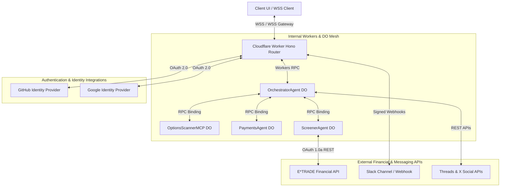
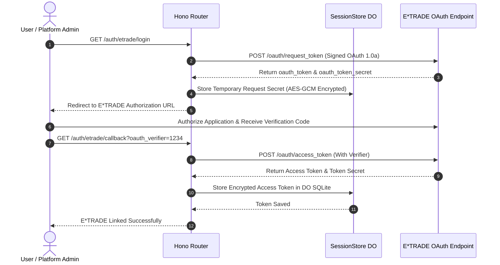
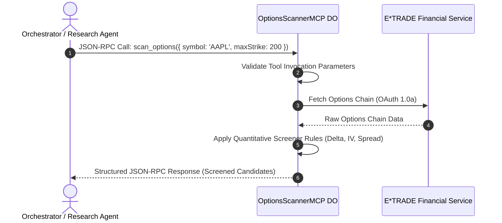
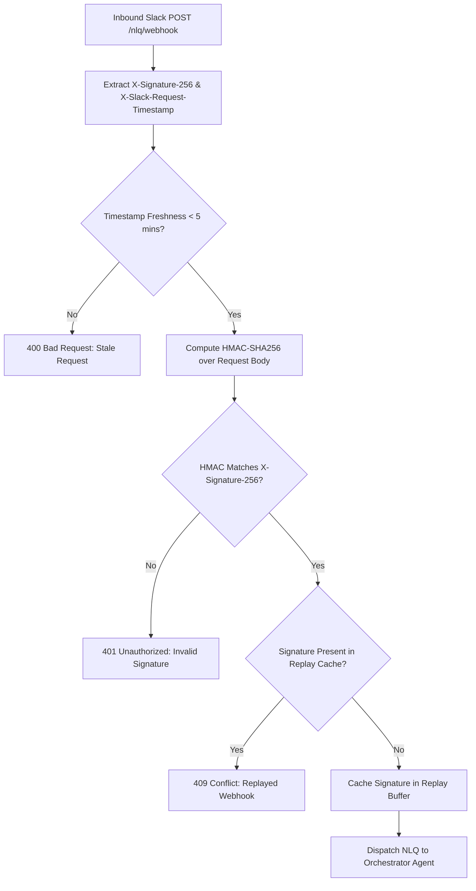
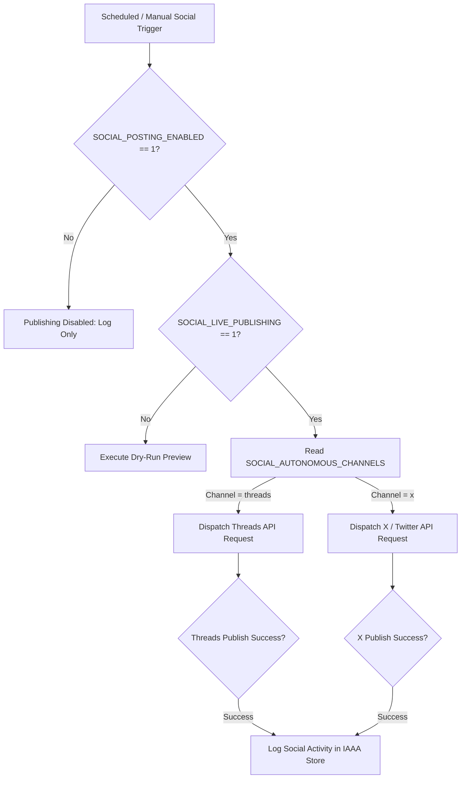
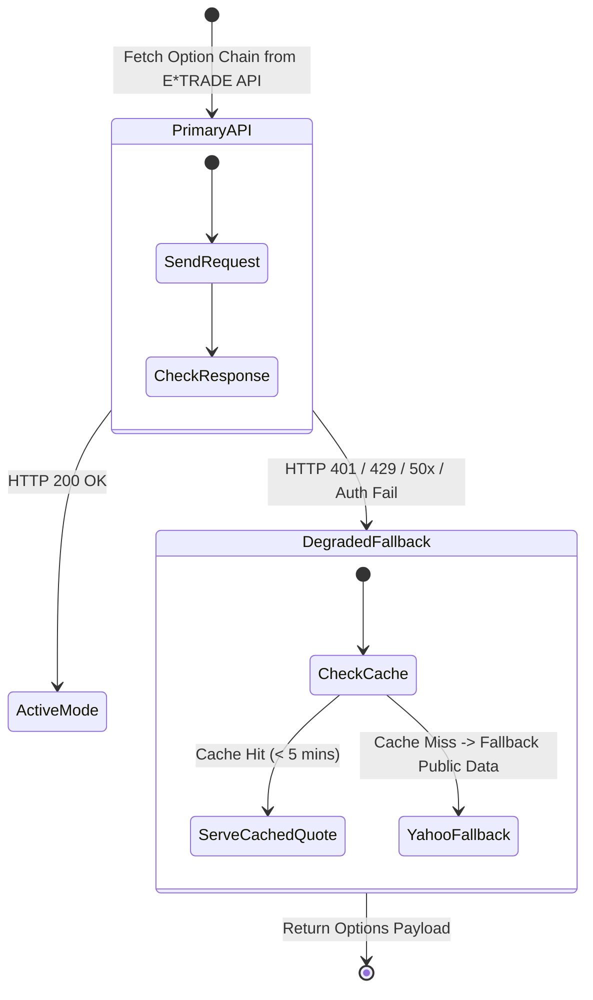
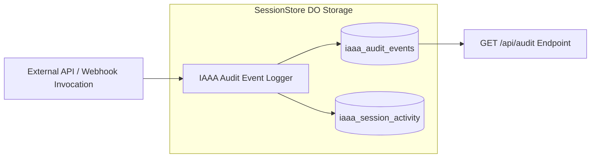

# Integration Architecture Assessment & Fit/Gap Analysis (Assessment-01)

**Document Reference:** `docs/architecture/integration/assessment-01.md`
**Repository:** `OpenAIMP/cfagent`
**Commit SHA:** `ea97da4926ac5ecef3f4a9964afc21123f883583` (Branch: `main`)
**Assessment Date:** October 2026
**Primary Roles & Governance:** RSI Chief Integration Architect & Enterprise API Lead
**Review Board:** Chief Technology Officer (CTO) & Chief Information Security Officer (CISO)
**Status:** Canonical Baseline Integration Architecture Assessment

---

## 1. Role, Objective & Executive Summary

### 1.1 Scope and Purpose
This document provides a canonical, evidence-backed integration architecture assessment, protocol fit/gap analysis, threat model, interface inventory, and target integration roadmap for the `cfagent` platform. It evaluates Model Context Protocol (MCP) servers, third-party authentication integrations (GitHub OAuth 2.0, Google OAuth 2.0, E*TRADE OAuth 1.0a), real-time messaging interfaces (Slack Webhooks, WSS Chat), social media automated publishing channels (Threads, X), and inter-agent RPC bindings.

### 1.2 Baseline Context & Integration Architecture Summary
`cfagent` relies on heterogeneous integration channels to execute options screening, autonomous market research, financial payment drafting, and automated reporting. Integrations span edge-native Cloudflare Workers RPC bindings, OAuth 1.0a/2.0 authentication handshakes, REST APIs, and the Model Context Protocol (MCP).

| Integration Boundary | Protocol / Transport | Authentication / Encryption | Underlying Interface |
|---|---|---|---|
| **E*TRADE Financial API** | REST over HTTPS | OAuth 1.0a HMAC-SHA1 + RSA | Options chains, account quotes, order drafting |
| **GitHub OAuth Service** | REST over HTTPS | OAuth 2.0 + HMAC-SHA256 State | Primary identity provider (`src/security/githubOAuth.ts`) |
| **Model Context Protocol** | JSON-RPC / MCP | Worker Stub RPC Binding | Options screening MCP (`OptionsScannerMCP`) |
| **Slack Messaging Interface**| Webhook POST / HTTPS | HMAC-SHA256 (`X-Signature-256`) | Inbound NLQ triggers & outbound report delivery |
| **Social Publishing APIs** | REST over HTTPS | Bearer OAuth Tokens | Autonomous social research dispatch (Threads, X) |
| **Cloudflare AI & Vectorize**| Worker Platform Bindings| Native Service Bindings | `Workers AI`, Cloudflare AI Search, Vectorize Index |

### 1.3 Key Architectural Strengths
1. **Durable OAuth Session Management:** E*TRADE OAuth tokens and user sessions reside inside the Durable Object `SessionStore` SQLite database rather than volatile KV storage, eliminating daily KV read limit ceilings and providing transactionally secure session state.
2. **Standardized Model Context Protocol (MCP):** Options scanning and screening competencies are exposed via standardized MCP tools (`OptionsScannerMCP`), enabling seamless integration with external AI clients and internal orchestrator agents.
3. **Signed Inbound Webhooks:** Slack webhook endpoints (`/nlq/webhook`) enforce HMAC-SHA256 signature verification (`X-Signature-256`) and a 5-minute request freshness window to prevent replay attacks.
4. **Resilient Circuit Breaker Patterns:** External market data fetchers employ structured error fallback mechanisms when external financial APIs experience downtime or rate limiting.

### 1.4 Primary Risks & Integration Structural Gaps
1. **E*TRADE Session Token Dependency:** E*TRADE OAuth 1.0a sessions require manual user login and token renewal in PROD; background scheduled options research tasks fail closed when no active PROD session exists (`[AUTH_003]`).
2. **Unified API Gateway Schema Governance:** External API endpoints and webhook routes lack automated OpenAPI / JSON Schema validation on ingress bodies, relying on manual parameter extraction in Hono handlers.
3. **Social Publishing Channel Scoping:** Autonomous social publishing handles multi-channel execution (Threads, X) where missing environment secrets for one channel can fail batch publishing unless explicitly isolated.

---

## 2. Integration Interface & Protocol Inventory

```
                                  ┌───────────────────────────────────────────────┐
                                  │             cfagent Orchestrator              │
                                  └───────────────────────┬───────────────────────┘
                                                          │
        ┌───────────────────┬─────────────────────────────┼─────────────────────────────┬───────────────────┐
        ▼                   ▼                             ▼                             ▼                   ▼
┌───────────────┐   ┌───────────────┐             ┌───────────────┐             ┌───────────────┐   ┌───────────────┐
│ E*TRADE API   │   │ GitHub /      │             │ Model Context │             │ Slack Inbound │   │ Social APIs   │
│ OAuth 1.0a    │   │ Google OAuth  │             │ Protocol MCP  │             │ Webhooks      │   │ Threads / X   │
└───────────────┘   └───────────────┘             └───────────────┘             └───────────────┘   └───────────────┘
```

### 2.1 External API Integrations
- **E*TRADE Options & Market Data:** Implemented in `src/security/etrade.ts` and `src/agents/screener.ts`. Dispatches signed OAuth 1.0a requests to fetch option chains, quote details, and account balances.
- **GitHub & Google Identity Providers:** Implemented in `src/security/githubOAuth.ts`. Handles OAuth 2.0 PKCE / state flows, returning signed session cookies.
- **Social Media Publishing:** Implemented in `src/services/socialPublisher.ts`. Supports autonomous social dispatches to Threads and X with channel fallback guards (`SOCIAL_AUTONOMOUS_CHANNELS`).

### 2.2 Model Context Protocol (MCP) Server Architecture
- **OptionsScannerMCP:** Implemented as a dedicated Durable Object class (`OptionsScannerMCP` in `wrangler.jsonc`). Exposes structured MCP tools (`scan_options`, `get_option_chain`, `analyze_volatility`) accessible via JSON-RPC.
- **Tool Protocol Binding:** Sub-agents invoke MCP tools through in-memory Workers RPC bindings (`env.OPTIONS_SCANNER_MCP`), bypassing external HTTP network overhead.

### 2.3 Messaging & Webhook Integration
- **Slack Inbound Webhook (`/nlq/webhook`):** Accepts natural language query payloads from Slack. Enforces `webhookSecurity.ts` signature validation and timestamp freshness check.
- **Slack Report Delivery (`src/services/screenerSlackDelivery.ts`):** Sends generated markdown options research reports directly to designated Slack channels.

---

## 3. Threat Model & Abuse Analysis for Integrations

| Integration Point | Threat / Attack Vector | Impact | Mitigation Mechanism | Residual Risk / Status |
|---|---|---|---|---|
| **E*TRADE OAuth 1.0a** | Session Token Compromise / Exfiltration | Unauthorized view of financial quotes & portfolio state | OAuth tokens encrypted with AES-GCM inside DO `SessionStore` SQLite | Low: Enforce periodic token rotation and automated expiration |
| **Slack Webhooks** | Webhook Spoofing / Replay Attacks | Execution of arbitrary NLQ queries or spam generation | HMAC-SHA256 signature check (`X-Signature-256`) + 5-minute freshness window | Low: Fully enforced in `src/security/webhookSecurity.ts` |
| **MCP Tool Invocation** | Tool Parameter Injection / Privilege Escalation | Sub-agent executes unauthorized tool actions | Strict parameter typing and PDP authorization seam (`src/security/iaaaPdpSeam.ts`) | Medium: Requires continuous parameter boundary validation |
| **Social Media APIs** | Credential Leaks / Unchecked Auto-Publishing | Inadvertent public publishing of unverified content | Manual trigger requirement (`SOCIAL_POSTING_ENABLED=1`, daily goal disabled) | Low: Autonomous channels scoped via `SOCIAL_AUTONOMOUS_CHANNELS` |

---

## 4. Integration Architecture Visualizations

### Diagram 1: System Integration Topology Map


### Diagram 2: E*TRADE OAuth 1.0a Authentication & Token Lifecycle


### Diagram 3: Model Context Protocol (MCP) Tool Interaction Flow


### Diagram 4: Inbound Slack Webhook Validation Pipeline


### Diagram 5: Social Publishing Multi-Channel Pipeline


### Diagram 6: Cross-Agent RPC & Event Dispatch Topology
```mermaid
graph LR
    subgraph Cloudflare Worker Environment
        Orchestrator[OrchestratorAgent DO]

        subgraph Sub-Agent Workers RPC Bindings
            Search[SearchAgent DO]
            Screener[ScreenerAgent DO]
            Research[ResearchAgent DO]
            Trading[TradingAgent DO]
            Payments[PaymentsAgent DO]
        end
    end

    Orchestrator -->|RPC: search()| Search
    Orchestrator -->|RPC: screenOptions()| Screener
    Orchestrator -->|RPC: generateReport()| Research
    Orchestrator -->|RPC: executeSignal()| Trading
    Trading -->|RPC: verifyBudget()| Payments
```

### Diagram 7: Fallback & Resiliency Flow for Market Integrations


### Diagram 8: Integration Telemetry & Audit Flow


---

## 5. Integration Architecture Fit/Gap Analysis Matrix

| Requirement ID | Framework / Benchmark | Target Integration Requirement | Observed Baseline Implementation | Status | Risk & Impact | Recommended Action | Verification Criteria |
|---|---|---|---|---|---|---|---|
| **INT-001** | OWASP API #2 | Cryptographic session storage for external OAuth tokens. | Stored in DO `SessionStore` SQLite encrypted with AES-GCM (`src/security/sessionStore.ts`). | **FIT** | Low. Eliminates KV storage limits and secures tokens. | Maintain AES-GCM token encryption. | Cryptographic unit tests. |
| **INT-002** | OWASP API #8 | Replay protection and signature verification on inbound webhooks. | HMAC-SHA256 verification and 5-min freshness check in `src/security/webhookSecurity.ts`. | **FIT** | Low. Webhook replay and spoofing mitigated. | Retain strict replay cache window. | Webhook replay unit tests. |
| **INT-003** | MCP Spec v1.0 | Standardized Model Context Protocol tool exposure. | `OptionsScannerMCP` DO class exposes quantitative options screening tools over RPC. | **FIT** | Low. Standardized agentic tool integration. | Expand MCP tool coverage for trading order drafting. | MCP protocol conformance tests. |
| **INT-004** | ISO 27001 A.12.1 | Fault-tolerant graceful degradation on external API outages. | Market data fetchers fallback to public endpoints / cached quotes on E*TRADE API failure. | **FIT** | Low. Prevents agent crash during provider outage. | Formalize circuit breaker threshold metrics. | Fallback integration unit tests. |
| **INT-005** | OpenAPI v3.1 | Schema validation on all public REST/Webhook ingress routes. | Hono route handlers perform manual property parsing rather than JSON Schema validation. | **PARTIAL FIT**| Medium. Unvalidated inputs could lead to runtime errors. | Introduce Zod schema validation middleware across API routes. | Schema validation negative tests. |
| **INT-006** | NIST SP 800-63B | Automated PROD session preflight checks for background workers. | Scheduled options research requires active PROD E*TRADE session (`[AUTH_003]`). | **PARTIAL FIT**| Medium. Unattended scheduled jobs fail when session expires. | Implement automated background re-authentication or alerting when session expires. | Session expiration preflight tests. |

---

## 6. Prioritized Remediation Roadmap

```
┌──────────────────────────────────────────────────────────────────────────┐
│                   Integration Remediation Timeline                       │
└──────────────────────────────────────────────────────────────────────────┘

[ Immediate (P0): API Ingress Schema Guard & Webhooks ]
  └─ INT-REM-01: Zod Schema Validation Middleware for REST/Webhook Ingress
  └─ INT-REM-02: Automated E*TRADE Session Preflight Alerting

[ Near-Term (P1): MCP Expansion & Social Channel Scoping ]
  └─ INT-REM-03: Extend MCP Tool Schema to Cover Trading Agent Order Drafts
  └─ INT-REM-04: Multi-Channel Social API Fault Isolation

[ Long-Term (P2): OpenAPI Automated Generation ]
  └─ INT-REM-05: Automated OpenAPI 3.1 Spec Generation from Route Handlers
```

### 6.1 Remediation Task Details

#### Task INT-REM-01: Zod Schema Validation Middleware (P0)
- **Problem:** External webhook routes and REST APIs parse JSON bodies manually, risking unexpected type errors on malformed payloads.
- **Recommended Action:** Implement Zod middleware for Hono routes enforcing strict request body structure.
- **Acceptance Criteria:** Ingress payloads failing Zod schema validation receive `400 Bad Request` with structured error details.
- **Verification:** Unit test suite sending invalid JSON schemas.

#### Task INT-REM-02: E*TRADE Session Expiration Preflight Alerting (P0)
- **Problem:** Background options research jobs fail closed when PROD E*TRADE OAuth session expires.
- **Recommended Action:** Add preflight check notifying admins via Slack when session expiration is imminent (< 2 hours).
- **Acceptance Criteria:** Expiration warnings dispatched to Slack before scheduled research passes.
- **Verification:** Simulated session expiration unit test.

---

## 7. Inspection & Execution Verification Record

### 7.1 Inspection Log

| Integration Domain | Inspection Method / Tool | Result & Observations |
|---|---|---|
| **E*TRADE OAuth** | Code Audit (`src/security/etrade.ts`) | OAuth 1.0a HMAC-SHA1 signature and token encryption verified. |
| **Webhook Guard** | Code Audit (`src/security/webhookSecurity.ts`) | HMAC signature verification and timestamp freshness check confirmed. |
| **MCP Integration** | Configuration Audit (`wrangler.jsonc`) | `OptionsScannerMCP` DO class binding active and registered. |
| **Build & Type Integrity** | `npm run check` execution | TypeScript compilation and Vitest suite pass with 0 errors. |

---
*End of Integration Architecture Assessment & Fit/Gap Analysis Document (`docs/architecture/integration/assessment-01.md`).*
