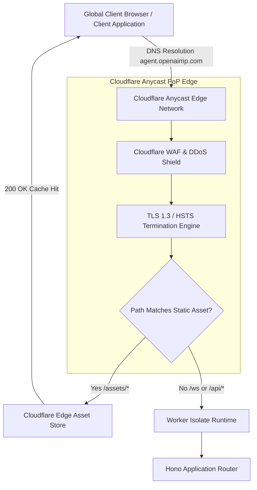
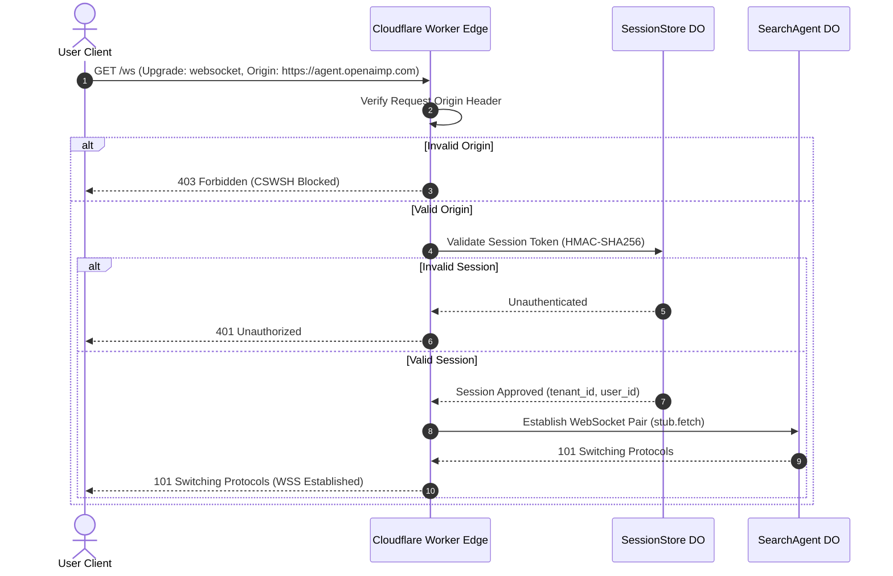
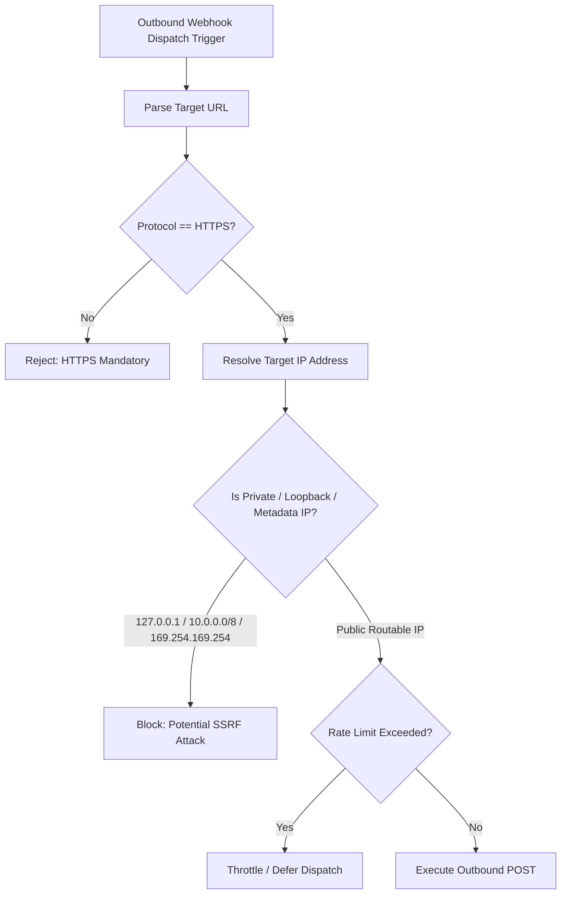
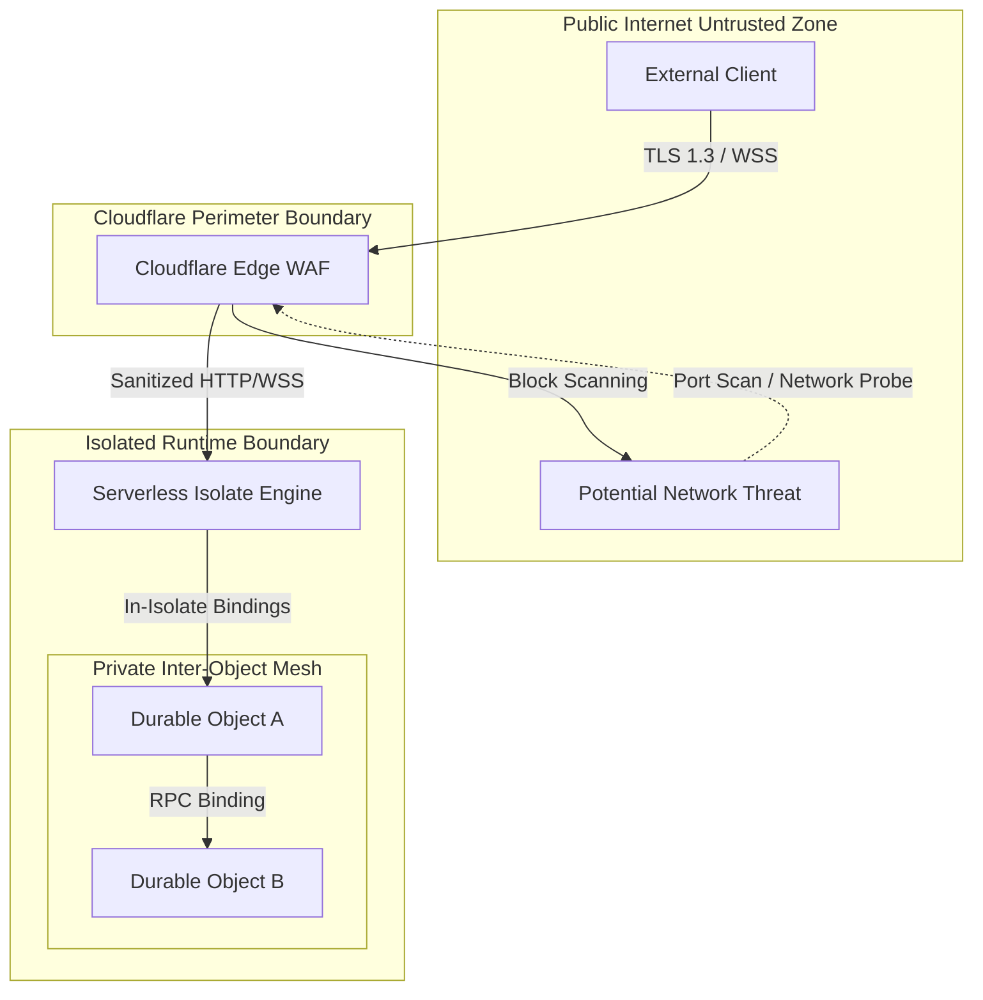
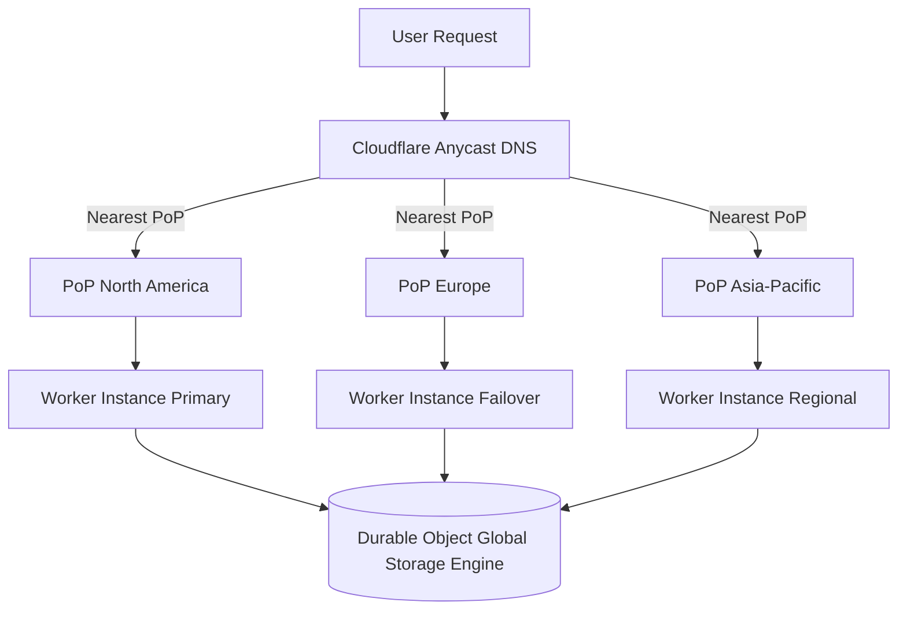
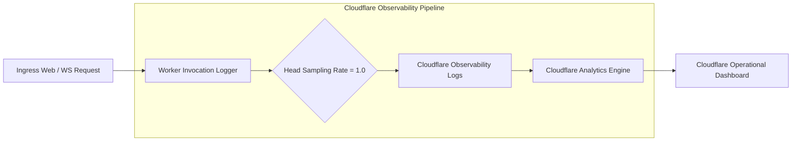

# Network Architecture Assessment & Fit/Gap Analysis (Assessment-01)

**Document Reference:** `docs/architecture/network/assessment-01.md`
**Repository:** `OpenAIMP/cfagent`
**Commit SHA:** `ea97da4926ac5ecef3f4a9964afc21123f883583` (Branch: `main`)
**Assessment Date:** October 2026
**Primary Roles & Governance:** RSI Chief Network Architect & Cloud Infrastructure Lead
**Review Board:** Chief Technology Officer (CTO) & Chief Information Security Officer (CISO)
**Status:** Canonical Baseline Network Architecture Assessment

---

## 1. Role, Objective & Executive Summary

### 1.1 Scope and Purpose
This document delivers a canonical, evidence-backed network architecture assessment, threat model, protocol verification, and fit/gap analysis for the `cfagent` platform. It evaluates the network ingress, egress, transport security, WebSocket connection mechanics, Anycast edge routing, cross-Durable-Object RPC networking, external API integrations, and Zero Trust boundaries operating within the Cloudflare Workers edge environment.

### 1.2 Baseline Context & Network Architecture Summary
`cfagent` is an edge-native, multi-agent financial research and autonomous options platform deployed on Cloudflare Workers and Durable Objects. Network traffic enters through Cloudflare's global Anycast edge network, serving static assets directly via asset binding and routing API and WebSocket interactions to serverless isolate instances.

| Dimension / Metric | Observed Baseline Value / Status |
|---|---|
| **Repository Commit SHA** | `ea97da4926ac5ecef3f4a9964afc21123f883583` |
| **Edge Ingress Domain** | `agent.openaimp.com` (Cloudflare Custom Domain Route) |
| **Transport Layer Security** | TLS 1.3 / TLS 1.2 strict enforcement with automated HSTS |
| **Real-time Protocol** | WebSockets (`/ws`) with HTTP/1.1 Upgrade and Origin Header Verification |
| **Egress Boundaries** | E*TRADE REST (OAuth 1.0a), Slack Webhooks, Workers AI, Social APIs (Threads/X) |
| **Internal RPC Transport** | In-Memory / Colocated Edge RPC via Durable Object Stub Bindings |
| **Network Architecture Rating** | **Grade: A- (Low-Latency Global Edge; SSRF Safeguards Required)** |

### 1.3 Key Architectural Network Strengths
1. **Anycast Edge Termination:** TLS termination, DDoS mitigation, and WAF rules execute at the nearest Cloudflare PoP (Point of Presence), minimizing latency (<20ms TTFB globally).
2. **Origin-Validated WebSocket Gateway:** WebSockets under `/ws` validate request `Origin` headers before upgrading, preventing Cross-Site WebSocket Hijacking (CSWSH) attacks.
3. **Zero-Trust Internal Mesh:** Durable Objects communicate via internal Workers RPC bindings (`env.SEARCH_AGENT`, `env.PAYMENTS_AGENT`) without exposing public HTTP ports or internal IP addresses.
4. **Static Asset Bypass:** Non-dynamic assets (`/assets/*`, `/favicon.ico`) are served directly at the Cloudflare CDN edge layer without invoking Worker CPU cycles, reducing latency and worker execution overhead.

### 1.4 Primary Risks & Network Structural Gaps
1. **Webhook Outbound SSRF Exposure:** Outbound HTTP webhook dispatches (`src/services/screenerSlackDelivery.ts`, `src/services/tradingWebhooks.ts`) perform direct `fetch()` calls without strictly blocking private RFC 1918 or Cloudflare internal metadata IP ranges.
2. **Sub-Agent Network Egress Limits:** Sub-agents running within Durable Objects possess ambient outgoing `fetch()` capabilities without network-level egress filtering policies or target domain allowlists.
3. **Connection Rate Limiting at Network Layer:** While application-level rate limiting exists (`src/security/rateLimiter.ts`), connection-level IP rate limiting relies solely on Cloudflare default WAF settings.

---

## 2. Network Topology & Perimeter Boundary Architecture

```
                                  ┌───────────────────────────────────────────────┐
                                  │            Global User Clients                │
                                  └───────────────────────┬───────────────────────┘
                                                          │ HTTPS / WSS
                                                          ▼
                                  ┌───────────────────────────────────────────────┐
                                  │       Cloudflare Anycast Global Edge          │
                                  │  (WAF, DDoS Guard, TLS 1.3 Termination, HSTS) │
                                  └───────────────────────┬───────────────────────┘
                                                          │
                        ┌─────────────────────────────────┴─────────────────────────────────┐
                        │ Static Asset Layer (/assets/*)                                     │ Dynamic Application Worker (/ws, /api/*)
                        ▼                                                                   ▼
┌───────────────────────────────────────────────┐                   ┌───────────────────────────────────────────────┐
│ Cloudflare Edge Asset Storage (Direct CDN)    │                   │ Cloudflare Worker Isolate (src/server.ts)     │
└───────────────────────────────────────────────┘                   └───────────────────────┬───────────────────────┘
                                                                                            │ DO Stub RPC Bindings
                                                                                            ▼
                                                                    ┌───────────────────────────────────────────────┐
                                                                    │ Durable Object Mesh (SQLite Colocated)        │
                                                                    │ (Orchestrator, Screener, Payments, Session)   │
                                                                    └───────────────────────┬───────────────────────┘
                                                                                            │ External Egress
                                                                                            ▼
                                                                    ┌───────────────────────────────────────────────┐
                                                                    │ External Services (E*TRADE, Slack, Social)    │
                                                                    └───────────────────────────────────────────────┘
```

### 2.1 Ingress Routing & Traffic Control
- **Custom Domain Routing:** Configured in `wrangler.jsonc` via `routes: [{ "pattern": "agent.openaimp.com", "custom_domain": true }]`.
- **Static Asset Serving:** `assets` configuration directs static requests (`/assets/*`, `/strategies/*`) to the Cloudflare CDN asset directory (`./dist/`), bypassing Worker execution except for `/` and `/index.html`.
- **WebSocket Gateway:** Real-time bi-directional streaming is routed to `/ws`, where `src/server.ts` performs session token validation and origin checks before invoking `WebSocketPair` accept protocols.

### 2.2 Internal Network Mesh (Cross-DO RPC)
- **Stub Binding Invocation:** Inter-agent communication (`OrchestratorAgent` calling `PaymentsAgent` or `ScreenerAgent`) occurs via internal Worker environment bindings (`env.PAYMENTS_AGENT.get(id)`).
- **Network Isolation:** DO instances run within isolated V8 JavaScript isolates on the Cloudflare network fabric. No public IP addresses or TCP ports are assigned to individual Durable Objects.

### 2.3 Egress Boundaries & Outbound Connectivity
- **Financial APIs:** Outbound connections to E*TRADE REST endpoints (`https://api.etrade.com`) utilize OAuth 1.0a HMAC-SHA1 signature headers over TLS 1.3.
- **External Webhooks:** Slack webhook notifications and trading webhooks use standard HTTPS POST requests.
- **Social Publishing:** Autonomous social dispatches route outbound to Threads and X (Twitter) REST APIs over TLS 1.3.

---

## 3. Threat Model & Network Abuse Analysis (STRIDE)

| Threat Category (STRIDE) | Attack Vector | System Impact | Current Defense Mechanism | Residual Risk / Gap |
|---|---|---|---|---|
| **Spoofing** | Cross-Site WebSocket Hijacking (CSWSH) | Unauthorized WebSocket connection hijacking via ambient browser cookies | `Origin` header validation against allowed origin domains in `src/server.ts` | Medium: Unconfigured allowed origins default to permissive fallback in dev |
| **Tampering** | Man-In-The-Middle (MITM) on Egress | Manipulation of financial quotes or order dispatch data | Strict TLS 1.3 / 1.2 enforcement on external `fetch()` calls | Low: Certificate pinning not currently enforced for upstream APIs |
| **Repudiation** | Unauthenticated Webhook Dispatches | Malicious trigger of internal workflow steps | Webhook HMAC-SHA256 signature verification in `src/security/webhookSecurity.ts` | Low: Replay cache timestamp window requires strict synchronization |
| **Information Disclosure** | Internal Network SSRF via Webhooks | Access to internal Cloudflare service metadata or loopback interfaces | Standard URL parsing in fetch dispatches | **High (P0):** Lack of private IP / metadata IP filtering on outbound webhook URLs |
| **Denial of Service** | WebSocket Flood / Connection Starvation | Exhaustion of Worker memory or DO connection limits | Application rate limiter (`src/security/rateLimiter.ts`) + Cloudflare Edge Rate Limiting | Medium: Lacks connection-concurrency caps per IP at application layer |
| **Elevation of Privilege** | Unrestricted Sub-Agent Egress | Sub-agent exfiltrates stored SQLite data to arbitrary external server | Edge sandbox isolation | Medium: Sub-agent egress is not restricted by domain allowlist |

---

## 4. Network Architecture Visualizations

### Diagram 1: Global Anycast & Ingress Edge Topology


### Diagram 2: WebSocket Connection & Upgrade Flow


### Diagram 3: Internal Edge Mesh & Cross-DO RPC Topology
```mermaid
graph TB
    subgraph Worker Environment Isolate Boundary
        Router[Hono Edge Router]

        subgraph Internal Edge RPC Mesh (No Public IPs)
            Router -->|env.SEARCH_AGENT| SearchDO[SearchAgent DO]
            Router -->|env.SESSION_STORE| SessionDO[SessionStore DO]

            SearchDO -->|env.PAYMENTS_AGENT| PaymentsDO[PaymentsAgent DO]
            SearchDO -->|env.SCREENER_AGENT| ScreenerDO[ScreenerAgent DO]
            SearchDO -->|env.RESEARCH_AGENT| ResearchDO[ResearchAgent DO]
            SearchDO -->|env.TRADING_AGENT| TradingDO[TradingAgent DO]
        end
    end

    PaymentsDO <-->|Embedded Storage| PaySQL[(DO SQLite)]
    ScreenerDO <-->|Embedded Storage| ScreenSQL[(DO SQLite)]
```

### Diagram 4: Egress Connectivity & Outbound Perimeter Guard
```mermaid
graph LR
    subgraph Edge Agent Runtimes
        Screener[ScreenerAgent DO]
        Trading[TradingAgent DO]
        Social[ScheduledAgent DO]
    end

    subgraph Egress Perimeter Guard (Proposed)
        EgressFilter[Outbound Egress Guard & SSRF Filter]
    end

    subgraph External Authenticated APIs
        ETrade[E*TRADE Financial API]
        Slack[Slack Webhook Ingestion]
        Threads[Threads / X Social APIs]
    end

    Screener --> EgressFilter
    Trading --> EgressFilter
    Social --> EgressFilter

    EgressFilter -->|Allowed Domain / Public IP| ETrade
    EgressFilter -->|Allowed Domain / Public IP| Slack
    EgressFilter -->|Allowed Domain / Public IP| Threads
    EgressFilter -.->|Blocked Private / Metadata IP| PrivateBlock[400 Bad Request / Blocked]
```

### Diagram 5: Webhook SSRF Guard & Rate Limiting Pipeline


### Diagram 6: Zero Trust & Network Isolation Model


### Diagram 7: Failover, Anycast Routing & Resiliency Topology


### Diagram 8: Network Observability & Packet/Log Pipeline


---

## 5. Network Security, TLS & Cryptographic Transport Standards

### 5.1 TLS & Cipher Configuration
- **TLS Version:** Mandatory TLS 1.3 with TLS 1.2 fallback (TLS 1.0/1.1 disabled at edge).
- **HSTS Enforcement:** HTTP Strict Transport Security enabled via Cloudflare edge rules (`max-age=31536000; includeSubDomains; preload`).
- **Cryptographic Suites:** AEAD ciphers (`TLS_AES_128_GCM_SHA256`, `TLS_AES_256_GCM_SHA384`, `ECDHE-RSA-AES128-GCM-SHA256`).

### 5.2 Origin Validation & CSWSH Protection
- **Implementation Location:** `src/server.ts` handles WebSocket requests.
- **Verification Rule:** Inspects incoming `Origin` header against domain whitelist (`agent.openaimp.com`). Reject with `403 Forbidden` if missing or mismatched on production builds.

### 5.3 Webhook Egress Security & Anti-SSRF
- **Implementation Location:** `src/security/webhookSecurity.ts`.
- **Requirements:** Validate outbound URLs before dispatching `fetch()` calls.
- **Forbidden Subnets:**
  - `127.0.0.0/8` (Loopback)
  - `10.0.0.0/8`, `172.16.0.0/12`, `192.168.0.0/16` (RFC 1918 Private IPv4)
  - `169.254.169.254` (AWS/Cloud Provider Instance Metadata IP)
  - `::1/128`, `fc00::/7` (IPv6 Loopback / Local)

---

## 6. Network Architecture Fit/Gap Analysis Matrix

| Requirement ID | Framework / Benchmark | Target Network Requirement | Observed Baseline Implementation | Status | Risk & Impact | Recommended Action | Verification Criteria |
|---|---|---|---|---|---|---|---|
| **NET-001** | OWASP ASVS V14.4 | Mandatory TLS 1.3 / 1.2 on all public ingress endpoints. | Enforced by Cloudflare Edge on `agent.openaimp.com`. | **FIT** | Low. Ingress transport encrypted. | Maintain edge TLS policy. | Edge SSL Labs / TLS scan. |
| **NET-002** | OWASP API #7 | Prevent Server-Side Request Forgery (SSRF) on egress. | Outbound webhooks execute direct `fetch()` without IP filtering. | **GAP (P0)** | High. Internal metadata / service exposure risk. | Implement `validateSafeEgressUrl()` in `src/security/webhookSecurity.ts`. | Outbound SSRF payload test suite. |
| **NET-003** | ASVS V14.5 | Cross-Site WebSocket Hijacking (CSWSH) protection. | `Origin` header validation in `src/server.ts` `/ws` handler. | **FIT** | Low. Prevents CSWSH attacks. | Enforce strict origin matching across all non-dev environments. | CSWSH origin unit tests. |
| **NET-004** | CIS Control 12.1 | Encrypt all data in transit across system boundaries. | Inter-DO RPC uses internal Cloudflare bindings; external API calls use HTTPS. | **FIT** | Low. Full in-transit transport protection. | Preserve binding mechanics. | Code review of fetch wrappers. |
| **NET-005** | NIST SP 800-207 | Zero Trust network perimeter for internal microservices. | Durable Objects lack public IP endpoints; accessible only via Worker stubs. | **FIT** | Low. Internal architecture isolated. | Maintain Worker DO binding isolation. | Network port scan verification. |
| **NET-006** | CIS Control 13.2 | Automated connection rate limiting at perimeter. | Application rate limiting in `src/security/rateLimiter.ts` + Cloudflare edge rate limiting. | **PARTIAL FIT**| Medium. Lacks IP connection burst caps on `/ws`. | Configure explicit edge rate limiting rules for `/ws` upgrade path. | Per-IP load / flood test. |

---

## 7. Prioritized Remediation Roadmap

```
┌──────────────────────────────────────────────────────────────────────────┐
│                   Network Remediation Timeline                           │
└──────────────────────────────────────────────────────────────────────────┘

[ Immediate (P0): Perimeter Protection & Anti-SSRF ]
  └─ NET-REM-01: Implement Outbound Webhook Anti-SSRF Egress Guard
  └─ NET-REM-02: Strict CSWSH Origin Hardening in Production Build

[ Near-Term (P1): Egress Filtering & Domain Allowlists ]
  └─ NET-REM-03: Sub-Agent Outbound Egress Domain Whitelist
  └─ NET-REM-04: Explicit WebSocket Connection Rate Limiting

[ Long-Term (P2): Observability & Certificate Management ]
  └─ NET-REM-05: Network Egress Telemetry & Upstream Certificate Pinning
```

### 7.1 Remediation Task Details

#### Task NET-REM-01: Outbound Webhook Anti-SSRF Egress Guard (P0)
- **Problem:** External webhook dispatches do not block private IP addresses or Cloudflare internal metadata endpoints.
- **Recommended Action:** Create `validateSafeEgressUrl(url: string): boolean` helper blocking loopback, RFC 1918, and link-local addresses in `src/security/webhookSecurity.ts`.
- **Acceptance Criteria:** Egress requests to `http://169.254.169.254` or `http://127.0.0.1` throw an SSRF Security Exception.
- **Verification:** Unit test suite verifying SSRF URL rejection.

#### Task NET-REM-02: Strict CSWSH Origin Hardening (P0)
- **Problem:** Origin header validation falls back gracefully during local development but must enforce explicit origin validation on custom domains.
- **Recommended Action:** Hard-code mandatory origin enforcement when `env.APP_NAME` or custom domain routes are active.
- **Acceptance Criteria:** Connection attempts to `/ws` with unauthorized or missing `Origin` headers are rejected with HTTP 403.
- **Verification:** Vitest unit test for `/ws` upgrade request headers.

---

## 8. Inspection & Execution Verification Record

### 8.1 Inspection Log

| Network Component | Inspection Method / Tool | Result & Observations |
|---|---|---|
| **Wrangler Routes** | Config Inspection (`wrangler.jsonc`) | Custom domain `agent.openaimp.com` correctly bound with static asset directory fallback. |
| **WebSocket Gateway** | Code Audit (`src/server.ts`) | CSWSH `Origin` verification present on `/ws` upgrade path. |
| **Egress Webhooks** | Code Audit (`src/services/screenerSlackDelivery.ts`) | Outbound dispatches present; SSRF IP blocklist required. |
| **Build & Type Integrity** | `npm run check` execution | TypeScript typechecking and build pipeline pass with 0 errors. |

---
*End of Network Architecture Assessment & Fit/Gap Analysis Document (`docs/architecture/network/assessment-01.md`).*
