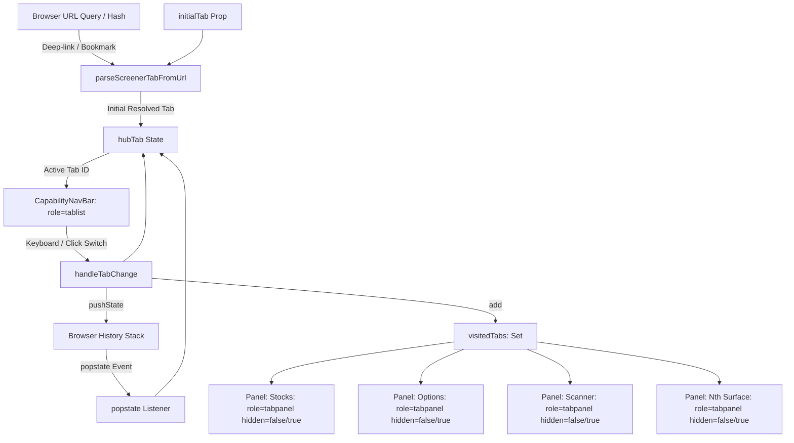

# NextGenTP Architecture Reference: Tabbed Browsing Hub Pattern

## 1. Overview & Objective

The **Tabbed Browsing Hub Pattern** is the reference architecture for multi-surface analytical and trading portals in NextGenTP. It solves three critical enterprise UX problems common to rich client portals:

1. **Ephemeral State Loss**: In traditional single-page apps, navigating between sub-panels destroys entered parameters, active filters, loaded datasets, and scroll positions. The Tabbed Browsing Hub Pattern provides **zero-loss state retention** through lazy-mounted background panels.
2. **Missing Permalinks & Broken History**: Direct links to nested capabilities fail or reset to default views, and browser Back/Forward buttons navigate away from the app entirely. This pattern implements **bidirectional history synchronization** via `window.history.pushState` and `popstate` listeners.
3. **Accessibility Barriers**: Tab navigation often lacks proper ARIA roles and keyboard traversal. This pattern enforces **WCAG 2.2 Level AA and WAI-ARIA 1.2** tablist specifications, including roving tabindex and arrow-key navigation.

---

## 2. Reference Implementation: Screener Hub (`ScreenersHub.tsx`)

The reference implementation is realized in `src/client/ScreenersHub.tsx` hosting 13 multi-asset screening and research capabilities:

- **Asset Screening**: Stocks (`stocks`), Options (`options`), Forex (`forex`), Futures (`futures`), Commodities (`commodities`), Fixed Income / Bonds (`bonds`).
- **Research & Strategy Execution**: Scanner (`scanner`), IV History (`iv-history`), Goal Screen (`goal-screen`).
- **Operations & Outcomes**: Reports (`reports`), Schedules (`schedules`), Proposal Review (`review`), Track Record (`track-record`).

### Architecture Component Diagram



---

## 3. Core Architectural Mechanisms

### 3.1 Universal URL Resolution & Deep-Linking
Deep-linking into any capability surface follows a deterministic 4-stage precedence cascade:

1. **URL Query Parameter**: `?screenerTab=<tab>` or `?tab=<tab>`. Example: `/screeners?screenerTab=scanner`.
2. **URL Hash**: `#<tab>` or `#tab=<tab>`. Example: `/screeners#options`.
3. **Parent Container Initial Tab Prop**: `props.initialTab`.
4. **Deterministic Safe Fallback**: `"stocks"`.

All input parameters are validated against `SCREENER_HUB_TABS` at runtime. Unknown, deprecated, or malformed values are rejected safely without crashing the rendering engine.

```typescript
export const SCREENER_HUB_TABS: readonly ScreenersHubTab[] = [
  "stocks", "options", "forex", "futures", "commodities", "bonds",
  "scanner", "iv-history", "goal-screen", "reports", "schedules",
  "review", "track-record",
] as const;

export function isValidScreenerTab(tab: unknown): tab is ScreenersHubTab {
  return typeof tab === "string" && (SCREENER_HUB_TABS as readonly string[]).includes(tab);
}

export function parseScreenerTabFromUrl(urlStr?: string): ScreenersHubTab | null {
  try {
    const targetUrl = urlStr
      ? new URL(urlStr, "http://localhost")
      : typeof window !== "undefined"
      ? new URL(window.location.href)
      : null;
    if (!targetUrl) return null;

    const param = targetUrl.searchParams.get("screenerTab") || targetUrl.searchParams.get("tab");
    if (param && isValidScreenerTab(param)) return param;

    const hash = targetUrl.hash.replace(/^#/, "");
    if (hash) {
      if (isValidScreenerTab(hash)) return hash;
      const hashParams = new URLSearchParams(hash);
      const hashTab = hashParams.get("screenerTab") || hashParams.get("tab");
      if (hashTab && isValidScreenerTab(hashTab)) return hashTab;
    }
  } catch {
    // Malformed URL, ignore
  }
  return null;
}
```

---

### 3.2 Bidirectional Browser History Synchronization
Every tab change updates the browser's history stack via `window.history.pushState` with an attached state descriptor `{ screenerTab: newTabId }`. When users press the browser's **Back** or **Forward** buttons, a window `popstate` event listener reconciles the active tab state instantaneously without a full page refresh.

```typescript
const handleTabChange = useCallback((newTabId: string) => {
  if (!isValidScreenerTab(newTabId)) return;
  setHubTab(newTabId);
  setVisitedTabs((prev) => new Set(prev).add(newTabId));
  onTabChange?.(newTabId);

  if (typeof window !== "undefined" && window.history) {
    try {
      const url = new URL(window.location.href);
      if (url.searchParams.get("screenerTab") !== newTabId) {
        url.searchParams.set("screenerTab", newTabId);
        window.history.pushState({ screenerTab: newTabId }, "", url.toString());
      }
    } catch {
      // Safe fallback for restricted sandbox environments
    }
  }
}, [onTabChange]);

useEffect(() => {
  if (typeof window === "undefined") return;

  const handlePopState = () => {
    const tabFromUrl = parseScreenerTabFromUrl();
    if (tabFromUrl && tabFromUrl !== hubTab) {
      setHubTab(tabFromUrl);
      setVisitedTabs((prev) => new Set(prev).add(tabFromUrl));
      onTabChange?.(tabFromUrl);
    }
  };

  window.addEventListener("popstate", handlePopState);
  return () => window.removeEventListener("popstate", handlePopState);
}, [hubTab, onTabChange]);
```

---

### 3.3 Multi-Tab State Retention (Retained DOM Panels)
Rather than unmounting components when switching away, the hub maintains a `visitedTabs` registry (`Set<ScreenersHubTab>`).

- **Lazy Mount**: Surfaces that the user has not yet visited are never instantiated, avoiding premature network calls and CPU cycles.
- **Persistent Retention**: Once visited, a surface remains mounted in the DOM. Inactive panels receive `hidden={hubTab !== id}` and explicit `style={hubTab !== id ? { display: "none" } : undefined}`.
- **Zero-Loss Switching**: Complex state like form inputs, options chains, search queries, pagination offsets, and polling intervals remain intact when switching between tabs.

```tsx
{visitedTabs.has("scanner") && (
  <div
    role="tabpanel"
    id="screener-tabpanel-scanner"
    aria-labelledby="cap-tab-scanner"
    hidden={hubTab !== "scanner"}
    style={hubTab !== "scanner" ? { display: "none" } : undefined}
  >
    <ErrorBoundary label="Strategy/Symbol Scanner panel">
      <ScannerPanel activeEnv={activeEnv} userLogin={userLogin} onPreviewTrade={onPreviewTrade} />
    </ErrorBoundary>
  </div>
)}
```

---

### 3.4 WCAG 2.2 / WAI-ARIA 1.2 Accessible Keyboard Navigation
The tab strip (`CapabilityNavBar.tsx`) adheres strictly to the WAI-ARIA Authoring Practices Guide (APG) for Tablists:

- The tab container carries `role="tablist"` and a descriptive `aria-label`.
- Each button has `role="tab"`, `aria-selected={isActive}`, `id={`cap-tab-${id}`}`, `aria-controls={`screener-tabpanel-${id}`}`, and roving `tabIndex={isActive ? 0 : -1}`.
- Roving keyboard navigation on `nav[role="tablist"]`:
  - `ArrowRight` / `ArrowDown`: Moves focus and activation to the next enabled tab (wrapping around from last to first).
  - `ArrowLeft` / `ArrowUp`: Moves focus and activation to the previous enabled tab (wrapping around from first to last).
  - `Home`: Moves focus and activation directly to the first tab.
  - `End`: Moves focus and activation directly to the last tab.

---

## 4. Adoption Guidelines for Other Hubs

Other hubs in NextGenTP (such as `ETradeTradingHub.tsx`, Portfolio Hub, Analytics Hub) can adopt this reference implementation by following these steps:

1. **Define Hub Tab Enum & Array**: Create `export const MY_HUB_TABS = [...] as const` and `isValidMyHubTab()`.
2. **Implement URL Parser**: Standardize on `?subTab=` or `?tab=` and `#` fallback parser.
3. **Adopt `visitedTabs` Set**: Replace unconditional ternary mounts with `visitedTabs.has(tabId) && (<div role="tabpanel" id={...} aria-labelledby={...} hidden={activeTab !== tabId}>...</div>)`.
4. **Wire `CapabilityNavBar`**: Pass `tabs`, `activeTabId`, and `onTabChange={handleTabChange}` to obtain instant WCAG 2.2 keyboard navigation.
