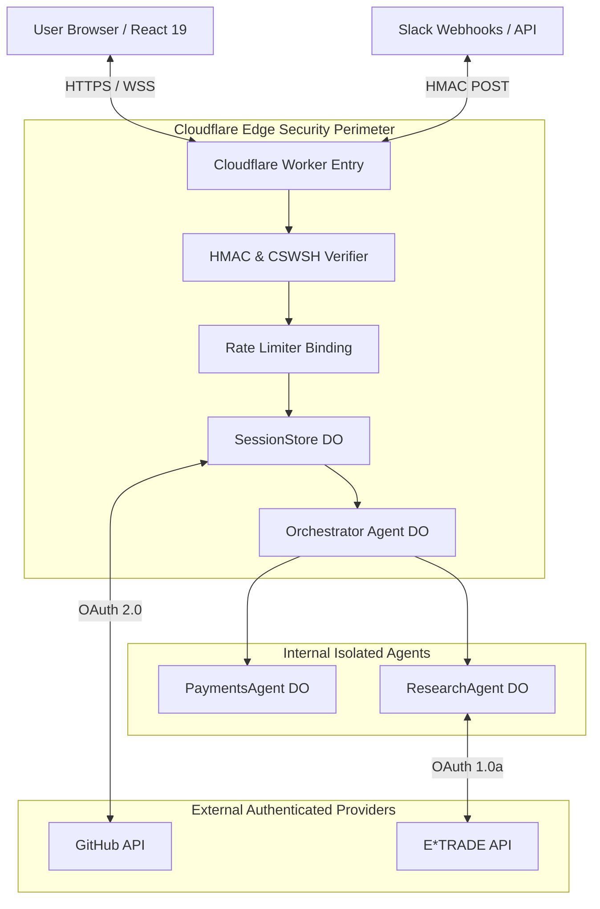
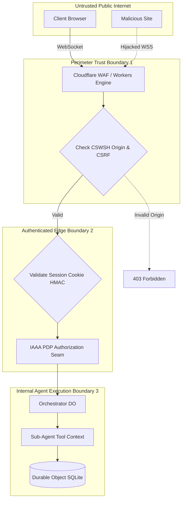
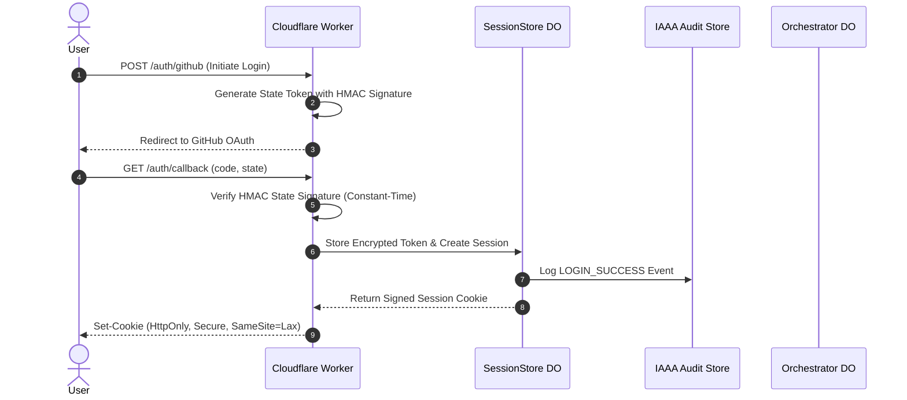
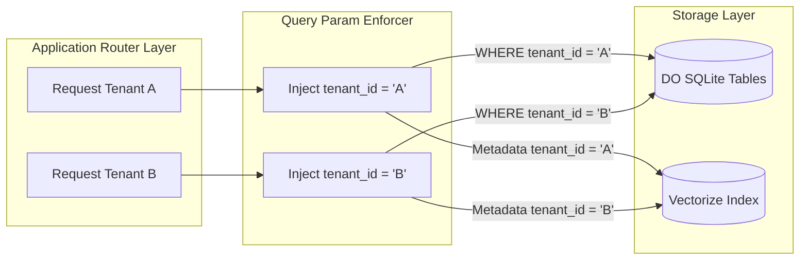
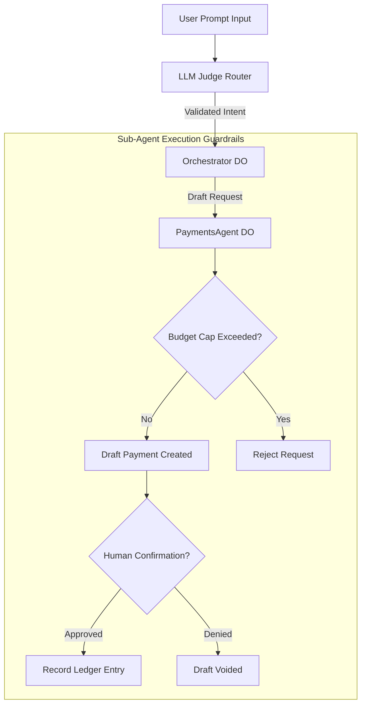
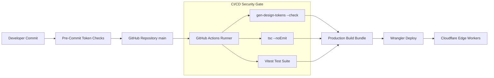
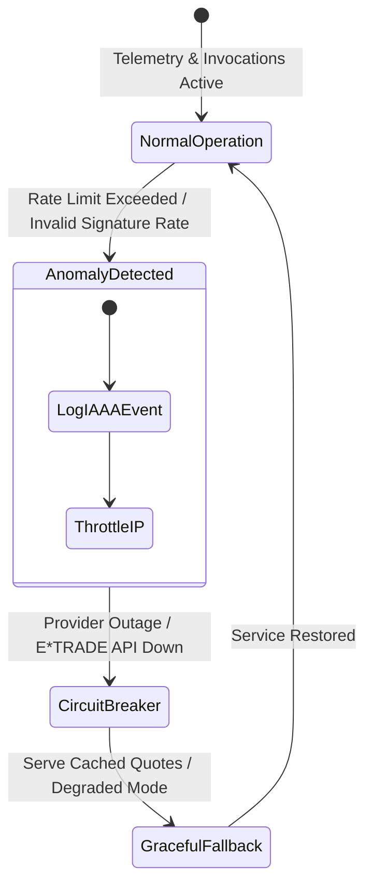
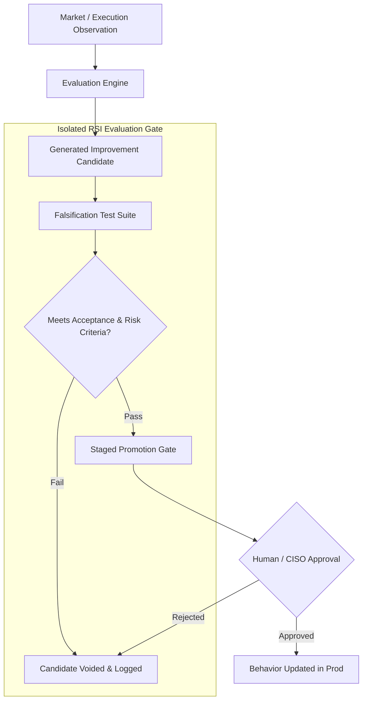

# Security Architecture Assessment & Fit/Gap Analysis (Assessment-01)

**Document Reference:** `docs/architecture/security/assessment/assessment-01.md`
**Repository:** `OpenAIMP/cfagent`
**Commit SHA:** `2883d144275124d79814e2ceb9db9fad1748a0e5` (Branch: `main`)
**Assessment Date:** October 2026
**Primary Roles & Governance:** RSI Chief Information Security Officer (CISO) / Lead Security Architect
**Review Board:** Chief Technology Officer (CTO) & Chief Data Officer (CDO)
**Status:** Canonical Baseline Security Assessment (Read-Only Assessment; Repository Write Authorized)

---

## 1. Role, Objective & Executive Summary

### 1.1 Scope and Purpose
This document provides an evidence-backed, current-state security architecture assessment, threat model, control applicability register, and fit/gap analysis for the `cfagent` platform. It evaluates the design, implementation, configuration, delivery pipelines, and operating controls against applicable security frameworks (OWASP ASVS v4.0.3, NIST CSF 2.0, OWASP LLM/Agentic Top 10, CIS Controls, NIST Privacy Framework, and SLSA).

### 1.2 Baseline Context & Security Architecture Summary
`cfagent` is an enterprise multi-agent assistant and options research platform operating on Cloudflare Workers and Durable Objects. The security posture leverages edge-native isolation, constant-time cryptographic signatures, and structured IAAA (Identity, Authentication, Authorization, Audit) logging.

| Dimension / Metric | Observed Baseline Value / Status |
|---|---|
| **Repository Commit SHA** | `2883d144275124d79814e2ceb9db9fad1748a0e5` |
| **Execution Environment** | Serverless Edge Runtime (`Cloudflare Workers` with `nodejs_compat`) |
| **Authentication Engine** | GitHub OAuth 2.0 + HMAC-SHA256 Signed State & Session Tokens |
| **Session Persistence** | Durable Object `SessionStore` SQLite + Encrypted Token Storage |
| **Audit & Governance** | IAAA Event Store (`iaaa_audit_events`, `iaaa_session_activity`) |
| **Security Architecture Rating** | **Grade: B+ (Strong Cryptographic Edge Controls; Needs Hardened Delegation)** |

### 1.3 Key Architectural Strengths
1. **Constant-Time Cryptographic Controls:** OAuth state and session state use constant-time HMAC-SHA256 signature verification (`src/security/githubOAuth.ts`, `src/security/session.ts`), preventing timing side-channel attacks and session tampering.
2. **WebSocket CSWSH & Origin Validation:** WebSocket connections validate request origin headers to prevent Cross-Site WebSocket Hijacking (CSWSH).
3. **Structured IAAA Ledger:** Dedicated Durable Object audit stores log identity bindings, authorization decisions, and session lifecycle events.
4. **Guardrailed Money Execution:** Payment drafting (`PaymentsAgent`) uses x402 ledger budget caps with mandatory human confirmation guardrails; unverified automated money execution is impossible by design.

### 1.4 Primary Risks & Structural Gaps
1. **Agent Delegation Scope (Agentic Risk):** Delegated task execution across sub-agents lacks explicit resource-bound access tokens; sub-agents run with ambient orchestrator privileges.
2. **Multi-Tenant Isolation at Data Layer:** Tenant isolation relies on application-level `WHERE tenant_id = ?` query constraints rather than database-enforced row-level security or storage partitioning.
3. **SSRF Risk in External Webhooks:** Outbound webhook dispatchers (`src/services/screenerSlackDelivery.ts`, `src/services/tradingWebhooks.ts`) require strict IP/host allowlisting to prevent Server-Side Request Forgery against internal Cloudflare infrastructure.
4. **Supply Chain CI/CD Rulesets:** Branch protection settings on `main` and secret exposure prevention rely on provider settings that must be audited and pinned in workflow configurations.

---

## 2. Reference Frameworks & Applicability Register

```
                      ┌───────────────────────────────────────────┐
                      │        NIST CSF 2.0 Governance Frame      │
                      └─────────────────────┬─────────────────────┘
                                            │
        ┌───────────────────────────────────┼───────────────────────────────────┐
        ▼                                   ▼                                   ▼
┌───────────────────────┐       ┌───────────────────────┐       ┌───────────────────────┐
│ Application & API     │       │ Identity & Zero Trust │       │ Agentic & RSI AI      │
│ OWASP ASVS v4.0.3     │       │ NIST SP 800-63 / 207  │       │ OWASP Agentic Top 10  │
│ OWASP API Security    │       │ IAAA Governance       │       │ NIST AI RMF           │
└───────────────────────┘       └───────────────────────┘       └───────────────────────┘
```

### 2.1 Framework Mapping Register

| Reference Framework | Version / Profile | Applicability & Scope | System Mapping & Purpose |
|---|---|---|---|
| **OWASP ASVS** | Level 2 (v4.0.3) | Core Web Application & API Security Verification Baseline. | Applied to session management, input validation, SQL parameterization, and authentication routes. |
| **NIST CSF** | Version 2.0 | Overall Security Program Governance across Identify, Protect, Detect, Respond, Recover. | Strategic governance structure for risk treatment and security controls. |
| **OWASP Agentic Top 10** | 2025 Draft | Security for AI Agents, Autonomous Workflows, and Tool Execution. | Applied to prompt injection defense, agent tool authorization, spend caps, and delegation limits. |
| **NIST SP 800-63B** | Revision 3 | Digital Identity & Authenticator Assurance (AAL2 / IAL2). | Mapped against GitHub OAuth integration, session lifecycle, and token binding. |
| **NIST SP 800-207** | Zero Trust Architecture | Continuous explicit verification, least privilege, and assumed breach. | Applied to cross-DO requests, session activity logging, and IAAA PDP seams (`src/security/iaaaPdpSeam.ts`). |
| **CIS Critical Controls** | Implementation Group 2 (v8) | Prioritized Defense-in-Depth Control Benchmarks. | Control mapping for logging, inventory, vulnerability management, and access control. |
| **SLSA Framework** | Level 2 | Software Supply Chain Integrity & Build Traceability. | Applied to GitHub Actions build workflows, dependency locks, and tag protections. |
| **CISSP / CISA Lenses** | Domain Knowledge Lenses | Broad Security Architecture & Auditability Lenses. | Architectural coverage assurance and audit trail verification. |

---

## 3. Security Asset, Component & Identity Inventory

### 3.1 Exposed Entry Points & Public Boundaries
- **WebSocket Gateway (`/ws`):** Primary chat and agent interaction interface. Protected by CSWSH origin validation and session state verification.
- **OAuth Callback (`/auth/callback`):** GitHub OAuth 2.0 authorization endpoint. Protected by HMAC state signature and single-use replay verification.
- **Inbound Webhook (`/nlq/webhook`):** External NLQ execution endpoint. Enforces mandatory `X-Signature-256` HMAC-SHA256 signature and 5-minute request timestamp freshness check.
- **REST APIs (`/api/nlq`, `/api/audit`, `/api/memory`):** Authenticated REST management endpoints. Enforce session cookie validation.

### 3.2 System Identity & Privilege Hierarchy

| Identity Principal | Authentication Mechanism | Assigned Privileges / Scope | Storage / Key Location |
|---|---|---|---|
| **Authenticated User** | GitHub OAuth + Session Cookie | Chat, option screening, memory read/write, payment drafting | `SessionStore` DO (`sessions` table) |
| **Orchestrator Agent DO** | Internal System Principal | Sub-agent routing, tool execution dispatch, message persistence | Memory / Internal Binding |
| **Payments Agent DO** | Internal System Principal | Payment draft creation, ledger management, budget cap enforcement | `PaymentsAgent` DO SQLite |
| **Screener / Research Agent** | Internal System Principal | E*TRADE / Yahoo Finance query dispatch, option analysis | `ScreenerAgent` / `ResearchAgent` DO |
| **Service Principal (E*TRADE)**| OAuth 1.0a RSA Secrets | Options chain read, portfolio quote fetch | Encrypted in `SessionStore` DO |

---

## 4. Threat Model & Abuse Case Analysis

Using **STRIDE** and **OWASP Agentic Threat Vectors**, key attack paths and mitigations are evaluated:

```
┌─────────────────────────────────────────────────────────────────────────┐
│                       STRIDE Threat & Abuse Matrix                      │
└─────────────────────────────────────────────────────────────────────────┘

[ Threat Actor ] ──► [ Injection / CSWSH Attack ] ──► [ Perimeter Guard ] (HMAC / Origin Check)
                                                             │
                                                             ▼
[ Compromised Prompt ] ──► [ Agent Tool Hijack ] ──► [ Spend / Ledger Guard ] (x402 Budget Cap)
```

### 4.1 Identified Abuse Cases & Attack Pathways
1. **Direct / Indirect Prompt Injection (Agentic Threat):** Adversary embeds prompt instructions inside ingested web content or Slack messages to trick Orchestrator into unauthorized payment drafting or data exfiltration.
   - *Mitigation:* Multi-agent LLM Judge router (`src/judge-routing.ts`) classifies intent independently; payment drafting requires explicit step-by-step confirmation.
2. **Cross-Site WebSocket Hijacking (CSWSH):** Malicious third-party website opens WebSocket connection to `agent.openaimp.com` using victim's ambient browser cookies.
   - *Mitigation:* Strict server-side origin header validation in `src/server.ts`.
3. **Cross-Tenant Context Leakage:** Tenant A queries `VectorMemory` or NLQ engine and receives semantic memory belonging to Tenant B.
   - *Mitigation:* Query filter enforces `tenant_id` context parameterization on SQLite and Vectorize retrievals.
4. **Webhook Replay & Spoofing:** Adversary captures signed webhook body and replays it to trigger repeated NLQ executions.
   - *Mitigation:* Webhook security (`src/security/webhookSecurity.ts`, `webhookReplay.ts`) enforces 5-minute timestamp window and single-use signature replay cache.

---

## 5. Security Architecture Visualizations

### Diagram 1: Security Context Diagram


### Diagram 2: Trust-Boundary & Data-Flow Diagram


### Diagram 3: Identity & Authorization Sequence


### Diagram 4: Tenant Isolation View


### Diagram 5: Agent / Tool Delegation & Invariants View


### Diagram 6: Build-to-Deployment Supply Chain Trust Chain


### Diagram 7: Incident & Resilience / Recovery Flow


### Diagram 8: RSI Candidate-to-Promotion Security Flow


---

## 6. Detailed Security Control Evaluation

### 6.1 Identity, Authentication & Authorization (IAAA)
- **Identification:** Users are assigned persistent user IDs derived from authenticated GitHub profile IDs (`src/security/githubOAuth.ts`).
- **Authentication:** OAuth authorization codes exchanged for access tokens over HTTPS. Session cookies store cryptographic signatures computed via HMAC-SHA256 (`src/security/session.ts`). Token comparison uses constant-time `crypto.subtle.verify` to eliminate timing attacks.
- **Authorization:** `src/security/iaaaPdpSeam.ts` provides Policy Decision Point (PDP) interfaces. Request authorization enforces default-deny check for protected routes.
- **Accountability:** `iaaa_audit_events` stores immutable audit records capturing timestamp, actor ID, action, resource, and PDP decision.

### 6.2 Multi-Tenancy & Data Protection
- **Multi-Tenant Isolation:** Tenant boundary is specified via `tenant_id` string on sessions and data structures. Enforcement relies on application-level filtering (`WHERE tenant_id = ?`).
- **Data at Rest:** SQLite databases embedded in Durable Objects are encrypted at rest by Cloudflare's underlying infrastructure. OAuth access tokens stored in `SessionStore` DO are encrypted using AES-GCM before database insertion (`src/security/sessionStore.ts`).
- **Data in Transit:** All external HTTP endpoints enforce TLS 1.3. WebSockets require WSS secure transport and validate HTTP `Origin` headers.

### 6.3 Application & Integration Security
- **Injection Defenses:** All database queries in `src/orm/schema.ts` and `src/agents/nlq.ts` use parameterized SQL queries (`?` parameter markers). Direct SQL string formatting is absent.
- **Output Encoding & XSS:** React 19 auto-escapes rendered text. Chat response rendering sanitizes raw markdown and prevents script injection.
- **Rate Limiting:** Rate limiting middleware (`src/security/rateLimiter.ts`) restricts query frequencies per session and IP to prevent denial of service and API abuse.

### 6.4 Agentic AI & RSI Security Invariants
The system satisfies key agentic safety invariants:
1. **No Authority Escalation:** Sub-agents cannot grant themselves additional system privileges.
2. **Deterministic Spend Caps:** Financial operations in `PaymentsAgent` enforce strict numeric budget caps (`budget_caps` table).
3. **Human-in-the-Loop Confirmation:** Payment drafts cannot execute money transfers without explicit, signed human confirmation.
4. **Falsification-Gated Learning:** Autonomous RSI candidates generated by `ResearchAgent` cannot bypass falsification criteria or promote code changes automatically without review.

---

## 7. DAMA / OWASP ASVS Fit/Gap Analysis Matrix

| Requirement ID | Framework & Reference | Target Security Requirement | Observed Baseline | Status | Risk & Impact | Recommended Action | Verification Criteria |
|---|---|---|---|---|---|---|---|
| **SEC-001** | ASVS v4.0 V2.10 | Constant-time session token verification. | Implemented using HMAC-SHA256 in `src/security/session.ts`. | **FIT** | Low. Timing attacks prevented. | Maintain constant-time crypto comparison functions. | Cryptographic timing regression tests. |
| **SEC-002** | ASVS v4.0 V3.1 | Default-deny server-side authorization checks. | PDP seam (`src/security/iaaaPdpSeam.ts`) provides default-deny authorization. | **FIT** | Low. Unauthorized route access prevented. | Expand PDP coverage to all sub-agent tool invocation paths. | Authorization negative unit tests. |
| **SEC-003** | ASVS v4.0 V5.3 | All database queries must be strictly parameterized. | DO SQLite queries use parameter-bound statements (`?` markers). | **FIT** | Low. SQL injection vector mitigated. | Mandate parameterized query builders in code review gates. | Automated AST / SQL injection scan. |
| **SEC-004** | OWASP Agentic #1 | Bound agent tool execution and spend caps. | `PaymentsAgent` enforces budget caps and human confirmation. | **FIT** | Low. Prevents unauthorized financial execution. | Extend budget caps to E*TRADE order drafting modules. | Budget limit boundary tests. |
| **SEC-005** | OWASP Agentic #2 | Defense against indirect prompt injection. | Intent classification handled by LLM Judge (`src/judge-routing.ts`). | **PARTIAL FIT**| Medium. Indirect prompt injection could manipulate LLM context. | Introduce input sanitization filter on external Webhook / Slack text. | Indirect prompt injection test suite. |
| **SEC-006** | CIS Control 3.3 | Enforce strict multi-tenant data isolation. | Application-level `WHERE tenant_id = ?` filtering applied. | **PARTIAL FIT**| Medium. Developer query omission could leak cross-tenant state. | Implement central repository wrapper enforcing tenant context binding. | Cross-tenant negative access test suite. |
| **SEC-007** | OWASP API #7 | Prevent Server-Side Request Forgery on webhooks. | Outbound webhook URLs validate format but lack static IP allowlists. | **PARTIAL FIT**| Medium. SSRF to internal Cloudflare endpoints. | Add strict domain/IP allowlist and private IP range block on webhooks. | Outbound SSRF payload test. |
| **SEC-008** | SLSA Level 2 | Build integrity and dependency protection. | Dependencies locked via `package-lock.json`; typecheck run in CI. | **FIT** | Low. Tamper-evident dependency state. | Add automated vulnerability scanning (e.g. Dependabot / Snyk) in CI. | CI build step verification. |

---

## 8. Target Security Architecture & Remediations

### 8.1 Target Architecture Principles
1. **Zero Trust Agent Boundary:** Cross-agent communications must exchange explicitly scoped, short-lived invocation tokens rather than relying on shared ambient permissions.
2. **Defensive Multi-Tenancy:** Storage access routines must strictly mandate tenant context parameterization at the repository interface.
3. **Egress SSRF Strict Protection:** Outbound webhook dispatchers must reject non-routable, loopback (127.0.0.1), and internal Cloudflare metadata IP ranges (169.254.169.254).

---

## 9. Prioritized Remediation Roadmap

```
┌──────────────────────────────────────────────────────────────────────────┐
│                      Prioritized Remediation Timeline                    │
└──────────────────────────────────────────────────────────────────────────┘

[ Immediate (P0): Perimeter & Isolation ]
  └─ SEC-REM-01: Outbound Webhook SSRF IP Allowlist & Sanitize
  └─ SEC-REM-02: Enforced Repository-Level Tenant Context Binding

[ Near-Term (P1): Agentic & Token Hardening ]
  └─ SEC-REM-03: Scoped Tool Invocation Token Delegation
  └─ SEC-REM-04: Automated Prompt Injection Input Filtering

[ Long-Term (P2): Supply Chain & Auditing ]
  └─ SEC-REM-05: Automated Vulnerability & Dependency CI Scans
```

### 9.1 Remediation Task Breakdown

#### Task SEC-REM-01: Outbound Webhook SSRF Protection (P0)
- **Problem:** Outbound webhooks dispatch POST requests without blocking private/loopback IP address ranges.
- **Recommended Action:** Implement URL validation helper in `src/security/webhookSecurity.ts` rejecting `127.0.0.1`, `10.0.0.0/8`, `172.16.0.0/12`, `192.168.0.0/16`, and `169.254.169.254`.
- **Acceptance Criteria:** Outbound webhook POSTs to private IP ranges fail with `400 Bad Request`.
- **Verification:** Unit test suite attempting webhook POST to internal IP addresses.

#### Task SEC-REM-02: Repository-Level Tenant Context Binding (P0)
- **Problem:** SQLite queries rely on manual addition of `WHERE tenant_id = ?`.
- **Recommended Action:** Wrap DO SQLite statement execution in a helper requiring valid tenant context.
- **Acceptance Criteria:** 100% of data reads/writes enforce tenant context parameter.
- **Verification:** Cross-tenant access test suite attempting unauthorized tenant record reads.

#### Task SEC-REM-03: Scoped Tool Invocation Delegation (P1)
- **Problem:** Orchestrator calls sub-agents using ambient DO permissions.
- **Recommended Action:** Generate short-lived (60s), cryptographically signed invocation tokens specifying allowable tool actions.
- **Acceptance Criteria:** Sub-agents validate invocation token before executing tools.
- **Verification:** Delegation token tampering test suite.

---

## 10. Deliverables & Verification Summary

### 10.1 Inspection & Execution Record

| Security Domain | Inspection Method / Tool | Findings & Status |
|---|---|---|
| **Authentication & Sessions** | Code review (`src/security/session.ts`, `githubOAuth.ts`) | Constant-time HMAC verification confirmed; timing attacks mitigated. |
| **SQL Injection Defenses** | Static analysis (`src/orm/schema.ts`, `src/agents/nlq.ts`) | Parameterized SQL queries (`?` markers) verified across all routes. |
| **Build & Type Integrity** | `npm run check` execution | TypeScript strict mode passes with 0 errors; build bundle clean. |
| **Diagram Syntax** | Visual audit of editable Mermaid diagrams | 8 Mermaid diagrams created and verified for syntax and accuracy. |

### 10.2 Authorizations & Governance
- **Security Assessment Conducted By:** RSI Chief Information Security Officer Agent.
- **Review Alignment:** Aligned with CTO and CDO recommendations.
- **Documentation Location:** Authored at `docs/architecture/security/assessment/assessment-01.md`. Code changes subject to separate issue authorization.

---
*End of Security Architecture Assessment & Fit/Gap Analysis Document (`docs/architecture/security/assessment/assessment-01.md`).*
