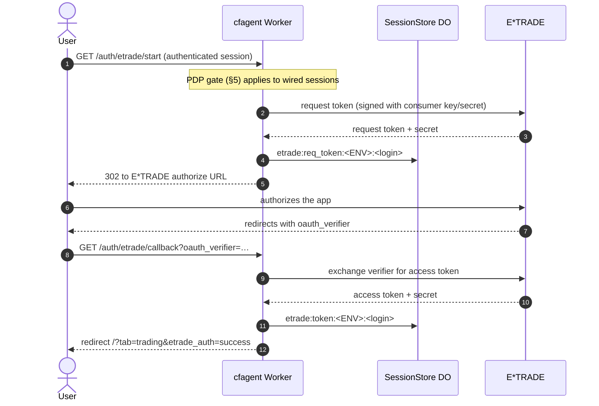
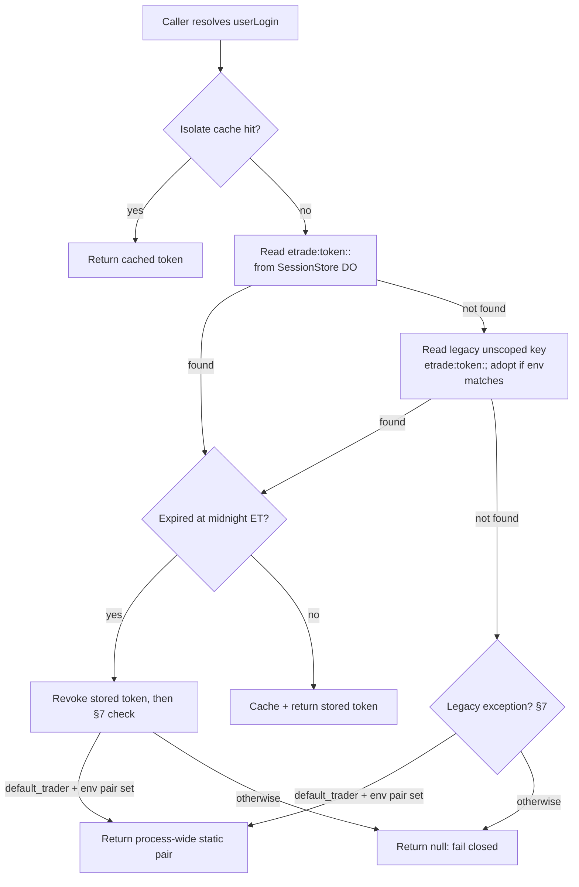

# E*TRADE Security Flow

Status: current-state design doc. Code references are to `src/` at the time of
writing; the doc is meant to be re-checked against the code when the flow
changes. Tracked by issue #1066, which also covers removing the legacy
exception described in §7.

## 1. The one-sentence version

The app holds **one app credential** (the E*TRADE consumer key/secret) and
**one access-token pair per user**. No user ever trades on another user's
token, and signing into the app does not by itself connect E*TRADE: each user
links their own brokerage account through their own OAuth flow.

## 2. Identities involved

| Identity | What it is | Where it comes from |
| --- | --- | --- |
| App | The OAuth consumer (cfagent as an E*TRADE API app) | Consumer key/secret in environment config (`src/config/environment.ts`) |
| User | A signed-in app user | App session; the login string is `session.githubLogin` (legacy key — see §6) |
| `default_trader` | Synthetic identity for unattended work — **being removed** | Hardcoded in the worker `scheduled()` and `queue()` handlers (`src/server.ts`); fallback in broker/NLQ/autopilot/watchlist routes when no login is present. Removal executes under #1185 (§8) |
| Service identity | Explicit, non-secret id for background jobs | Config (`SERVICE_USER_LOGIN`, owner-set; absence = fail closed). Designed in #1066, implemented under #1185; replaces `default_trader` as the background identity (§7, §8) |

## 3. Per-user linking: the 3-legged OAuth 1.0a flow

Routes: `/auth/etrade/start` (also `/api/etrade/oauth/start`),
`/auth/etrade/callback`, `/api/etrade/oauth/status`,
`/api/etrade/oauth/renew`, `/api/etrade/oauth/revoke` — all in
`src/server.ts`, all resolved against `session.githubLogin`. The start and
verifier routes are the ones the PDP gate covers (§5); revoke is deliberately
ungated (revocation is a safety action).

## 4. Per-request authentication: how a call picks its token

Every E*TRADE API call is signed per request (OAuth 1.0a header, HMAC) with
the consumer secret plus the **caller's own** access-token secret. The lookup
is `getValidTokens(env, userLogin)` in `src/security/etradeOAuth.ts`:

Notes on the lookup:

- **Login resolution.** Worker routes use the session login directly. The
  generic `/api/*` forwarder and DO routes set an `x-user-login` header from
  `session.githubLogin` before forwarding. Broker, NLQ, autopilot, and
  watchlist routes resolve `x-user-login || sessionId || "default_trader"`.
  The last fallback is part of the legacy exception (§7), not a user feature.
- **Storage.** Tokens live in the SessionStore Durable Object under the
  `etrade` namespace (moved off Workers KV in #329; the KV fallback was
  removed in #604). Keys are environment-scoped (`TEST`/`PROD`) so the two
  environments hold independent sessions. An unscoped legacy key is still
  read as a fallback and adopted into the scoped key on match.
- **Isolate cache.** `getValidTokens` runs on the hottest read path (once
  per E*TRADE request), so repeats are served from an in-isolate token
  cache; every write path invalidates it (`src/security/etradeTokenCache.ts`).
- **Expiry.** A stored token is valid until midnight US Eastern Time after
  the day it was stored (`isTokenExpiredEt`). On expiry the stored token is
  revoked and the lookup falls through to §7 — for a real user that means
  null (re-link required); for `default_trader` it means the static pair.
- **Renewal.** The `0 3 * * *` cron runs `renewAllStoredETradeTokens`,
  which lists every `etrade:token:` entry and renews each unexpired token
  in place. Renewal is per token, per user: there is no shared clock.

## 5. Authorization gating (IAAA, #945)

Linking an integration is a consequential action, so for wired sessions with
`IAAA_PDP_ENABLED=1`, starting an E*TRADE connection requires the
`integration:connect` permission in the resolved tenant (default `"primary"`),
checked via the Slice 3 PDP before any token request is made. Denial is a 403
and no E*TRADE call happens. Legacy (pre-wiring) sessions inside their #1749
grace bound (createdAt + 7 days) take the pre-change path and are PDP-exempt;
past the bound they are denied with `legacy_pdp_grace_expired` until re-login
(see authz.md §8). E*TRADE revoke and API-key deletion are
deliberately **not** gated: revocation must never be blocked by the same
policy it escapes from.

## 6. IAAA interaction and a known key fragility

Token keys are still keyed by the **login string** by default, not
by the stable internal user id — but since #1759 they are no
longer reachable by login string alone. The IAAA migration layer
(`src/security/iaaaMigration.ts`) records login↔internal-id
aliases on wired login (a recycled login that already belongs to
someone else is rejected, never overwritten), and
`src/security/etradeOAuth.ts` dual-reads: the internal-id key
first, the alias-login key second (this is what keeps a
pre-rename token reachable), then the current login key; new
access-token writes with a known identity also land under the
internal-id key. Revocation with an identity deletes all three.
Residual, bounded: the `getValidTokens` hot path (trading
client, login-keyed isolate cache) does not yet take an
identity, so a renamed user's trading client misses the old
token until re-connect or until that path is wired — the old
key itself persists and remains reachable through the
`getStoredTokens`-based paths (preflight, schedules). See
`iaaa-login-key-cutover-1759.md`.

## 7. The legacy exception: `default_trader` and the process-wide static pair

This is the one place where the per-user rule does not hold, and it exists
only because cron and queue handlers have no user session.

**Mechanism.** `getValidTokens` builds a `legacyStaticToken` if and only if
`userLogin === "default_trader"` **and** the process environment carries
both `ETRADE_OAUTH_TOKEN` and `ETRADE_OAUTH_TOKEN_SECRET` (aliases
`ETRADE_ACCESS_TOKEN` / `ETRADE_ACCESS_TOKEN_SECRET`, read in
`src/config/environment.ts`). It is served in three places: on isolate-cache
null, when no stored token exists, and after a stored token expires and is
revoked. `getETradeAuthStatus` likewise reports `authenticated: true` for
`default_trader` whenever the env pair is set.

**Consumers.** The worker `scheduled()` handler (all cron ticks: 30-minute
agent tick, research, reflection, adaptation, retention) and the `queue()`
handler (options-analysis jobs) hardcode `userLogin = "default_trader"`.
That is why the hourly Market Screen fails with "E*TRADE token missing in
PROD" when this one pair is absent: the screen has no user session to draw
a token from, so it stands or falls with the static pair — even while
individual users hold valid tokens of their own.

**What it cannot do (important).** The static pair is served **only** for
`default_trader`, never for a real login. It cannot leak one user's token
to another user, and no user's stored token is ever served to anyone else.
Removing it changes the background identity's lifecycle, not user isolation.

**Risks of keeping it.**

1. **A process-wide secret, not a token.** It cannot be rotated per
   identity or revoked without changing environment/secrets and
   redeploying; every background job shares the same blast radius.
2. **It never expires by the rules.** Each read stamps it `storedAt: now`,
   so the midnight-ET expiry rule never fires and the renewal pass never
   touches it. If E*TRADE revokes it, nothing notices until a call fails.
3. **It masks failure.** `authenticated: true` is reported for
   `default_trader` whenever the env vars exist, regardless of whether
   E*TRADE still honors the pair.
4. **Attribution is synthetic.** Background actions are attributed to a
   made-up identity, not to an accountable authorization, which weakens
   the audit trail.

**Removal (designed in #1066; executing under #1185).** Replace
`default_trader` with an explicit, non-secret service-identity id whose
token is obtained through the same 3-legged flow as any user and stored
under the same store — then delete the static fallback, delete the env
fields from the config so no new consumer can reintroduce it, and make
every former `default_trader` fallback site fail closed unless the service
identity is passed explicitly. Rollback is redeploying the previous
release: re-adding the env vars alone must not restore the exception,
because the code will no longer read them. The honest limit: background
jobs still need *an* account — the service identity is authorized against
the owner's brokerage account by explicit owner action, as a token
independent of the owner's personal token, so revoking one does not kill
the other. §8 states, flow by flow, where identity comes from once the
exception is gone.

## 8. Life after `default_trader`: where every flow gets its identity

Removal is executed under #1185 (owner direction, 2026-10-23: the system
is multi-dimensional now; the shared synthetic identity goes completely).
The per-site inventory behind this section classified all 164 occurrences
of the literal (114 in `src/`, 50 in `tests/`). The rule afterwards is
singular: **every execution runs under an identity that was authenticated,
stored by an authenticated action, or explicitly configured — or it does
not run.**

| Flow | Identity after removal | Source | When no identity exists |
| --- | --- | --- | --- |
| User routes — broker, options, watchlists, autopilot, NLQ chat | The session login | `x-user-login`, set by the worker's `requireAuth` from `session.githubLogin` | **401.** The route never invents one. This also removes a latent second defect: the old chain's middle term (`sessionId`) is the Orchestrator DO *instance id* (`ctx.id.toString()`), not a login — the chain degraded header → instance-id → synthetic login, and the whole tail is deleted, not just the literal |
| Screener / research and report reads | Header login, else the stored screener execution-context owner | `ScreenerExecutionContext`, persisted by `OrchestratorAgent.onRequest` from authenticated requests | Honest error; report stores record the miss in `storeErrors` rather than substituting an identity |
| Durable scheduled work (user screeners, schedules) | The schedule's stored owner login | The schedule record / stored execution context | The run is skipped and logged under its schedule id — never executed anonymously |
| Worker `scheduled()` / `queue()` (agent tick, research, reflection, adaptation, retention, options-analysis queue) | The service identity | `SERVICE_USER_LOGIN` config; its token lives in the SessionStore like any user's | The handler logs and skips. Queue messages dispatch under the payload's stored owner when one is present, else the service identity |
| Inbound email | No sender identity (by design, #815) | Any E*TRADE access runs under the service identity | n/a for addressing (see "addressing is not identity" below) |
| Public scanner (paid) | Session-affinity label only — never an identity (#700 / #180) | Downstream orchestrator work runs under the service identity; paid actions bind the **verified payer** (#183) | A payment is never attributed to a synthetic or instance identity |
| NLQ execution and payments | The `userLogin` threaded from the authenticated route / async-job payload | `payer:` is that verified identity only | The action is refused |
| TradingAgent / ReportAssetAgent / ScreenerAgent instances | Per-login instances; an agent's owner is its instance selection, recorded in DO storage at entry from the validated header — never defaulted | The service identity inherits the legacy bare instance names (`"default"`, `"trading"`), so existing background state keeps its home under its new owner | An agent with no recorded owner fails closed |
| Token resolution (`getValidTokens`) | The stored per-identity token only; expired → revoked → `null` | SessionStore (`etrade:token:<ENV>:<login>`) | `null` → the caller fails closed with an auth-required error; `getETradeAuthStatus` reports the truth. The 03:00 UTC renewal pass already enumerates every stored token, so the service token is renewed with no special case |

**Addressing is not identity.** Durable Object instance names are
addresses, not principals. The session-less entry points address one
shared Orchestrator instance; that address is a constant, not a login,
and is never used as a token key, an audit actor, or a payer. Where the
legacy address literally equals the old identity string, it survives in
exactly one named constant, documented as an address, until a state
migration renames it — renaming an address orphans the live state behind
it, and no identity property depends on the name.

**Why the system is better without it.**

1. **One identity rule, no exceptions.** "No stored token → no execution"
   holds for every principal, human or service. A rule with one exception
   is the exception's rule; auditors and the #1078 ExecutionContext
   contract can now bind *every* execution to a real principal.
2. **The background token gets a real lifecycle.** Expiry (midnight ET),
   the 03:00 UTC renewal pass, and revocation apply to the service token
   exactly as to user tokens — replacing a process-wide secret that never
   expired, could not be rotated without a redeploy, and reported
   `authenticated: true` even if E*TRADE had revoked it.
3. **Failures are loud.** A missing or revoked service token fails the
   background job visibly, under its own identity, instead of silently
   degrading to a shared pair whose provenance no one can check.
4. **Attribution is real.** Audit entries name the accountable principal —
   a user, a schedule's owner, or the service identity — never a made-up
   login shared by unrelated work.
5. **Blast radius shrinks.** Revoking the service token stops background
   work without touching any user's session; revoking a user never stops
   the platform's own jobs. Each identity is independently revocable.
6. **Every record has an owner.** Data written by unattended work belongs
   to the service identity or to the schedule's owner by construction —
   the precondition for tenant isolation (#945) and per-user accounting
   to mean anything.

**Migration order (merges deploy, so order is safety).** (1) The owner
authorizes the service identity through the normal linking flow and sets
`SERVICE_USER_LOGIN`. (2) Phase A lands: entry points take the service
identity explicitly; dual-run verifies background jobs use the stored
service token. (3) Phase B lands: the static-token exception and the env
config fields are deleted. (4) Phase C lands: every fallback site fails
closed. (5) The owner deletes the `ETRADE_OAUTH_TOKEN*` Worker secrets.
Rollback at any step is redeploying the previous release.

## 9. What this doc does not claim

- Live production environment values were not inspected (secrets are never
  read from chat or code); the env-var names above are from
  `src/config/environment.ts`, not from a live deployment listing.
- Whether a second signed-in user has actually completed E*TRADE linking
  in production is not established here; the mechanism supports it, and
  the per-user storage keys are the evidence.
