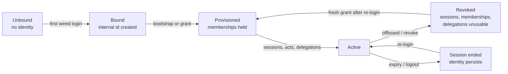

# Identity lifecycle — provisioning and deprovisioning (IAAA)

The entire identity lifecycle as IAAA defines it: how an identity is
created, provisioned, kept alive, revoked, and re-provisioned — and,
crucially, which parts of that lifecycle are live paths and which are
machinery waiting for a route. Lifecycle policy version:
`iaaa-lifecycle-1` (`src/security/lifecycle.ts`, Slice 6).

The companion documents own the pieces: [authn.md](authn.md) for
sign-in and sessions, [authz.md](authz.md) for the PDP and grants,
[security-workflow.md](security-workflow.md) for the composition. This
document owns the lifecycle itself.

## 1. Creation: binding is provisioning's precondition

An identity comes into existence at first wired login, when Slice 1
binds `(issuer, subject)` to a stable internal user id
(`src/security/identityBinding.ts`). The binding rules are the
lifecycle's first gate (see [authn.md](authn.md) §2): email is never
identity, a GitHub login is never identity (numeric id required), a
Google login requires a verified email, and anything missing fails the
login closed — there is no partially-created identity.

At the same login, the alias layer records the login↔internal-id alias
(`iaaa-alias:` keys). If the login already belongs to a different
internal id (a recycled login), the alias is rejected and the original
preserved: a new identity can never inherit another identity's state by
reusing its login.

Creation is **not** authorization. A newly bound identity holds no
membership, and every PDP gate denies it until something provisions it.
"Signed in" and "provisioned" are different lifecycle states, and the
system never confuses them.

## 2. Provisioning: bootstrap, grants, approvals

There are exactly three provisioning mechanisms, and only the first has
a live operator path:

### 2a. Bootstrap-on-login (live)

On a wired login, if the caller is listed in `IAAA_BOOTSTRAP_ADMINS`
and holds no membership yet, `provisionBootstrapAdmins`
(`src/security/iaaaBootstrap.ts`, via the end-to-end post-login runner)
grants tenant-admin for the caller-supplied tenant. Entries prefixed
`platform:` grant platform-admin **only** while the genesis marker
(`iaaa-bootstrap:platform-genesis:<tenantId>`) is absent; once set,
later `platform:` entries grant tenant-admin only. Bare entries must be
UUIDs; a pasted login is rejected. A blank list grants nothing. See
[authz.md](authz.md) §3 and
[iaaa-github-end-to-end-defaults.md](iaaa-github-end-to-end-defaults.md).

### 2b. Admin grants (module, no route)

`grantMembership` (`src/security/iaaaMembershipStore.ts`) grants a
membership only after enforcing Slice 3's `canGrantRole` for **every**
binding before anything is written; a denied binding denies the whole
grant atomically, platform privileges require a platform-admin granter,
and `grantedBy` is always overwritten with the granter. There is no
admin route or panel action that calls it today — the IAAA panel is
read-only (verified: no put/append/revoke). Provisioning by a human
admin is therefore a designed mechanism without a live path, and any
claim that "an admin can provision users" must say through which path
or not at all.

### 2c. Approvals (module, no route)

Slice 6 approvals (`createApproval` / `validateApproval`) bind a grant
to a proposal hash: one approver, one tenant, named granted actions, an
expiry. Validation order is deliberate — revoked beats unexpired,
expired beats unchanged, and only then is the proposal hash compared,
so a changed proposal can never be masked and an unchanged proposal can
never rescue a revoked or expired approval. Expiry is exclusive (an
approval expiring exactly at `nowMs` is expired). Like grants, approvals
have no live caller outside the module and its tests; they are the
mechanism by which a sensitive grant would be approved, not a path that
currently approves anything.

## 3. Active life: what keeps an identity usable

- **Sessions:** 7-day absolute TTL, idle expiry on fresh reads,
  rotation (old id revoked, absolute expiry and `authTimeMs`
  preserved — rotation is not re-authentication), and step-up for
  sensitive operations ([authn.md](authn.md) §3).
- **Membership changes:** new grants add bindings; revocations (see §4)
  set `revokedAtMs` on the record rather than deleting it, so the
  history of who held what, and when it ended, survives.
- **Delegations:** effective authority is always the intersection of
  initiator, tenant, resource, delegation, and approval, and
  delegations expire and carry action budgets ([authz.md](authz.md) §5).
- **Re-login:** re-binds the same `(issuer, subject)` to the same
  internal id. Re-login after offboarding therefore resurrects the
  identity but **not** its authority (see §5).

There is no "suspended" state. The lifecycle's only off-switch is
revocation (§4): an identity is either usable (valid session +
unrevoked memberships) or it is not.

## 4. Deprovisioning: revoke, verify, offboard

Deprovisioning is Slice 6's `revokePrincipal` / `isPrincipalFullyRevoked`
/ `offboardPrincipal`, operating on the three stores a principal's
authority lives in: sessions (Slice 2), memberships (Slice 3),
delegations (Slice 4).

### 4a. `revokePrincipal` — what it revokes

For a given internal id, it revokes: every **supplied** session id, every
membership returned by `getMembershipsByUser`, and every delegation
returned by `listByDelegator`. Semantics that matter:

- **Idempotent.** Already-revoked items are not double-counted.
- **Failure-isolating.** A failure in one category does not stop the
  other categories, and a failed item appears in `failures` — it is
  never silently dropped.
- **Honest reporting.** The report counts items checked per category
  (including already-revoked ones) and sets `allRevoked` only when
  nothing failed. An empty revocation (nothing to revoke) is **not** a
  failure.
- **The session-registry limitation.** The Slice 2 store maps sessions
  to users internally but exposes **no listing**, so the caller must
  supply the session ids it issued (its own session registry).
  Supplying another principal's id revokes only that id, never a whole
  user — and maintaining that registry is the caller's responsibility.
  A principal with sessions the caller does not know about is not fully
  revoked by this call, and the report cannot tell you otherwise unless
  you check (§4b).

### 4b. `isPrincipalFullyRevoked` — the check, not the assumption

This re-reads current store state: every supplied session revoked, every
membership carrying `revokedAtMs`, every delegation revoked. A session
issued **after** revocation, or a membership granted **after** it, is
correctly reported as not revoked. An empty category counts as revoked
for that category — there is nothing left usable. Deprovisioning is
therefore a two-step discipline (revoke, then verify), not a single
call to trust.

### 4c. `offboardPrincipal` — the checklist

Offboarding wraps revocation in a per-category checklist:
`revoke-sessions`, `revoke-memberships`, `revoke-delegations`, each
`done`, `failed`, or `not-applicable` (nothing to revoke). `offboarded`
is true only when nothing failed, and everything revocation could not
revoke is listed in `unrevoked`. The caller **must** handle `unrevoked`
(retry, escalate, or record it) — the module refuses to drop it
silently, but it cannot force the caller to act.

### 4d. Interrupted execution

`reconcileInterruptedExecution` handles work interrupted mid-flight
(outcomes: `completed`, `interrupted`, `unknown`). Offboarding that is
interrupted is not assumed complete: reconciliation, not optimism, is
how a half-finished offboarding is resolved. This is the recovery half
of the lifecycle, and it exists because revocation across three stores
is not atomic.

## 5. What is live today vs machinery awaiting a path

| Lifecycle step | Status |
| --- | --- |
| Identity binding on first login + alias recording | Live |
| Bootstrap-on-login provisioning (incl. genesis) | Live |
| Session logout (`deleteSession`) + logout audit seam | Live |
| Single-session revocation consulted at validation (`sessionIsUsable` checks `isSessionRevoked` between validity and expiry) | Live |
| E*TRADE disconnect (revoke route, ungated) + API-key deletion (ungated) | Live |
| Bulk `revokePrincipal` / `offboardPrincipal` / `isPrincipalFullyRevoked` | Machinery only — **no route, no admin action, no scheduled job calls them** |
| Admin `grantMembership` path | Machinery only — no route; panel is read-only |
| Approval creation/validation as a live gate | Machinery only — no caller outside module + tests |

The honest summary: **IAAA defines the full lifecycle, and the
deprovisioning half is implemented but not wired.** An operator today
cannot offboard a principal through the product; they can only revoke
individual sessions (logout), individual integrations (E*TRADE revoke),
and individual keys (key delete), while the principal's memberships
stand. Wiring an offboarding path — including the session registry the
bulk revocation needs — is the remaining lifecycle work, and it belongs
in the #945 completion scope, not in a footnote.

## 6. What offboarding does NOT do

- **It does not erase the identity.** Bindings, aliases, and audit
  records are retained: audit is append-only by design, and a revoked
  membership record keeps its `revokedAtMs` rather than disappearing.
  Offboarding ends authority, not history. There is no identity-record
  deletion API, and no binding deletion API.
- **It does not close the genesis window retroactively.** If the
  genesis marker is already set, a re-offboarded platform admin cannot
  re-bootstrap themselves to platform-admin: later `platform:` entries
  grant tenant-admin only. Re-provisioning after offboarding requires a
  fresh grant from someone who holds `role:assign` — the bootstrap
  cannot be used to self-restore.
- **It does not revoke what it cannot see.** Unknown session ids (see
  §4a), tokens held outside the three stores (notably a still-valid
  E*TRADE access token or API key, which have their own revoke paths),
  and grants made after verification are outside the offboarding
  report. A complete deprovisioning run therefore also revokes the
  principal's integrations and keys through their own paths, then
  re-verifies.

## 7. Re-provisioning after offboarding

Re-login re-binds the same internal id, but revoked memberships stay
revoked and new sessions are still denied at every PDP gate until a
fresh grant provisions the identity again. The lifecycle is therefore a
loop, not a line: bound → provisioned → active → revoked →
(re-granted) → provisioned. The loop's guard is that revocation is
sticky (records, not deletions) while identity is stable (the same
`(issuer, subject)` always resolves to the same id) — so
deprovisioning can be undone by a legitimate grant, but never by
accident, and never by the former holder acting alone.

## 8. User-initiated deactivation (current state + proposed path)

Deactivation is offboarding requested by the holder, rather than by an
admin — "deactivate my account", as opposed to "this account is
offboarded". The distinction matters because the authority to request
it differs, but the effect must be identical.

**Current state: there is no self-service deactivation route.** A user
today cannot deactivate their own account through the product. The
pieces that would execute a deactivation exist (§4's offboarding
machinery, §5's live per-item revocations), but no route collects them
into one user-initiated action, and no confirmation or audit event
exists for "user deactivated themselves".

**Proposed path (not implemented).** A deactivation request, from an
authenticated session, must:

1. Confirm intent (a deliberate confirmation step — deactivation is
   destructive and must never fire from a single misclick or a
   prefetched link).
2. Run `offboardPrincipal` for the caller's own internal id (sessions,
   memberships, delegations), then verify with
   `isPrincipalFullyRevoked` and surface any `unrevoked` items instead
   of reporting success.
3. Revoke the caller's integrations and keys through their own paths
   (E*TRADE revoke, API-key delete), which offboarding does not cover
   (§6).
4. Suppress the caller's communications (see
   [email-communications.md](email-communications.md): deactivation
   stops digest and welcome mail; security mail about the deactivation
   itself is still delivered once, as the receipt).
5. Emit an audit event for the deactivation, attributed to the caller.
6. Leave the identity record, aliases, and audit history in place (§6):
   deactivation ends authority, not history, so a later re-provisioning
   (§7) is possible and auditable.

**Email-only opt-out is not deactivation.** "I don't want these emails"
must never require deactivation, and deactivation must never be the
only way to stop mail. The two are separate controls with separate
stores: notification preferences govern mail; offboarding governs
authority. The preferences model is proposed in
[email-communications.md](email-communications.md).
