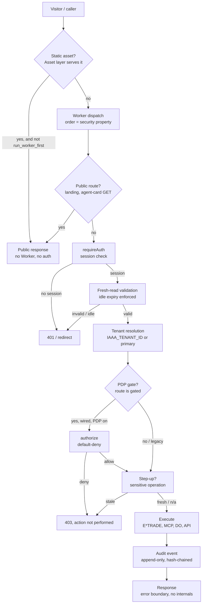

# Security workflow — the holistic picture

How the pieces in this folder compose into one system. Each section links
to the document that owns its detail; this document owns only the
composition — the order things happen, the handoffs between them, and the
places where a handoff can fail.

## 1. The lifecycle of a request

Read the diagram as a contract: a route that skips a box must document
why (see [api-security.md](api-security.md) for the deliberately ungated
surfaces and [zero-trust.md](zero-trust.md) for the honest gaps). The
boxes are owned, in order, by: dispatch
([api-security.md](api-security.md)), authentication
([authn.md](authn.md)), tenant + PDP + delegation
([authz.md](authz.md)), execution surfaces ([etrade.md](etrade.md),
[mcp-security.md](mcp-security.md)), and audit
([authz.md](authz.md) §9's open decisions apply here too).

## 2. The lifecycle of a user

Onboarding, linking, and leaving — the three workflows every user goes
through, and the security event at each step:

1. **Sign in.** Provider login through the registry
   ([authn.md](authn.md) §1, [iaaa-provider-onboarding.md](iaaa-provider-onboarding.md)).
   Identity is bound as `(issuer, subject)` → internal id; email and
   login are never identity. First wired login records the login↔id
   alias.
2. **Get authorized.** Bootstrap (first admins, genesis window) or a
   grant from someone holding `role:assign` ([authz.md](authz.md) §§2–3).
   Until membership exists, every PDP gate denies — a signed-in user
   with no membership can see the app but cannot link, administer, or
   act through a gated route.
3. **Link integrations.** Each integration is linked separately, through
   its own gated flow. E*TRADE linking requires `integration:connect`
   ([etrade.md](etrade.md) §3); the token is stored per user, per
   environment, and renewed by the background pass.
4. **Act.** Requests follow §1. Sensitive acts (key mint) step up.
   Delegated acts intersect initiator, tenant, resource, delegation,
   and approval.
5. **Leave / revoke.** Revocation is never gated: E*TRADE revoke, key
   deletion, and session revocation all work even when the policy that
   normally governs the caller would say no. A revoked session stays
   revoked; a revoked token is gone from the store (and, for
   `default_trader`, falls back to the static pair until #1066 lands —
   the one place where "revoked" does not yet mean "gone").

## 3. The lifecycle of unattended work

Background work has no user, so it cannot follow §1's session boxes. It
follows [workflow-security.md](workflow-security.md) instead: a named
identity (today the synthetic `default_trader`, planned: the explicit
service identity), a durable fire/no-fire guard, a kill switch for
anything consequential, and audit attribution to its own identity. The
renewal pass is the exception that proves the rule — it iterates every
user's stored token precisely so that no user's security depends on
another user's session existing.

## 4. The lifecycle of a secret

| Secret | Where it lives | How it rotates | What kills it |
| --- | --- | --- | --- |
| Provider client secrets | GitHub PROD secrets → deploy sync → Worker secrets | Re-issue at the provider, re-sync, redeploy | Removing the secret + redeploy |
| E*TRADE user access tokens | SessionStore DO, per user per env | 03:00 UTC renewal pass; re-link on expiry | Revoke route, or expiry at midnight ET |
| E*TRADE static pair (legacy) | Process env (`ETRADE_OAUTH_TOKEN*`) | Env change + redeploy only | #1066: code stops reading it, then deletion |
| API keys | Bearer-equivalent; owner-held | Re-mint (step-up gated) | Revoke (ungated) |
| Session material | SessionStore DO | Rotation | Revocation store |

The rule across all five: a secret's lifetime is a property of its
store and its rotation mechanism, never of the code that reads it. If a
secret can only die by redeploy, that is a gap, and it is named as one
(the static pair is the current example).

## 5. Failure modes, and what each one must do

| Failure | Required behavior | Where it is (not) yet true |
| --- | --- | --- |
| No session | 401 / redirect, no data | True everywhere gated |
| Stale session on sensitive op | 403 until re-login | True for key mint; legacy sessions cannot mint at all |
| Unknown provider / adapter | 403, no fallback | True |
| Corrupt membership | Throw, no silent proceed | True |
| Failed audit write on login | Today: login proceeds (open CISO decision) | Stated, not hidden |
| Expired user token | Revoke stored, re-link required | True |
| Expired static pair | Falls back to itself (never "expires") | #1066 removes this |
| Missing background token | Screener fails loudly ("token missing") | True — loud, not silent |
| Duplicate scheduled delivery | Durable claim suppresses it | True for screener; per-job guards elsewhere |

## 6. Where to go next

- New to the system: [design.md](design.md) (the hub) → this document →
  [authn.md](authn.md).
- Auditing a specific surface: the doc named for it in §1's boxes.
- Changing a gate: read the owning doc, then [zero-trust.md](zero-trust.md)
  §6 (the rules for extending the posture).
- Open questions: the #945 open list (thresholds, retention, audit
  blocking), #1066 (service identity), #1024 (`DOCS_PUBLIC_SURFACES` and
  A2A POST auth). Open questions are load-bearing: a design that
  assumes them away is wrong.
