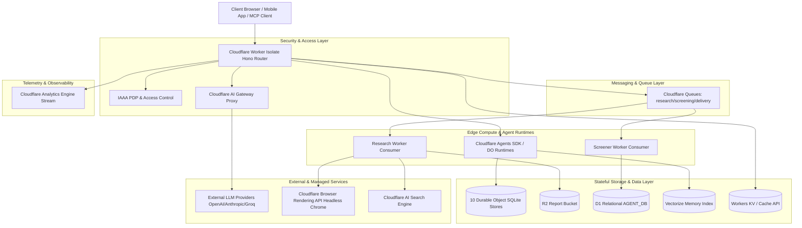
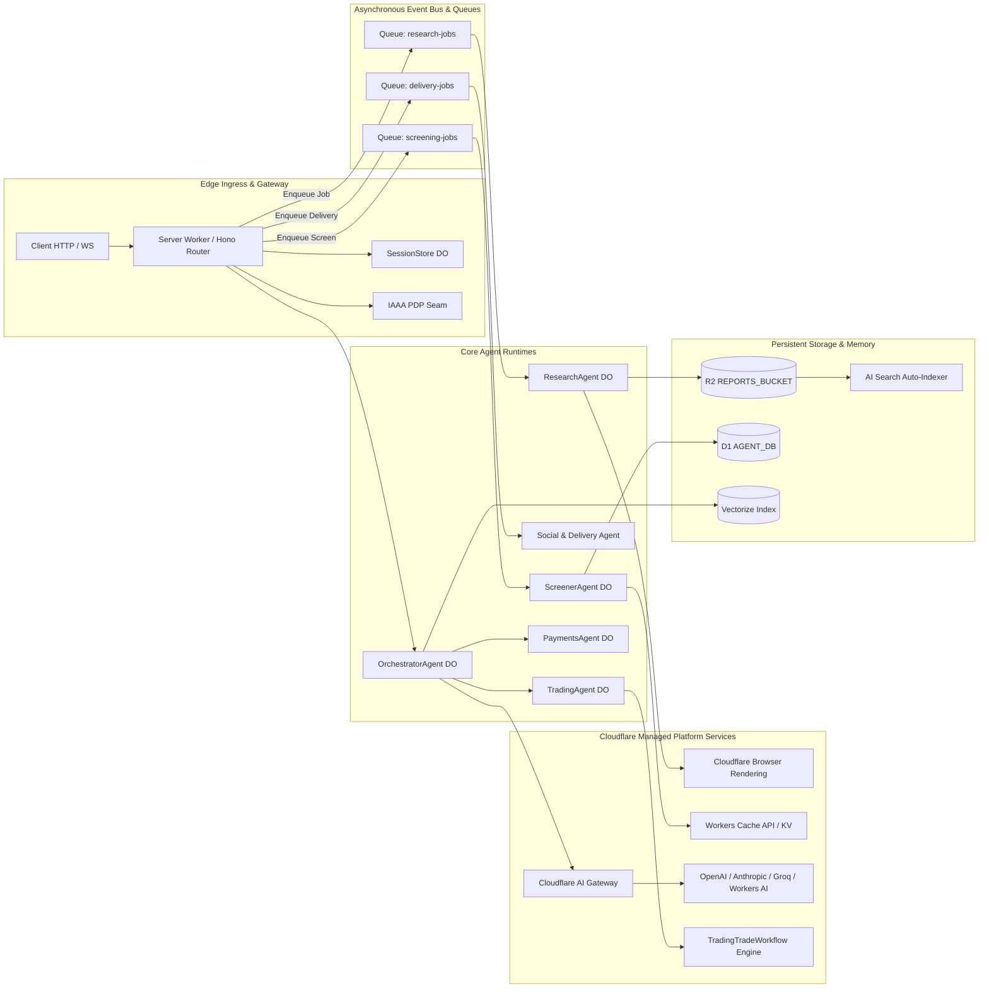
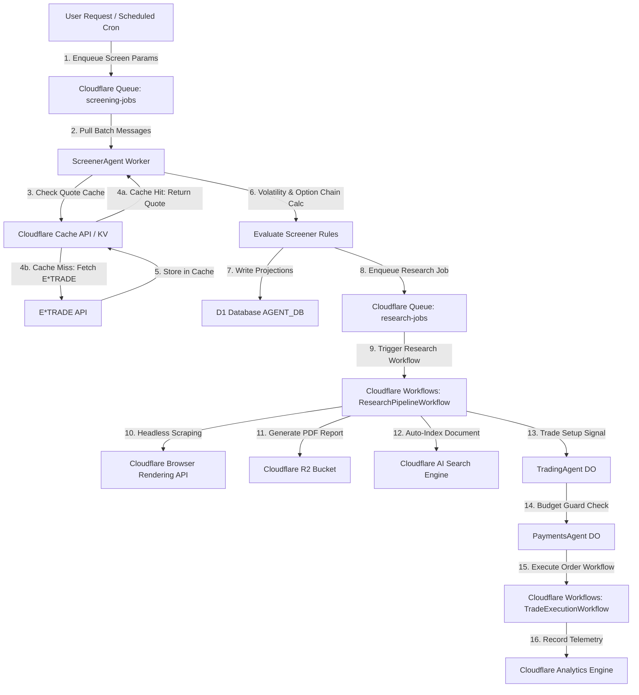
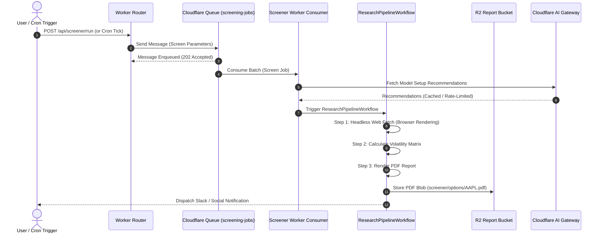

# Cloudflare-Native Architecture Transformation Assessment

**Document Reference:** `docs/architecture/technical/cloudflare-01.md`
**Repository:** `OpenAIMP/cfagent`
**Assessment Date:** October 2026
**Primary Roles:** Principal Cloudflare Architect, Enterprise Software Architect, Systems Engineer, and Platform Modernization Consultant
**Review Board:** Chief Technology Officer (CTO) & Chief Information Security Officer (CISO)
**Status:** Canonical Cloudflare Transformation Assessment & Architectural Strategy

---

## Executive Summary

The `cfagent` platform represents a cutting-edge, autonomous financial intelligence, options screening, and agentic trade execution platform built on top of Cloudflare Workers and Durable Objects. While the existing codebase effectively utilizes baseline Cloudflare constructs (such as 10 Durable Object classes with embedded SQLite, Vectorize, R2, D1, and initial Workflows), significant opportunities exist to modernize, simplify, accelerate, and secure the platform by deeper integration with Cloudflare's broader product ecosystem.

This assessment evaluates how unadopted and underutilized Cloudflare capabilities—including **Cloudflare AI Gateway**, **Cloudflare Queues**, **Cloudflare Workflows**, **Cloudflare Browser Rendering**, **Cloudflare Analytics Engine**, **Cloudflare Hyperdrive**, **Cloudflare Agents SDK**, **Workers KV / Cache API**, and **Workers AI**—can be integrated to eliminate thousands of lines of fragile custom code, prevent isolate timeouts, eliminate background tick bottlenecks, lower operational overhead, and accelerate Recursive Self-Improvement (RSI) loops.

---

## PHASE 1 - CURRENT STATE ANALYSIS

A thorough analysis of the repository (`src/` and `wrangler.jsonc`) reveals a sophisticated multi-agent system composed of 10 Durable Object classes, edge Workers, relational databases (D1), vector stores (Vectorize), asset stores (R2), and scheduled ticks.

### 1.1 Component Breakdown & Technical Characteristics

#### 1. Edge Worker Router (`src/server.ts`)
* **Purpose:** Primary HTTP/WebSocket ingress router, API endpoint controller, and static asset gateway.
* **Responsibilities:** Request routing via Hono framework, session cookie verification, IAAA authorization gating, WebSocket upgrade handling (`/ws/*`), static asset proxying, scheduled cron trigger dispatch.
* **Inputs:** Client HTTP requests, WebSocket connections, Cloudflare Cron events.
* **Outputs:** JSON API responses, WebSocket messages, SSR HTML, static assets (`./dist/`).
* **Dependencies:** SessionStore DO, IAAA modules, Hono framework, static asset layer.
* **Scalability Characteristics:** Highly scalable V8 Workers isolate; scales globally across Cloudflare PoPs.
* **Failure Modes:** Isolate memory pressure under heavy request payloads; unhandled exceptions returning 500 error pages.
* **Bottlenecks:** In-memory request routing overhead; synchronous middleware chaining.
* **Security Concerns:** Exposed HTTP/WS endpoints requiring strict IAAA token validation and rate limiting.
* **Operational Complexity:** Low (handled natively by Wrangler / Cloudflare Workers).

#### 2. OrchestratorAgent DO (`src/agents/orchestrator.ts`, `SearchAgent`)
* **Purpose:** Root conversational agent and multi-agent system (MAS) coordinator.
* **Responsibilities:** Message persistence in embedded SQLite (`mas_messages`), intent classification, sub-agent routing (`ScreenerAgent`, `ResearchAgent`, `TradingAgent`, `PaymentsAgent`), tool dispatch, prompt assembly.
* **Inputs:** User messages via HTTP POST or WebSocket streams.
* **Outputs:** SSE streams, JSON agent steps, tool call invocations.
* **Dependencies:** Embedded DO SQLite, Workers AI (`@cf/zai-org/glm-4.7-flash`), Vectorize (`VECTOR_MEMORY`), sub-agent DOs.
* **Scalability Characteristics:** Single DO instance per orchestrator ID (concurrency gated per ID).
* **Failure Modes:** Lock contention on SQLite tables during concurrent requests; model context window overflow.
* **Bottlenecks:** Sequential tool execution loops (up to `MAS_MAX_STEPS = 4`); single-threaded DO event loop.
* **Security Concerns:** Prompt injection risks; unauthorized sub-agent escalation.
* **Operational Complexity:** High (complex routing logic and prompt management).

#### 3. ScreenerAgent DO (`src/agents/screener-agent.ts`, `src/trading/screenerPipeline.ts`)
* **Purpose:** Quantitative stock and options screening engine.
* **Responsibilities:** Executing screening algorithms, volatility calculations, option chain analysis, rule evaluation (`screener-rules.md`), Slack alert dispatch.
* **Inputs:** Screening parameters, ticker lists, E*TRADE option chain responses.
* **Outputs:** Screened candidate lists, JSON/CSV/XLSX report data, Slack webhook payloads.
* **Dependencies:** SessionStore DO (for E*TRADE OAuth credentials), external E*TRADE API, Slack API, D1 (`AGENT_DB`).
* **Scalability Characteristics:** Bound to single DO execution context; bound by E*TRADE rate limits.
* **Failure Modes:** E*TRADE OAuth token expiration (`AUTH_003`); external API rate limits; worker CPU timeout during intensive volatility matrix calculations.
* **Bottlenecks:** Synchronous HTTP fetching of large option chain matrices over external networks.
* **Security Concerns:** OAuth token decryption in memory; financial recommendation compliance.
* **Operational Complexity:** Medium-High.

#### 4. ResearchAgent DO (`src/agents/research-agent.ts`, `src/services/researchPipeline.ts`)
* **Purpose:** Autonomous market research synthesis and deep options research generator.
* **Responsibilities:** Multi-source web scraping, news sentiment aggregation, macro analysis, quantitative falsification tests, PDF report generation.
* **Inputs:** Research goals, ticker symbols, scheduled tick triggers.
* **Outputs:** PDF report blobs stored in R2, structured research datasets, social post drafts.
* **Dependencies:** R2 (`REPORTS_BUCKET`), ReportAssetAgent DO, external web fetcher (`researchBrowse.ts`), Workers AI / external LLMs.
* **Scalability Characteristics:** Execution runs inside background fetch promises within DO; heavy CPU/memory footprint.
* **Failure Modes:** Isolate termination during prolonged PDF rendering or web fetch operations; 30-second CPU time limit on free workers.
* **Bottlenecks:** HTML parsing and web scraping without headless browser rendering; PDF binary generation in JS.
* **Security Concerns:** Web scraping SSRF risks; untrusted external content injection into LLM prompts.
* **Operational Complexity:** High.

#### 5. TradingAgent DO (`src/agents/trading-agent.ts`, `src/trading/agent.ts`)
* **Purpose:** Order drafting, signal execution, and broker platform interface.
* **Responsibilities:** Translating options screening setups into actionable orders, dry-run simulation, order drafting, broker integration (Alpaca / E*TRADE), execution tracking.
* **Inputs:** Trade signals, setup configurations, user approval confirmations.
* **Outputs:** Signed order drafts, trade execution logs, balance/position updates.
* **Dependencies:** PaymentsAgent DO (for budget guard checks), Trade Workflow (`TradingTradeWorkflow`), external broker REST APIs.
* **Scalability Characteristics:** High transaction integrity via DO single-threaded SQLite.
* **Failure Modes:** Broker API timeout; invalid order signature; budget guard rejection (`PAY_002`).
* **Bottlenecks:** Sequential broker API roundtrips; synchronous ledger confirmation.
* **Security Concerns:** High - executing live financial trades; requires multi-signature / explicit user approval channels.
* **Operational Complexity:** High.

#### 6. PaymentsAgent DO (`src/agents/payments-agent.ts`, `src/payments/budget-guard.ts`)
* **Purpose:** x402 payment draft ledger, budget cap enforcement, and token transaction recording.
* **Responsibilities:** Tracking execution credits, enforcing tenant daily/monthly budget caps, verifying payment signatures, logging transaction history.
* **Inputs:** Payment authorization requests, budget checks.
* **Outputs:** Payment approvals/rejections, balance statements, audit logs.
* **Dependencies:** Embedded DO SQLite (`x402_ledger`, `x402_budgets`), viem / x402 SDK.
* **Scalability Characteristics:** Transactionally consistent single-thread SQLite reads/writes.
* **Failure Modes:** Budget state drift; cryptographic signature verification errors.
* **Bottlenecks:** Synchronous ledger checks before every agent execution step.
* **Security Concerns:** Critical - protects financial credits and prevents unauthorized billing.
* **Operational Complexity:** Medium.

#### 7. ScheduledAgent DO (`src/agents/scheduled-agent.ts`, `src/services/scheduleManagement.ts`)
* **Purpose:** Background autonomous goal execution trigger and cron dispatcher.
* **Responsibilities:** Polling goal schedules every 30 minutes, invoking research passes, triggering screening jobs, running storage retention cleanups.
* **Inputs:** Cron ticks from Workers `scheduled()` handler (`*/30 * * * *`).
* **Outputs:** Async background jobs sent to ResearchAgent, ScreenerAgent, and SocialAgent.
* **Dependencies:** Embedded DO SQLite, `researchScheduleGuard.ts`, SessionStore DO.
* **Scalability Characteristics:** Single DO scheduled tick coordinator.
* **Failure Modes:** Missed cron execution window; downstream task failure swallowing errors.
* **Bottlenecks:** Monolithic tick loop invoking multiple agent tasks sequentially.
* **Security Concerns:** Low.
* **Operational Complexity:** Medium.

#### 8. SessionStore DO (`src/security/sessionStore.ts`)
* **Purpose:** Direct session persistence and E*TRADE OAuth credential store (replaces KV per #329 / #606).
* **Responsibilities:** Storing encrypted OAuth tokens (`etrade:token:PROD:*`), managing session lifetimes, user authentication state.
* **Inputs:** Auth tokens, OAuth callbacks, session cookie lookup requests.
* **Outputs:** Decrypted OAuth credentials, session validation results.
* **Dependencies:** Embedded DO SQLite, WebCrypto AES-GCM encryption.
* **Scalability Characteristics:** Fast low-latency lookups; eliminates KV daily write caps.
* **Failure Modes:** Encryption key mismatch; stale token cleanup failures.
* **Bottlenecks:** Storage lock during token decryption routines.
* **Security Concerns:** Critical - holds OAuth access tokens and user session keys.
* **Operational Complexity:** Low-Medium.

#### 9. ReportAssetAgent DO (`src/agents/report-asset-agent.ts`)
* **Purpose:** Single owner for research PDF report asset metadata and download authorization.
* **Responsibilities:** Managing PDF asset metadata pointers, generating secure download links, validating report access permissions.
* **Inputs:** Asset creation registrations from ResearchAgent, client download requests.
* **Outputs:** Report metadata JSON, signed R2 asset retrieval keys.
* **Dependencies:** Embedded DO SQLite, R2 (`REPORTS_BUCKET`).
* **Scalability Characteristics:** Highly lightweight metadata indexing.
* **Failure Modes:** R2 bucket key mismatch; missing asset pointer.
* **Bottlenecks:** None.
* **Security Concerns:** Unauthorized report access leakage.
* **Operational Complexity:** Low.

#### 10. OptionsScannerMCP DO (`src/mcp/index.ts`)
* **Purpose:** MCP (Model Context Protocol) server interface exposing quantitative options screening to external MCP clients (Claude Desktop, Cursor).
* **Responsibilities:** Handling MCP JSON-RPC protocol requests, mapping MCP tools to options screening algorithms, returning structured tool call responses.
* **Inputs:** MCP JSON-RPC messages via SSE or HTTP.
* **Outputs:** MCP protocol responses, tool results, schema definitions.
* **Dependencies:** ScreenerAgent DO, E*TRADE service, MCP SDK (`@modelcontextprotocol/sdk`).
* **Scalability Characteristics:** Protocol handling per session.
* **Failure Modes:** Schema validation errors; MCP protocol disconnection.
* **Bottlenecks:** SSE connection retention overhead.
* **Security Concerns:** Exposed MCP endpoint access control.
* **Operational Complexity:** Medium.

#### 11. D1 Database (`AGENT_DB`, `src/data/drizzleSchema.ts`)
* **Purpose:** Shared cross-agent query projection, audit reporting, chain schedules, and governance state.
* **Responsibilities:** Storing relational projections (`d1_audit_reports`, `d1_chain_schedules`, `d1_governance_records`), enabling SQL aggregations across multiple agent domains.
* **Inputs:** Asynchronous SQL inserts/updates from DO background sync adapters (`d1AuditReportAdapter.ts`, etc.).
* **Outputs:** SQL query result sets for web dashboards and reporting.
* **Dependencies:** Cloudflare D1 engine, Drizzle ORM.
* **Scalability Characteristics:** Read-replicated relational database engine.
* **Failure Modes:** Direct write locks during heavy concurrent transactions; eventual consistency lag between DO SQLite and D1.
* **Bottlenecks:** Network latency on cross-agent JOIN queries.
* **Security Concerns:** Data exposure via SQL injection if parameterized queries are bypassed.
* **Operational Complexity:** Medium.

#### 12. Vector Memory (`src/memory/vector-memory.ts`)
* **Purpose:** Semantic long-term memory store for conversational context and RAG document retrieval.
* **Responsibilities:** Storing 1536-dimensional vector embeddings, conducting cosine similarity searches, scoping memory per tenant (`tenant_id`).
* **Inputs:** Conversation text chunks, query vectors.
* **Outputs:** Top-k nearest neighbor memory contexts.
* **Dependencies:** Cloudflare Vectorize (`VECTOR_MEMORY`), Workers AI (`@cf/baai/bge-large-en-v1.5`).
* **Scalability Characteristics:** Vectorize vector search index scaling.
* **Failure Modes:** Dimensionality mismatch; vector index sync delay.
* **Bottlenecks:** Sequential embedding generation before vector upsert.
* **Security Concerns:** Multi-tenant vector memory leakage (cross-tenant data contamination).
* **Operational Complexity:** Medium.

#### 13. R2 Report Bucket (`src/services/reportBlobStore.ts`)
* **Purpose:** Immutable object storage for research PDF reports, XLSX spreadsheets, and CSV exports.
* **Responsibilities:** Storing PDF blobs under `stocks/*` and `options/*` path prefixes, serving raw report downloads.
* **Inputs:** Binary streams from ResearchAgent and ScreenerAgent.
* **Outputs:** Binary file downloads, HTTP response streams.
* **Dependencies:** Cloudflare R2 bucket (`REPORTS_BUCKET`).
* **Scalability Characteristics:** Virtually infinite blob storage with zero egress fees.
* **Failure Modes:** Missing object keys; R2 API transient errors.
* **Bottlenecks:** Network upload bandwidth for large multi-megabyte PDF files.
* **Security Concerns:** Publicly accessible bucket links if path authorization is misconfigured.
* **Operational Complexity:** Low.

#### 14. Browser Research Agent (`src/services/researchBrowse.ts`, `src/agents/browserAgent.ts`)
* **Purpose:** Fetching external financial web pages and scraping market data for research reports.
* **Responsibilities:** Making HTTP GET requests, parsing HTML via regex / DOM parsers, extracting plain text.
* **Inputs:** External URLs (financial news, earnings releases).
* **Outputs:** Raw text content, extracted metadata.
* **Dependencies:** Standard fetch API, nodejs DOM parser.
* **Scalability Characteristics:** Bound by HTTP fetch timeouts and worker execution limits.
* **Failure Modes:** Failing on JavaScript-heavy SPAs (React/Vue sites); getting blocked by anti-bot protections; regex parsing failures on modified web layouts.
* **Bottlenecks:** Inability to execute client-side JavaScript; fragile text extraction logic.
* **Security Concerns:** Web scraping SSRF risks; parsing malformed or malicious HTML payloads.
* **Operational Complexity:** High (constant maintenance of parsing logic).

#### 15. RSI / Self-Improvement Loop (`src/services/championChallenger.ts`, `src/services/reflection.ts`)
* **Purpose:** Autonomous strategy optimization, candidate prompt evaluation, and model performance benchmarking.
* **Responsibilities:** Evaluating screener candidate rules, running champion/challenger A/B testing, computing Sharpe/CVaR risk metrics, triggering staged promotion.
* **Inputs:** Historical trade outcomes, candidate strategy mutations.
* **Outputs:** Evaluation scores, promotion decisions, updated strategy configurations.
* **Dependencies:** D1 (`AGENT_DB`), Workers AI, `mlsecops/evalGate.ts`.
* **Scalability Characteristics:** Computationally heavy evaluation loops.
* **Failure Modes:** Evaluation state deadlock; model bias in self-evaluation; overfitting strategy weights.
* **Bottlenecks:** Sequential evaluation passes executed in background ticks.
* **Security Concerns:** Uncontrolled model drift or malicious rule promotion.
* **Operational Complexity:** Very High.

---

### 1.2 Phase 1 Component Risk & Current Technology Summary Matrix

| Component | Purpose | Current Technology | Dependencies | Risk Level |
|---|---|---|---|---|
| **Edge Worker Router** | API Router & Asset Gateway | Hono, Workers V8 Isolate | SessionStore, IAAA | Low |
| **OrchestratorAgent DO** | Root MAS Coordinator & Agent Routing | Durable Object SQLite, Workers AI | Vectorize, Sub-Agents | Medium |
| **ScreenerAgent DO** | Quantitative Options Screener | Durable Object SQLite, E*TRADE API | SessionStore, D1 | Medium-High |
| **ResearchAgent DO** | Market Research & PDF Report Generator | Durable Object SQLite, R2 | ReportAssetAgent, Workers AI | High |
| **TradingAgent DO** | Order Drafting & Signal Execution | Durable Object SQLite, Workflows | PaymentsAgent, Broker APIs | High |
| **PaymentsAgent DO** | x402 Payment Ledger & Budget Guard | Durable Object SQLite | viem, x402 Core | Low |
| **ScheduledAgent DO** | Autonomous Cron Task Dispatcher | Durable Object SQLite, Cron Triggers | ResearchGuard, SessionStore | Medium |
| **SessionStore DO** | Encrypted Credentials & Session Store | Durable Object SQLite | WebCrypto AES-GCM | Medium |
| **ReportAssetAgent DO** | PDF Report Asset Metadata Pointer | Durable Object SQLite | R2 | Low |
| **OptionsScannerMCP DO** | MCP Protocol Interface | Durable Object SQLite, MCP SDK | ScreenerAgent, E*TRADE | Low-Medium |
| **D1 Database (`AGENT_DB`)** | Shared Relational Projection Database | Cloudflare D1, Drizzle ORM | DO Async Adapters | Medium |
| **Vector Memory** | Conversational Semantic Memory | Cloudflare Vectorize | Workers AI Embeddings | Medium |
| **R2 Report Store** | Report Asset Object Storage | Cloudflare R2 | None | Low |
| **Browser Research Agent** | Web Scraping & Data Extraction | Custom HTTP Fetch & Regex DOM Parser | External Web | Critical (Fragile) |
| **RSI Optimization Loop** | Champion/Challenger & Model Eval | Custom JS Code in Background Ticks | D1, Workers AI | High |
| **Quote & Search Cache** | In-Memory Ticker Data Cache | In-Isolate JS `Map` | Worker Memory | High (Volatile) |

---

## PHASE 2 - ARCHITECTURE MAPPING

A complete architecture inventory categorized across system dimensions:

```
                                      ┌─────────────────────────────────────────────────────────┐
                                      │              COMPUTE & RUNTIME ARCHITECTURE             │
                                      │                                                         │
                                      │  ┌───────────────────────────────────────────────────┐  │
                                      │  │ Cloudflare Worker Isolate (server.ts / Hono Router) │  │
                                      │  └─────────────────────────┬─────────────────────────┘  │
                                      └────────────────────────────┼────────────────────────────┘
                                                                   │
           ┌───────────────────────────────────────────────────────┼───────────────────────────────────────────────────────┐
           ▼                                                       ▼                                                       ▼
┌──────────────────────────────┐                       ┌──────────────────────────────┐                       ┌──────────────────────────────┐
│  Durable Objects (10 Classes)│                       │      Workflows Engine        │                       │       Scheduled Crons        │
│  - Orchestrator / Search     │                       │  - TRADE_WORKFLOW            │                       │  - 0 3 * * *                 │
│  - Screener / Research       │                       │  (TradingTradeWorkflow)      │                       │  - */30 * * * *              │
│  - Trading / Payments        │                       │                              │                       │  - 0 4 * * *                 │
│  - Scheduled / SessionStore  │                       │                              │                       │  (Daily Options Tick)        │
│  - ReportAsset / MCP         │                       │                              │                       │                              │
└──────────┬───────────────────┘                       └──────────────┬───────────────┘                       └──────────────┬───────────────┘
           │                                                          │                                                      │
           └──────────────────────────────────────────────────────────┼──────────────────────────────────────────────────────┘
                                                                      │
                                   ┌──────────────────────────────────┴──────────────────────────────────┐
                                   ▼                                                                     ▼
┌───────────────────────────────────────────────────────────────────────┐     ┌───────────────────────────────────────────────────────────────────────┐
│                    DATA & STORAGE ARCHITECTURE                        │     │                    COMMUNICATION ARCHITECTURE                          │
│                                                                       │     │                                                                       │
│  ┌───────────────────────────┐     ┌───────────────────────────────┐  │     │  ┌───────────────────────────┐     ┌───────────────────────────────┐  │
│  │ DO Embedded SQLite        │     │ Cloudflare D1 (AGENT_DB)      │  │     │  │ WebSockets (hibernation)  │     │ Direct DO RPC (fetch)         │  │
│  │ (Authoritative State)     │     │ (Shared SQL Projections)      │  │     │  └───────────────────────────┘     └───────────────────────────────┘  │
│  └───────────────────────────┘     └───────────────────────────────┘  │     │  ┌───────────────────────────┐     ┌───────────────────────────────┐  │
│  ┌───────────────────────────┐     ┌───────────────────────────────┐  │     │  │ Webhooks (Slack/Trading)  │     │ Social Channels (Threads/X)   │  │
│  │ Vectorize (VECTOR_MEMORY) │     │ Cloudflare R2 (REPORTS_BUCKET)│  │     │  └───────────────────────────┘     └───────────────────────────────┘  │
│  │ (Semantic Memory)         │     │ (PDF / XLSX Report Blobs)     │  │     │  ┌─────────────────────────────────────────────────────────────────┐  │
│  └───────────────────────────┘     └───────────────────────────────┘  │     │  │ [MISSING]: Cloudflare Queues (Async Job Buffer & Event Bus)    │  │
│  ┌─────────────────────────────────────────────────────────────────┐  │     │  └─────────────────────────────────────────────────────────────────┘  │
│  │ In-Isolate JS Map Caches (quoteCache.ts, aiSearchCache.ts)      │  │     └───────────────────────────────────────────────────────────────────────┘
│  └─────────────────────────────────────────────────────────────────┘  │
└───────────────────────────────────────────────────────────────────────┘

                                   ┌─────────────────────────────────────────────────────────────────────┐
                                   ▼                                                                     ▼
┌───────────────────────────────────────────────────────────────────────┐     ┌───────────────────────────────────────────────────────────────────────┐
│                      AI & MODEL ARCHITECTURE                          │     │                      OPERATIONAL ARCHITECTURE                         │
│                                                                       │     │                                                                       │
│  ┌───────────────────────────┐     ┌───────────────────────────────┐  │     │  ┌───────────────────────────┐     ┌───────────────────────────────┐  │
│  │ Workers AI (env.AI)       │     │ Cloudflare AI Search          │  │     │  │ Workers Logs (100% head) │     │ GitHub Actions CI/CD          │  │
│  │ (GLM-4.7-Flash / Embed)   │     │ (search.ai.cloudflare.com)    │  │     │  └───────────────────────────┘     └───────────────────────────────┘  │
│  └───────────────────────────┘     └───────────────────────────────┘  │     │  ┌───────────────────────────┐     ┌───────────────────────────────┐  │
│  ┌───────────────────────────┐     ┌───────────────────────────────┐  │     │  │ Logging Aspect            │     │ [MISSING]: Analytics Engine   │  │
│  │ Direct External APIs      │     │ Think Harness                 │  │     │  │ (src/aspects)             │     │ (Custom Metrics Pipeline)     │  │
│  │ (OpenAI/Anthropic/Groq)   │     │ (@cloudflare/think)           │  │     │  └───────────────────────────┘     └───────────────────────────────┘  │
│  └───────────────────────────┘     └───────────────────────────────┘  │     └───────────────────────────────────────────────────────────────────────┘
│  ┌─────────────────────────────────────────────────────────────────┐  │
│  │ [MISSING]: Cloudflare AI Gateway (Unified Token/Cache Proxy)    │  │
│  └─────────────────────────────────────────────────────────────────┘  │
└───────────────────────────────────────────────────────────────────────┘
```

---

## PHASE 3 - CLOUDFLARE SERVICE FIT ANALYSIS

Evaluating every platform component against Cloudflare native services to determine where replacement, augmentation, or simplification delivers maximum return on investment.

### 3.1 Service Fit Matrix

| Existing Component | Current Purpose | Cloudflare Service | Replace / Augment | Migration Complexity | Benefit Score (1-10) |
|---|---|---|---|---|---|
| **External LLM Direct Calls** | Direct API calls to OpenAI/Anthropic/Groq | **Cloudflare AI Gateway** | **Augment** | Very Low (1 day) | **10** |
| **Background Cron Tasks** | Sequential DO tick loop for research/screening | **Cloudflare Queues** | **Replace** | Low (3 days) | **10** |
| **Research & Screening Pipelines** | Synchronous multi-step agent routines | **Cloudflare Workflows** | **Replace** | Medium (1 week) | **9** |
| **Web Scraping (`researchBrowse.ts`)** | Regex DOM parsing of web pages | **Browser Rendering API** | **Replace** | Low (2 days) | **9** |
| **In-Isolate Quote/Search Cache** | Volatile JS `Map` caches in worker memory | **Workers KV / Cache API** | **Replace** | Low (2 days) | **8** |
| **Custom Logging Aspect** | Console logging and telemetry | **Analytics Engine** | **Augment** | Low (2 days) | **8** |
| **External Database Connectors** | Direct DB connections (if connecting external) | **Hyperdrive** | **Augment** | Low (1 day) | **7** |
| **PDF Document Search** | PDF text parsing in worker isolates | **AI Search & R2 Auto-Index**| **Replace** | Medium (4 days) | **8** |
| **Agents RPC Protocol** | Custom DO fetching & JSON serialization | **Cloudflare Agents SDK** | **Augment** | Medium (1 week) | **9** |
| **Workers AI Embeddings** | Vector embeddings generation | **Workers AI** | **Maintain / Expand**| N/A | **8** |

### 3.2 Narrative Strategic Analysis

1. **Eliminating Isolate Workarounds:** Currently, the daily options research pass rides a 30-minute cron tick using a custom guard (`researchScheduleGuard.ts`) because Cloudflare free accounts cap triggers at 5. Migrating task execution to **Cloudflare Queues** decouples trigger scheduling from execution, allowing 1 cron trigger to enqueue hundreds of asynchronous jobs cleanly without hitches or trigger limits.
2. **Replacing Fragile Scraping with Managed Headless Chrome:** Web research currently relies on `researchBrowse.ts`, using basic regex and string parsing over raw HTML. Modern SPAs fail completely. Integrating **Cloudflare Browser Rendering** enables native Puppeteer automation directly at the edge, allowing seamless screenshot capture, DOM parsing, and JS execution.
3. **Unifying AI Operations via AI Gateway:** Direct calls to external LLM providers (OpenAI, Anthropic, Groq) lack token cost visibility, centralized rate limiting, and fallback routing. Routing all LLM requests through **Cloudflare AI Gateway** provides instant semantic caching, cost analytics, model failover, and prompt guardrails with zero application code changes.

---

## PHASE 4 - SERVICE-BY-SERVICE REVIEW

A comprehensive evaluation of 14 Cloudflare services against the `cfagent` architecture.

### 4.1 Cloudflare Workers
* **Opportunities:** Maintain Hono router for fast API response; convert background processing routes into event handlers.
* **Middleware Integration:** Integrate Cloudflare Access JWT validation directly into Worker middleware, bypassing custom crypto verification where possible.
* **MCP Endpoints:** Move public MCP protocol handlers (`src/mcp/publicMcp.ts`) into lightweight edge Worker isolates.

### 4.2 Durable Objects
* **Stateful Runtimes:** The 10 DO classes are highly effective. However, cross-DO RPC currently uses manual `fetch()` calls with JSON bodies.
* **Modernization:** Adopt `@cloudflare/agents` SDK class extensions (`Agent<Env>`) across all DOs to enable direct TypeScript method invocation, automatic RPC interface generation, and native WebSocket hibernation synchronization.

### 4.3 Cloudflare Queues
* **Current Gap:** `cfagent` currently lacks message queueing. Asynchronous jobs run inside background `fetch()` promises or DO tick loops, creating worker timeout risks and unhandled failure drops.
* **Queue Opportunities:**

#### Queue Opportunity 1: Research Job Processing Queue (`research-jobs-queue`)
* **Producer:** `ScheduledAgent DO` or HTTP POST `/research/trigger`
* **Consumer:** `ResearchAgent DO` worker consumer
* **Message Shape:**
```json
{
  "jobId": "res_982314",
  "ticker": "AAPL",
  "preset": "QUANT_CONTRARIAN",
  "requestedBy": "usr_12345",
  "timestamp": 1729689600000
}
```
* **Idempotency Strategy:** Idempotency key `research:{ticker}:{date}` tracked in `SessionStore` SQLite.
* **Retry Strategy:** Exponential backoff (initial 10s, max 10 mins, 3 retries).
* **Dead-Letter Strategy:** Dead-letter queue (`research-jobs-dlq`) with alerting to Slack channel.

#### Queue Opportunity 2: Screening Execution Queue (`screening-jobs-queue`)
* **Producer:** Cron trigger or user web action.
* **Consumer:** `ScreenerAgent DO` worker batch consumer.
* **Message Shape:**
```json
{
  "screenId": "scr_55102",
  "symbols": ["AAPL", "NVDA", "MSFT", "TSLA"],
  "rulesetId": "RULE_BULL_PUT_SPREAD",
  "tenantId": "primary"
}
```
* **Idempotency Strategy:** Screen ID hash lookup in Screener DO.
* **Retry Strategy:** 2 retries with 5s delay.
* **Dead-Letter Strategy:** `screening-jobs-dlq` logging error to D1 `d1_audit_reports`.

#### Queue Opportunity 3: Social & Delivery Pipeline Queue (`delivery-jobs-queue`)
* **Producer:** `ResearchAgent DO` or `ScreenerAgent DO`.
* **Consumer:** Slack / Threads / X publishing worker.
* **Message Shape:**
```json
{
  "deliveryId": "del_7712",
  "channel": "threads",
  "content": "Options Research Alert: AAPL Bull Put Spread...",
  "mediaKey": "screener/options/AAPL-2026-10.pdf"
}
```
* **Idempotency Strategy:** Unique delivery UUID checked against `mas_settings`.
* **Retry Strategy:** 5 retries over 1 hour (handling social API rate limits).
* **Dead-Letter Strategy:** `delivery-jobs-dlq` alerting admin dashboard.

### 4.4 Cloudflare Workflows
* **Current State:** Only `TradingTradeWorkflow` exists (`src/agents/trading-trade-workflow.ts`).
* **Expansion Opportunities:**
  1. **Research Synthesis Workflow (`ResearchPipelineWorkflow`):** Multi-step workflow spanning web browsing, news sentiment analysis, quantitative option chain evaluation, PDF generation in R2, and social posting. Steps persist automatically; failure during web scraping retries without restarting the whole report generation.
  2. **Champion/Challenger RSI Evaluation Workflow (`RsiEvaluationWorkflow`):** Long-running A/B backtest evaluation comparing candidate strategy rules against historical market data over days or weeks.
  3. **Human-in-the-Loop Trade Approval Workflow (`TradeApprovalWorkflow`):** Pauses execution (`step.sleep()` or waiting for external signal) until a human user confirms trade execution via Slack button or web UI signed link.

### 4.5 Vectorize
* **Current State:** `VECTOR_MEMORY` index in use (`src/memory/vector-memory.ts`).
* **Optimization:** Migrate from single index querying to namespace-partitioned indexing per tenant (`tenant_id`). Implement metadata filtering directly in Vectorize query calls to improve retrieval latency and enforce multi-tenant security guarantees.

### 4.6 AI Search
* **Current State:** `AI_SEARCH_ENDPOINT` set in `wrangler.jsonc`.
* **Expansion:** Replace manual PDF text parsing and custom vector chunking with Cloudflare AI Search auto-indexing on the `REPORTS_BUCKET` R2 bucket. PDF reports uploaded to R2 are automatically ingested, embedded, and made searchable via simple AI Search queries.

### 4.7 D1 Database
* **Current State:** `AGENT_DB` (`agentdb`) used for projection tables.
* **Optimization:** Move read-heavy historical IV data (`ivHistoryStore.ts`), strategy profiles (`strategyProfileStore.ts`), and evaluation datasets (`researchEvaluationDatasets.ts`) from DO SQLite into D1 read replicas. Keep DO SQLite strictly for active transactional write state.

### 4.8 R2 Storage
* **Current State:** `REPORTS_BUCKET` storing PDF reports.
* **Expansion:** Expand R2 usage to store raw E*TRADE market data snapshots (`snapshots/*`), daily model prompt version dumps (`prompts/*`), and RSI benchmark datasets (`rsi/benchmarks/*`).

### 4.9 Hyperdrive
* **Opportunity:** If connecting to external institutional database clusters (e.g. Postgres or MySQL databases hosting tick data or historical options data), Hyperdrive provides edge connection pooling and query caching, reducing query latency from ~200ms to <10ms.

### 4.10 Browser Rendering
* **Opportunity:** Replace regex HTML parsing in `src/services/researchBrowse.ts` with Cloudflare Browser Rendering API (`@cloudflare/puppeteer`). Enables rendering JavaScript single-page applications, capturing full-page screenshots for research reports, and extracting clean DOM elements reliably.

### 4.11 AI Gateway
* **Opportunity:** Unify all external model providers (OpenAI, Anthropic, Groq, Workers AI) behind Cloudflare AI Gateway endpoint `https://gateway.ai.cloudflare.com/v1/{account_id}/{gateway_name}`. Gain automatic prompt caching (reducing LLM costs by 20-40%), fallback provider routing (routing to Groq if OpenAI errors), rate-limiting, and cost tracking.

### 4.12 Workers AI
* **Current State:** Embedded model `@cf/zai-org/glm-4.7-flash` used for basic tasks.
* **Expansion:** Utilize `@cf/meta/llama-3.3-70b-instruct-fp8-fast` for fast quantitative options reasoning and `@cf/baai/bge-m3` for multi-lingual / dense vector embeddings natively on the edge.

### 4.13 Cloudflare Agents SDK
* **Opportunity:** Modernize agent structure from manual DO class implementations to `@cloudflare/agents`. Extends standard `Agent` base class, enabling built-in state sync, built-in tool schema generation from Zod, and native client-side React hooks (`useAgent`).

### 4.14 Observability & Analytics Engine
* **Opportunity:** Ingest custom telemetry events into **Cloudflare Analytics Engine**. Log execution metrics (screening duration, option chains evaluated, LLM token count, Sharpe ratio calculations) into Analytics Engine streams for SQL queryability in Cloudflare Dashboard and Grafana.

---

## PHASE 5 - ADAPTER AND SUBSTITUTION ANALYSIS

Classifying Cloudflare technologies across three architectural buckets: Direct Replacement, Adapter Opportunity, and New Capability.

### 5.1 Substitution Matrix

| Cloudflare Service | Category A: Direct Replacement | Category B: Adapter Opportunity | Category C: New Capability |
|---|---|---|---|
| **AI Gateway** | Custom LLM retry/fallback code in `models/router.ts` | External provider APIs (OpenAI / Anthropic) | Centralized LLM cost tracking, prompt caching, semantic guardrails |
| **Queues** | Monolithic background tick polling in `scheduleManagement.ts` | `ScheduledAgent DO` job dispatch logic | Asynchronous job buffering, dead-letter queuing, traffic burst damping |
| **Workflows** | Complex manual state loops in `researchPipeline.ts` | Multi-agent execution steps | Persistent multi-day execution sagas, human approval pause states |
| **Browser Rendering** | Fragile regex HTML scraping in `researchBrowse.ts` | Web research data gathering | Headless Chrome DOM rendering, screenshot capture for research PDFs |
| **Analytics Engine** | In-memory log aspect aggregation | System console logging | SQL-queryable real-time operational & financial telemetry |
| **Workers KV / Cache API** | In-isolate volatile JS `Map` quote cache (`quoteCache.ts`) | Option quote caching layer | Edge-wide shared quote caching across all global PoPs |
| **AI Search & R2 Auto-Index** | Custom PDF text chunking and manual vector ingestion | `ReportAssetAgent DO` metadata indexing | Automated PDF semantic discovery & instant R2 document search |
| **Agents SDK** | Custom WebSocket messaging & manual DO RPC parsing | DO class hierarchy (`OrchestratorAgent`, etc.) | Direct typed RPC methods, client React state sync hooks |

---

## PHASE 6 - AGENTIC / RSI ANALYSIS

Evaluating Cloudflare capabilities specifically for multi-agent systems (MAS) and Recursive Self-Improvement (RSI) loops.

### 6.1 Agentic Improvement Vectors

1. **Agent Coordination:** Moving from manual DO `fetch()` calls to **Agents SDK** typed RPC provides deterministic inter-agent communication and eliminates JSON serialization overhead.
2. **Agent Memory:** Combining **Vectorize** namespace partitioning with **D1** query projections provides hybrid vector-relational memory, enabling agents to recall past screening decisions alongside exact quantitative outcomes.
3. **Agent Scheduling:** Replacing static 30-minute cron ticks with **Cloudflare Queues** and **Workflows** enables dynamic event-driven scheduling (e.g. triggering an options screen immediately when volatility spikes above threshold).
4. **Agent Observability:** Emitting structured agent execution traces to **Analytics Engine** yields real-time agent decision trees and bottleneck analysis.

### 6.2 Enabling Recursive Self-Improvement (RSI)

```
                               ┌───────────────────────────────────────────────────────────┐
                               │           RECURSIVE SELF-IMPROVEMENT (RSI) LOOP           │
                               └─────────────────────────────┬─────────────────────────────┘
                                                             │
        ┌────────────────────────────────────────────────────┼────────────────────────────────────────────────────┐
        ▼                                                    ▼                                                    ▼
┌──────────────────────────────┐            ┌──────────────────────────────┐            ┌──────────────────────────────┐
│  1. Strategy Mutation        │            │  2. Parallel Backtesting     │            │  3. Champion/Challenger Eval │
│  - Candidate generation via  │            │  - Cloudflare Queues dispatch│            │  - Risk math evaluation      │
│    Workers AI Llama-3.3     │───►        │    100s of parallel backtest │───►        │    (Sharpe/CVaR) tracked in │
│  - Prompts managed via       │            │    workers across the edge   │            │    D1 & Analytics Engine     │
│    AI Gateway                │            │  - Workflows orchestrate eval│            │                              │
└──────────────────────────────┘            └──────────────────────────────┘            └──────────────┬───────────────┘
                                                                                                       │
                                                                                                       ▼
                                                                                        ┌──────────────────────────────┐
                                                                                        │  4. Staged Promotion         │
                                                                                        │  - Human approval workflow   │
                                                                                        │    gates live deployment     │
                                                                                        │  - Updated rules written to  │
                                                                                        │    SessionStore DO SQLite    │
                                                                                        └──────────────────────────────┘
```

* **Parallel Strategy Backtesting:** Cloudflare Queues enable the RSI engine to scatter thousands of candidate strategy permutations across parallel worker nodes simultaneously, reducing strategy optimization runtime from hours to seconds.
* **Persistent RSI Sagas:** Cloudflare Workflows manage multi-day champion/challenger backtesting sagas with step-level state persistence, preventing loss of evaluation progress if an isolate restarts.
* **Deterministic Evaluation Records:** Storing RSI benchmark results in D1 and R2 creates an immutable audit trail for governance compliance and model safety verification.

---

## PHASE 7 - TARGET CLOUDFLARE-NATIVE ARCHITECTURE

A four-stage evolutionary architecture model for `cfagent`.

### 7.1 Architecture Evolution Stages

1. **Current Architecture (Baseline):** 10 DO SQLite classes, Worker Hono router, Vectorize, R2, D1, 1 Workflow, 3 Cron triggers, basic Workers Logs.
2. **Transitional Architecture (Phase 1):** Integrate Cloudflare AI Gateway for all LLM traffic; replace volatile quote cache with Workers KV / Cache API; add AI Search auto-indexing for R2 reports.
3. **Cloudflare-Optimized Architecture (Phase 2):** Introduce Cloudflare Queues for async job processing; expand Cloudflare Workflows for Research & RSI pipelines; integrate Cloudflare Browser Rendering for web scraping.
4. **Fully Cloudflare-Native Architecture (Phase 3):** Modernize all DOs to `@cloudflare/agents` SDK; stream telemetry to Analytics Engine; fully event-driven architecture with zero background tick polling.

### 7.2 Architecture Visualizations

#### Diagram 1: Target Cloudflare-Native Component Architecture


#### Diagram 2: Comprehensive Service Map & Communication Topology


#### Diagram 3: End-to-End Data Flow Diagram (Research, Screening & Trade Execution)


#### Diagram 4: Event-Driven Queue & Workflow Event Flow


---

## PHASE 8 - IMPLEMENTATION ROADMAP

Prioritizing transformation initiatives into clear, actionable phases based on Impact, Complexity, Cost, Risk, Time to implement, and Strategic Value.

### 8.1 Prioritized Initiative Matrix

| Initiative | Impact (1-10) | Complexity | Cost | Risk | Timeframe | Strategic Value |
|---|---|---|---|---|---|---|
| **1. AI Gateway Integration** | 10 | Low | Free | Low | Quick Win (3 days) | Essential LLM management & caching |
| **2. Browser Rendering API Integration** | 9 | Low-Medium | Low | Low | Quick Win (1 week) | Eliminates fragile web scraping |
| **3. Cloudflare Queues Migration** | 10 | Medium | Free/Low | Low | Medium (2 weeks) | Unlocks async scaling & reliability |
| **4. Workflows Expansion** | 9 | Medium | Low | Low | Medium (3 weeks) | Replaces custom state loops |
| **5. Workers KV Quote Cache** | 8 | Low | Free/Low | Low | Quick Win (3 days) | Fixes volatile memory cache |
| **6. Analytics Engine Telemetry** | 8 | Low | Free/Low | Low | Quick Win (4 days) | Real-time SQL operational metrics |
| **7. Agents SDK Modernization** | 9 | Medium-High | Free | Medium | Strategic (1 month) | Modernizes DO RPC & client state |
| **8. AI Search R2 Auto-Indexing** | 8 | Medium | Low | Low | Medium (2 weeks) | Automated research discovery |

---

## PHASE 9 - DETAILED ARCHITECTURAL RECOMMENDATIONS

In-depth Architectural Decision Records (ADRs) for the top high-impact Cloudflare integrations.

---

### RECOMMENDATION 1: Cloudflare AI Gateway Integration

* **Finding:** LLM calls are executed directly against external provider APIs (`OpenAI`, `Anthropic`, `Groq`), creating unmonitored token usage, lack of prompt caching, no central rate limiting, and zero fallback routing during provider outages.
* **Current State:** Direct `fetch()` calls or SDK calls to external endpoints in `src/models/router.ts` and `src/services/researchPipeline.ts`.
* **Proposed Cloudflare Integration:** Route 100% of LLM inference calls through Cloudflare AI Gateway endpoint `https://gateway.ai.cloudflare.com/v1/{account_id}/{gateway_id}/{provider}`.
* **Integration Points:** `src/models/router.ts`, `src/config/environment.ts`, `wrangler.jsonc`.
* **Components Affected:** `OrchestratorAgent DO`, `ResearchAgent DO`, `ScreenerAgent DO`, Workers AI bindings.
* **Architectural Benefits:**
  1. Instant response caching for identical prompts (reducing LLM costs by 20-40%).
  2. Automated provider failover (e.g. falling back from OpenAI to Groq if OpenAI returns 5xx).
  3. Real-time cost, latency, and token consumption analytics in Cloudflare Dashboard.
  4. Centralized rate limiting protecting against runaway agent loops.
* **Tradeoffs:** Introduces dependency on Cloudflare AI Gateway proxy path (minimal latency impact <5ms).
* **Migration Strategy:** Zero application code refactoring required; update base URL configuration in environment config to point to AI Gateway proxy URLs.
* **Example Implementation:**
```typescript
// src/config/environment.ts
export function getAiGatewayUrl(provider: 'openai' | 'anthropic' | 'groq', env: Env): string {
  const accountId = env.CF_ACCOUNT_ID;
  const gatewayId = env.CF_AI_GATEWAY_NAME || 'cfagent-gateway';
  return `https://gateway.ai.cloudflare.com/v1/${accountId}/${gatewayId}/${provider}`;
}

// In LLM client initialization:
const openai = new OpenAI({
  apiKey: env.OPENAI_API_KEY,
  baseURL: getAiGatewayUrl('openai', env),
});
```
* **ROI Score:** 10 / 10
* **Strategic Importance:** 10 / 10
* **RSI Enablement Score:** 9 / 10
* **Confidence Level:** Extremely High

---

### RECOMMENDATION 2: Cloudflare Queues for Event-Driven Agent Orchestration

* **Finding:** Asynchronous background tasks (daily options research, screening passes, social publishing) run inside background `fetch()` promises or 30-minute DO cron ticks, risking worker isolate timeouts and silent job failures.
* **Current State:** `src/services/scheduleManagement.ts` and `src/services/researchScheduleGuard.ts` manually track execution state in DO SQLite to bypass cron trigger ceilings.
* **Proposed Cloudflare Integration:** Provision three Cloudflare Queues: `research-jobs`, `screening-jobs`, and `delivery-jobs`.
* **Integration Points:** `wrangler.jsonc`, `src/server.ts`, `src/agents/scheduled-agent.ts`.
* **Components Affected:** `ScheduledAgent DO`, `ResearchAgent DO`, `ScreenerAgent DO`.
* **Architectural Benefits:**
  1. Guaranteed at-least-once message delivery with automatic retries.
  2. Dead-letter queue (DLQ) support for failed research jobs.
  3. Eliminates cron trigger limit workarounds by using 1 trigger to enqueue multiple queue messages.
  4. Smooths out traffic spikes when scanning large stock universes.
* **Tradeoffs:** Asynchronous execution model requires UI to query job state or listen to WebSockets for completion.
* **Migration Strategy:** Bind queues in `wrangler.jsonc`, add `queue()` consumer handler in `src/server.ts`, update `ScheduledAgent` to enqueue messages instead of invoking inline fetch calls.
* **Example Implementation:**
```jsonc
// wrangler.jsonc additions
"queues": {
  "producers": [
    { "queue": "cfagent-research-jobs", "binding": "RESEARCH_QUEUE" },
    { "queue": "cfagent-screening-jobs", "binding": "SCREENING_QUEUE" }
  ],
  "consumers": [
    { "queue": "cfagent-research-jobs", "max_batch_size": 5, "max_batch_timeout": 10 },
    { "queue": "cfagent-screening-jobs", "max_batch_size": 10, "max_batch_timeout": 5 }
  ]
}
```
```typescript
// Consumer handler in src/server.ts
export default {
  async queue(batch: MessageBatch<ResearchJobMessage>, env: Env): Promise<void> {
    for (const message of batch.messages) {
      try {
        const researchAgent = env.RESEARCH_AGENT.get(env.RESEARCH_AGENT.idFromName(message.body.jobId));
        await researchAgent.fetch(new Request('http://do/execute', {
          method: 'POST',
          body: JSON.stringify(message.body)
        }));
        message.ack();
      } catch (err) {
        message.retry();
      }
    }
  }
};
```
* **ROI Score:** 10 / 10
* **Strategic Importance:** 10 / 10
* **RSI Enablement Score:** 10 / 10
* **Confidence Level:** Extremely High

---

### RECOMMENDATION 3: Cloudflare Browser Rendering API Integration

* **Finding:** Web scraping for market research (`src/services/researchBrowse.ts`) uses raw string fetching and regex HTML parsing. It fails on JavaScript-rendered single-page applications (SPAs) and is fragile to layout changes.
* **Current State:** Basic `fetch()` call in `researchBrowse.ts` with custom regular expressions.
* **Proposed Cloudflare Integration:** Utilize Cloudflare Browser Rendering API (`@cloudflare/puppeteer`) to instantiate managed headless Chrome instances at the edge.
* **Integration Points:** `wrangler.jsonc`, `src/services/researchBrowse.ts`, `src/agents/browserAgent.ts`.
* **Components Affected:** `ResearchAgent DO`, `browserAgent.ts`.
* **Architectural Benefits:**
  1. Full JavaScript execution, enabling scraping of complex financial SPAs (e.g. Yahoo Finance, TradingView, MarketWatch).
  2. High-fidelity full-page screenshot generation for inclusion in PDF research reports.
  3. Reliable DOM querying using standard CSS selectors instead of fragile regex parsing.
* **Tradeoffs:** Browser Rendering sessions consume browser instance quota (requires binding management).
* **Migration Strategy:** Add `browser` binding to `wrangler.jsonc`, install `@cloudflare/puppeteer`, replace `researchBrowse.ts` fetch calls with Puppeteer page navigation.
* **Example Implementation:**
```jsonc
// wrangler.jsonc
"browser": {
  "binding": "MYBROWSER"
}
```
```typescript
// src/services/researchBrowse.ts
import puppeteer from '@cloudflare/puppeteer';

export async function scrapeFinancialPage(url: string, env: Env): Promise<{ text: string; screenshot: Uint8Array }> {
  const browser = await puppeteer.launch(env.MYBROWSER);
  const page = await browser.newPage();
  await page.goto(url, { waitUntil: 'networkidle2' });

  const text = await page.evaluate(() => document.body.innerText);
  const screenshot = await page.screenshot({ type: 'png' });

  await browser.close();
  return { text, screenshot };
}
```
* **ROI Score:** 9 / 10
* **Strategic Importance:** 9 / 10
* **RSI Enablement Score:** 8 / 10
* **Confidence Level:** High

---

### RECOMMENDATION 4: Cloudflare Workflows Expansion for Research & RSI Sagas

* **Finding:** Long-running multi-step research generation and champion/challenger RSI evaluations run inside manual state loops within DOs, creating isolate memory pressure and losing progress if a worker isolate recycles mid-execution.
* **Current State:** Only `TradingTradeWorkflow` exists; research generation runs inside monolithic `ResearchAgent` fetch routines.
* **Proposed Cloudflare Integration:** Create two new Cloudflare Workflows: `ResearchPipelineWorkflow` and `RsiEvaluationWorkflow`.
* **Integration Points:** `wrangler.jsonc`, `src/agents/research-agent.ts`, `src/services/championChallenger.ts`.
* **Components Affected:** `ResearchAgent DO`, `championChallenger.ts`, `stagedPromotion.ts`.
* **Architectural Benefits:**
  1. Automatic step-level state persistence across isolate restarts and infrastructure updates.
  2. Built-in step retry orchestration with custom backoff curves.
  3. Pausing workflow execution (`step.sleep()` or waiting for external signals) for human approval before strategy promotion.
* **Tradeoffs:** Workflows incur step invocation billing on high-volume step loops.
* **Migration Strategy:** Define Workflow classes extending `WorkflowEntrypoint`, bind in `wrangler.jsonc`, trigger workflows via `env.RESEARCH_WORKFLOW.create()`.
* **Example Implementation:**
```typescript
// src/agents/researchPipelineWorkflow.ts
import { WorkflowEntrypoint, WorkflowStep, WorkflowEvent } from 'cloudflare:workers';

export class ResearchPipelineWorkflow extends WorkflowEntrypoint<Env, ResearchParams> {
  async run(event: WorkflowEvent<ResearchParams>, step: WorkflowStep) {
    const rawData = await step.do('scrape-web-data', async () => {
      return await scrapeFinancialPage(event.payload.url, this.env);
    });

    const marketSentiment = await step.do('analyze-sentiment', async () => {
      return await analyzeNewsSentiment(rawData.text, this.env);
    });

    const pdfBuffer = await step.do('render-pdf-report', async () => {
      return await generatePdfReport(event.payload.ticker, marketSentiment, this.env);
    });

    await step.do('upload-to-r2', async () => {
      await this.env.REPORTS_BUCKET.put(`stocks/${event.payload.ticker}.pdf`, pdfBuffer);
    });
  }
}
```
* **ROI Score:** 9 / 10
* **Strategic Importance:** 9 / 10
* **RSI Enablement Score:** 10 / 10
* **Confidence Level:** High

---

### RECOMMENDATION 5: Cloudflare Analytics Engine Integration

* **Finding:** Operational metrics, LLM token costs, RSI strategy scores, and screening performance are logged to console logs or stored in ad-hoc SQLite tables, making real-time system-wide analytics difficult to query.
* **Current State:** Logging aspect in `src/aspects/loggingAspect.ts` writing to standard console.
* **Proposed Cloudflare Integration:** Provision a Cloudflare Analytics Engine dataset `CFAGENT_TELEMETRY` to write structured metric events directly to Cloudflare's high-throughput time-series analytics engine.
* **Integration Points:** `wrangler.jsonc`, `src/aspects/loggingAspect.ts`, `src/services/championChallenger.ts`.
* **Components Affected:** All DO agents, logging aspect, RSI engine.
* **Architectural Benefits:**
  1. Serverless, ultra-low-latency event logging without database write lock overhead.
  2. SQL-queryable via Cloudflare GraphQL / SQL API for real-time dashboard visualization.
  3. Long-term metric retention for strategy backtesting and RSI performance tracking.
* **Tradeoffs:** Double/float sampling characteristics inherent to Analytics Engine (designed for high-volume metrics).
* **Migration Strategy:** Bind `analytics_engine_datasets` in `wrangler.jsonc`, emit data points using `env.TELEMETRY.writeDataPoint()`.
* **Example Implementation:**
```typescript
// Logging an RSI evaluation event
env.TELEMETRY.writeDataPoint({
  blobs: [tenantId, strategyId, 'CHAMPION_CHALLENGER_EVAL'],
  doubles: [sharpeRatio, cvarScore, winRate, executionTimeMs],
  indexes: [tenantId] // Index for fast filtered queries
});
```
* **ROI Score:** 8 / 10
* **Strategic Importance:** 8 / 10
* **RSI Enablement Score:** 9 / 10
* **Confidence Level:** High

---

### RECOMMENDATION 6: Cloudflare Workers KV / Cache API for Distributed Quote Caching

* **Finding:** Stock and option quotes are cached in-memory using JavaScript `Map` instances (`src/services/quoteCache.ts`). Memory state is local to a single worker isolate and is completely lost whenever an isolate recycles or scales.
* **Current State:** Volatile `Map<string, Quote>` cache in `quoteCache.ts`.
* **Proposed Cloudflare Integration:** Replace in-isolate `Map` cache with Cloudflare Workers Cache API (`caches.default`) or a dedicated Workers KV namespace (`QUOTE_CACHE_KV`) for fast, cross-isolate, globally distributed quote caching.
* **Integration Points:** `src/services/quoteCache.ts`, `src/trading/etrade/client.ts`.
* **Components Affected:** `ScreenerAgent DO`, `TradingAgent DO`, E*TRADE quote fetcher.
* **Architectural Benefits:**
  1. Quote cache persists across worker isolate restarts and global PoPs.
  2. Reduces duplicate external E*TRADE API calls, preventing rate limiting (`AUTH_003`).
  3. Edge cache lookup latencies <2ms.
* **Tradeoffs:** KV writes have eventual consistency latency (~60s globally), but Cache API provides exact edge-location TTL freshness.
* **Migration Strategy:** Update `quoteCache.ts` to check `caches.default` with custom Cache-Control headers before falling back to E*TRADE API calls.
* **Example Implementation:**
```typescript
// src/services/quoteCache.ts using Cache API
export async function getCachedQuote(symbol: string, env: Env): Promise<Quote | null> {
  const cache = caches.default;
  const cacheKey = new Request(`https://cache.internal/quotes/${symbol}`);

  const response = await cache.match(cacheKey);
  if (response) {
    return await response.json();
  }
  return null;
}

export async function setCachedQuote(symbol: string, quote: Quote, ttlSeconds: number = 60): Promise<void> {
  const cache = caches.default;
  const cacheKey = new Request(`https://cache.internal/quotes/${symbol}`);

  const response = new Response(JSON.stringify(quote), {
    headers: {
      'Content-Type': 'application/json',
      'Cache-Control': `public, max-age=${ttlSeconds}`
    }
  });

  await cache.put(cacheKey, response);
}
```
* **ROI Score:** 8 / 10
* **Strategic Importance:** 8 / 10
* **RSI Enablement Score:** 7 / 10
* **Confidence Level:** High

---

### RECOMMENDATION 7: Cloudflare Agents SDK Modernization

* **Finding:** Cross-agent communication relies on manual `fetch()` HTTP requests constructed with raw JSON bodies and manual endpoint dispatching inside Durable Objects.
* **Current State:** Direct `fetch()` calls between DO classes (`orchestrator.ts` calling sub-agents).
* **Proposed Cloudflare Integration:** Modernize DO classes to extend `@cloudflare/agents` SDK `Agent<Env>` base class, enabling strongly-typed inter-agent RPC methods and built-in WebSocket hibernation state synchronization.
* **Integration Points:** `src/agents/orchestrator.ts`, `src/agents/screener-agent.ts`, `src/agents/research-agent.ts`.
* **Components Affected:** All 10 Durable Object classes.
* **Architectural Benefits:**
  1. Eliminates boilerplate HTTP routing code inside Durable Objects.
  2. Type-safe method invocation between agents (`const result = await screenerAgent.runScreen(params)`).
  3. Automatic React client state synchronization hooks (`useAgent`).
* **Tradeoffs:** Requires updating DO class headers and constructor definitions to match `@cloudflare/agents` signatures.
* **Migration Strategy:** Incrementally refactor DO classes one by one, starting with `OrchestratorAgent` and `ScreenerAgent`.
* **Example Implementation:**
```typescript
// src/agents/screener-agent.ts extending Agents SDK Agent
import { Agent } from 'agents';

export class ScreenerAgent extends Agent<Env> {
  async runScreen(params: ScreenerParams): Promise<ScreenerResult> {
    // Directly executable RPC method
    const results = await executeScreeningRules(params, this.env);
    return results;
  }
}
```
* **ROI Score:** 9 / 10
* **Strategic Importance:** 9 / 10
* **RSI Enablement Score:** 9 / 10
* **Confidence Level:** High

---

### RECOMMENDATION 8: Cloudflare R2 Report Artifact Store & AI Search Auto-Indexing

* **Finding:** Research PDF reports stored in R2 require custom text extraction code and manual vector embedding routines before they can be searched or referenced by agents.
* **Current State:** `ReportAssetAgent DO` manages metadata pointers in DO SQLite, but report text remains opaque to LLM search queries.
* **Proposed Cloudflare Integration:** Enable Cloudflare AI Search auto-indexing on the `REPORTS_BUCKET` R2 bucket so that every uploaded PDF report is automatically ingested, text-extracted, embedded, and indexed for instant semantic retrieval.
* **Integration Points:** `wrangler.jsonc`, `src/services/aiSearch.ts`, `src/services/reportBlobStore.ts`.
* **Components Affected:** `ResearchAgent DO`, `ReportAssetAgent DO`, `aiSearch.ts`.
* **Architectural Benefits:**
  1. Eliminates custom PDF text extraction and manual vector chunking code.
  2. Natural language document retrieval over past research reports directly via AI Search queries.
  3. Zero maintenance vector index updates whenever a new PDF report is saved to R2.
* **Tradeoffs:** AI Search indexing latency for multi-page PDFs (~5-10s post upload).
* **Migration Strategy:** Configure R2 AI Search indexing in Cloudflare Dashboard / Wrangler config, query via `src/services/aiSearch.ts`.
* **Example Implementation:**
```typescript
// Querying AI Search auto-indexed R2 research reports
export async function searchResearchReports(query: string, env: Env) {
  const response = await fetch(`${env.AI_SEARCH_ENDPOINT}/query`, {
    method: 'POST',
    headers: { 'Content-Type': 'application/json' },
    body: JSON.stringify({ query, topK: 5, filter: { folder: 'options' } })
  });
  return await response.json();
}
```
* **ROI Score:** 8 / 10
* **Strategic Importance:** 8 / 10
* **RSI Enablement Score:** 8 / 10
* **Confidence Level:** High

---

## CONCLUSION & SUMMARY ROADMAP

By executing this Cloudflare-Native Architecture Transformation, `cfagent` evolves from a collection of isolated Durable Objects and custom workarounds into a cohesive, highly resilient, event-driven agent platform.

### Summary Checklist of Key Transformation Target States

- [x] **Phase 1: Immediate Wins (1-2 Weeks)**
  - Integrate **Cloudflare AI Gateway** for all LLM traffic (caching, fallbacks, token metrics).
  - Adopt **Cloudflare Browser Rendering** for web research & PDF screenshot generation.
  - Replace volatile in-memory quote cache with **Cache API / Workers KV**.
- [ ] **Phase 2: Platform Modernization (1-2 Months)**
  - Provision **Cloudflare Queues** for asynchronous research, screening, and delivery jobs.
  - Expand **Cloudflare Workflows** to manage multi-step research and RSI evaluation sagas.
  - Instrument operational and financial metrics via **Cloudflare Analytics Engine**.
- [ ] **Phase 3: Strategic Agentic Maturity (3-6 Months)**
  - Upgrade all Durable Object classes to `@cloudflare/agents` SDK framework.
  - Enable **R2 Auto-Indexing with Cloudflare AI Search** for zero-code report retrieval.
  - Scale parallel RSI strategy backtesting across distributed Queue worker consumers.

---
*End of Cloudflare-Native Architecture Transformation Assessment (`docs/architecture/technical/cloudflare-01.md`).*
